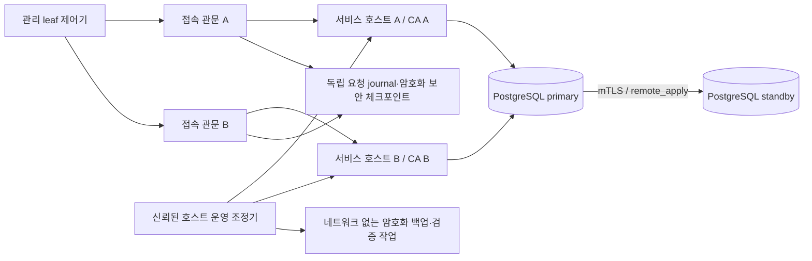

# CA 공유 DB·서비스 호스트 이중화와 안전한 복원

후속 [관리 영역 이중화](control-plane-high-availability.md)는 이 문서의 단일 관리 영역을 별도
로컬 관리 cell 두 개로 확장한다. 아래 33개 결과와 단일 관리 영역 한계는 당시 기본 프로필 기록이다.
관리 이중화와 DB/호스트 복구를 동시에 조합한 전체 장애 행렬의 완료를 뜻하지 않는다.

2026-11-04 · 기준 `aitest` `b6e35be` · `feature/chaeheeju-db-host-recovery`

[CA 프로세스 HA](ca-high-availability.md)를 확장한 **별도 로컬 실행 프로필**이다.
두 CA가 사용하는 PostgreSQL을 동기 복제하고, CA·DB를 독립 Docker 엔진과 저장소에 나누어 배치한다.
백업 시점 이후의 토큰 소비·인증서 폐기 기록을 독립 체크포인트와 대조한 뒤에만 복원 경로를 연다.
앱 SQLite·정책·탐지·개선 전 평가 데이터는 변경하지 않는다. 앱 서버 전체의 이중화 완료를 뜻하지 않는다.

## 구성과 신뢰 경계



- 로컬 서비스 호스트는 privileged Docker-in-Docker 컨테이너다. 서로 다른 데몬 ID와 `/var/lib/docker`
  볼륨을 사용한다. 부모 Docker socket을 연결하지 않고, 내부 데몬은 Unix socket만 연다.
  이는 신뢰된 시험용 서버 역할이다. 일반 CA·DB·관문·leaf 프로세스는 uid 10001, 읽기 전용 루트로 실행한다.
- 두 서비스 호스트와 관문만 backend 내부망에 참여한다. PC에 CA·DB·Docker API 포트를 공개하지 않는다.
  leaf가 접근하는 관문은 TCP 바이트를 전달하며 업무 TLS/mTLS를 종료하거나 인증을 대행하지 않는다.
- CA마다 독립 DB client 키를 사용한다. DB와 물리 복제는 별도 transport PKI의 client 인증서와
  `verify-full` 서버 이름 검증을 사용한다. `secops_ca`는 관리자 역할이 아니며 SERIALIZABLE을 유지한다.
  체크포인트 역할 `recovery_reader`에는 네 보안 테이블의 SELECT만 부여하고 기본 트랜잭션을 read-only로 둔다.
- CA의 DB 연결에는 승인된 두 주소와 `target_session_attrs=read-write`를 사용한다. 체크포인트 연결에는
  read-only 역할과 호환되는 `target_session_attrs=primary`를 사용한다. 임의 DB로 우회하지 않는다.
- master CA 설정, 암호화 root/JWK 보관함, leaf 제어기, journal, 백업·백업 키는 두 서비스 호스트 바깥의
  신뢰된 로컬 관리 영역에 둔다. 온라인 CA에 root/JWK 보관함이나 백업 키를 연결하지 않는다.

## 장애 전환과 재가입

정상 상태는 `synchronous_commit=remote_apply`와 `FIRST 1 (node_b)`의 동기 대기 노드다.
대기 노드가 없어지면 새 발급의 성공을 계속 보장하지 않는다. 동기 복제를 유지한 채 복제를 건너뛰는
자동 모드 전환을 하지 않는다. 클라이언트가 이미 보낸 POST의 다른 CA 재전송 금지도 그대로다.

장애 전환은 **운영자가 명시적으로 실행하는 조정 작업**이다. 자동 고장 감지·합의 선출은 구현하지 않는다.
조정기는 키 교체와 같은 관리 lease를 획득하고 leaf 발행기를 pause/ack한다. 이전 서비스 호스트의 이름·ID·
이미지와 소유 범위를 검증하고 실제 정지 상태를 재확인한 뒤에만 대기 DB를 승격한다. 대상 DB가 대기
상태이며 독립 checkpoint와 같은 DB system identifier를 갖고 그 LSN까지 재생했는지도 검사한다.
다른 DB 세대의 LSN은 비교하지 않는다. 정지 증명을 못 하거나 재생이 뒤처지면 거부한다.
네트워크 단절만으로 상대 호스트가 죽었다고 추정하지 않는다.

봉쇄한 노드의 관문은 client 내부망에서도 분리한다. 관문을 켜 둔 채 backend만 끊어 TLS EOF를
만들면 기존 클라이언트의 안전한 "TLS 오류는 즉시 거부" 규칙 때문에 정상 대체 CA로 넘어가지 못하기
때문이다. client DNS/연결 경로를 제거해 전송 전 연결 장애로 처리하고, 복제·CA TLS 확인이 끝난 뒤
승인된 `ca-a`/`ca-b` 별칭을 다시 연결한다. TLS 인증 오류와 이미 전송한 POST의 재시도 금지는 유지한다.

승격 직후는 **명시적인 단일 durable primary 상태**다. 재가입 전까지 두 복제본 보호로 표현하지 않는다.
외부 서비스 호스트의 재시작 정책은 `no`로 고정·검증해 봉쇄한 host가 저절로 돌아오지 않게 한다.
내부 CA·DB에는 `unless-stopped`를 적용해 정상적인 대기 host 재기동 후 해당 역할로 복구한다.
관리자가 명시적으로 멈춘 CA는 seal 작업 중 다시 켜지지 않으며, 조정기가 검증 후 시작한다.
이전 호스트는 자동으로 다시 켜지 않는다. 재가입은 봉쇄된 기존 객체를 확인하고 새 Docker 저장소·새 데몬을
생성한 뒤 살아 있는 primary에서 `pg_basebackup`으로 다시 구성한다. 이전 데이터 디렉터리의 primary
재사용을 금지하고, read-only standby·동기 복제를 확인한 후 해당 CA 접속을 다시 허용한다.
기존 저장소는 조정 작업 중 격리하며 시험의 최종 정리 단계에서 제거한다.

## 백업·복원과 보안 상태 되감기 방지

1. 키 교체가 idle인지 확인하고 발행기를 pause/ack한 뒤 신규 관문 접속을 닫고 진행 중인 연결을 기다린다.
2. PostgreSQL custom `pg_dump`, 승인된 CA 설정/온라인 issuer, 암호화 offline 보관함, 등록 JWK/leaf 관리
   파일, 실제 노드 DB transport 자격 증명을 AES-256-GCM으로 봉인한다. 메타데이터도 AAD로 인증한다.
   백업 키는 별도 Linux 볼륨에 두며 평문 키·DB dump는 Windows 파일·명령 인자·공개 결과에 저장하지 않는다.
3. 관문은 CA에 첫 바이트를 보내기 **전에** 요청 연결 intent·증가 sequence를 journal에 원자적으로 기록한다.
   모든 연결이 종료되면 새로운 접속을 잠시 막은 상태로 DB의 일관된 read-only snapshot을 암호화한다.
   파일과 Linux 부모 디렉터리를 fsync한다. snapshot 범위는 `used_ott`, `revoked_x509_certs`,
   `x509_certs`, `x509_certs_data` 네 테이블이다. 요청 내용·비밀 토큰은 journal에 기록하지 않는다.
   **이 연결 종료 snapshot만으로 복원을 허용하지 않는다.** 중간에 끊긴 연결은 SQL 작업 완료의 증거가
   아니기 때문이다. 별도 `seal`/백업 장벽에서 두 CA 쓰기 프로세스의 정지와 `secops_ca` DB 세션 0개를
   확인한 뒤에만 `settled_sequence`를 확정한다. 이때 확인 대상도 현재 system identifier의 쓰기 가능한
   primary인지 검사한다. standby의 빈 연결 목록으로 primary의 처리 완료를 대신 증명하지 않는다.
   이후 접속이 한 번이라도 생기면 기존 seal은 무효다.
4. 복원 전 백업 인증 태그·dump digest·현재 authority 세대·DB incarnation·최신 checkpoint sequence를
   확인한다. 현재 sequence와 같은 writer-stop seal도 필요하다. 미해결 intent, 미확정 쓰기, 키 세대
   불일치, 과거 DB incarnation, 위조된 ciphertext는 복원을 막는다.
   checkpoint가 DB와 같은 과거 시점으로 되감기는 전역 공격을 방어한다는 의미는 아니다.
5. 두 기존 호스트를 모두 정지시킨 뒤 새 엔진·새 DB에 이전 dump를 복원한다. 이어서 살아남은 독립
   최신 checkpoint의 네 보안 테이블을 하나의 트랜잭션으로 대조·재적용한다. 제한된 mTLS reader로 digest를
   다시 확인하고 동기 standby와 CA를 구성한다. 관문을 닫은 채 관리 경로로 각 CA의 TLS 이름·체인·현재
   issuer·health를 확인한다. 새 DB incarnation을 등록한 뒤 접속을 허용한다.
6. 백업 이후 소비한 아직 유효한 토큰의 재사용 거부, 백업 이후 폐기한 인증서의 갱신 거부, 새 nonce의
   정상 발급을 양 CA에서 각각 시험한다. 단순 인증서 만료를 폐기 보존의 증거로 세지 않는다.

이 복원은 **서비스 호스트 두 개의 손실**을 대상으로 한다. 살아남은 관리 영역의 root/JWK·leaf 상태와
동일한 authority 세대인지 검증한다. 관리 영역까지 유실된 전체 PKI 재해 복구나 임의로 오래된 키 세대로의
rollback을 지원하지 않는다. 체크포인트를 잃으면 과거 dump만으로 서비스를 임의 재개하지 않는다.
백업/복원 실패 시 관문과 발행기를 닫아 둔다. 성공한 백업도 leaf 발행기는 운영자의 재개 판단을 위해 pause를
유지하며, 다음 authority timer 작업은 기존 절차로 pause를 관리한다.

## 로컬 재현

Docker Desktop Linux 엔진과 프로젝트 `.venv`를 사용한다. AWS·유료 LLM·실계정 인증은 필요 없다.
고정 도구와 wheel 지문은 [복구 도구 lock](../infra/mtls/ca-recovery-tools.lock.json)에 기록한다.

```powershell
.venv\Scripts\python.exe -m scripts.test_ca_host_recovery --directory runtime/c02/c04/recovery-reproduce
.venv\Scripts\python.exe -m pytest tests/test_ca_host_recovery.py -q
```

실행기는 임의 프로젝트 이름으로 자원을 만들고 `finally`에서 해당 자원만 제거한다. 기존 Docker 작업과 사용자
ZIP을 보존한다. `runtime`에는 비공개 실행 로그와 공개 요약이 함께 있으므로 폴더 전체를 업로드하지 않는다.
도구의 이미지 digest와 이미지 내부/실행 소스 해시가 결과에 포함된다. 소스가 시험 중 변경되면 완료로 세지 않는다.

조정기 `scripts.ca_host_recovery`는 실행 중인 승인 프로필에 한해 `status`, `backup`, `restore-check`,
`failover`, `rejoin`, `seal`, `restore`를 제공한다. `seal --target <primary>`는 쓰기 프로세스를 정지/확인해
복원용 상태를 확정하고 관문을 닫아 둔다. 실제 전원 손실 후 새 seal을 만들어 상태를 추정하지 않는다.
자동 정리가 끝난 시험 프로필은 재사용할 수 없다. `--old`,
`--target`은 a/b, 백업 이름은 `backup-*.sealed`로 제한한다. 정리된 프로필로 임의 운영 객체를 찾지 않는다.

## 검증 기록과 남은 한계

단위 회귀 검사는 기존 앱·탐지·정책 기준선을 변경하지 않고 실행했다. 새 복구 단위 사례는 47개다.

| 검사 | 단독 재실행 결과 |
|---|---|
| Windows 전체 pytest | 917 통과, 기존 의존성 경고 3개, 98.94초 |
| Linux Docker 전체 Ruff/pytest | Ruff 통과, 917 통과, 기존 의존성 경고 2개, 64.73초 |

재시작 봉쇄 guard 2개를 추가하기 전 병렬 예비 실행에서는 양 환경 모두 기존 `test_signal_worker_process`의 첫 process-death 사례가
20초 child-process 제한으로 실패했다(각 914 통과/1 실패). 해당 제한이나 앱 코드를 바꾸지 않고
단독으로 다시 실행해 위 결과를 얻었다. 이 예비 실패를 최종 통과 합계에서 제외한다.

실제 통합 실행은 **새 클러스터 1회·33개 검사 통과**다. [공개 근거·소스/이미지 지문·실패/정리 원자료](infrastructure-results/c04-ca-db-recovery-windows-20261104.json)에 기록한다. 활성 신원 3개와 등록 발급 키 66개를 사용하고,
root/issuer/JWK 1 epoch의 이행과 양 CA의 구 JWK 새 요청 132개 거부를 확인했다. 초기 2개·재가입 1개·
복원 2개로 서로 다른 Docker 데몬 ID 5개를 관측했다. 기존 HA의 444개 결과와 합산하지 않는다.

| 실제 시험 | 결과 |
|---|---|
| DB·복제 mTLS와 정상 동기 복제 | CA/replicator의 인증된 TLS, `remote_apply`와 synchronous standby 확인 |
| 대기 host 중단·재기동 | 중단 중 신규 발급 성공을 확인하지 못했으며, 내부 서비스 재시작·동기 합류 후 새 발급 정상 대조 |
| 주 host 봉쇄·승격 | 고정 ID 정지 증명과 client 관문 분리 후 승격. 살아 있는 노드에서 mTLS 갱신, 소비 토큰/폐기 인증서 거부 |
| 재가입 | 기존 저장소를 재사용하지 않은 새 daemon·basebackup. read-only standby·동기 합류·재가입 CA 발급 확인 |
| 백업 거부 | 과거 authority 세대, 변조 ciphertext, seal 이후 미확정 접속/쓰기, 복원 이전 DB incarnation을 거부 |
| 두 host 손실 후 cold restore | gate가 닫힌 writer-stop seal 상태에서 양 host를 정지하고 새 DB 2개에 복원. 최신 네 보안 테이블 digest 대조 후 재개 |
| 복원 후 정상/거부 대조 | 양 CA 각각 소비한 토큰 거부·폐기 인증서 갱신 거부·새 nonce 발급 성공. 검사 시작 때 토큰 유효기간 약 270초·인증서 약 571초 잔여 |

복원 조정기 진입부터 양 CA health까지 **329.891초**를 관측했다. 새 Docker 엔진 생성과 로컬 이미지
적재를 포함한 1개 표본이다. 백업 sequence 169 이후 최신 확정 sequence 176을 재적용하고 새로운
PostgreSQL system identifier로 전환했다. 운영 RTO 목표 달성·RPO 0·평균/백분위 지연으로 해석하지 않는다.
종료 후 전용 container·volume·network·image tag를 Docker에서 독립 조회해 모두 0개임을 확인했다.

보조 격리 시험에서는 standby가 없는 동일 고정 PostgreSQL에 `remote_apply`와 role의
`statement_timeout=500ms`를 적용했다. 3초 동안 COMMIT 성공 응답이 없어 시험 client를 의도적으로
종료했다. 이 시간 제한에서 조기 성공으로 복제 대기를 우회한 동작은 관측하지 않았으며, 임시 서버도
제거했다. 보조 결과는 공개 근거에 별도 기록하고 33개 통합 검사에 합산하지 않는다.

예비 실행의 실패도 보존한다. 초기 Dockerfile 이미지 참조 오류, standby 준비 시간 초과(새 데이터 디렉터리에
0700 명시 후 재검증), 단일 엔진용 120초 ceremony deadline 초과(이 프로필만 harness 360초로 분리),
소스 수정에 따른 실행 중단 2회, 준비 단계 `TimeoutExpired`, 대기 host 재기동 후 내부 서비스 미복구가
있었다. 마지막 문제는 내부 `unless-stopped`와 외부 `no` 정책·봉쇄 guard로 보완하고 같은 동기 합류
검사를 통과했다. 정책·JWT/인증서 만료 판정이나 기존 앱 테스트 제한을 느슨하게 바꾸지 않았다.

- DinD 두 노드는 동일 물리 PC·커널·Docker Desktop에 있으므로 물리 호스트/디스크/지역 장애 보장은 없다.
- journal과 키 보관 영역은 독립 서비스 호스트 손실에는 남지만 단일 관리 영역이다. 그 영역의 손실·관리자
  침해·키와 checkpoint의 동시 되감기까지 방어하는 quorum, 외부 서명 앵커, HSM 또는 WORM은 없다.
- 전체 HTTP/ACME/admin API 상태 복구를 지원한다고 확대하지 않는다. 허용된 X.509 발급·갱신·폐기 경로만
  평가한다. checkpoint의 모든 연결마다 snapshot을 만드는 방식의 운영 부하·대규모 RTO는 측정하지 않았다.
- 최종 cold restore는 **최신 writer-stop seal 후 관문이 닫힌 상태의 두 서비스 호스트 손실**을 시험한다.
  seal 이후의 신규 접속/미확정 쓰기를 동반한 갑작스러운 DB 전체 손실은 복원을 거부한다. 연속 WAL 보관과
  외부 commit 증명 없이 임의 장애 시점의 최신 보안 상태를 복구한다고 주장하지 않는다.
- DB transport PKI 자동 갱신·폐기, 무중단 키 교체, 앱 권한 DB 복원, 실제 IdP/EDR 연동과 팀원 독립 재현은 후속이다.
  복원 도중 조정기 자체가 종료된 뒤의 자동 재개·전사 운영 runbook도 이번 성공 경로 시험에 포함하지 않는다.
- RPO/RTO는 이 시험의 관측 결과로만 기록한다. 장애 중 전송/응답이 불확실한 요청의 성공·exactly-once를
  보장하지 않으며, 불확실한 보안 상태를 초기화해 가용성을 높이지 않는다.

설계 근거: PostgreSQL의 [동기 대기 서버](https://www.postgresql.org/docs/17/warm-standby.html),
[`remote_apply`](https://www.postgresql.org/docs/17/runtime-config-wal.html),
[Docker 데몬 접근 보호](https://docs.docker.com/engine/security/protect-access/).
