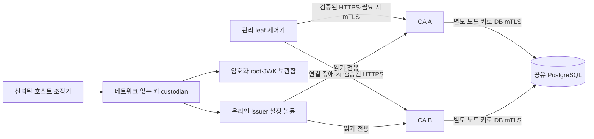

# 로컬 CA 프로세스 고가용성

2026-11-03 · 기준 `aitest` `0c32273` · `feature/chaeheeju-ca-high-availability`

[CA·발급 JWK 키 교체](authority-key-rotation.md)의 후속 프로필이다. CA 두 프로세스가 같은 발급 정책과
중간 CA 키를 사용하고 PostgreSQL의 토큰 소비·인증서·폐기 상태를 공유한다. 관리 클라이언트는 기본 CA에
연결하지 못하면 두 번째 CA에 연결한다. 앱·탐지·정책·개선 전 평가 결과는 변경하지 않는다.

## 제공하는 가용성 범위

| 장애·변경 | 처리 |
|---|---|
| 기본 CA 종료·응답 정지·CA 통신망 단절 | TLS 연결 수립 단계에서 두 번째 승인 CA로 전환. 신규 발급·mTLS 갱신·leaf rekey/권한 pin 반영을 이어감 |
| 두 번째 CA 종료 | 기본 CA에서 발급·갱신을 이어감 |
| 모든 CA 중단 | 발급·갱신은 거부. 아직 유효한 기존 인증서의 업무 접근과 별도 요청별 인가는 유지 |
| 공유 DB 중단 | 발급·갱신을 거부. 상태 없는 임시 CA·새 DB·폐기 상태 초기화로 우회하지 않음 |
| CA/JWK 세대 변경 | 기존 leaf 발행기를 pause/ack하고 각 CA를 순서대로 재시작. 모든 CA의 새 issuer·새 JWK 발급을 확인한 뒤 이행 |
| 이전 발급 JWK 폐기 | 모든 CA에 각각 새 nonce·CSR 요청을 보내 모두 거부되는 것을 확인한 뒤 구 비밀 파일 제거 |

이것은 **한 Docker 호스트 안의 CA 프로세스 장애 대응**이다. PostgreSQL은 단일 인스턴스이며 DB·Docker
엔진·호스트·저장소 장애를 견디는 전체 PKI 고가용성은 아니다. 키 세대 교체 시 발급 pause도 유지하므로
무중단 키 교체·HA 운영 SLA로 표현하지 않는다. 별도 로드밸런서를 추가하지 않아 그 장비의 단일 장애점은
만들지 않지만, 자동 전환은 이 프로필의 관리 클라이언트에 적용된다. 외부 `step` CLI나 단일 `ca` 주소만
사용하는 미등록 프로그램까지 자동 전환하는 것은 아니다.

## 네트워크와 키 경계



- CA 통신망과 DB 전용망은 Docker 내부망이며 호스트 공개 포트가 없다. leaf 제어기는 DB 전용망에
  참여하지 않는다. DB에는 CA 전용 연결만 허용하며 앱 DB는 기존 SQLite 그대로다.
- DB TLS는 업무 CA와 **독립된 로컬 transport PKI**다. 업무 루트 교체가 DB 연결 신뢰를 바꾸지 않도록 한다.
  CA마다 서로 다른 client 키를 사용하고 서버 이름·체인은 `sslmode=verify-full`로 검사한다.
  PostgreSQL은 client 인증서를 요구하며 평문·무인증 연결을 거부한다. DB transport PKI의 자동 수명 관리는
  이 프로필에서 구현하지 않았으므로 운영 배포 시 별도 갱신·폐기·배포 절차가 필요하다.
- `secops_ca` 역할에는 superuser·DB 생성·역할 생성 권한이 없다. 미리 만든 CA 전용 DB에 필요한 테이블을
  관리한다. 초기화용 postgres 로컬 Unix socket 접근은 신뢰된 호스트 운영자의 관리 경계다.
- CA A/B에는 온라인 issuer 키·암호만 읽기 전용으로 연결한다. root/JWK 암호화 보관함이나 Docker socket은
  연결하지 않는다. 소프트웨어 키와 같은 볼륨의 복호화 암호라는 [기존 보관함 한계](authority-key-rotation.md)는 유지한다.
- 새 개인키·DB 인증 키는 RAM과 전용 Linux 볼륨에서만 다룬다. 호스트 JSON에는 공개 계획·상태·지문만 남긴다.
  사용자 ZIP·기존 Docker 작업·OS 신뢰 저장소·실계정은 변경하지 않는다.

## 전환과 중복 실행의 기준

[`/state/ca-endpoints.json` 예시](../infra/mtls/ca-endpoints.example.json)를 둔 프로필에서만 `[ca-a, ca-b]`를 사용한다. 파일이 없는 기존 실행기는
`https://ca:9000`의 단일 CA를 그대로 사용한다. 허용 이름·중복·개수·연결 시간 상한을 검사하며 고정 포트와
기존 루트 검증을 유지한다. 연결·TLS 수립 중의 네트워크 오류만 다음 CA로 전환한다.

TLS 인증 실패는 숨기지 않고 즉시 실패한다. 인증 토큰 전송 전 서버 인증을 완료하며, HTTP 요청을 보낸 뒤
발생한 timeout/응답 유실이나 401/403을 다른 CA로 재시도하지 않는다. 일회용 토큰이 이미 소비됐을 수 있기
때문이다. 고장 시 모든 요청의 성공이나 exactly-once 업무 처리를 보장하지 않는다. 제어기는 기존 backoff와
신원 유효성 검사로 다음 실행을 처리하고, 만료·회수 신원을 새 bootstrap으로 살리지 않는다.

부분 발급 뒤 서비스 재적용이 중단돼도, 성공한 bootstrap grant는 검증된 후보 인증서를 상태 파일에
저장한 뒤 제거한다. 마지막 grant를 소진하면 빈 JSON을 남기지 않고 파일을 즉시 unlink하며, 기존의
빈 파일도 publication 재개 전에 정리한다. 배포 성공 여부에 비밀 정리가 종속되지 않도록 한 경계다.
아직 사용하지 않은 grant까지 지우거나 실패한 발급을 성공으로 바꾸지는 않는다. 물리적 소거와는 구분한다.

두 CA가 DB를 공유하는 것만으로 상태 경쟁이 사라지는 것은 아니다. 고정 `step-ca 0.30.2`의
`nosql v0.8.0` PostgreSQL compare-and-swap은 조회와 UPSERT를 트랜잭션에서 수행한다. 이 프로필은
CA 역할에 **SERIALIZABLE** 격리를 설정해 같은 부재 행의 동시 소비 경쟁을 충돌로 종료시킨다. 충돌은
발급 성공이 아닌 오류가 될 수 있으며, 포괄적인 CA/ACME/admin API의 분산 트랜잭션 보장으로 확대하지 않는다.

SQL 충돌 때문에 한 번의 타이머 작업이 여러 배포로 나뉠 수 있다. 중단 복구 시험은 한 배포에 모든
신원이 포함된다고 가정하지 않는다. 대신 **전체 활성 신원의 기존 키가 남아 있는지**, 중단된 실제 배포가
등록된 신원만 포함하는지, 재시작 후 그 배포가 같은 후보 키/인증서를 사용하는지 각각 확인한다.
다음 타이머를 잠시 보류해 복구 순간을 관측한 뒤 다시 실행하고, 최종적으로 **활성 신원 전체가 새 키로
교체되는지** 별도 확인한다. 부분 배포를 허용한다는 이유로 기존 키 보존·신원 범위·전체 이행 검사를 생략하지 않는다.

키 교체 조정기는 각 CA의 이름·고정 ID·이미지 SHA-256·동일한 읽기 전용 CA 볼륨을 모두 검증한 뒤 순서대로
재시작한다. 마지막 CA까지 새 issuer TLS와 노드별 **서로 다른 새 JWK 토큰**의 발급을 증명해야 leaf 이행을
허용한다. 구 JWK 검사도 각 노드에 별도의 새 CSR·nonce를 만들어 공유 DB의 단순 replay 거부와 구분한다.
중간에 실패하면 기존 journal·겹침 신뢰·키를 유지하고 같은 단계에서 재개한다. 이 동안 유지보수에 따른
발급 중단은 가능하며, 독립된 임의 외부 발급 클라이언트의 혼합 세대 요청까지 조정하는 분산 합의는 아니다.

## 로컬 실행

```powershell
.venv\Scripts\python.exe -m scripts.test_ca_high_availability --smoke --directory runtime/c02/c04/ha-smoke-reproduce
.venv\Scripts\python.exe -m scripts.test_ca_high_availability --repeats 1 --directory runtime/c02/c04/ha-full-reproduce
```

실행기는 새 CA/DB/내부망/키 볼륨을 만들고 종료 시 자기 프로젝트 자원만 정리한다. 처음부터 PostgreSQL을
사용하는 새 프로필이며 기존 Badger DB를 운영 중 자동 마이그레이션하는 도구가 아니다. 이전 실행기와
폐기·갱신 비교는 기준선으로 보존한 뒤 HA 클라이언트 선택을 명시적으로 활성화한다.

PostgreSQL은 [고정 이미지](../infra/mtls/ca-ha-tools.lock.json), CA·CLI는
[기존 버전/SHA-256](../infra/mtls/ca-tools.lock.json)을 사용한다. 시험 기간만 키 타이머를 가속한다.
계속 운영할 때는 승인된 HA profile의 `ca_replicas`와 endpoint 파일을 함께 유지하며 기존
`scripts.authority_rotation_coordinator run --profile <profile.json>`을 사용한다.

HA 시험의 정적·자동 canary 인증서는 **동일하게 90초**, 자동 갱신 여유는 60초다. 공유 SQL 상태와
전체 서비스 재적용·제어기 재시작 시간을 분리해 기능을 확인하는 가속 시험 조건이며, 실제 20분 인증서
정책은 바꾸지 않는다. 기존 단일 CA 실행기의 30초 비교도 유지한다. 앞선 HA 30초 시험은 재시작 중
canary가 만료되어 실패했으며 이 결과를 보존한다. 90초 시험 통과를 30초 갱신 SLA 통과로 해석하지 않는다.

## 검증 기록

[공개 원자료](infrastructure-results/c04-ca-ha-windows-20261103.json)와
[HA 계약](../infra/mtls/ca-ha-contract.json)에 결과를 보존했다. 11/3 23:17~23:56 KST에 서로 다른
초기 루트·DB로 **2회 × 222 = 444개**를 통과했다. 회당 재사용한 검사 항목 197개와 HA 검사 25개다.
가속 canary 조건은 위의 90초/60초이며, 이전 30초 실행과 동일 조건 성능 비교를 주장하지 않는다.
반복 assertion 수이며 고유 위협 444종이나 정밀도·재현율·F1 점수가 아니다.

| 검증 | 실제 결과 |
|---|---|
| CA 장애 전환 | 기본 CA 종료·pause·CA 망 단절에서 새 발급과 mTLS 갱신 성공. 보조 CA 종료 시 기본 CA 발급 성공 |
| 자동 관리 | 기본 CA 중단 상태에서 실제 leaf rekey·pin 배포 완료. 모든 CA/DB 중단에는 발급 거부, 유효한 업무 접근 유지 |
| DB 신뢰 | 별도 CA client 키 2개의 mTLS 연결 관측. 평문·client 인증서 누락·잘못된 서버 이름 거부. CA 역할의 비관리 권한/격리 설정 확인 |
| 동시 소비 | 전체 24쌍의 동시 요청에서 각 쌍의 발급 성공 응답은 1개. 충돌 시 500을 포함한 실패 응답을 허용하며 무오류 처리를 뜻하지 않음 |
| 공유 상태 | CA A에서 소비한 토큰과 폐기한 인증서는 CA B에서 거부. 양 CA 및 DB 재시작 후에도 거부 상태 유지 |
| 서비스 키 복구 | 중단 배포는 1회차 48개·2회차 46개 신원. 매번 활성 48개 전체의 기존 키 보존, 실제 중단 후보의 동일 키/인증서 복구, 최종 전체 새 키 이행을 확인 |
| authority 교체 | 회당 root+issuer+JWK → issuer+JWK → JWK의 3 epoch. 각 단계 활성 신원 48개·Python/NGINX/Go TLS 서버 14개 이행 |
| 모든 CA의 키 폐기 | 매 epoch 각 CA에 구 JWK 66개로 새 CSR/nonce 요청. 전체 792개를 401/403으로 거부. 양 노드의 새 issuer·새 JWK 발급도 별도 확인 |
| 업무·관측 | 교체 후 실제 M3 위험 관찰→worker→권한 회수→다음 문서 거부, scrape·동일 경보 발생/해제 통과 |
| 전체 회귀 | 새 단위 사례 52개 포함 Windows **870건/112.21초/기존 경고 3개**, Linux Docker **870건/85.27초/기존 경고 2개**, Ruff 통과 |
| 정리 | 최종·초기 5개 프로젝트의 컨테이너·볼륨·망·전용 이미지 태그 잔여 0, 단위 이미지 4개 제거. 기존 kind 작업과 사용자 ZIP 보존 |

실행 이미지의 핵심 Python 소스 11개를 호스트/가져온 입력과 대조하고, 최종 전체 입력의 지문도 다시
확인했다. 원자료의 `source_commit`은 시작 HEAD이며 실제 미커밋 실행 입력은 `source_input_sha256`와
이미지 안의 파일 지문으로 식별한다. 앱·탐지·정책·개선 전 품질 데이터는 변경하지 않았다.
전환 시간은 Docker exec 등 호스트 비용을 포함하며 배경 부하를 통제한 RTO/성능 SLA 측정이 아니다.

초기 빠른 25개 검증과 앞선 전체 시도들은 최종 444개에서 제외한다. 첫 전체 시도는 1회차 222개를
통과했으나 2회차 bootstrap 파일 삭제 확인이 실패했다. 초기 파일 내용은 내보내지 않아 정확한 내용은
단정하지 않는다. 별도로 소진 파일 정리가 배포 실패/재개에 종속되는 코드 경로를 재현하고 개선했다.
다음 시도에서는 기존의 전체 batch 가정/키 존재 결합 assertion이 실패했다. 당시 pending map도 내보내지
않아 실패한 하위 조건을 단정하지 않으며, 전체 키 보존과 실제 배포 복구·최종 전체 이행을 나눠 검증하도록
보강했다. 그다음 30초 canary 재시작 시험은 실제 만료 상태가 관측돼 실패했고, HA 조건을 동일 수명
90초로 명시한 새 이미지에서 전체 두 회를 다시 통과했다. 실패 상태·소스/이미지 지문·정리를 원자료에 분리한다.

도구 보조 실행이며 팀원 독립 재현·운영 배포 완료로 기록하지 않는다. 단위 fixture의 초기 공개 root
누락과 예외 타입 기대값 오류도 수정한 뒤 최종 870건을 확인했다.

## 근거와 남은 운영 조건

- [Smallstep HA 운영 고려](https://smallstep.com/docs/step-ca/certificate-authority-server-production/):
  다중 CA에 공유 SQL DB를 사용한다. remote provisioner management는 이 프로필의 별도 관리 API로 열지 않고
  기존 단일 조정기의 고정 파일/전체 노드 재시작으로 범위를 제한한다.
- [DB 설정과 TLS](https://smallstep.com/docs/step-ca/configuration/): Badger/Bolt와 SQL의 동시 접근 차이,
  PostgreSQL `verify-full` 및 인증서 경로 설정을 따른다.
- [step-ca 토큰 소비](https://github.com/smallstep/certificates/blob/v0.30.2/db/db.go),
  [고정 nosql PostgreSQL 구현](https://github.com/smallstep/nosql/blob/v0.8.0/postgresql/postgresql.go),
  [PostgreSQL 트랜잭션 격리](https://www.postgresql.org/docs/17/transaction-iso.html): 상태 경쟁과 오류 범위를 판단한 근거다.
- [PostgreSQL TLS](https://www.postgresql.org/docs/17/ssl-tcp.html),
  [인증서 인증](https://www.postgresql.org/docs/17/auth-cert.html): 서버 이름 검증·client 인증서·키 0600을 적용한다.

다중 호스트 배치·DB 복제/자동 승격과 fencing·독립 백업/복원·DB transport PKI 자동 교체·HSM·운영 부하/
장기 장애 측정·독립 검토는 후속 조건이다. 정상 주기 교체와 침해된 루트의 사고 복구, 새 TLS 연결 거부와
기존 연결 강제 종료, 파일 unlink와 복구 불가능한 소거도 계속 구분한다.
