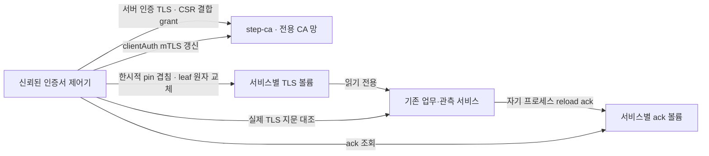

# 3주차 CA 통합 인수: 지속 실행 경로의 인증서 발급·갱신

11/6 후속 [지속 실행 개인키 교체·관측 진단](persistent-key-rotation.md)을 별도 선택형으로 연결한다.
아래 동일 키 갱신 기준선은 보존한다. reload group의 실제 볼륨 경로 보완과 현재 소스의 회귀 결과는
후속 기록을 따른다. 이전 native TLS 관측을 올바른 ack 경로 검사 결과로 소급하지 않는다.

2026-11-06 · 채희주 인프라 구성·실행·측정, Codex 도구 보조.

기존 [인증서 자동화](certificate-automation.md)는 별도 전체-hop 캠페인에서 검증했다.
이번에는 해당 제어기를 [지속 실행 관측 환경](persistent-monitoring.md)에 연결한다.
기본 9서비스·관측 14서비스를 유지하며 `scripts.authority_mtls_runtime`을 선택하면
관측 환경에 CA·인증서 제어기를 추가한 16서비스·9개 내부망이 된다.
김택희 담당 앱·탐지·정책 코드와 개선 전 평가 데이터/기준선은 변경하지 않는다.

## 인수 범위와 신뢰 경계



| 영역 | 실제 권한 |
|---|---|
| 오프라인 root | 최초 준비 때 드라이버 RAM에서만 사용. 개인키를 반환하거나 호스트/온라인 볼륨에 저장하지 않음 |
| CA | 암호화된 intermediate 개인키·시작 암호·Badger DB를 CA 전용 Linux 볼륨에 저장. 서비스 leaf 개인키/업무 DB 없음 |
| 제어기 | 서비스 TLS 볼륨 RW, 자체 journal/관리 신원, 모든 시험 서비스 망 접근. CA 서명키·업무 DB·responder API 키·수집 서명키·Docker socket 없음 |
| 업무 서비스 | CA 망에 연결하지 않음. 자기 TLS 볼륨은 RO, NGINX/Go만 자기 ack 볼륨에 쓰기 |
| worker/watchdog | 기존 `network=none`, CA/인증서 관리 권한 없음 |

제어기는 여러 leaf 개인키와 pin 정책을 관리하는 중앙 신뢰 제어면이다. 서비스별 agent/HSM,
실제 workload attestation 또는 침해된 제어기/호스트를 견디는 구조로 확대하지 않는다.
관측 TLS 볼륨에 함께 둔 scrape/notify 토큰도 제어기에서 읽을 수 있다. 업무 API 키·서명키와는
분리하지만 관측 토큰까지 제어기에서 완전히 분리한 secret store는 아니다.
CA 시작 암호와 암호화 key도 같은 CA 볼륨에 있으므로 외부 secret manager 보호 수준은 아니다.
호스트 포트·호스트 bind·OS 인증서 저장소·외부 클라우드/유료 모델은 사용하지 않는다.

## 발급에서 정상 재개까지

1. 승인된 서비스 목록에서 역할·용도별 JWK provisioner를 만든다. 최초 private signing key는
   드라이버 RAM에만 둔다. 기존 leaf는 초기 CSR/신원 확인용이며 자동 발급 결과와 구분한다.
2. 실제 CSR SHA-256에 묶인 일회용 grant를 전용 Linux 상태 볼륨에 전달한다. 실제 CA가 서명한
   결과를 journal에 먼저 저장한 뒤 사용한 grant를 제거한다. 초기화 성공 뒤 signing key 객체를 비운다.
3. 제어기는 응답의 issuer·키·이름·SAN·단일 EKU·만료를 검사한다. 새 pin 겹침→leaf 교체→
   서비스 reload ack→실제 TLS의 새 지문→구 pin 제거 순서로 게시한다.
4. Python은 기존 요청별 profile 재읽기를 재사용한다. NGINX는 자기 설정 검사/reload,
   Prometheus/Alertmanager는 자기 자식 프로세스 SIGHUP/ack를 사용한다. Docker socket은 주지 않는다.
5. clientAuth는 mTLS 자체 갱신, serverAuth는 기존 서버별 제한 JWK `/sign` 재발급을 쓴다.
   serverAuth에 clientAuth 권한을 추가하거나 일반 client에 서버 발급 권한을 주지 않는다.
6. down/up은 CA DB·제어기 journal·신원과 기존 키를 유지한다. 정상 재개에서 hierarchy,
   provisioner 또는 bootstrap 권한을 새로 만들지 않는다.

일반 leaf는 20분, 관리 갱신 신원은 1시간으로 발급한다. 기본 갱신 임계는 각각 400초/1,200초다.
인수 시험의 1,190초/3,590초 임계는 빠른 타이머 검사용이며 운영값으로 복사하지 않는다.
이번은 **동일 개인키 leaf 갱신**이다. 기존 개인키/CA·JWK 자동 교체와 CA HA 구현을 이번 프로필에서
동시에 활성화하거나 통합 인수한 것으로 기록하지 않는다.

최초 grant 소비 후 응답 유실/초기화 중단은 새 승인 없이 재등록하지 않는다. 초기화가 끝나지 않은
descriptor를 다른 드라이버가 재개하면 `authority_initialization_requires_new_approved_bootstrap`으로
거부한다. 기존 실행 중 프로세스가 남았으면 소유 프로젝트를 확인해 정리하고 새 승인/환경을 준비한다.
완료되지 않은 환경을 자동 덮어쓰기·root 재생성으로 복구하는 기능은 없다.

CA DB 유실도 새 DB 생성으로 숨기지 않는다. 새 CA 볼륨에만 `initialize.once`를 두고, CA 시작
직전에 이를 `require-existing-db`로 원자 이동·디렉터리 fsync한다. 이후에는 기존 Badger
`MANIFEST`·`KEYREGISTRY`와 초기화 marker가 필요하다. 호스트의 시작 전 검사와 CA 컨테이너
자체 entrypoint가 각각 검사하므로 호스트 실행기를 거치지 않는 컨테이너 재시작에도 적용된다.
최초 승인 소비 후 DB 생성 전 중단은 새 승인/새 환경이 필요하며 자동 승인 파일을 다시 쓰지 않는다.
메타데이터 존재 검사는 DB 유실의 기동 차단이며, 임의의 옛 DB 사본이나 부분 손상·전원 손실의
일관성을 인증하는 백업/복원 승인 프로토콜은 아니다.

## 실행 환경 고정과 변경 거부

기존 [release lock](runtime-release-lock.md)에 CA 공식 archive lock·NGINX reload script·16서비스
구조를 포함한다. `step-ca 0.30.2`/`step 0.31.0`의 기존 공식 archive SHA-256을 검증하고 지정된
regular 바이너리만 추출한다. 앱→관측 도구→CA 도구의 기반 image ID·상속 layer prefix를 대조하며,
Compose는 검증한 로컬 image ID/`pull_policy=never`를 사용한다.

재시작 전에 CA 도구 image ID/바이너리 지문, CA 공개 설정/root/issuer·reload script, 제어기의 고정
관리 root/정책/provisioner/probe/reload 설정 지문을 대조한다. 불일치하면 서비스 기동 전에 거부한다.
`paused`·`disabled`·범위 제한 `renew_before`만 로컬 관리 제어로 구분한다. 호스트 관리자는 이 값과
정책 파일을 바꿀 수 있으므로 호스트 attestation·서명된 운영 승인·분산 CAS·정책 anti-rollback과 구분한다.

## 로컬 재현

```powershell
.venv/Scripts/python.exe -m scripts.authority_mtls_runtime up --directory runtime/c02/my-authority
.venv/Scripts/python.exe -m scripts.authority_mtls_runtime status --directory runtime/c02/my-authority
.venv/Scripts/python.exe -m scripts.authority_mtls_runtime down --directory runtime/c02/my-authority
```

down은 저장 볼륨을 보존한다. `down --purge`는 검증한 소유 프로젝트 자원만 삭제한다.
이전 9/14서비스 descriptor를 이 프로필로 자동 승격하지 않는다. 반복 시험에는 새 directory를 쓴다.

```powershell
.venv/Scripts/python.exe -m pytest tests/test_authority_mtls_runtime.py tests/test_certificate_lifecycle.py -q
.venv/Scripts/python.exe -m scripts.test_authority_mtls_runtime --directory runtime/c02/ca-acceptance-reproduce01
```

기존 DB 복구18·관측/mTLS71 회귀는 별도 원래 프로필에서 유지한다. CA 인수 실행은 동일 사건/상태
회귀 수치를 중복 합산하지 않고 CA에 연결한 업무/관측 경로의 발급·갱신·권한·복구를 검사한다.
테스트가 초기 인증서를 발급받기 전의 상태와 실제 CA 서명 후의 세대/지문을 구분한다.

## 검증 기록과 남은 인수

첫 준비 실행에서 실제 16서비스 기동, 신원39개 자동 발급, native Python/NGINX/Go 서버11개의
실제 새 TLS 지문을 확인했다. 이 준비 실행을 최종 소스의 전체 인수 결과로 합산하지 않는다.
최종 인수·전체 회귀·실패 시도·정리는
[공개 원자료](infrastructure-results/ca-runtime-acceptance-20261106.json)에 연결했다.
정확한 head 및 병합 후 CI 대조는 PR 기록에 남긴다.

첫 인수 실행은9개 검사를 통과한 뒤 시험 수신기 notify 토큰의 초기화 누락으로 TypeError가 발생했다.
이는 시험 드라이버 오류이며 통합 인수 성공으로 기록하지 않는다. 소유 컨테이너·볼륨·망은 각각0개로
정리했고, 수신 토큰 준비를 보완했다. 후속으로 기존 유효 leaf와 현재 leaf의 전송 대조군,
관리 갱신 신원의 업무 역할 거부, 실제 collector의 폐기 전/후 같은 전송 경로 대조도 추가했다.

두 번째 인수 실행은7개 검사를 통과한 뒤 시험 probe가 기존 TLS profile API의 `Path` 및 같은
디렉터리 asset 규칙을 지키지 않아 중단됐다. 소유 자원은 각각0개로 정리했다. 서비스의 엄격한
asset 검증은 유지하고, 시험 helper가 인증서/키를 제어기 tmpfs의 전용 임시 디렉터리에0600으로
복사해 정상 profile을 만들도록 수정했다. 요청 후 임시 개인키 삭제와 초과 크기 입력의 통신 전
거부를 unit으로 확인했다. 이전 시도들의 성공 수치를 최종 통과 수에 합산하지 않는다.

운영용 최초 grant는300초다. 인수 드라이버만 replay 시험 대상 collector grant를1시간으로 발급하고
드라이버 RAM에서 소비한 grant를 한 번 보관한다. CA DB 재시작 후 재사용 거부를 검사할 때에도
JWT가 아직 만료 전인지 먼저 확인해, 단순 토큰 만료가 replay DB 유실을 가리지 못하게 한다.
이 테스트 전용 수명을 운영 발급 권한이나 정상 실행 프로필로 확대하지 않는다. 토큰 원문은 공개하지 않는다.

세 번째 중간 인수는26개를 모두 통과했고 소유 컨테이너·볼륨·망은 각각0개다. 이후 CA DB 전체
유실 시의 기동 보호를 추가했으므로 이26개를 최종 소스의 검사 수로 바꾸지 않는다. 추가 보호를
포함한 집중237개(신규29개,7.07초), 최종 Linux 전체2,050개(기존 경고2,490.62초),
실제 CA 인수29개를 모두 통과했다. 최종 소유 컨테이너·볼륨·망은 각각0개다.
최종 실행 입력156개와 image payload를 대조했으며 release SHA-256은
`677ebea961f926228d7ea2cbe295307a4702e0a54eeed1e15387267af397e0d5`다.
초기 Linux2,043 통과는 probe helper/DB gate 전의 소스 결과이며2,050으로 바꿔 적지 않는다.
로컬 일부 실행을 병행했으므로 위 시간은 후보 간 성능 비교/SLO가 아니다.

인수 검사는 실제 일회용 grant 재사용 거부, 타이머 갱신·구 pin 제거·재적용 관측,
갱신 후 문서 전달/지표/새 경보의 동일 episode 해제, CA 장애 중 유효 경로 유지와 갱신 실패,
CA/제어기 재시작·DB의 폐기 보존, 제어기 재시작 후 disabled/pin 회수 보존,
저장소 보존 재개 및 고정 제어기 설정 변경 시 전체 기동 거부를 포함한다.
만료 뒤 자동 재등록 금지는 기존 제어기 unit 회귀로 재확인하며, 과거 별도 C04 캠페인의 실제
짧은 수명 만료 실험을 이번 지속 실행 프로필에서 재실행했다고 바꾸지 않는다.

운영 인수의 잔여 항목:

- [개인키 교체 연결](persistent-key-rotation.md)은 후속 인수로 진행했다. [CA/JWK 교체](authority-key-rotation.md)·
  [CA HA](ca-high-availability.md)/공유 DB 호스트 복구를 이 지속 실행 경로에 연결한 별도 계약/인수는 남긴다.
- active CRL/OCSP·native Go 연결의 즉시 폐기, CA 관리 API 세분화 RBAC·HSM/외부 secret manager,
  인증서 전용 운영 경보/조직 IdP 연계. CA serial 폐기만으로 업무 접근이 즉시 끊긴다고 주장하지 않는다.
- [전체 JSONL 저장 계약](app-state-recovery.md)·C01~C03 운영 선정·새 Go 도구 포함 이미지의
  공급망/취약점 영향 검토·운영 부하·김택희 독립 재현. 인프라 도구 실행과 독립 검토를 구분한다.

자체 대시보드 계획과 11/29 기능 동결·12/6 제출 가능본 목표를 유지한다. 이번 결과를
3주차 전체 완료·상용 CA 운영 승인·탐지 정밀도/재현율/F1/오탐률 검증으로 확대하지 않는다.
