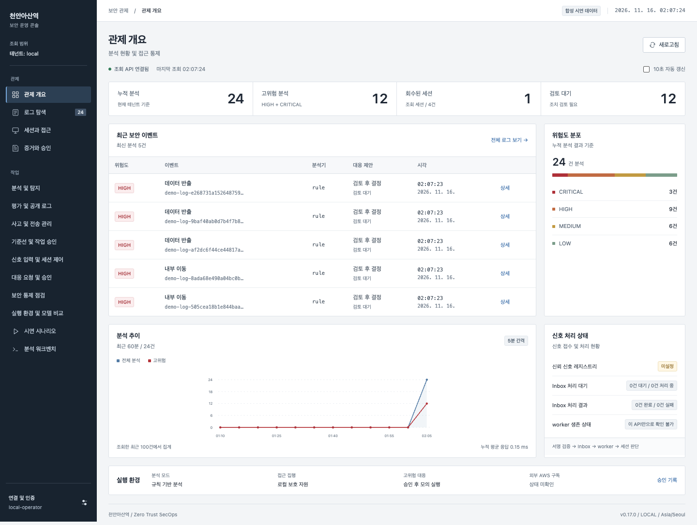
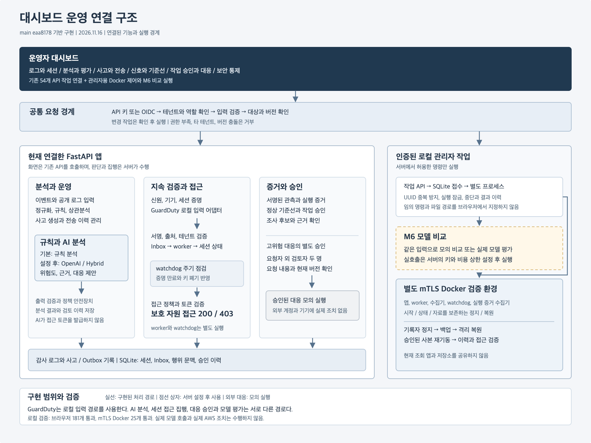
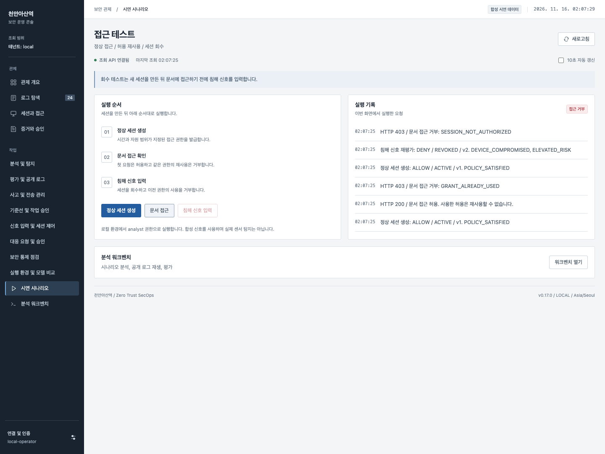
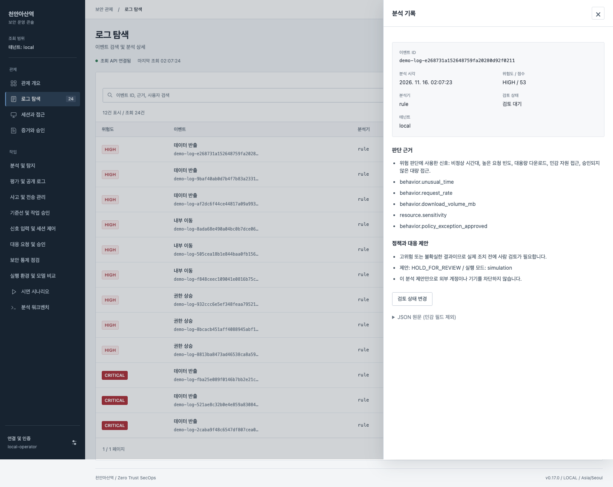
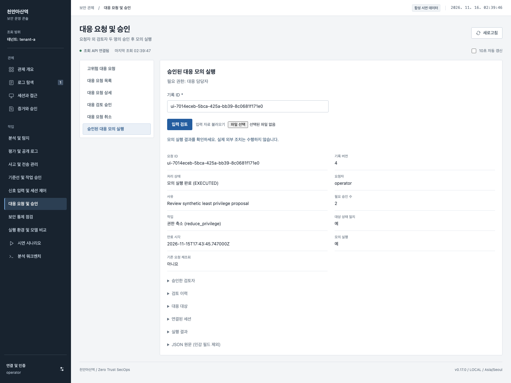

# 관제 대시보드와 로컬 시연

대시보드는 PR #59와 통합 PR #76을 통해 `main`에 반영됐다.
`/`에서 관제 화면을, `/static/workbench.html`에서 기존 분석 워크벤치를 제공한다.
화면은 기존 조회와 정책 API를 사용하며 탐지 규칙과 접근 집행을 별도로 구현하지 않는다.

2026년 11월 16일 화면 개편은 `main`의 `eaa8178`을 기준으로 했다.
최근 보안 이벤트를 요약 지표 바로 아래에 배치하고, 위험도 분포는 건수 목록과 가로 막대로 표시한다.
밝은 작업 영역과 짙은 탐색 메뉴를 구분하고 표의 행 간격을 줄였다. 날짜와 시각은 두 줄로
표시하며 전체 시각은 셀 설명에도 남긴다. 상세 기록은 오른쪽 패널에서 확인한다.
위험도와 접근 판단은 색상뿐 아니라 텍스트로 구분한다. 시연 기능은 도구 메뉴에 둔다.
왼쪽 상단은 프로젝트 이름만 표시하고, 하단 연결 메뉴에는 현재 조회 신원을 표시한다.
이니셜 배지는 사용하지 않으며 좁은 화면에서도 연결 메뉴 이름을 유지한다.



## 화면 구성



구현도 원본: [SVG](images/dashboard-architecture.svg), [Mermaid](images/dashboard-architecture.mmd).
AI 분석은 설정된 분석 모드에 따라 위험도, 근거와 대응 제안을 만든다. 지속적인 접근 집행은
세션 정책과 토큰 검증 경로에서 수행하며, 외부 대응의 모의 실행과는 구분한다.

| 화면 | 보여주는 내용 | 범위 |
| --- | --- | --- |
| 관제 개요 | 분석 수, 위험도, 검토 대기, 세션 회수, 분석 활동, Inbox 상태 | 서버가 반환한 현재 테넌트 기록 |
| 로그 탐색 | 검색, 위험도, 분석기, 검토 상태, 페이지 이동, 근거와 원문, JSON 내보내기 | 최근 100건 내 검색과 필터 |
| 세션과 접근 | ALLOW, STEP_UP, HOLD, DENY와 버전별 이력 | API가 반환하는 최근 세션 |
| 증거와 승인 | 행위 문맥 이력, 대응 요청, 검토자와 승인 수, 모의 실행 결과 | 상세에서 권한에 맞는 승인과 실행 화면으로 이동 |
| 시연 시나리오 | 정상 세션 생성, 한 번의 접근, 재사용 거부, 침해 신호와 회수 | 실제 로컬 정책 API에 합성 신호 입력 |
| 분석 | 시나리오, 분석과 정규화, 규칙 평가, 사고 상관분석, 검토 상태 변경 | 기존 분석 API와 같은 인증 사용 |
| 평가 | 공개 로그 재생, 반복 평가, 품질 보고서와 벤치마크 | 모델 호출 여부와 입력을 확인한 뒤 실행 |
| 사고와 전송 | 사고 생성과 상태 변경, 전송 기록 복구와 결과 기록 | 버전 확인 후 변경, 외부 전송 성공을 대신 만들지 않음 |
| 기준선과 승인 | 서명된 수집 및 실행 증거, 정상 기준선, 작업 승인 등록과 회수 | 신뢰 출처와 서명을 기존 서버에서 검증 |
| 신호와 접근 | 서명 신호 접수와 평가, 세션 평가와 회수, 보호 자원 접근 | Inbox와 원래 접근 집행 API 사용 |
| 대응 요청 | 요청, 두 사람 승인, 취소, 승인된 대응 모의 실행 | 서로 다른 실제 인증 신원 필요 |
| 보안 통제 | 통제별 근거와 준비 상태 | 서버의 현재 검증 자료 |
| 실행 환경 및 모델 비교 | 별도 Docker 환경 시작, 정지, 복원, 검증과 M6 비교 | 명시적으로 설정한 로컬 관리자 전용 |
| 분석 워크벤치 | 이전 분석 도구 | 기존 화면 유지, 새 메뉴는 대시보드 인증을 공유 |

누적 분석 수와 위험도 분포는 `/metrics`의 누적 집계다. 활동 차트는 조회한 최근 100건 중
최근 12개 5분 구간의 표본이며 마지막 구간은 진행 중이다. 회수 세션 수도 조회 표본 기준이다.
이 숫자를 탐지 정확도, F1 또는 전체 운영 환경의 처리량으로 해석하지 않는다.
worker의 프로세스 생존과 AWS 구독 상태는 이 조회 API만으로 확인하지 않는다.
로그 표와 상세는 연월일을 함께 표시하며 화면 하단의 브라우저 시간대를 따른다.
내보낸 JSON은 서버가 반환한 원래 시각과 오프셋을 보존한다.

## 별도 시연 환경 실행

프로젝트의 개발 의존성을 설치한 상태에서 저장소 루트에서 실행한다.

```bash
.venv/bin/python -m scripts.serve_dashboard_demo --seed
```

브라우저에서 `http://127.0.0.1:8765`를 연다. `127.0.0.1`에만 바인딩한다.
기존 `.env.local`과 상속된 앱 설정을 사용하지 않고 규칙 분석, JSONL, 별도 SQLite 파일로 시작한다.
모델 API, 클라우드 저장소, 외부 대응 시스템은 호출하지 않는다.

`runtime/dashboard-demo`에 분석 24건, 정상 및 제한 상태 세션 4개, 미승인 대응 요청 1개를
기존 API로 생성한다. 임의의 탐지 결과나 승인 결과를 화면에 삽입하지 않는다.
상단에 **합성 시연 데이터 / LOCAL**을 표시한다. 대응 요청은 5분 후 만료되므로 시간이
지나면 EXPIRED로 바뀌는 것이 정상이다. 두 사람의 승인을 대신 만들지 않는다.

Ctrl+C로 종료한 후 같은 명령을 실행하면 기존 기록을 보존하고 시드 데이터를 중복 생성하지 않는다.
새 시연 기록이 필요하면 새 경로를 지정한다.

```bash
.venv/bin/python -m scripts.serve_dashboard_demo --seed --data-dir runtime/dashboard-demo-next --port 8766
```

기존 파일이 있는 외부 폴더에는 시작하지 않는다. 시드 생성 중 중단된 폴더도 자동으로 덮어쓰지
않으며 새 폴더 사용을 안내한다. 기존 평가 및 운영 저장소의 정리 명령은 포함하지 않는다.

## 3분 시연 순서

1. **관제 개요**에서 합성 데이터 표시와 규칙 분석 모드를 설명한다.
2. **로그 탐색**에서 위험도를 선택하고 상세를 연다. 판단 근거, 정책 제안, 검토 상태와
   정규화 원문을 보여준다. 분석 제안 자체가 외부 계정 차단을 뜻하지 않음을 설명한다.
3. **시연 시나리오**에서 정상 세션 생성 후 문서 접근을 누른다. HTTP 200을 확인한다.
   같은 버튼을 다시 누르면 HTTP 403, `GRANT_ALREADY_USED`가 기록된다.
4. 다시 **정상 세션 생성**을 누른다. 이번에는 문서 접근 전에 **침해 신호 입력**을 누른다.
   DENY / REVOKED를 확인한 뒤 문서 접근을 누르면 아직 사용하지 않은 이전 허용도 HTTP 403,
   `SESSION_NOT_AUTHORIZED`로 거부된다.
5. **세션과 접근**에서 해당 세션의 v1과 v2 이력을 보여준다. **증거와 승인**에서 대응 요청과
   실제 승인 수를 확인한다. 모의 대응과 실제 외부 집행을 구분한다.



접근 허용은 시간 제한도 있으므로 생성 직후 단계를 실행한다. 만료된 토큰의 거부를 회수 검증으로
소개하지 않는다. 이 시연의 기기 침해는 합성 입력이며 실제 센서 탐지 또는 AWS 경보 수신이 아니다.

## 인증과 오류 처리

기존 앱을 실행하면 기존 API 인증 설정을 그대로 따른다. **연결 및 인증**에서 하나의 API 키 또는
Bearer 토큰을 입력한다. 신원과 테넌트, 유효 역할은 새 읽기 전용 `GET /auth/me`가 기존
`get_principal` 및 viewer 권한 검사를 통해 반환한다. 입력한 사용자 이름으로 신원을 만들지 않는다.

키와 시연용 grant는 해당 페이지의 메모리에만 보관한다. URL, 콘솔, localStorage,
sessionStorage에 기록하지 않는다. 페이지 이동이나 새로고침하면 다시 인증해야 한다.
인증 변경 시 화면 데이터, 상세, 시연 토큰을 지우고 진행 중인 요청을 취소한다.
이전 신원의 늦은 응답은 적용하지 않는다. mTLS 전송 신원과 gateway 경로 제한은 변경하지 않는다.
기존 gateway가 `/auth/me` 또는 화면 경로를 제공하지 않으면 조회 실패를 표시하며 우회하지 않는다.

401, 403, 503, 네트워크 오류, 잘못된 응답 형식은 빈 성공 결과와 구별한다.
실패한 영역은 이전 값을 정상 값처럼 유지하지 않는다. 조회는 10초마다 갱신하며 비활성 탭에서는
자동 조회를 멈춘다. 요청이 진행 중이면 중복 조회를 만들지 않고 12초 후 시간 초과로 처리한다.

로그 문자열은 텍스트 노드로 표시한다. 원문 보기와 내보내기에서는 token, secret, password,
authorization, API key, signature, cookie 이름을 가진 필드를 가린다. 이 처리는 업무 내용 전체의
비식별화를 보장하지 않으므로 내보낸 로그는 필요한 범위로만 공유한다.

변경 작업은 입력 검토, 대상과 현재 버전 확인, 실행 순서로 진행한다. 요청자는 자기 요청을
승인할 수 없다. 다른 검토자가 각자 인증한 뒤 승인하고, 요청자가 승인된 대응을 모의 실행한다.
검토 후 버전이 바뀌면 서버의 409를 표시하며 새 버전으로 자동 재시도하지 않는다.
두 승인자의 키를 한 페이지에 보관하거나 사용자의 이름 입력으로 승인자를 만들지 않는다.
분석 워크벤치는 새 대시보드의 인증 메모리를 공유하지 않는다.

복잡한 이벤트와 서명 자료는 JSON 파일로 불러올 수 있다. 업로드는 입력 칸만 채우며 자동으로
전송하지 않는다. 합성 예제는 새 이벤트 ID와 현재 시각을 사용하고 정답 라벨을 제거한다.
기준선과 작업 승인의 시작 시각은 기본적으로 5분 뒤로 채운다. 검토 중 그 시각이 지났다면
다시 지정해야 한다. 승인 기간은 기준선 유효기간 안에 있어야 하며 소급 등록은 허용하지 않는다.
서명된 자료의 내용은 화면에서 임의로 수정하면 검증에 실패한다. GuardDuty는 기존 수집기가
검증하고 변환한 서명 입력을 사용하며 이 화면이 AWS 구독을 새로 생성하지는 않는다.

## 관리자 실행 환경

기본 상태에서는 호스트 작업이 꺼져 있다. 인증 없는 합성 시연 서버에서는 실행할 수 없다.
기존 앱을 `AUTH_MODE=api_key` 또는 `oidc`로 실행하고 서버에 등록된 `admin` 신원으로 연결한다.
개별 사용자 등록은 [백엔드 화면 계약](backend-screen-contract.md)을 따른다. 키 원문은 Git에
추가하지 않는다. `.env.local`에서 다음 설정을 사용한다.

```dotenv
DASHBOARD_OPERATIONS_DIRECTORY=runtime/dashboard-operations
DASHBOARD_OPERATIONS_TENANT=local
DASHBOARD_LIVE_MAX_USD=0
```

테넌트는 관리자 계정의 테넌트와 일치해야 한다. 새 전용 폴더는 권한 0700으로 생성하며 기존
자료가 있는 폴더나 심볼릭 링크는 거부한다. `APP_ENVIRONMENT=local` 또는 `test`에서만 허용한다.
Docker는 앱을 실행하는 호스트에서 사용할 수 있어야 한다. Docker 소켓을 웹 컨테이너에
새로 연결하지 않는다.

**실행 환경 및 모델 비교**에서 앱과 수집 서비스 시작을 먼저 실행한 뒤 상태를 조회한다.
이 환경은 `runtime/c02/dashboard-<전용 폴더 해시>`에 생성되며 현재 대시보드가 조회하는
앱 저장소와 분리된다. 앱, worker, 수집기, watchdog과 실행 증거 수집기를 기존 mTLS 실행기로
관리한다. 복원은 기록자 정지, 백업, 격리 복원, 승인된 사본 재기동 순서를 그대로 사용한다.
정지는 자료를 보존하며 삭제 옵션은 제공하지 않는다. 장애와 복원 검증은 또 다른 일회성 환경을
만들어 기존 테스트 실행기로 검증하고 해당 테스트 환경만 정리한다.

실행 환경은 생성 당시의 코드와 이미지에 묶여 있다. 코드를 바꾼 뒤 기존 환경을 자동으로
덮어쓰지 않는다. 새 버전을 검증할 때는 기존 환경을 정지하고 새 전용 작업 폴더를 지정한다.
이전 폴더의 작업 이력과 보존된 자료는 그대로 남는다.
실행 증거 수집기는 상시 수집과 인증 검증용 프로세스를 함께 실행할 수 있도록 메모리와
swap 합산 상한을 384MB로 제한하며, 메모리 상한도 같은 값으로 설정해 추가 swap을 허용하지
않는다. 나머지 서비스와 호스트 가상머신 설정은 유지한다.

M6 모의 모델 비교는 API 비용 없이 실행된다. 200세션 비교에는 검증된 묶음 경로를 서버의
`DASHBOARD_M7_PAIRED_DIRECTORY`에 설정한다. 실호출에는 모델별 키, 서버의
`DASHBOARD_LIVE_MAX_USD` 상한, 화면의 개별 실행 비용 상한이 모두 필요하다. 기본 상한은 0이다.
200세션 실호출의 최대 생성 요청 수는 600이며 기존 평가기가 데이터 해시, 요청 수와 비용을 검사한다.
키와 자료 경로를 브라우저에서 입력하거나 변경할 수 없다.

작업은 SQLite에 접수한 뒤 별도 프로세스가 실행한다. 브라우저를 닫거나 웹 서버를 재시작해도
동작 중인 작업과 이력을 조회할 수 있다. 같은 입력을 다시 실행하면 같은 요청 ID로 조회하며
중복 작업을 만들지 않는다. 새로운 실행이 필요하면 사유를 바꾼다. 실행기가 사라지면
`INTERRUPTED`로 표시하며 복원이나 유료 평가를 자동 반복하지 않는다. 실제 상태를 확인한 후
다음 작업을 선택한다. 결과를 받지 못한 경우에도 접수 ID와 최근 작업 목록으로 확인한다.
Docker 검증의 각 통과 항목, 보관 정리와 복원 결과, 테스트 환경 정리 결과도 작업 이력에
표시한다. 원본 설정과 민감 필드는 결과에서 제외하며 작업 상태와 검증 항목의 완료를 구분한다.

## 검증 재현

```bash
.venv/bin/python -m ruff check .
.venv/bin/python -m pytest -q
```

브라우저 검증은 앱 의존성과 분리해서 설치할 수 있다. 아래는 macOS에서 설치된 Chrome을 사용하는 예다.

```bash
python3 -m venv runtime/dashboard-browser-tools
runtime/dashboard-browser-tools/bin/python -m pip install --only-binary=:all: --require-hashes -r infra/runtime/requirements/browser.lock
runtime/dashboard-browser-tools/bin/python -m scripts.test_dashboard_browser --app-python .venv/bin/python --browser-channel chrome
runtime/dashboard-browser-tools/bin/python -m scripts.test_dashboard_operations_browser --app-python .venv/bin/python --browser-channel chrome
```

CI는 고정된 Python 의존성과 별도 브라우저 잠금 파일로 Chromium을 설치한다.
실제 로컬 API, 검색과 상세, 내보내기, 200/403 접근, 401/403/503 실패, 잘못된 응답,
저장된 HTML 문자열, 신원 변경 중 늦은 응답, 인증 저장 방지, 재시작과 중복 시드 방지,
390/768/1440px 화면을 검사한다. 결과 JSON과 화면 캡처는 CI의
`dashboard-browser-evidence` artifact에서 확인한다. HTTP 오류와 악성 문자열 검사는 명시적
브라우저 모의 응답이며 정상 접근, 재사용 거부, 회수 거부는 실제 API 결과다.

## 화면 개편 및 기능 연결 검증

기존 브라우저 검사는 검색, 내보내기, 상세 조회, 정상 접근과 재사용 및 회수 거부, 오류 처리,
인증 변경, 재시작 기록 보존을 포함한다. 기능 연결 검사는 모든 작업 폼의 PC와 모바일 배치,
실제 규칙 분석, 서로 다른 신원으로 승인, 모의 대응 실행, 수동 회수 후 접근 거부,
권한과 테넌트 차단, M6 모의 작업 접수와 중복 방지를 확인한다.
호스트 작업 시험은 저장소 소유권, 고정 명령, 비용 상한, 프로세스 중단과 이력 보존을 확인한다.
정책 판단과 F1 계산은 기존 구현을 사용한다. 합성 입력과 명시적 오류 모의 응답을 사용하며
독립 탐지 성능 평가를 대신하지 않는다.

화면 연결 후 Chrome에서 기존 관제 검사 46개와 작업 화면 검사 135개를 통과했다.
후자는 54개 작업 폼의 390px 및 1440px 배치와 실제 API 흐름을 포함한다.
검토 도중 버전이 변경된 요청의 거부와 작업 접수 후 응답 유실 시 동일 요청 복구도 확인한다.
로컬 전체 Python 시험은 5,447개 통과, 조건부 시험 192개 건너뜀으로 종료됐다.
수집기 메모리와 검증 입력의 시작 시각 조정 후 관련 실행 환경, 승인 신원, 대시보드 작업 시험
49개와 오류 진단 시험 15개도 통과했다. 서버의 유효기간 검사와 승인 조건은 변경하지 않았다.
결과 표시 보완 후 인증과 관련 회귀 시험 68개를 다시 통과했다. 별도 mTLS Docker 환경은
25개 검증을 모두 통과했으며, 기록 정리, 중복 입력, 전송 장애와 강제 종료 후 복구,
2인 승인, 관련 접근 403과 무관 접근 200, 복원 중 장애와 재시도, 이력 보존,
기존 토큰 403과 새 토큰 200을 포함한다. 검증용 컨테이너와 볼륨은 정리됐다.
완료 보고서의 25개 항목이 인증된 작업 조회 API에서도 반환되는 것을 확인했다.
모델 실호출이나 실제 AWS 계정에 대한 조치는 수행하지 않았다.




