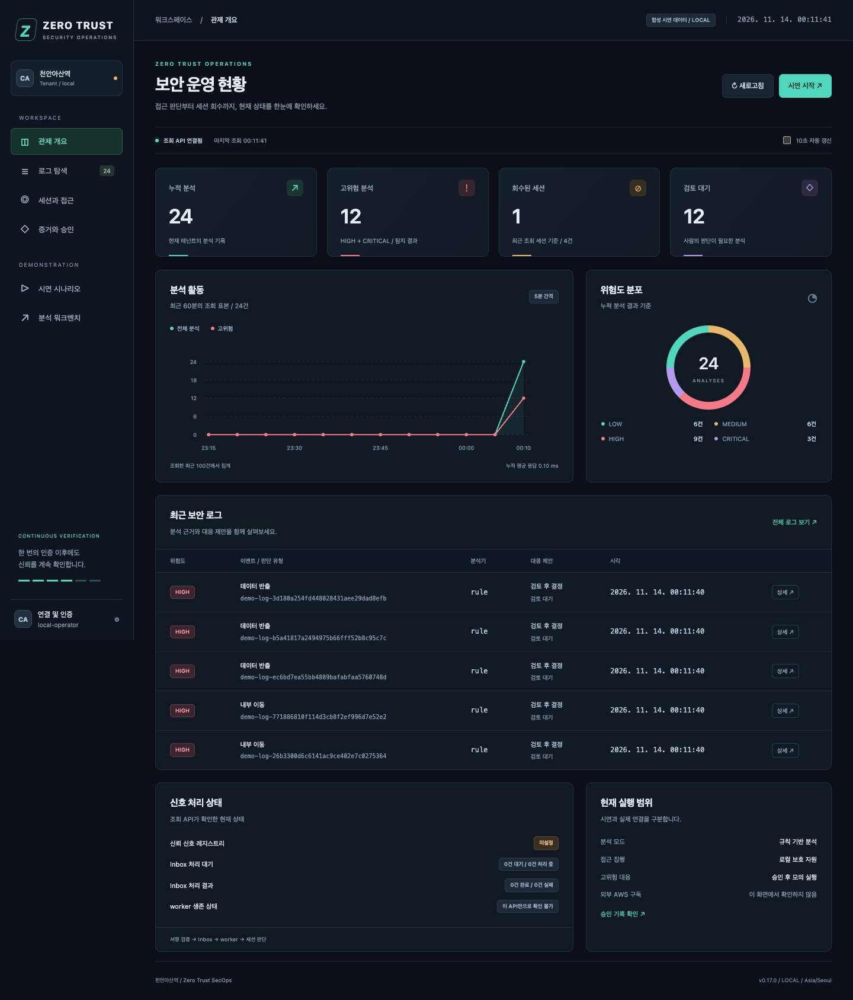
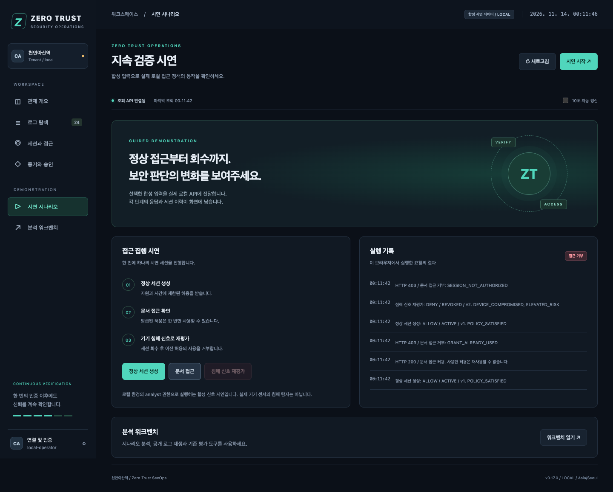

# 관제 대시보드와 로컬 시연

`aitest`의 PR #57 병합 커밋 `07ef9cc`에서 `feature/kim-dashboard`를 분리했다.
이번 변경은 화면과 조회 연결이다. 탐지 규칙, F1 개선, 승인 정책, 복원 절차는 변경하지 않는다.
기존 분석 화면은 `/static/workbench.html`로 유지하고 새 대시보드를 `/`에 제공한다.



## 화면 구성

| 화면 | 보여주는 내용 | 범위 |
| --- | --- | --- |
| 관제 개요 | 분석 수, 위험도, 검토 대기, 세션 회수, 분석 활동, Inbox 상태 | 서버가 반환한 현재 테넌트 기록 |
| 로그 탐색 | 검색, 위험도, 분석기, 검토 상태, 페이지 이동, 근거와 원문, JSON 내보내기 | 최근 100건 내 검색과 필터 |
| 세션과 접근 | ALLOW, STEP_UP, HOLD, DENY와 버전별 이력 | API가 반환하는 최근 세션 |
| 증거와 승인 | 행위 문맥 이력, 대응 요청, 검토자와 승인 수, 모의 실행 결과 | 현재 신원에 허용된 읽기 전용 조회 |
| 시연 시나리오 | 정상 세션 생성, 한 번의 접근, 재사용 거부, 침해 신호와 회수 | 실제 로컬 정책 API에 합성 신호 입력 |
| 분석 워크벤치 | 기존 시나리오 분석, 공개 로그 재생, 평가 도구 | 이전 화면의 기능 유지 |

누적 분석 수와 위험도 분포는 `/metrics`의 누적 집계다. 활동 차트는 조회한 최근 100건 중
최근 12개 5분 구간의 표본이며 마지막 구간은 진행 중이다. 회수 세션 수도 조회 표본 기준이다.
이 숫자를 탐지 정확도, F1 또는 전체 운영 환경의 처리량으로 해석하지 않는다.
worker의 프로세스 생존과 AWS 구독 상태는 이 조회 API만으로 확인하지 않는다.
로그 표와 상세는 연월일을 함께 표시하며 화면 하단의 브라우저 시간대를 따른다.
내보낸 JSON은 서버가 반환한 원래 시각과 오프셋을 보존한다.

## 별도 시연 환경 실행

프로젝트의 개발 의존성을 설치한 상태에서 저장소 루트에서 실행한다.

```bash
.venv/bin/python -m scripts.serve_dashboard_demo --seed
```

브라우저에서 `http://127.0.0.1:8765`를 연다. `127.0.0.1`에만 바인딩한다.
기존 `.env.local`과 상속된 앱 설정을 사용하지 않고 규칙 분석, JSONL, 별도 SQLite 파일로 시작한다.
모델 API, 클라우드 저장소, 외부 대응 시스템은 호출하지 않는다.

`runtime/dashboard-demo`에 분석 24건, 정상 및 제한 상태 세션 4개, 미승인 대응 요청 1개를
기존 API로 생성한다. 임의의 탐지 결과나 승인 결과를 화면에 삽입하지 않는다.
상단에 **합성 시연 데이터 / LOCAL**을 표시한다. 대응 요청은 5분 후 만료되므로 시간이
지나면 EXPIRED로 바뀌는 것이 정상이다. 두 사람의 승인을 대신 만들지 않는다.

Ctrl+C로 종료한 후 같은 명령을 실행하면 기존 기록을 보존하고 시드 데이터를 중복 생성하지 않는다.
새 시연 기록이 필요하면 새 경로를 지정한다.

```bash
.venv/bin/python -m scripts.serve_dashboard_demo --seed --data-dir runtime/dashboard-demo-next --port 8766
```

기존 파일이 있는 외부 폴더에는 시작하지 않는다. 시드 생성 중 중단된 폴더도 자동으로 덮어쓰지
않으며 새 폴더 사용을 안내한다. 기존 평가 및 운영 저장소의 정리 명령은 포함하지 않는다.

## 3분 시연 순서

1. **관제 개요**에서 합성 데이터 표시와 규칙 분석 모드를 설명한다.
2. **로그 탐색**에서 위험도를 선택하고 상세를 연다. 판단 근거, 정책 제안, 검토 상태와
   정규화 원문을 보여준다. 분석 제안 자체가 외부 계정 차단을 뜻하지 않음을 설명한다.
3. **시연 시나리오**에서 정상 세션 생성 후 문서 접근을 누른다. HTTP 200을 확인한다.
   같은 버튼을 다시 누르면 HTTP 403, `GRANT_ALREADY_USED`가 기록된다.
4. 다시 **정상 세션 생성**을 누른다. 이번에는 문서 접근 전에 **침해 신호 재평가**를 누른다.
   DENY / REVOKED를 확인한 뒤 문서 접근을 누르면 아직 사용하지 않은 이전 허용도 HTTP 403,
   `SESSION_NOT_AUTHORIZED`로 거부된다.
5. **세션과 접근**에서 해당 세션의 v1과 v2 이력을 보여준다. **증거와 승인**에서 대응 요청과
   실제 승인 수를 확인한다. 모의 대응과 실제 외부 집행을 구분한다.



접근 허용은 시간 제한도 있으므로 생성 직후 단계를 실행한다. 만료된 토큰의 거부를 회수 검증으로
소개하지 않는다. 이 시연의 기기 침해는 합성 입력이며 실제 센서 탐지 또는 AWS 경보 수신이 아니다.

## 인증과 오류 처리

기존 앱을 실행하면 기존 API 인증 설정을 그대로 따른다. **연결 및 인증**에서 하나의 API 키 또는
Bearer 토큰을 입력한다. 신원과 테넌트, 유효 역할은 새 읽기 전용 `GET /auth/me`가 기존
`get_principal` 및 viewer 권한 검사를 통해 반환한다. 입력한 사용자 이름으로 신원을 만들지 않는다.

키와 시연용 grant는 해당 페이지의 메모리에만 보관한다. URL, 콘솔, localStorage,
sessionStorage에 기록하지 않는다. 페이지 이동이나 새로고침하면 다시 인증해야 한다.
인증 변경 시 화면 데이터, 상세, 시연 토큰을 지우고 진행 중인 요청을 취소한다.
이전 신원의 늦은 응답은 적용하지 않는다. mTLS 전송 신원과 gateway 경로 제한은 변경하지 않는다.
기존 gateway가 `/auth/me` 또는 화면 경로를 제공하지 않으면 조회 실패를 표시하며 우회하지 않는다.

401, 403, 503, 네트워크 오류, 잘못된 응답 형식은 빈 성공 결과와 구별한다.
실패한 영역은 이전 값을 정상 값처럼 유지하지 않는다. 조회는 10초마다 갱신하며 비활성 탭에서는
자동 조회를 멈춘다. 요청이 진행 중이면 중복 조회를 만들지 않고 12초 후 시간 초과로 처리한다.

로그 문자열은 텍스트 노드로 표시한다. 원문 보기와 내보내기에서는 token, secret, password,
authorization, API key, signature, cookie 이름을 가진 필드를 가린다. 이 처리는 업무 내용 전체의
비식별화를 보장하지 않으므로 내보낸 로그는 필요한 범위로만 공유한다.

승인 및 모의 실행 버튼은 추가하지 않았다. 서로 다른 검토자의 신원 확인과 승인은 기존 API를
따른다. 분석 워크벤치는 기존 로컬 시뮬레이션 화면이며 새 대시보드의 인증 메모리를 공유하지 않는다.

## 검증 재현

```bash
.venv/bin/python -m ruff check .
.venv/bin/python -m pytest -q
```

브라우저 검증은 앱 의존성과 분리해서 설치할 수 있다. 아래는 macOS에서 설치된 Chrome을 사용하는 예다.

```bash
python3 -m venv runtime/dashboard-browser-tools
runtime/dashboard-browser-tools/bin/python -m pip install --only-binary=:all: --require-hashes -r infra/runtime/requirements/browser.lock
runtime/dashboard-browser-tools/bin/python -m scripts.test_dashboard_browser --app-python .venv/bin/python --browser-channel chrome
```

CI는 고정된 Python 의존성과 별도 브라우저 잠금 파일로 Chromium을 설치한다.
실제 로컬 API, 검색과 상세, 내보내기, 200/403 접근, 401/403/503 실패, 잘못된 응답,
저장된 HTML 문자열, 신원 변경 중 늦은 응답, 인증 저장 방지, 재시작과 중복 시드 방지,
390/768/1440px 화면을 검사한다. 결과 JSON과 화면 캡처는 CI의
`dashboard-browser-evidence` artifact에서 확인한다. HTTP 오류와 악성 문자열 검사는 명시적
브라우저 모의 응답이며 정상 접근, 재사용 거부, 회수 거부는 실제 API 결과다.

## 병합할 때

현재 작업은 `feature/kim-dashboard`에 보관하고 `aitest` 대상으로 검토한다.
`main` 병합과 `extra`의 F1 개선을 이 변경에 포함하지 않는다.
백엔드 변경은 `app/dashboard_api.py`와 `app/main.py`의 router 등록 2줄뿐이다.
팀장 쪽에서 API나 인증 경로를 변경했다면 합친 커밋에서 브라우저 CI와 전체 CI를 다시 실행한다.
이번 화면 검증을 독립적인 탐지 성능 평가나 운영 배포 승인으로 대체하지 않는다.
