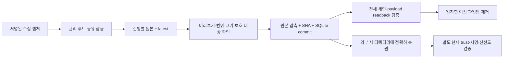

# 실행 캡처 무손실 보관·복원 — v72

2026-11-14. 인프라 담당 범위에서 [v71 수집 신선도](extra-collector-freshness.md)의 실행별 파일 누적 문제를 보강했다.
시작 조건인 [PR65](https://github.com/cheonan-asan-sta/zero-trust-llm-secops/pull/65)의 기준 커밋4142d49에 대해 **CI16개 모두 성공**을 확인한 뒤 별도 이름 브랜치에서 구현했다. 해당 CI unit은5,325통과·2skip·2warnings다.

최종 동일 소스 스냅샷에서 **관련384개·실제 systemd32조건 통과**, 기존1,681,815행 결정 SHA 동일을 확인했다.
유료 API/AWS 호출0. 탐지 규칙·LLM·업무 정책·라벨·PEP와 앱 대기열의 기존 execution_archive는 변경하지 않았다.

## 개선 전후와 범위

| 항목 | v71 | v72 |
|---|---|---|
| 실행별 capture.json | 실행마다 누적, 정리 운영 미구현 | 오래된 관리 대상만 SQLite에 원본 바이트 그대로 압축 보관 |
| 최신 관측 | 원자적 latest 게시·현재 trust 재검증 | latest 원본과 최신 관측을 보호하며 수집기/정리기 공유 잠금 |
| 원본 제거 | 제공하지 않음 | DB commit·전체 검증·해당 payload readback 이후에만 해당 파일 제거 |
| 실행기 중단 | 신선도 ledger 재시작 검증 | commit 직후/파일 unlink 직후 실제 프로세스 종료 후 중복 없는 재개 |
| 감사 복원 | hot 원본 직접 확인 | 관리 루트 바깥 새 디렉터리에 byte-exact 복원, 신선도 갱신 없음 |
| 용량 초과 | 실행 파일 누적 | 관리 hot 수/바이트·archive 행/원본 바이트 한도, 초과 시 원본 보존·pressure 보고 |

대상은 Linux의 `/var/lib/secops-evidence/<instance>` 관리 캡처다. 형식·범위가 맞는32자리 소문자 hex 실행 디렉터리의 단일 capture.json만 취급한다.
다른 파일/추가 파일/외부 범위/링크는 보존하고 skipped로 집계한다. 전체 디스크, 다른 컨테이너, 팀원의 앱 저장소를 청소하는 기능이 아니다.

## 저장 흐름과 신뢰 경계



보관기는 envelope/event/runtime proof의 구조·tenant/server/unit/source·event SHA/PID 결합을 검사한다.
**보관 자체는 과거 서명의 현재 유효성이나 사람 신원·업무 인가를 검증하지 않는다.** 폐기/만료 키의 과거 증거도 원래 바이트로 보존해야 하므로 새로운 서명이나 현재 시각을 붙이지 않는다.
복원 출력에는 authenticity_or_freshness_asserted=false를 명시한다. 현재 사용 여부는 기존 모니터/정책 소비자가 별도로 재검증한다. 실제 시험에서 복원한 과거 유효 캡처는 capture_regression으로 거부됐다.

원본/압축 SHA와 행 순서의 로컬 해시 체인을 검증한다. 이것은 손상 탐지이며 관리자에 의한 재계산·DB 전체 rollback·호스트 장악을 방지하는 원격 증명이 아니다.
압축은 암호화가 아니며 unlink도 보안 삭제가 아니다. 파일시스템 권한과 별도 백업/암호화 운영이 필요하다.

## 잠금·보관·중단 후 복구

관리 루트는 실행 계정 소유0700, lock/DB는0600·정규 파일·hardlink1개만 허용한다. Linux flock 대기는 최대5초다.
수집기는 `--latest`의 부모가 실행 디렉터리의 부모와 같을 때 같은 잠금으로 게시하며, 잠금 대기 후 현재 trust와 신선도를 다시 검사한다. 기존 단발 출력 경로는 호환한다. 보관은 이 협력형 관리 레이아웃에서만 지원한다.

기본 미리보기는 캡처/latest/보관 payload를 바꾸지 않고 DB가 없으면 생성하지 않는다. **협력 잠금을 위해0바이트 lock 파일은 생성할 수 있다.**
apply는 임시 DB에 유효 스키마를 먼저 commit한 뒤 원자적으로 DB를 게시한다. 원본 바이트를 zlib 압축하고 synchronous=FULL 트랜잭션으로 기록한 뒤 전체 검증과 대상 payload readback을 마쳐야 원본을 제거한다.
파일은 dirFD/O_NOFOLLOW로 열어 내용·inode·mtime·크기·link 수를 다시 확인한다. 해당 capture.json 하나와 비어 있는 소유 실행 디렉터리만 제거하며 재귀 삭제하지 않는다.

DB와 파일시스템 정리는 하나의 원자적 트랜잭션이 아니다. 중단 시 중복 원본 또는 pending 상태가 남고 재실행으로 마무리한다.
commit 전 실패는 원본을 보존한다. commit 직후와 unlink 직후의 실제 os._exit 종료를 시험했고, 복구 후 중복 보관 없이 모든 원본 바이트를 복원했다.
손상 DB/최신 파일 부재·변경/대상 변경/추가 파일은 안전하게 중단하거나 건너뛴다. 비협력형 쓰기나 관리자 변경을 모두 원자적으로 차단한다고 주장하지 않는다.

## 사용과 운영 한도

관리 루트 소유 계정으로 프로젝트 환경에서 실행한다. root로 대신 실행해 소유권 검증을 우회하지 않는다.

```text
python -m scripts.archive_service_captures --root /var/lib/secops-evidence/<instance> --tenant <tenant> --server <server> --unit <unit.service> --source <collector>
```

기본은 preview다. 같은 명령에 `--apply`를 붙여 명시적으로 보관·정리한다. `ready`는 종료0, storage_pressure/unavailable은2다.
한 번의 batch로 한도에 도달하지 못하면 pressure가 유지되며 추가 실행/운영 조치가 필요하다. latest와 가장 최근 관측은 보호하므로 hot 최소 한도가 항상 충족되지는 않는다.

```text
python -m scripts.archive_service_captures --root /var/lib/secops-evidence/<instance> --tenant <tenant> --server <server> --unit <unit.service> --source <collector> --restore <32자리실행ID> --output <관리루트밖새디렉터리>
```

기존 디렉터리/관리 루트 내부/심볼릭 링크 출력은 거부한다. 복원은 열람용이며 latest를 교체하지 않는다.

| 설정 | 기본 | 의미 |
|---|---:|---|
| max-hot-records | 100 | 인식된 관리 hot 캡처 수 |
| max-hot-bytes | 16MiB | 인식된 관리 hot 원본 바이트 |
| max-records | 10,000 | 보관 DB 논리 행 수 |
| max-raw-bytes | 256MiB | 보관 원본의 비압축 바이트 합 |
| batch-size | 64 | 회차당 선택/미완료 정리 상한, 최대256 |

스캔은10,000항목, 개별 캡처는64KiB로 제한한다. 알 수 없는 파일은 hot 한도 계산에서 제외하므로 전체 디스크 상한이 아니다.
압축 크기·SQLite 파일 크기는 별도 보고한다. 행/원본 바이트 한도는 물리 DB 파일/journal/파일시스템 하드 쿼터가 아니다.
보관 DB가 가득 차면 자동으로 과거 증거를 지우지 않는다. 외부 보관·백업/용량 조정·보존 정책 승인 후 운영해야 한다.

[선택형 oneshot 서비스](../infra/systemd/secops-capture-archive@.service)는 전용 계정·capability0·NoNewPrivileges·PrivateNetwork·AF_UNIX로 실행한다.
개인키/토큰/자격 소켓은 필요 없다. 공용 범위 설정은 기존 collector.conf를 사용한다. 서비스는 --apply이므로 먼저 CLI preview로 확인한다.
운영에 설치하거나 자동 타이머를 켜지 않았고 상시 스케줄링은 남아 있다.

## 실제 검증 결과

| 검증 | 결과 |
|---|---|
| 관련 pytest | **384통과**, 실패/skip0. 기존353개 + 신규31개 |
| 정적 검사 | 전체 Ruff+RUF100 통과, collector/archive 두 서비스 template verify 통과 |
| 실제 systemd | Ubuntu24.04 WSL systemd255.4에서 **32조건 통과** |
| 정상 영향 | 정상 캡처4건 추가 경보0, latest 계속 fresh |
| 보관·복원 | 실제 캡처4개 중 이전3개 보관, 모든 cold payload/복원 byte-exact, hot1개 유지 |
| 과거 복원 | 이전 캡처 복원 후 최신 근거로 사용하는 시도 거부 |
| 권한·용량 | 보관 worker UID1·effective/bounding capability0·NoNewPrivileges, archive 부족 시 원본/latest 유지 |
| 중단·경쟁 | commit 전 오류·commit/unlink 후 실제 종료·동시 정리·busy lock·DB 변조·링크·추가 파일 보존 |
| 기존 결정 | **1,681,815행** 전후 결정 SHA 동일, 새 FP0·TP 손실0·정답 재열람0 |
| 환경·정리 | 동일 고정1,015개 소스, Docker network none/비root/read-only/cap drop/OOM 없음. 소유 컨테이너·실제 unit/상태/소켓/자격·WSL 스냅샷 정리 |
| 비용 | 유료 API/AWS0 |

첫 묶음 시험은383통과·1실패였다. 최신 파일 부재에서 실제 FileNotFoundError를 발생시켰는데 테스트가 ValueError를 예상했다.
누락 조건의 예상 예외를 정확히 수정했고 제품 오류를 숨기는 변경은 하지 않았다. 최종384개 전체 관련 묶음과 실제 systemd를 같은 최종 스냅샷으로 다시 실행했다.
PR65의5,325개는 이전 기준 CI이며 이번 새 소스 전체 재실행으로 바꾸지 않는다.

실제 시험의 관리 hot 원본5772B에서 이전3개 원본4329B를 압축 payload 2466B로 보관했다.
**SQLite DB 파일은 16384B**이며 남은 hot1443B를 합하면 이 작은 시험의 전체 파일 크기는 오히려 커진다. latest/lock와 파일시스템 메타데이터도 별도다.
따라서 압축률을 전체 디스크 절감률로 표시하지 않는다. 대규모 반복 실행의 실제 용량/지연 측정과 외부 보관은 후속이다.

실제 운영 계정을 만들지 않고 기존 정적 fixture daemon UID1을 썼으며 경로/계정은 로컬 값으로 치환했다.
수집기 capability는 기존 필요 권한을 유지하고 보관 worker만0이다. 키 공급자/수집기 기존 제어도 함께 검증했다.
31초 신선도/시계 역행은 실제 서명 캡처를 쓰는 별도 모니터 ledger의 제어 시각 시험이며 OS 시계를 바꾸지 않았다.

## 기존 오탐·미탐 비교

고정한 v67 개발 기준선의 예측을 재검증했고 과거 로그에 실행 주체·정책을 소급 생성하지 않았다. 새 독립 성능 평가는 아니다.

| 항목 | F1 이전→이후 | FP 이전→이후 | FN 이전→이후 |
|---|---:|---:|---:|
| 공유 서버 감사 | 0%→0% | 24→24 | 6→6 |
| 웹 서버 감사 | 70.77%→70.77% | 37→37 | 1→1 |
| 인증 | 95.08%→95.08% | 0→0 | 3→3 |

정상4건의 추가 경보0은 기능 검증이며 운영 FPR0%나 독립 F1 목표 달성이 아니다. 이번 인프라 보관은 미탐을 해결하는 탐지 개선으로 기록하지 않는다.

## 남은 작업·근거

상시 수집/보관 타이머·대규모 용량/지연·외부 보관/백업복구·보존 정책·파일시스템 물리 쿼터,
운영 계정/키 공급자 HA, 짧은 실행의 kernel EXECVE/SYSCALL 근거, 실제 조직 SSO/사람 로그인·독립 PDP/앱 연결, 신규 독립 정상·위협 평가가 남아 있다.
이번에는 수집 캡처의 로컬 보관·복원까지만 인수했으며 운영 배포나 담당 외 정책·LLM·대시보드 완료로 표시하지 않는다.

- [공개 CI/검증/지문 JSON](infrastructure-results/extra-capture-archive-v72-20261114.json)
- [보관 구현](../scripts/f1_lab/capture_archive.py), [공유 잠금](../scripts/f1_lab/capture_store.py), [단위/중단 시험](../tests/test_capture_archive.py), [실제 systemd 실행](../scripts/run_capture_archive.py)
- [SQLite atomic commit](https://www.sqlite.org/atomiccommit.html): DB commit과 파일시스템 정리의 경계.
- [Python flock](https://docs.python.org/3.12/library/fcntl.html#fcntl.flock), [dirFD unlink](https://docs.python.org/3.12/library/os.html#os.unlink): 협력 잠금과 특정 디렉터리 기준 파일 제거.
- [systemd 실행 제한](https://www.freedesktop.org/software/systemd/man/latest/systemd.exec.html): 별도 보관 worker의 권한/네트워크 제한.
