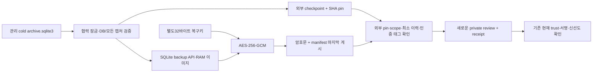

# 캡처 보관 DB 암호화 백업·격리 복원 — v75

2026-11-14. [v74 경보 연결](extra-collector-alerts.md) 후 다음 인프라 작업인 캡처 보관 DB 백업·복원을 구현했다.
기준 aitest **0892117의 CI16개 성공**, 단위5,395통과·2skip을 확인했다. 별도 담당자 브랜치에서 구현했고 비용 없는 로컬 시험으로 검증했다.

## 완료 결과

**관련552개·실제 systemd63조건 통과**, 기존1,681,815행 판정 SHA 동일·새 FP0·TP 손실0이다. 유료 API/AWS 호출0.
이번에는 새로운 cold archive.sqlite3 백업을 다룬다. 기존 CA/DB 백업과 웹 증거 원장은 그대로 이용 범위를 구분한다.
활성 hot/latest 캡처·신선도 ledger·서명/복구키·정책/앱 DB는 패키지에 넣지 않는다. 전체 운영 상태의 재해 복구가 아니다.

| 구분 | 구현 |
|---|---|
| checkpoint | 원본 보관 DB의 scope SHA·기록 수·원본 바이트 합·체인 head를 외부 파일로 내보내고 SHA pin 제공 |
| backup | 일관된 SQLite 백업 이미지를 RAM에서 생성·검증하고 별도 AES-256-GCM 복구키로 암호화 |
| restore | manifest SHA·최소 checkpoint·복구키·scope/이력/DB 검증 후 새로운0700 review 경로에만 복원 |
| verify | 외부 receipt SHA와 checkpoint를 다시 적용해 복원 DB의 SHA·개수·head를 재검증 |
| 실제 서비스 | capability0·비root·격리 network의 선택형 oneshot, 별도 capture-backup-key 자격 사용 |

## 제로트러스트 보관·복원 흐름



기존 캡처 검증기·잠금·canonical JSON, 웹 원장 백업에서 사용한 SQLite backup API/AES-GCM 방식과 기존 systemd 자격 공급자를 활용했다.
원본은 OS 소유자/0700·DB0600·정규 파일·link 수를 확인한다. 공유 잠금으로 협력형 수집/보관 작업과 조정하고 원본 DB는 읽기 전용 연결로 연다.
SQLite backup API로 RAM 복사본을 만들고 스키마 종류·quick_check·모든 압축 캡처와 체인/개수/바이트를 재검증한다. 임의 view/trigger/추가 객체를 거부하고 SQL 진행 시간·셀 길이·확장 로드를 제한한다.
원본 DB 파일과 SQLite 복사본의 페이지 헤더까지 같은 바이트라고 전제하지 않는다. 이미지 SHA와 캡처 원본 바이트를 각각 확인한다.

AES-GCM nonce는 매번 새12바이트 난수다. scope/checkpoint·생성 시각·원본 위치·DB SHA·키 ID를 AAD로 결합한다.
manifest와 암호문은0600이며 메타데이터는 암호화되지 않는다. 복구키는 포함하지 않는다. 생성용 DB 복사본은 RAM이며 복원 후 review DB는0600 평문이다.

파일은 private 임시 파일에 완전히 쓰고 fsync한 다음 동일 파일시스템 hardlink로 기존 대상을 덮어쓰지 않고 게시한다. 임시 링크를 제거하고 디렉터리를 fsync한다.
manifest는 암호문 뒤에, restore receipt는 review 상태 뒤에 게시한다. 중간 종료의 추가 임시 파일/link 수·불완전 inventory·없는 receipt는 검증에서 거부한다.
완료되지 않은 출력은 보존하고 같은 경로를 덮어쓰거나 자동 활성화하지 않는다. 새 경로로 재시도하고 기존 부분 결과는 별도 확인해야 한다.

## 외부 pin과 rollback 경계

checkpoint/manifest/receipt SHA는 **복원할 패키지 밖에서 별도로 보존한 값**을 사용한다. 파일 내용에서 읽은 SHA를 무조건 현재 기준으로 채택하지 않는다.
checkpoint 생성 시 --previous-checkpoint/--previous-checkpoint-sha256을 주면 이전의 최소 이력·시각을 만족해야 새 checkpoint를 만든다.
백업은 지정한 checkpoint와 정확히 같은 현재 head를 요구하므로 보관 기록이 추가됐으면 새 checkpoint가 필요하다.
복원은 현재 외부 checkpoint 이상의 기록 수와 해당 prefix의 체인 head·바이트 합을 요구한다. 같은 개수의 다른 이력도 거부한다.
동일한 이력을 나중에 다시 확인한 checkpoint는 그 이력을 담은 기존 백업을 검증할 수 있다. 시간만 새로 확인했다고 기록이 새로 생기는 것은 아니다.

이 검사는 운영자가 보존한 최종 pin을 전제로 한다. 원격 WORM·서명된 외부 witness·호스트 장악/최종 pin 전체 rollback 방지나 물리 호스트 신원을 증명하지 않는다.
과거 관측 시각·서명·키 유효기간·회수 상태를 갱신하지 않는다. 보관 검증은 현재 사용자의 인가 재인증이 아니다.
복원본에는 latest.json이나 활성 수집 구성을 만들지 않으며 automatic_activation_allowed=false를 명시한다.

## CLI 사용과 키 분리

Linux의 관리 루트 소유 계정으로 실행한다. checkpoint·백업·복원 출력의 부모는 별도0700 디렉터리로 미리 준비한다.
checkpoint 파일은 소유자0600이며 패키지·원본 관리 루트와 별도로 보존한다. pin을 저장하는 설정/운영 원장은 별도로 관리한다.

```text
python -m scripts.capture_archive_backup checkpoint --tenant <tenant> --server <server> --unit <app.service> --source <collector> --root <관리루트> --output <외부체크포인트.json>
python -m scripts.capture_archive_backup backup --tenant <tenant> --server <server> --unit <app.service> --source <collector> --root <관리루트> --checkpoint <체크포인트> --checkpoint-sha256 <외부SHA> --key-id <복구키ID> --output <새백업디렉터리>
python -m scripts.capture_archive_backup restore --tenant <tenant> --server <server> --unit <app.service> --source <collector> --backup <백업디렉터리> --manifest-sha256 <외부SHA> --checkpoint <현재체크포인트> --checkpoint-sha256 <외부SHA> --key-id <복구키ID> --output <새격리디렉터리>
python -m scripts.capture_archive_backup verify --tenant <tenant> --server <server> --unit <app.service> --source <collector> --checkpoint <현재체크포인트> --checkpoint-sha256 <외부SHA> --receipt-sha256 <외부receiptSHA> --output <복원디렉터리>
```

backup/restore는 기본으로 **stdin의 정확한32바이트** 복구키를 받는다. 키를 argv·환경·문서에 넣지 않는다. checkpoint/verify는 복구키가 필요 없다.
--systemd-credential은 별도 **capture-backup-key** 이름만 읽고 runtime-key로 대체하지 않는다. 기존 runtime-key 기본 호출은 유지한다.
실제 키 보관·복구·회전/버전 배포는 운영자가 준비할 별도 범위다. 시험은 별도 난수 키를 RAM에서 생성했으며 API 키 파일을 읽지 않았다.

[선택형 서비스](../infra/systemd/secops-capture-backup@.service)는 별도 root 전용 Unix 자격 공급 소켓을 사용한다. 개인키/복구키를 일반 디스크 파일로 제공하도록 요구하지 않는다.
systemd가 만든 읽기 전용 메모리 자격 사본은 사용한다. 공개 capture-backup.conf의 키 ID·checkpoint 절대 경로·SHA pin은 운영 설정으로 검토해야 한다.
원본과 checkpoint 디렉터리는 read-only이고 기존 .capture-store.lock 파일만 쓰기 예외다. 백업 출력 StateDirectory만 쓰기 가능하며 실제 운영에 설치/활성화하지 않았다.
자동 checkpoint 갱신/백업 timer는 제공하지 않는다. 최소 이력 pin을 무조건 자동 갱신해 rollback을 숨기지 않는다.

## 한도·실패와 복원 검토

- SQLite 이미지 최대64MiB, 암호문은 그 크기+16바이트다. 초과하면 잘라내지 않고 거부한다.
- 전용 백업 부모 디렉터리는 협력 잠금 아래 최대16항목을 허용한다. 완료/불완전 출력과 알 수 없는 항목도 예산을 차지하며 자동 삭제하지 않는다. lock 파일만 집계에서 제외한다.
- source 잠금 대기는 최대5초, SQLite 복사/읽기 VM 진행 시간은20초 한도를 적용한다. 서비스 전체 시작 제한은60초다. 전체 파일시스템 하드 쿼터나 실행 시간 SLO는 아니다.
- 원본 cold DB가 아직 없거나 복구가 필요한 hot journal 상태이면 먼저 원래 보관 작업을 확인해야 한다. hot-only 자료가 이 백업에 들어갔다고 판단하지 않는다.
- 복원은 기존 경로·원본 위치 내부/상위·패키지/체크포인트 경로와 겹칠 수 없다. 원본 DB가 사라져도 manifest와 외부 pin·복구키만으로 새 격리 경로에 복원할 수 있다.
- verify 후 review/archive.sqlite3의 캡처는 기존 archive restore CLI로 별도 새 경로에 추출할 수 있다. 사용 전 현재 서명/권한/신선도는 원래 소비자가 다시 확인한다.

기존 archive ready 지표는 이 백업의 성공을 증명하지 않는다. 현재 백업 명령의 반환값·manifest/receipt pin과 검증 결과를 확인한다. 백업용 경보·일정·원격 저장 운영은 후속이다.

## 최종 로컬 검증 결과

| 검증 | 결과 |
|---|---|
| 관련 pytest | **552개 통과**, 신규 백업38개·자격 이름/분리3개 포함 |
| 정적 검사 | 전체 Ruff+RUF100 및 backup 포함 서비스/timer template verify 통과 |
| 실제 systemd | **63조건 통과**, 기존53+새 백업10 |
| 원본 DB 유실 모형 | 소유 시험 DB를 임시로 사용할 수 없게 한 상태에서 복원/verify/캡처 추출 성공, 이후 원본 위치·내용 복구 |
| 원본 바이트 | 실제 보관 캡처6건 모두 복원 바이트 동일, 원본 DB/latest 내용 불변 |
| 과거 근거 | 추출한 과거 캡처가 fresh로 사용되지 않음 |
| 자격·권한 | 실제 worker 비root UID1·effective/bounding capability0·NoNewPrivileges, 별도 복구 자격은 root manager만3회 수신 |
| 공급자 장애 | 키 소켓 중단 시243/CREDENTIALS, 새 패키지 게시 없음. 잘못된 키 복원 시 출력 상태 없음 |
| 실제 프로세스 중단 | 암호문/manifest·복원 state/receipt 게시 전후6지점 os._exit. 불완전 결과 거부·완료 결과 재검증 |
| 거부·한도 | 변조/잘못된 pin·scope·이력·키, 링크/추가 객체, unsupported SQLite schema, 원본/기존 경로 중첩, 패키지/DB 한도 거부 |
| 기존 판정 비교 | **1,681,815건** 결정 SHA 동일·새 FP0·TP 손실0·정답 재열람0 |
| 정상 기능 영향 | 단발5건+timer 선택4건, 추가 탐지 경보0 |
| 비용·정리 | API/AWS0, 소유 container/unit/state/자격 socket/WSL snapshot 정리, OOM 없음 |

동일 고정1,041개 소스 스냅샷에서 관련 시험·원래 판정 비교·실제 systemd를 실행했다. Docker는 network none·비root·read-only·cap drop이다.
WSL systemd는 기존 정적 fixture daemon UID1과 치환 경로를 썼고 실제 서비스 계정을 만들지 않았다. 서비스 제한은 유지하며 소유 fixture의 기존 가속 timer/대상 시간 설정을 따른다.
복구키는 RAM과 systemd 메모리 자격 사본으로만 전달했고 실행 DB·백업 패키지·원본 캡처·키는 GitHub에 올리지 않는다.
이 시험은 운영 키 보관/다중 호스트 HA·실제 조직 SSO·독립 위협 성능 평가를 대신하지 않는다.

## 기존 오탐·미탐 비교와 다음 작업

| 항목 | F1 이전→이후 | FP 이전→이후 | FN 이전→이후 |
|---|---:|---:|---:|
| 공유 서버 감사 | 0%→0% | 24→24 | 6→6 |
| 웹 서버 감사 | 70.77%→70.77% | 37→37 | 1→1 |
| 인증 | 95.08%→95.08% | 0→0 | 3→3 |

이는 유지된 개발 기준선이며 백업 성공을 탐지 품질 목표 달성으로 환산하지 않는다. 과거 로그에 실행 주체·정책을 소급 생성하지 않았다.
다음 우선 작업은 **지속 부하·용량·장애 검증**이다. 운영 백업키/최종 pin 보관·원격 백업/보존·물리 쿼터·timer/경보, 실제 지속 mTLS 설정/lock 활성화, kernel 실행 이력·조직 SSO/앱 연동과 새 독립 평가는 남아 있다.

- [공개 결과·소스/판정 지문](infrastructure-results/extra-capture-backup-v75-20261114.json)
- [백업 구현](../scripts/f1_lab/capture_backup.py), [CLI](../scripts/capture_archive_backup.py), [단위/프로세스 종료 시험](../tests/test_capture_backup.py), [실제 systemd 시험](../scripts/f1_lab/capture_backup_runtime.py)
- [Python SQLite backup API](https://docs.python.org/3.12/library/sqlite3.html#sqlite3.Connection.backup), [AES-GCM API](https://cryptography.io/en/latest/hazmat/primitives/aead/#cryptography.hazmat.primitives.ciphers.aead.AESGCM): 일관된 DB 복사와 인증 암호화에 사용했다.

후속 부하·용량·장애 시험과 8시간 장기 검증의 미완료 범위는 [v76 결과](extra-capture-load.md)를 따른다.
