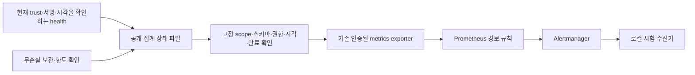

# 수집 상태·보관 용량 경보 연결 — v74

2026-11-14. 인프라 담당 범위의 [v73 주기 실행](extra-collector-schedule.md)에 집계 상태 게시와 기존 exporter/경보 규칙의 선택형 연결을 추가했다.
유료 API/AWS 호출0. 탐지 규칙·LLM·라벨·업무 정책·PEP는 변경하지 않았다.

## aitest 통합과 발견한 시험 문제

사용자 요청에 따라 PR61~67의 각 CI16개 성공·충돌 없음·검증 소스 일치를 확인하고, PR 대상을 aitest로 정리해 순서대로 merge commit으로 병합했다.
최종 기준은 **71b4050**이며 파일 트리는 PR67의4471ee5와 완전히 같다. PR 기록과 원래 브랜치를 유지했고 팀원의 대시보드 PR59는 변경하지 않았다.

병합 후 CI43577241225의 unit은 **1실패·5,359통과·2skip**였다. 보관 변조 시험이 임의 디렉터리 순서의 첫 파일을 삭제 대상으로 가정했지만, 그 파일이 실제 보관 선택에 포함되지 않을 수 있었다.
그 경우 삭제를 시도하지 않는 제품 동작은 맞으므로 테스트가 예외를 기대하면 안 된다.
[수정 PR68](https://github.com/cheonan-asan-sta/zero-trust-llm-secops/pull/68)은 원본 관측 시각으로 실제 보관 대상3개를 각각 선택하고, 변조된 hot 파일 보존과 commit된 원본 바이트 복원을 함께 검사한다.
별도 오프라인 Docker33개 시험을 통과했다. 성공이 나올 때까지 같은 CI를 반복하는 대신 이 순서 의존성을 수정했다. PR68과 그 이후 aitest의 최종 CI 상태는 해당 PR/실행 기록을 따른다.

## 구현 흐름



선택형 systemd drop-in을 설치하면 health/archive worker가 /var/cache/secops-capture-status/<instance>-health.json 및 <instance>-archive.json을 원자적으로 게시한다.
원본 캡처/ledger는 기존0700을 유지하고, 별도 집계 cache 디렉터리만0755·집계 파일0644로 제공한다. 임시 파일/fsync/replace/디렉터리 fsync를 사용한다.
기존 파일의 scope/kind/시각·정규 파일/link 수를 확인하며 잘못된 대상이나 시계 후퇴를 덮어쓰지 않는다. 교체 후 fsync 오류는 게시 완료 여부가 불확실할 수 있다.

집계에는 scope SHA·확인/관측/만료 시각·상태·제한된 개수/바이트만 들어간다. 실제 tenant/server/unit 이름·명령·캡처·키·토큰은 내보내지 않는다.
공개 집계는 압축 보관소나 원본 증거의 대체물이 아니며, 로컬 파일 작성자와 설정 관리자를 신뢰하는 **서명 없는 운영 관측값**이다. 관리자 위조·저장소 전체 rollback을 방지하는 원격 증명이 아니다.

health 게시 직전에 같은 캡처의 현재 trust·서명·내용을 다시 확인한다. scrape 측은 보고서의 범위·형식·파일 권한·미래 시각과 유효기간을 확인한다.
health 보고서는25초 후 만료되며 그 전에도 캡처의 관측30초/실제 proof 만료 중 빠른 시각을 넘으면 observation_fresh를0으로 내린다. archive는180초 후 만료된다.
이는 최근 검증 보고서의 유효성이다. scrape마다 현재 공개키 레지스트리를 재검증하거나, 보고서 작성 직후의 권한 폐기를 즉시 확인하는 것은 아니다. 다음 health 실행/만료까지 관측 지연이 있다.
어떤 지표도 현재 사람 신원·업무 인가·위협 부재·접근 허용을 증명하지 않는다.

## 기존 관측 체계 연결 방법

기본 서비스에는 자동 활성화하지 않았다. 검토 후 두 서비스의 collector-metrics.conf drop-in을 설치하고 daemon-reload한다.
archive의 상태 게시 옵션은 --apply에서만 허용한다. preview/restore 결과가 실제 정리 성공 지표로 게시되지 않도록 했다.

exporter에는 --collector-profile <공개프로필.json>을 추가한다. 기존 mTLS 서버/상류 옵션과 scrape 인증은 유지한다.
monitoring_runtime_control의 선택 환경 변수 C01_COLLECTOR_PROFILE은 /collector/profile.json만 받으며 같은 CLI 옵션으로 연결한다.

```json
{
  "schema": "zt-collector-metrics-profile-1",
  "scope_sha256": "<설정한 tenant/server/unit/source의 canonical SHA256>",
  "health_file": "/collector/status/app-health.json",
  "archive_file": "/collector/status/app-archive.json"
}
```

scope SHA는 collector_status_bridge.scope_hash에 해당 ArchiveScope를 전달해 계산한다. key_id를 제외해 같은 수집 범위의 키 교체를 지원한다.
프로필은 exporter 시작 시 고정하고 변경 시 재시작한다. 프로필과 집계 디렉터리는 읽기 전용으로 마운트하고 원본 캡처·ledger·키 경로를 exporter에 마운트하지 않는다.
현재 고정 MonitoredRuntime 배포 정의에는 새 host mount/환경 활성화를 자동 추가하지 않았다. 실제 지속 mTLS 프로필에 반영하려면 해당 구성/lock과 새 마운트의 인수가 필요하다.
이번에는 옵션·drop-in·실제 로컬 관측 흐름까지 구현했으며 운영 배포 완료로 기록하지 않는다.

| 신규 경보 | 조건 | 의미 |
|---|---|---|
| C01CollectorObservationNotFresh | 활성화된 bridge의 유효한 fresh 관측 보고서 없음 | 수집 근거 확인 필요 |
| C01CollectorArchiveUnavailable | archive 보고서 없음/손상/범위 오류/만료/작업 불가 | 보관 상태 확인 불가 |
| C01CollectorArchivePressure | 현재 archive 보고서가 storage_pressure | 보관 한도·용량 운영 조치 필요 |

경보는2초 지속 후 발생한다. bridge를 설정하지 않은 exporter에서는 새 지표/경보가 생기지 않는다. health와 archive의 장애는 별도로 관측하며, 실패한 보고서의 과거 성공 개수는 다시 내보내지 않는다.
scope나 시각을 label로 늘리지 않고 worker 두 값만 사용한다. 외부 이메일/Slack 등은 연결하거나 발송하지 않았고 로컬 수신기만 사용했다.

## 검증 결과와 범위

| 검증 | 결과 |
|---|---|
| 최종 관련 pytest | **511개 통과**, 전체 Ruff+RUF100 통과 |
| 실제 systemd | 기존 수집·보관·timer 제어 포함 **53조건 통과** |
| 실제 상태 게시 | drop-in으로 유효 캡처·보관 개수 게시, 잘못된 trust는 unavailable, 보관 한도는 pressure, 올바른 설정 후 회복 |
| 원본 권한 | 캡처 디렉터리0700 유지, 집계만0755/0644, exporter에 수집키 권한 불필요 |
| 실제 관측 도구 흐름 | 캐시된 Prometheus3.15.1·Alertmanager0.34.2·인증된 로컬 수신 **13조건 통과** |
| 경보/해제 | stale·보관 pressure·파일 부재를 수신, 같은 fingerprint/시작 시각의 경보 해제 확인, 지속 장애 중 새 경보 정체성/반복 통지 없음 |
| 실제 보고자 중단 | heartbeat 중단 후 실제25초 만료 확인, 과거 fresh 유지하지 않음, 재개 후 해제 |
| 기존 판정 비교 | **1,681,815행** 결정 SHA 동일·새 FP0·기존 TP 손실0·정답 재열람0 |
| 정상 기능 제어 | 실제 단발5건+timer 선택4건, 추가 탐지 경보0 |
| 환경·정리 | Docker network none/비root/read-only/cap drop/OOM 없음, 직접 만든 컨테이너·프로세스·systemd unit/cache/상태·소켓·WSL 스냅샷 정리 |
| 비용 | 유료 API/AWS0 |

최종511개 스냅샷과 실제 systemd/관측 흐름 스냅샷의 차이는 **tests/test_capture_archive.py 한 파일**이다. app/scripts/infra 제품 바이트는 모두 같다.
실제53/13조건은 제품 코드가 같은1차509개 스냅샷에서 통과했고, 테스트 안정화 후 최종511개와 판정 대조를 실행했다. 테스트 파일만 바뀌어 실제 systemd/관측 흐름은 반복하지 않았다.

실제 systemd는 서명된 프로세스 캡처를 사용했다. Prometheus 경보 흐름은 별도의 **제어된 집계 fixture**를 이용했고 모든 HTTP 연결은 network none 컨테이너 하나의 loopback 안에 있다.
이 결과를 새 운영 mTLS 종단 간 인수로 표현하지 않는다. 실제 exporter의 기본 scrape 인증과 기존 mTLS 코드 경로를 유지하고 관련 회귀를 포함했다.
관측 도구 시작 중에는 기존 C01ExporterDown이 up 부재로 발생·해제된 기록이 있다. 준비 완료 후 신규 collector 정상 경보0과 시작 중 기존 경보를 구분한다.
기존31초/시계 역행 제어와 새 실제 시간 공백 제어의 구분은 v73을 따른다.

## 기존 오탐·미탐 비교

| 항목 | F1 이전→이후 | FP 이전→이후 | FN 이전→이후 |
|---|---:|---:|---:|
| 공유 서버 감사 | 0%→0% | 24→24 | 6→6 |
| 웹 서버 감사 | 70.77%→70.77% | 37→37 | 1→1 |
| 인증 | 95.08%→95.08% | 0→0 | 3→3 |

운영 상태 경보와 위협 탐지 오탐은 다른 지표다. 이 표는 유지된 개발 기준선이며 새 독립 평가가 아니다. 인프라 경보 연결을 F1 목표 달성으로 바꾸지 않는다.

## 다음 작업

신규 캡처 보관 DB의 백업·격리 복원, 장시간 부하/용량 검증을 다음 우선 작업으로 유지한다.
고정 지속 mTLS 프로필의 실제 마운트/lock 통합, 운영 경보 전달/대시보드, 수집키 공급자 HA, kernel 실행 이력·조직 SSO/독립 PDP/앱 연동과 새 독립 성능 평가는 남아 있다.

- [공개 검증·병합·소스/판정 지문](infrastructure-results/extra-collector-alerts-v74-20261114.json)
- [집계·만료·프로필 구현](../scripts/f1_lab/collector_status_bridge.py), [실제 systemd 제어](../scripts/f1_lab/collector_status_runtime.py), [실제 경보 흐름](../scripts/run_collector_alert_flow.py), [단위/거부 회귀](../tests/test_collector_status_bridge.py)
- [Prometheus 지표 형식](https://prometheus.io/docs/instrumenting/exposition_formats/), [경보 설계 지침](https://prometheus.io/docs/practices/alerting/): 제한된 집계 지표와 상태/용량 증상 중심의 경보·실제 전달 확인에 참고했다.
