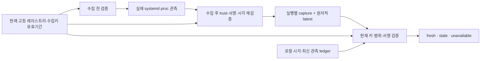

# 수집키 유효기간·관측 신선도·공급자 복구 — v71

후속 [v72 실행 캡처 무손실 보관·복원](extra-capture-archive.md)에서 보관/관리 hot 한도·중단 후 재개·정확한 복원을 검증했다. 아래353개/24조건과 보관 미구현 설명은 v71 당시 기록이다. 상시 스케줄링/운영 용량 인수는 여전히 남아 있다.

2026-11-14. 인프라 담당 범위에서 [v70 수집기 인수](extra-systemd-collector-runtime.md)를 보강했다.
시작 전 [PR64 CI](https://github.com/cheonan-asan-sta/zero-trust-llm-secops/pull/64)의 기준 커밋2f35cdb에 대해
**집계 포함16개 검사 모두 성공**을 확인했다. CI unit은5,288통과·2skip·2warnings였다.
CI 진행 중에는 신규 구현을 시작하지 않았고, 성공 확인 후 별도 이름 브랜치에서 작업했다.

이번 변경은 수집 근거의 유효성과 장애 후 복구를 다룬다. 탐지 규칙·LLM·업무 정책·라벨·PEP를 변경하지 않았다.
**동일 최종 소스 스냅샷에서 관련353개·실제 systemd24조건·기존1,681,815행 결정 유지 검증을 통과했다.**
유료 API/AWS 호출은0이다.

## 개선 전후

| 항목 | v70 | v71 |
|---|---|---|
| 수집 시 키 확인 | 키/역할/범위·활성 여부 | 키의 시작/만료 시각을 수집 전후 확인, 수집 도중 trust 변경 거부 |
| 짧은 키 유효기간 | 수집 proof 기본30초 | proof 만료를 서명 권한 만료 이내로 줄이고 다시 서명 |
| 최신 관측 위치 | 실행 회차별 capture.json | 기존 보관본과 별도로 원자적 latest.json 게시 지원 |
| 최신 근거 소비 | 두 proof를 업무 정책과 결합할 때 검증 | 별도 신선도 CLI/모니터가 현재 공개키·범위·서명·시각을 재검증 |
| 재시작·이전 파일 | 소비자가 근거를 직접 선택 | 로컬 ledger로 관측 시각 후퇴·시계 역행·같은 시각의 내용 교체 거부 |
| 공급자 장애 | 키 교체/폐기 시험 | 소켓 공급자 중단 시 이전 latest 보존, 재시작 후 새 서명 근거로 회복 |

## 제로트러스트 관측 흐름



`fresh`는 **최근에 서명된 수집 근거가 있다**는 뜻이다. 현재 프로세스가 여전히 살아 있음, 정상 기기,
실제 사람의 신원, 업무 인가, 위협 부재를 증명하지 않는다. 마지막 관측 이후 서비스가 바뀌었을 가능성은 남는다.
이 상태를 접근 허용·권한 회수·경보 해제에 단독으로 사용하지 않는다. 기존 탐지 결과는 그대로 유지한다.

## 수집 전후 확인과 게시

[collect_payload](../scripts/collect_shared_execution.py)는 고정 tenant/server/unit/source/key의 runtime/systemd 권한만 받는다.
활성 여부, 정확한 공개키와 `issued_at <= 현재 < expires_at`을 **대상 수집 전에** 확인한다.
수집 후에는 공개 레지스트리를 다시 읽어 SHA pin·내용·현재 키 유효기간이 유지되는지 검사한다.
수집 중 폐기/교체·만료가 확인되면 새 payload를 반환하지 않아 게시하지 않는다.

남은 키 수명이30초보다 짧으면 관측 시각·내용을 유지한 채 proof 만료를 키 만료 이내로 줄이고 서명을 다시 만든다.
끝난 관측을 현재 시각으로 고치거나 과거 키의 유효기간을 늘리지 않는다.
수집 후 검증과 게시 사이에 root가 설정을 바꾸는 모든 경쟁을 원자적으로 막는 것은 아니므로 소비자는 현재 trust를 다시 확인한다.

CLI의 기존 stdin/`--systemd-credential`과 실행별 출력은 호환을 유지한다.
선택형 `--latest <파일>`로 같은 서명 payload를 최신 위치에도 게시할 수 있으며 운영 템플릿은 이를 사용한다.
같은 디렉터리에0600 임시 파일을 쓰고 fsync한 뒤 os.replace하고 디렉터리도 동기화한다.
교체 전 실패 시 해당 임시 파일만 제거하며 기존 latest는 유지한다. 교체 후 디렉터리 동기화가 실패하면 새 latest가 존재할 수 있어 완료 여부는 불확실하다.
읽기 측도 정규 파일·크기64KiB·symlink 거부·전후 inode/크기/mtime을 확인한다.

실행별 보관본과 latest는 **각각의 파일 원자성**이며 두 파일을 하나의 DB 트랜잭션처럼 취급하지 않는다.
보관본 생성 후 latest 교체/디렉터리 동기화가 실패하면 부분 결과가 존재할 수 있고 CLI는 실패를 알린다.
신뢰하는 로컬 상태 디렉터리·파일시스템/운영자를 전제로 하며 분산 저장소나 하드웨어 변조 방지 저장소가 아니다.

## 신선도 모니터

[collector_freshness.py](../scripts/f1_lab/collector_freshness.py)의 `CollectorScope`, `inspect_capture`, `CollectorMonitor`를 추가했다.

| 상태 | 판단 조건 | 의미 |
|---|---|---|
| fresh | 현재 고정 공개키/권한·범위/모드·서명이 유효하고 event30초 이내·proof 미만료 | 최근 수집 근거 있음 |
| stale | 서명/현재 수집 권한 검증은 가능하나 관측/proof의 신선도 한계 초과 | 새 수집 필요 |
| unavailable | 파일/서명/키/범위 오류·현재 수집 권한 만료/폐기·시계/관측 후퇴·저장소 오류 | 현재 근거 확인 불가 |

키 자체가 만료/폐기된 경우는 stale로 신뢰를 연장하지 않고 unavailable이다.
runtime proof는 event SHA·PID·tenant/server/unit/source/key와 일치해야 하며 lab·다른 역할·추가 미승인 필드는 거부한다.
proof의 실제 관측/발급/만료 순서, event 이후5초 관측 범위, 최대30초 수명을 확인한다.
출력은 수집 근거 상태이고 별도 업무 정책 proof를 검증한 결과가 아니다.

모니터는 SQLite에 현재 확인 시각과 scope별 최신 관측 시각/event SHA만 보존한다.
재시작·동시 중복 조회를 지원하며 시계 역행, 더 과거의 유효 캡처 복원, 같은 관측 시각에 다른 event를 끼우는 경우를 거부한다.
scope 수는 기본1,000·최대10,000으로 제한한다. ledger 자체를 백업으로 되돌리거나 호스트 전체를 변조하는 공격을 막는다고 주장하지 않는다.
시계가 역행하면 자동으로 ledger를 초기화하지 않고 운영 확인이 필요하다. 보존/정리·다중 호스트 합의는 별도 인수다.

## 사용 방법

[상태 CLI](../scripts/service_capture_status.py)는 서비스 상태를 변경하지 않고 관측 파일을 검증하며 로컬 진행 ledger를 갱신한다.

```text
python -m scripts.service_capture_status --tenant <tenant> --server <server> --unit <unit.service> --source <collector> --key-id <key-id> --capture /var/lib/secops-evidence/<instance>/latest.json --registry <공개레지스트리> --registry-sha256 <고정SHA> --ledger <신뢰하는로컬경로>/freshness.sqlite3
```

fresh는 종료 코드0, stale/unavailable은2다. 출력에 authorization_checked=false와 automatic_enforcement_allowed=false를 명시한다.
모니터 계정에는 capture 읽기와 ledger 쓰기 권한이 필요하다. 수집기의 강한 capability를 모니터에 그대로 부여할 이유는 없다.
현재는 CLI/라이브러리 제공이며 대시보드·PEP·상시 스케줄러에 자동 연결하지 않았다.
수집기의 자격 소켓 공급자·계정·설치 전제는 [v70 문서](extra-systemd-collector-runtime.md)를 따른다.

## 최종 검증 결과

| 검증 | 결과 |
|---|---|
| 관련 pytest | **353개 통과**, 실패/skip0. v70 관련316개 + 신규37개 |
| 코드 검사 | 전체 Ruff+RUF100 통과 |
| 실제 systemd | Ubuntu24.04 WSL systemd255.4, **24조건 통과** |
| 정상 영향 | 실제 정상 capture4건 모두 기존 판단 유지, 추가 경보0 |
| 키 경계 | 만료/미발효 키의 새 capture0, 짧은 키 수명에 맞춘 proof 만료/서명 검증 |
| 장애·회복 | 실제 소켓 공급자 중단 시 systemd 자격 설정 실패·이전 latest 유지, 공급자 재시작 후 새 서명 관측으로 회복 |
| 재시작·복원 | 별도 로컬 ledger로 시계 역행·이전 유효 capture 복원 거부 |
| 기존 개발 결과 | **1,681,815행** 결정 SHA 동일·새 FP0·TP 손실0·라벨 재열람0 |
| 환경 | 동일 고정 소스 스냅샷, Docker network none/비root/읽기 전용 root, native는 별도 WSL manager 시험 |
| 정리·비용 | 소유 컨테이너/unit/file/설정/상태/소켓/자격 사본/WSL 스냅샷 제거, 유료 API/AWS0 |

실제 수집기는 기존 정적 fixture daemon UID1, 대상은 nobody UID65534를 사용했고 실제 운영 계정을 만들지 않았다.
설치/출력 경로·fixture 계정은 로컬 값으로 치환했다. 반복 fault 시험을 빠르게 하기 위해 **소유 시험 unit에만** StartLimitBurst=30을 적용했다.
운영 템플릿의 재시작 제한을 바꾸지는 않았다. capability/NoNewPrivileges 등 기존 제한은 유지했다.

31초 공백·시계 역행은 **실제 서명 캡처를 사용하되 별도 ledger의 모니터 시각을 주입한 제어 시험**이다.
OS 시계를 바꾸거나 실제31초 장애를 관측했다고 표현하지 않는다. 소켓 공급자 중단·재시작과 새 캡처 회복은 실제 실행이다.
353개는 관련 시험이다. PR64의5,288개 CI unit 결과를 이번 새 소스의 전체 재실행으로 바꾸지 않는다.
[공개 근거 JSON](infrastructure-results/extra-collector-freshness-v71-20261114.json)에 CI 통과 조건·소스/시험/비교 지문을 보존했다.

## 기존 지표 비교

과거 로그에는 이번 서명/호출 회차 근거가 없어 소급 생성하지 않았다. 외부 SHA로 고정한 기존 예측을 대조했고 정답을 다시 열지 않았다.
아래 값은 **그대로 유지된 v67 개발 기준선**이며 새 독립 평가가 아니다.

| 항목 | F1 이전→이후 | FP 이전→이후 | FN 이전→이후 |
|---|---:|---:|---:|
| 공유 서버 감사 | 0%→0% | 24→24 | 6→6 |
| 웹 서버 감사 | 70.77%→70.77% | 37→37 | 1→1 |
| 인증 | 95.08%→95.08% | 0→0 | 3→3 |

정상4건의 추가 경보0은 기능 검증이다. 운영 FPR0%나 독립 F1 목표 통과로 확대하지 않는다.

## 남은 인수·근거

실제 운영 전용 계정/키 공급자 HA·상시 수집 스케줄링·보관본 정리/용량 운영,
종료가 빠른 실행의 kernel EXECVE/SYSCALL 근거, 실제 조직 SSO/사람 로그인·독립 PDP/앱 연결,
새로운 독립 정상·위협 평가는 남아 있다. 이번 범위는 인프라 수집/검증이며 다른 담당자의 업무 정책·LLM·대시보드를 대신 구현하지 않았다.

- [실제 통합 제어](../scripts/run_collector_freshness.py), [단위/회귀 제어](../tests/test_collector_freshness.py).
- [Python os.replace](https://docs.python.org/3.12/library/os.html#os.replace), [fsync](https://docs.python.org/3.12/library/os.html#os.fsync): 동일 파일시스템 안에서의 파일 교체와 동기화 기준.
- [systemd 실행·자격 환경](https://www.freedesktop.org/software/systemd/man/latest/systemd.exec.html): 기존 계정/자격 공급·제한 실행 환경 유지.
