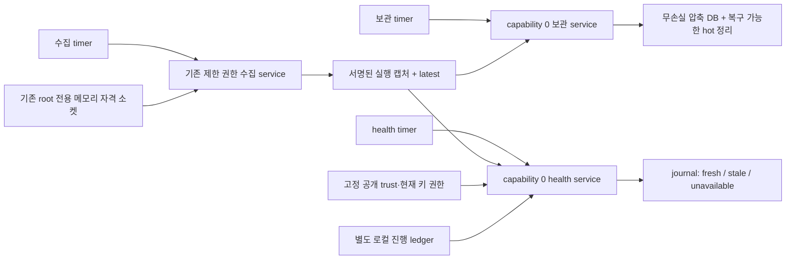

# 수집·보관·신선도 확인의 주기 실행 — v73

후속 [v74 수집 상태·보관 용량 경보](extra-collector-alerts.md)에서 선택형 집계 게시와 경보/해제 흐름을 검증했다. 아래388개/43조건과 exporter 미연결 설명은 v73 당시 기록이다.

2026-11-14. 인프라 담당 범위의 [v72 무손실 보관·복원](extra-capture-archive.md)에 선택형 주기 실행을 연결했다.
시작 전 [PR66](https://github.com/cheonan-asan-sta/zero-trust-llm-secops/pull/66)의 ba72196 기준 **CI16개 모두 성공**을 확인했다.
해당 CI unit은5,356통과·2skip·2warnings이며, 전체 성공 후 별도 이름 브랜치에서 신규 구현을 시작했다.

최종 동일 구현 스냅샷에서 **관련388개·실제 systemd43조건 통과**, 기존1,681,815행 결정 SHA 동일을 확인했다.
유료 API/AWS0. 기존 탐지 규칙·LLM·라벨·업무 정책·PEP·앱 execution_archive는 변경하지 않았다.

## 개선 전후

| 항목 | v72 | v73 |
|---|---|---|
| 수집 실행 | 단발 CLI/oneshot | 선택형 수집 timer가 회차마다 새 서명 관측 수집 |
| 보관 실행 | preview/명시적 apply | preview 검토 후 선택형 timer로 기존 무손실 apply 반복 |
| 신선도 확인 | 단발 CLI/로컬 ledger | 별도 무권한 health service/timer가 수집 실패 중에도 확인 |
| 공급자 장애 | 수동 단발 중단/재개 인수 | 타이머 자격 취득 실패·이전 latest 유지·실제 공백 후 stale·자동 회복 검증 |
| 상태 소비 | fresh/stale/unavailable | 같은 의미 유지, journal에 주기 출력하며 인가·자동 조치 불가 명시 |

## 동작과 신뢰 경계



수집·보관은 v72의 협력 잠금·현재 trust 재확인·commit/readback 후 정리 계약을 그대로 사용한다.
health는 자격 소켓을 읽지 않고 capture 경로는 read-only, 별도 상태 디렉터리의 ledger만 갱신한다.
전용 secops-collector 계정, capability0·NoNewPrivileges·PrivateNetwork·AF_UNIX를 사용한다. 실제 시험에서는 기존 daemon UID1로 치환했다.
선택형 --observe-worker-security가 요청되면 상태 CLI는 실제 worker UID/capability/NoNewPrivileges도 관측한다. 관측 실패 시 fresh 완료를 주장하지 않는다. 기존 CLI 기본 동작은 유지한다.

**fresh는 최근 서명된 관측이 있다는 뜻**이며 서비스의 현재 생존·정상 기기·사람 신원·업무 인가·위협 부재가 아니다.
health는 authorization_checked=false, automatic_enforcement_allowed=false를 출력한다. 주기 실행 결과를 접근 허용·경보 해제·사용자 차단에 단독 연결하지 않았다.
수집이 실패해도 health는 독립적으로 실행한다. 기존 파일을 현재 시각으로 다시 서명하거나 실패 시점의 관측을 소급 생성하지 않는다.

## 기본 주기와 실제 운영 범위

| timer | 시작 후 최초 | 서비스 종료 후 다음 실행 | 정확도 창/추가 지연 |
|---|---:|---:|---|
| secops-execution-collector@.timer | 2초 | 10초 | 1초/최대1초 |
| secops-capture-health@.timer | 5초 | 10초 | 1초/최대1초 |
| secops-capture-archive@.timer | 30초 | 1분 | 5초/최대5초 |

모두 oneshot과 OnUnitInactiveSec 기반의 monotonic timer다. 같은 활성 service를 동시에 복제 실행하지 않는다.
이는 고정10초 완료나30초 신선도 SLO를 보장하지 않는다. 서비스 실행 시간·대기·CPU/디스크 압력·중단/절전으로 관측 공백이 생길 수 있고 기존 모니터가 stale/unavailable로 알린다.
Persistent=no이며 달력 기반 누락 회차 catch-up을 제공하지 않는다. 재시작 시 현재 관측을 새로 수집하며 과거 회차의 증거를 만들지 않는다.
systemd의 시작 제한/타임아웃은 그대로 적용되므로 설정/용량 장애의 영구 해결이나 무한 성공을 보장하지 않는다.

운영 배포 전 기존 [수집기 계정·키 공급자 전제](extra-systemd-collector-runtime.md)를 준비하고, 공개 collector.conf와 registry SHA pin을 검토해야 한다.
프로젝트/가상환경은 /opt/secops, 관리 캡처는 /var/lib/secops-evidence/<instance>, health ledger는 /var/lib/secops-capture-health/<instance>.sqlite3다.
아래는 설치 검토를 위한 예시이며 이번에는 실제 운영 계정/설정/자동 기동을 변경하지 않았다.

```text
# 먼저 관리 루트 소유 계정으로 기존 archive CLI 기본 preview 확인
# 검토된 service/timer 파일을 설치한 운영 호스트에서만 실행
systemctl daemon-reload
systemctl enable --now secops-execution-collector@app.timer secops-capture-health@app.timer secops-capture-archive@app.timer
systemctl list-timers --all secops-*
journalctl --unit=secops-capture-health@app.service --no-pager
```

archive service는 --apply이므로 timer 활성화 전에 preview/보존 정책/복원 경로를 검토한다. 보관 DB가 차면 원본을 유지하고 storage_pressure를 보고한다.
health의 fresh는 종료0, stale/unavailable은2다. 실패 상태도 다음 timer 실행의 대상이며 실제 자격 장애 후 재개를 인수했다.
journal은 상태 기록이며 외부 경보 전달·대시보드·장기 보관 exporter는 아직 연결하지 않았다.

중단할 때는 세 timer를 disable --now하고, 실행 중인 oneshot의 종료 상태도 확인한다. timer만 중단해도 이미 실행 중인 서비스는 완료할 수 있다.
필요한 정비 중 서비스 stop은 보관 commit/정리 중단을 만들 수 있으므로 기존 v72 재개·복원 계약을 따른다. ledger를 임의 초기화해 stale/replay를 해제하지 않는다.

## 실제 검증 결과

| 검증 | 결과 |
|---|---|
| 관련 pytest | **388통과**, 실패/skip0. v72 관련384개 + 신규4개 |
| 코드/구성 | 전체 Ruff+RUF100, 서비스3개+timer3개 systemd-analyze verify 통과 |
| 실제 systemd | Ubuntu24.04 WSL systemd255.4, **43조건 통과**. 기존32개+주기 실행11개 |
| 정상 영향 | 기존 단발 정상4건+주기 실행에서 선택 검증한 정상4건, 각각 추가 경보0 |
| 실제 주기 실행 | 서로 다른 새 서명 관측 반복, health 비root/capability0, 자동 보관 원본 SHA 보존 |
| 공급자 중단 | timer의 자격 취득243 실패, 이전 latest 원본 유지 |
| 실제 시간 공백 | 마지막 관측 나이 30.123초에서 health stale. 공급자 중단 후 stale 확인까지 27.508초, OS 시각/모니터 시각 주입 없음 |
| 자동 복구 | 공급자 소켓만 복원 후 timer가 새 서명 관측 수집, health fresh 회복. collector service 수동 start/reset 없이 확인 |
| timer 재시작/중단 | 재시작 시 현재 관측만 수집, timer 정지+oneshot 종료 후5초간 추가 캡처 없음 |
| 기존 결정 비교 | **1,681,815행** 전후 결정 SHA 동일, 새 FP0·TP 손실0·정답 재열람0 |
| 환경·정리 | 동일 고정 1024개 구현 소스, Docker network none/비root/read-only/cap drop/OOM 없음. 소유 컨테이너·unit/timer/상태/소켓/자격·WSL 스냅샷 정리 |
| 비용 | 유료 API/AWS0 |

기본 주기를 기다리는 장기 시험 대신 소유 fixture timer만 최초1초·수집/health 종료 후2초·보관3초·정확도100ms·추가 지연0으로 치환했다.
실제 서비스 계정은 만들지 않고 daemon UID1을 사용했으며 경로도 소유 /run·/var/lib 디렉터리로 치환했다. 수집기 필요 capability는 유지하고 health/보관만0이다.
소유 대상 fixture만 sleep180초/RuntimeMax240초로 늘려 실제 공백을 관측할 시간을 확보했다. 기존 단발 fixture 기본 시간은 유지한다.
기존 빠른 fault 제어의 StartLimitBurst=30 역시 소유 fixture에만 적용했다. 운영 서비스/timer 기본값은 이 가속 설정으로 변경하지 않았다.

첫 native 소비 시도는 tar 생성 중 host SHA를 읽어 완성본과 불일치했고, **추출/fixture 생성 전 무결성 guard에서 중단**됐다.
완성된 manifest를 확인한 뒤 같은 최종 스냅샷으로 다시 실행했다. 로컬 실행 도우미에 manifest 준비 확인을 추가했고 제품 소스/판정 변경은 없었다.
기존32조건 안의31초/시계 역행 제어는 이전처럼 별도 ledger 시각 주입이며, **이번 신규 수집 공백은 실제 경과 시간**이다. OS 시계를 바꾸지 않았다.
388개는 관련 시험이다. PR66의5,356개 CI를 이번 새 소스 전체 재실행으로 바꾸지 않는다.

## 기존 오탐·미탐 전후

고정한 v67 개발 예측의 결정을 대조했고 과거 실행 주체/명령/정책을 소급 생성하지 않았다. 아래 값은 그대로 유지한 개발 기준선이며 새 독립 성능 평가가 아니다.

| 항목 | F1 이전→이후 | FP 이전→이후 | FN 이전→이후 |
|---|---:|---:|---:|
| 공유 서버 감사 | 0%→0% | 24→24 | 6→6 |
| 웹 서버 감사 | 70.77%→70.77% | 37→37 | 1→1 |
| 인증 | 95.08%→95.08% | 0→0 | 3→3 |

정상 기능 제어8건의 추가 경보0을 운영 FPR0%나 독립 F1 목표 달성으로 확대하지 않는다. 이번 개선은 관측·보관 운영의 지속성이지 탐지 모델 개선이 아니다.

## 남은 인수·근거

실제 운영 계정/키 공급자 HA와 배포 인수, 장기 부하·용량·외부 보관/백업복원·물리 쿼터,
상태 경보 exporter/외부 전달·대시보드 연결, 짧은 실행의 kernel EXECVE/SYSCALL, 실제 조직 SSO/독립 PDP/앱 연결과 신규 독립 정상·위협 평가는 남아 있다.
이번에는 선택형 템플릿과 로컬 실제 timer 동작을 인수했으며 운영 상시 배포·다른 담당 영역 완료로 기록하지 않는다.

- [공개 CI·결과·소스/결정 지문](infrastructure-results/extra-collector-schedule-v73-20261114.json)
- [실제 timer 제어](../scripts/f1_lab/collector_schedule_runtime.py), [통합 실행](../scripts/run_collector_schedule.py), [CLI 회귀 제어](../tests/test_collector_schedule.py)
- [health 서비스](../infra/systemd/secops-capture-health@.service), [수집 timer](../infra/systemd/secops-execution-collector@.timer), [보관 timer](../infra/systemd/secops-capture-archive@.timer), [health timer](../infra/systemd/secops-capture-health@.timer)
- [systemd timer 공식 명세](https://www.freedesktop.org/software/systemd/man/latest/systemd.timer.html): OnUnitInactiveSec·정확도/지연·활성 서비스 중복 시작 방지·Persistent의 달력 timer 적용 범위 확인.
- [systemd 실행 제한](https://www.freedesktop.org/software/systemd/man/latest/systemd.exec.html): 독립 health worker의 읽기 전용 경로·별도 상태 디렉터리·권한 제한.
