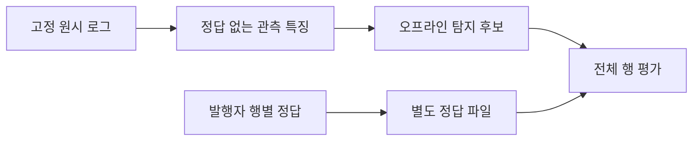

# extra: 원시 관측 후보의 개발 진단과 남은 실패

2026-11-12 · **새 독립 평가/프로젝트 목표 달성은 미완료다.**
아래 수치는 원시 개발 자료에 적합하고 같은 자료에서 진단한 결과다. 기존 앱의 F1이나 독립 성능으로 쓰지 않는다.
[원시 자료 수집·대응 범위](extra-native-evaluation.md)를 먼저 따른다.
[v19 실행 근거](infrastructure-results/extra-native-raw-candidate-v19-20261112.json)에 데이터·모델·시험 지문과 그룹 결과를 보존했다.

## 이번에 실제로 추가한 것

`raw_observations.py`가 원시 행에서 역사적 시각과 고정된 의미/형태 특징을 추출한다.
인증 실패/성공, 권한 전환 도구, 민감 파일 접근 문자열, 웹 요청 메서드/상태/크기,
일반적인 웹 공격 구문, DNS 이름 길이/엔트로피/응답 형태, 제한된 감사 이벤트 종류다.
높은 DNS 엔트로피나 스캐너 문자열만으로 악성 정답·권한 거부를 확정하지 않는다.

호스트 이름·사용자·IP·원시 도메인/경로 토큰·시나리오 이름·절대 시각은 모델 특징으로 넘기지 않는다.
일반적인 길이/형태 특징은 관측 가능한 신호지만 간접적인 출처 편향이 없는지는 다른 시나리오에서 검증해야 한다.
계정 활성·기기 정상·MFA·역할·업무 승인도 만들어 넣지 않는다. LLM과 운영 앱은 변경하지 않았다.

`prepare_native_raw.py`는 관측 입력, 평가 정답, 연결/시간 근거를 세 파일로 분리한다.

`native_bayes.py`는 고정 특징 어휘의 범주형 Naive Bayes 보조 후보다.
정답은 지도학습의 계수 추정에만 사용하고 추론 함수는 관측 특징만 받는다.
숨은 정답/식별자 필드가 들어오면 거부한다. 파일 오류·추론 불가가 있는 정답 행도 평가 분모에서 빼지 않는다.
정답을 바꿔도 추론 입력 파일이 바뀌지 않는 시험을 추가했다.

`fit_native_raw.py`는 새 단순 형태 휴리스틱과 통계 후보를 함께 진단한다.
이 휴리스틱은 비교를 위한 **새 원시 관측 참고 후보**이며 원본 Sigma 기준선이 아니다.
원본 `app/`에는 필요한 맥락이 없는 원시 로그를 정상 기기/역할로 채워 넣어 비교하지 않았다.
학습 산출물은 고정 지문과 함께 남기되 운영/최종 후보로 채택하지 않았다.

## 시간과 모집단 전수 확인

대상은 russellmitchell 개발 시나리오의 대응 원시/라벨8쌍,295,243행이다.
공격61,862·정상233,381이며 경보가 발생한 행만 고르지 않았다.
원본 행 번호와 라벨을 보존하고 같은 전체 행을 두 후보의 분모로 사용한다.
이8쌍은 전체 공개 ZIP이나 기존 여섯 탐지 영역을 대표하는 최종 평가셋이 아니다.

| 확인 항목 | 실제 결과 |
|---|---:|
| 시간 해석 실패 | 0 |
| 선언된 시뮬레이션 범위 밖 | 0 |
| 특징 변환 실패 | 0 |
| 학습에 사용할 수 없었던 행 | 0 |
| 시간이 역순으로 나타난 인접 구간 | 웹 접근 로그3곳 |

시각은 발행자의 명시적 호스트 UTC 설정을 사용한다. 연도가 없는 syslog는 선언된 시뮬레이션 구간으로
연도를 해석한다. 절대 시각을 분류 특징으로 쓰지 않는다. 향후 시간 창을 만들 때는 원본 순서를 그대로
시간 순서로 간주하지 않고, 원본 행 ID를 유지한 채 사건 시각과 동률 순서를 명시해야 한다.

## 개발 자료 재대입 결과

같은 자료로 학습하고 다시 예측했으므로 **일반화·독립 평가 결과가 아니다.**
통계 후보는 사전에 둔 기준 임계값0.5를 표시한다. 다른 임계값도 진단했지만 최종값을 선정하지 않았다.

| 후보 | TP | FP | FN | TN | 정밀도 | 재현율 | F1 | 오탐률 |
|---|---:|---:|---:|---:|---:|---:|---:|---:|
| 새 형태 참고 후보 | 56,215 | 1 | 5,647 | 233,380 | 99.998% | 90.87% | 95.22% | 0.00043% |
| 범주형 통계 후보0.5 | 60,674 | 466 | 1,188 | 232,915 | 99.24% | 98.08% | 98.66% | 0.200% |

두 후보의 전체 행 수는 동일하다. 기존 관찰 holdout360의 shadow F1 80%와는 자료·입력·범위·후보가
달라 전후 성능 개선 폭으로 빼거나 비교하지 않는다. 기존 기준선/라벨은 그대로다.

## 높은 전체 점수만으로 채택하지 않은 이유

DNS275,900행이 전체의 약93.45%다. 전체 점수가 희소한 감사·VPN·CPU 공격 실패를 가린다.
통계 후보0.5의 **파일별 평균 재현율은30.28%**, 최저는0%이며 웹 정상 행의 오탐률은53.89%다.

| 원시 로그 그룹 | 공격 행 수 | 통계 후보 TP/FN | 재현율 | 정상 행 오탐률 |
|---|---:|---:|---:|---:|
| 내부 공유 감사 | 2 | 0 / 2 | 0% | 0% |
| DNS | 54,035 | 52,988 / 1,047 | 98.06% | 0.0072% |
| 인트라넷 인증 | 8 | 2 / 6 | 25% | 0% |
| 웹 오류 | 36 | 7 / 29 | 19.44% | 정상 행이 없어 계산 불가 |
| 웹 접근 | 7,695 | 7,677 / 18 | 99.77% | 53.89% |
| 인트라넷 감사 | 9 | 0 / 9 | 0% | 0% |
| VPN | 28 | 0 / 28 | 0% | 0% |
| CPU 관측 | 49 | 0 / 49 | 0% | 0% |

이 평균은 파일8개를 같은 비중으로 본 개발 진단이며 기존 여섯 영역의 공식 지표를 대체하지 않는다.
오류를 감추기 위해 작은 그룹이나 시간/관측 실패 행을 제거하지 않는다.

## 다음 후보의 우선순위

1. 웹 정상 트래픽의 오탐을 줄일 상대 시간 창·요청 빈도/다양성 맥락. 미래 이벤트나 절대 공격 일시를 사용하지 않는다.
2. 현재 빠진 실제 CPU 수치·감사/프로세스·VPN 관측의 의미를 조사하고 필요한 입력 특징을 보완한다.
   높은 CPU나 정상 권한 전환 자체를 악성으로 가정하지 않는다.
3. 희소 그룹과 지배적인 DNS 사이의 학습/평가 불균형을 별도로 진단한다. 그룹 이름을 분류 특징으로 넣지 않는다.
4. 둘째 개발 시나리오 santos에서 출처가 바뀌어도 유지되는 개선인지 점검한다.
5. 개발/보정의 입력·분할/중복을 검토하고 후보를 동결한 뒤 예약 최종 평가를 수행한다.

santos 수집은 별도 고정 계약 `infra/f1-lab/public-assets-next-development.json`과 공개 GET만 사용한다.
이는 개발 자료이며 최종 예약 harrison/wilson의 본문·행별 라벨은 아직 읽지 않았다.
현재 자료에 없는 IdP·EDR·업무 승인 전체를 대표한 것으로 쓰지 않고 기존 전체 목표를 유지한다.

Windows·격리 Linux에서 관련130개 시험 통과. Linux 소스406파일 전후 일치·시험 컨테이너 잔여0.
유료 API/AWS 호출0, GitHub 업로드/병합 없음. 데이터 준비·후보 모델은 로컬 runtime에 보존한다.

## 후속: 추가 관측과 HTTP 창·결정트리 개발 진단

[v20 실행 근거](infrastructure-results/extra-native-context-tree-v20-20261112.json)에 기존 후보의 악화와 새 후보를 함께 보존했다.

`raw_context.py`에 실제 정규화 CPU 수치, su/감사 UID·터미널·웹 작업 디렉터리,
**실행하지 않고 해석만 하는** 제한된16진수 감사 명령, VPN 단계 관측을 추가했다.
권한이나 기기 정상 상태를 새로 발급한 것이 아니다. 원래 입력/정답/결과는 보존했다.

HTTP 창은 같은 원시 소스/클라이언트의 현재·과거 요청만 사용한다.1/10/60초 요청 수,
60초 요청 대상 다양성,10초 오류 수를 버킷으로 표현한다. 식별자와 요청 경로 자체는 모델에 넣지 않는다.
원본 시각 역순3곳은 사건 시각·원본 행 번호의 순서로 창을 계산하되 출력 행 ID/순서는 그대로 유지했다.
미래 요청 추가가 과거 특징을 바꾸지 않는 시험과 클라이언트 격리·만료·시계 역행 시험을 추가했다.

추가 특징을 그대로 곱한 Naive Bayes는 웹 오탐이450→506건으로 **악화**했다.
이 결과도 `runtime/f1/ait-raw-context-fit-russell-20261112/fit.json`에 보존했다.
특징 조합을 분기하는 고정 구성의 작은 범주형 결정트리도 비교했다.
트리는 깊이8/최소 잎5/클래스 균형 Gini 분할이다. 라벨을 바꾸지 않고 같은 벡터의 양쪽 클래스 건수를
모두 보존하며, 학습 계산을 압축하더라도 평가에서는 전체295,243행을 그대로 센다.

| 개발 재대입 후보 | TP | FP | FN | TN | 정밀도 | 재현율 | F1 | 오탐률 |
|---|---:|---:|---:|---:|---:|---:|---:|---:|
| 추가 관측 NB0.5 | 60,688 | 510 | 1,174 | 232,871 | 99.17% | 98.10% | 98.63% | 0.219% |
| 추가 관측·HTTP 창 트리0.5 | 60,767 | 26 | 1,095 | 233,355 | 99.957% | 98.23% | 99.09% | 0.0111% |

트리의 웹 접근 FP는0/835·TP7,686/7,695, 인트라넷 감사 TP8/9로 바뀌었다.
그러나 내부 공유 감사0/2·VPN0/28·CPU0/49와 웹 오류7/36은 여전히 부족하다.
파일별 평균 재현율도 약44.55%로 여전히 낮다. 관측 특징을 추가했다고 모든 그룹이 좋아진 것은 아니다.
개발 재대입이며 아직 트리 후보를 운영/최종 모델로 채택하지 않았다. 단독 항목의 기여도를 분리한 실험도 아니다.

관련 집중 시험은 Windows151·격리 Linux151개 통과, 소스412파일 전후 일치·시험 컨테이너 잔여0이다.
원본 앱/기존 라벨, 원래 준비 파일과 실패한 후보 결과를 보존했다. 새 준비 파일의 정답 sidecar는 원본과 바이트가 같다.
다음은 그룹 불균형·빠진 맥락·입력의 구분 가능성을 점검하고 다른 개발 시나리오에서 검증하는 것이다.

현재 AIT만으로 전체 기존 목표를 대표할 수 없는 부분과 더 풍부한 공개 맥락 자료는
[추가 출처 검토](extra-contextual-source-review.md)에 별도로 정리했다. 같은 개발 점수를 독립 평가로 바꾸어 주장하지 않는다.

후속 [고정 모델의 santos 전이 진단](extra-native-transfer.md)에서는 재학습 없이 F1 98.63%였으나
웹 FPR6.95%·파일별 평균 재현율41.92%로 미채택 사유가 이어졌다. 독립 최종 평가는 아직 하지 않았다.

[v22 관측 종류별/순서 이진 후보](extra-metadata-and-heads.md)에서 CPU 관측의 실패 원인과 개선을
확인했지만 VPN 오탐 악화 때문에 전체 후보는 채택하지 않았다. 원래 후보와 모든 실패 결과를 보존한다.
