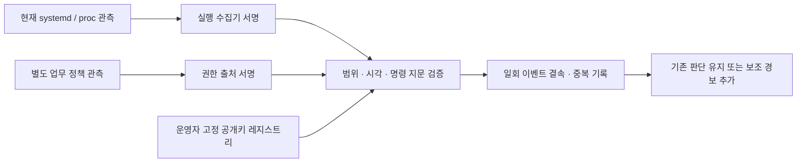

# 공유 서버 실행 근거 수집·연결 — v68

2026-11-14. [v67 감사·인증 후보](extra-audit-auth-refinement.md) 후속으로 실행 주체·명령 근거를
현재 OS에서 수집하고 별도 권한 근거와 연결하는 선택형 경로를 구현했다.
**실제 Linux 프로세스 수집·관련233개 테스트·기존1,681,815행 결정 회귀를 비용 없이 로컬에서 검증했다.**
이 기능을 과거 서비스 로그의 빈 필드에 소급 적용하거나 공유 서버 F1이 올랐다고 기록하지 않았다.

## 수집 내용과 근거의 의미

| 근거 | 수집·결속 방법 | 추정하지 않는 내용 |
|---|---|---|
| 서비스 실행 회차 | systemd의 MainPID·InvocationID, 실제 커널 boot ID | 이름이 같다는 이유로 다른 실행 회차와 합치지 않음 |
| 현재 프로세스 | /proc의 PID·시작 tick·UID·effective UID·현재 PPID | PID만으로 재사용된 프로세스를 같은 실행으로 간주하지 않음 |
| 로그인 주체 | 읽을 수 있는 audit login UID·session ID | unset/읽기 실패를 root나 인증된 사람으로 채우지 않음 |
| 부모 관측 | 읽을 수 있는 현재 부모의 PID·시작 tick·실행 파일 지문 | 현재 부모를 원래 사람 호출자나 부모-자식 생성 이력의 증명으로 삼지 않음 |
| 실행 파일·명령 | 열린 실행 파일의 SHA256, NUL 경계를 보존한 실제 cmdline SHA256·인자 수 | 원문 명령을 실행하거나 기본 출력에 보존하지 않음 |
| 원본 결속 | 수집 payload SHA, event ID, tenant/server/unit/boot/invocation/PID | 과거 파일명·mtime만으로 사건 당시 근거를 만들지 않음 |

수집 전후 프로세스 시작 tick·PPID·UID·명령 바이트·실행 파일 지문과 boot ID를 대조한다.
파일 크기/행/인자 수 상한을 넘거나 실행 파일·프로세스가 바뀌면 수집을 실패시킨다.
권한 때문에 부모·audit UID를 읽지 못하면 해당 값은 미확인이다. 명령 지문은 익명화나 완전한 코드 무결성 증명이 아니다.
`cmdline`은 현재 프로세스가 수정할 수 있고 실행 파일 지문은 인터프리터가 읽는 스크립트·공유 라이브러리 전체를 포함하지 않는다.
따라서 이 수집을 커널 EXECVE 이력이나 사람 신원 검증의 대체로 사용하지 않는다.

## 두 수집 경로

1. **현재 manager snapshot — 기본 경로.** 읽기 전용 `systemctl show`로 실행 회차와 MainPID를 확인하고,
   그 프로세스의 현재 상태를 수집한다. 새 capture ID와 실제 수집 시각을 가진 새 관측이며 과거 START/STOP을 고치지 않는다.
   수집 전후 manager 상태도 같아야 한다. 최근 journal 메시지가 없는 조용한 서비스도 이 경로로 관측한다.
2. **native journal — 선택 경로.** `journalctl`의 `_BOOT_ID`, `_SYSTEMD_UNIT`, `_SYSTEMD_INVOCATION_ID`, `_PID`,
   cursor·수신 시각을 읽고 같은 MainPID·실행 회차의 현재 프로세스와 연결한다.
   사용자 제공 `UNIT`/`INVOCATION_ID` 별칭, 중복 배열·누락 값, 오래된 이벤트에는 fallback하지 않는다.

명령은 고정된 읽기 작업만 실행하고 shell을 사용하지 않는다. 서비스 시작·정지·재설정·클라우드 배포 기능은 노출하지 않는다.
서브프로세스의 bus/preload 환경 변수를 차용하지 않으며 native journal의 출력 필드와 행 수도 제한한다.
이미 종료한 short-lived 프로세스나 MainPID가 없는 서비스는 현재 스냅샷을 만들 수 없어 미확인으로 남는다.

## 서명·권한·위험 판단



실행 수집기와 권한 출처는 다른 Ed25519 키·역할을 사용한다. 서명은 출처·무결성을 확인하며 수집기의 정직함이나
실제 OS 전체의 신뢰성을 보증하지 않는다. 레지스트리와 SHA pin·최소 버전은 운영자 설정이며 외부 요청자가 정하는 값이 아니다.

- 두 서명 모두 정확한 event SHA에 결속되고, tenant/server/unit·실행 모드·키 활성 상태와 유효 기간을 확인해야 한다.
- 현재 프로세스 관측은 event 관측 이후5초 안이어야 하며, 업무 정책의 관측 시각은 event보다 늦을 수 없다.
  proof는 최대30초, event는 현재 시각에서 최대30초까지만 받는다. 사후 allow/deny를 사건 당시 승인으로 소급하지 않는다.
- 현재 정책 SHA·최소 버전과 실행 파일/명령 지문이 같아야 한다. 키 폐기·교체·잘못된 역할·범위는 중복 처리 때도 다시 검사한다.
- **서명된 명시적 deny와 실제 실행 관측이 함께 있을 때만 보조 경보를 추가한다.** 실행 계정이 root이거나 서비스 이름이 낯설다는 이유만으로 올리지 않는다.
- allow·unknown·증거 누락·검증 실패는 기존 판단을 유지한다. 서명된 allow도 기존 경보를 지우거나 접근 권한을 발급하지 않는다.
- SQLite에 이벤트/근거 지문을 남긴다. 같은 event와 같은 근거는 재시작·동시 전달 후에도 한 기록이고,
  같은 event ID를 다른 내용으로 바꾸면 거부한다. 시계 역행과 용량 초과도 거부한다.
  이 로컬 저장소는 신뢰하는 운영자 디렉터리의 중복 방지용이며 원격 변조·백업 rollback 방지 저장소로 인증한 것은 아니다.

`local_process_lab`와 운영 `systemd` 모드는 레지스트리·event·소비자 설정에서 나눈다.
기본 소비자는 systemd만 받으며 로컬 제어 사례의 키/이벤트로 운영 모드를 만족시킬 수 없다.

## 구현과 실행

- [수집기](../scripts/f1_lab/shared_execution_collector.py): 실제 Linux `/proc`, 읽기 전용 systemd/journal 수집.
- [서명·결속·중복 방지](../scripts/f1_lab/shared_execution_evidence.py): 현재 레지스트리 검증과 `VerifiedServiceRisk` 어댑터.
- [수집 CLI](../scripts/collect_shared_execution.py): collector 역할의32바이트 개인키를 stdin으로만 전달받는다.
  공개키·서버·unit·역할을 고정 레지스트리와 먼저 대조하고 새 출력 디렉터리에 event/runtime proof를 저장한다.
  권한 proof는 수집기가 대신 만들지 않는다. 디렉터리는0700, capture 파일은0600으로 생성한다.

```text
python -m scripts.collect_shared_execution --tenant <tenant> --server <server> --unit <primary-unit.service> --source <collector> --key-id <key-id> --registry <registry.json> --registry-sha256 <SHA> --output <새출력>
```

stdin은 별도의 키 전달 경로로 연결한다. 키·명령 원문을 위 인자나 문서에 쓰지 않는다.
기본은 현재 snapshot이고 native journal은 `--collection-basis native_journal`로 선택한다.
소비자는 `PinnedServiceRegistry`와 `ServiceEvidenceJoiner`를 운영자 설정으로 만들고
`VerifiedServiceRisk.decide(previous, event=event, proofs=[runtime, authorization])`로 호출한다.
실제 앱/PEP의 권한 발급·회수 경로에는 아직 연결하지 않았다.

## 실제 로컬 검증 결과

| 묶음 | 실행 결과 |
|---|---|
| 관련 pytest | **233개 통과**, 실패/skip0. 신규 수집/서명/재시작/위조 검사와 기존 감사·인증·웹 서명·평가 계약 회귀 포함 |
| 실제 프로세스 수집 제어 | 고정된 소유 Python 프로세스를 실제 실행해 UID·PPID/부모 지문·실행 파일/명령 지문 수집 |
| 정상 정책 제어 | allow 정상1건의 추가 경보0 |
| 거부 정책 충돌 제어 | 실행 전 deny가 있는 실제 실행1건에서 보조 경보1 |
| 별도 통합 제어 | 실행·권한·중복/재시작·다른 invocation·사후 정책·lab/prod 분리·누락 근거 **7조건 통과** |
| 기존 개발 결정 회귀 | R/S/F/H **1,681,815행**, 모든 출처의 전후 결정 지문 동일·새 FP/TP 손실0 |
| 환경·정리 | network none·비root·read-only root·cap drop, Ruff+RUF100 통과, 소스983파일 전후 불변·OOM false·해당 컨테이너/소유 child 종료 |
| 비용·비밀값 | 유료 LLM/AWS 호출0, 개인키·명령 원문 저장0 |

위233개는 관련 시험 묶음이다. v67 전체5,134개 통과 기록을 이번 전체 재실행으로 바꾸어 쓰지 않는다.
제어 사례1+1건은 기능 검증이며 독립 탐지 F1이나 기업 성능 합격률로 제시하지 않는다.
Linux `/proc`는 실제로 검증했고 UID와 부모 지문은 수집됐다. 이 환경의 audit login UID/session은 없어 미확인이며 사람 신원을 증명하지 않았다.
Docker의 PID1은 systemd가 아니므로 실제 운영 systemd 호스트 인수는 미실시다. native adapter의 파서·명령·변조 거부 경로는 시험 입력으로 검증했다.

## 기존 결과와 남은 작업

과거 공개 로그에는 필요한 호출 ID·당시 프로세스·별도 서명 정책이 없다. 이를 새로 채워 넣지 않았다.
기존 예측 파일의 외부 SHA를 고정해 새 증거가 없는 경우의 결정을 모두 대조했고 정답은 다시 읽지 않았다.
따라서 아래는 **유지된 v67 기준선**이며 새 독립 재채점이 아니다.

| 항목 | 기존→이후 F1 | 기존→이후 FP | 기존→이후 FN |
|---|---:|---:|---:|
| 공유 서버 감사 | 0%→0% | 24→24 | 6→6 |
| 웹 서버 감사 | 70.77%→70.77% | 37→37 | 1→1 |
| 인증 | 95.08%→95.08% | 0→0 | 3→3 |

다음 인수는 실제 Linux 공유 서버에서 권한을 제한한 수집기를 운영자 키와 연결하고,
현재 업무 정책 출처·신원 체계를 별도로 연동하는 일이다. 종료가 빠른 실행의 사건 당시 근거와 원래 호출 주체에는
kernel EXECVE/SYSCALL 등 추가 수집이 필요하다. 현재 프로세스 관측으로 과거 기록을 바꾸거나 원래95%/5% 독립 목표를 통과시켰다고 주장하지 않는다.

[전체 실행 근거](infrastructure-results/extra-shared-execution-evidence-v68-20261114.json)에 소스·시험·제어·기존 결정 지문을 보존했다.
코드/공개 근거만 공유하고 원시 로그·기존 대형 예측·실행 DB·개인키는 Git에 올리지 않는다.

## 형식 선정 근거

- [systemd manager API](https://www.freedesktop.org/software/systemd/man/latest/org.freedesktop.systemd1.html): MainPID와 실행 회차를 구분하는 InvocationID를 대조한다.
- [systemd journal 필드](https://www.freedesktop.org/software/systemd/man/latest/systemd.journal-fields.html): 신뢰되는 underscore 메타데이터를 선택하고 사용자 제공 별칭으로 대체하지 않는다.
- [journalctl 출력](https://www.freedesktop.org/software/systemd/man/latest/journalctl.html): 출력 필드/행을 제한해 메시지 본문과 무제한 로그를 수집하지 않는다.
- [Linux proc stat](https://man7.org/linux/man-pages/man5/proc_pid_stat.5.html): PID와 부팅 후 시작 tick을 함께 확인한다.
- [Linux proc cmdline](https://man7.org/linux/man-pages/man5/proc_pid_cmdline.5.html): 현재 관측 가능한 인자이며 프로세스가 수정할 수 있다는 한계를 반영한다.
