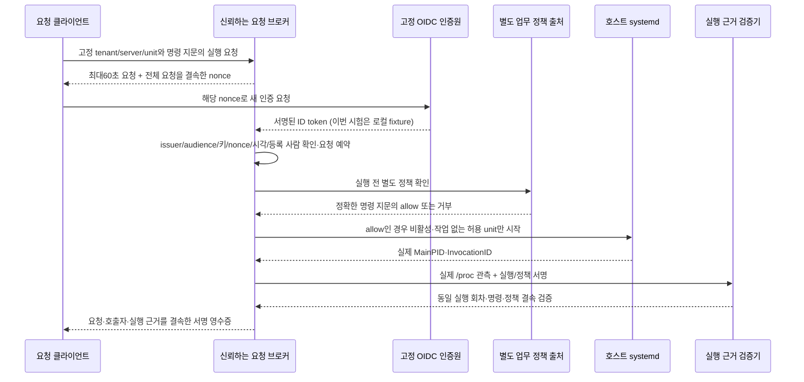

# systemd 운영 연동·호출 신원 결속 — v69

2026-11-14. [v68 실행 근거 수집](extra-shared-execution-evidence.md)의 후속이다.
**실제 systemd 255가 PID 1인 로컬 Ubuntu 24.04 WSL에서 서비스 시작·현재 프로세스·journal·호출 신원을 연결했다.**
사용자 선택에 따라 인증원은 로컬 서명 토큰 fixture로 검증했다. 회사·학교 SSO 로그인이나 실제 사람의 현장 참여를 검증한 결과는 아니다.

## 이번에 달라진 점

| 영역 | v68 | v69 |
|---|---|---|
| 실제 실행 환경 | Docker의 실제 /proc, systemd 명령은 시험 입력 검증 | 실제 systemd manager가 관리하는 전용 서비스에서 연동 검증 |
| 호출자 | UID·현재 부모 관측, 사람 신원 미확인 | 별도 고정 인증원의 서명된 ID token과 운영자 사람 디렉터리 확인 |
| 실행 결속 | 실행/업무 정책 proof | 실행 요청 nonce → 인증 → 별도 정책 허용 → systemd 시작 → 실행 회차·명령 지문 → 서명 영수증 |
| 재실행 방지 | 이벤트 중복 처리 | 실행 전 요청 예약, 중복/재시작/동시 호출 차단, 불확실한 요청 자동 재시도 금지 |
| 배포 준비 | 수집 CLI | 운영 설치용 systemd 수집기 템플릿과 허용 unit만 시작하는 어댑터 |
| 기존 탐지 수치 | 과거 결정 유지 | 1,681,815개 기존 결정 동일·새 FP/TP 손실0 유지 |

수집 CLI 자체는 계속 읽기 전용이다. 새 `SystemdUnitLauncher`는 별도 브로커에서 승인된 고정 unit만 시작하는 경로다.
새 인증 기능은 선택형 라이브러리 통합이며 전체 앱의 로그인·PEP 권한 발급/회수 경로를 교체한 것은 아니다.

## 제로트러스트 흐름과 신뢰 경계



요청 브로커·운영자 trust bundle·PDP·수집기·systemd 관리자와 로컬 ledger를 신뢰하는 범위다.
관리자 root가 unit/프로세스/저장소를 동시에 바꾸거나 다른 관리자 경로에서 실행하는 경우까지 원격 증명하지 않는다.
부모가 systemd PID 1이고 실행 UID가 nobody/root여도 그 값을 사람 호출자로 사용하지 않는다.

### 신원 확인

- 운영자가 SHA pin·최소 버전·최대24시간 유효 기간으로 고정한 공개 trust bundle을 매번 확인한다.
  인증원 issuer·audience·RS256 공개 JWKS·사람/워크로드 디렉터리는 요청자가 지정할 수 없다.
- ID token 서명, 정확한 issuer/audience, 허용 kid/알고리즘, `azp`가 있으면 해당 client,
  `iat`·`exp`·`nbf`·`auth_time`, 요청 전체를 결속한 nonce를 확인한다.
  토큰 수명은 최대60초이며 `auth_time`은 요청 발급 이후의 초 단위 시각이어야 한다.
- 서명된 `sub`라도 운영자 디렉터리의 같은 tenant에서 활성 person으로 등록되어야 한다.
  임의 username/email/UID나 토큰의 자칭 사람/관리자 필드로 대체하지 않는다.
  workload·미등록·비활성·다른 tenant는 사람 호출자가 될 수 없다.
- `jku`·`x5u` 같은 토큰 지정 키 URL은 거부한다. 키 네트워크 탐색 없이 고정 public JWKS만 사용한다.
  개인키가 들어간 JWKS, 약한 RSA, 중복 키/디렉터리도 거부한다.
- ID token은 이 브로커의 인증 응답 검증에만 쓴다. 일반 API의 bearer access token으로 사용하지 않는다.
- 이번 issuer `https://local-caller.invalid`는 네트워크 서버가 아니라 메모리 키로 서명하는 시험 인증원이다.
  `expected_environment="local_oidc"`를 명시한 시험 설정에서만 받는다. 기본 `oidc` 소비자는 이 trust bundle을 거부한다.

등록 person의 유효 토큰은 해당 인증원의 주장이다. 실제 사람의 현재 존재, MFA 수행, 검증된 기기 상태를 자동으로 증명하지 않는다.
이번에는 비밀번호/브라우저 로그인·실제 외부 SSO·MFA를 수행하지 않았다. 시험 토큰을 실제 사람 인증 실적으로 보고하지 않는다.

### 인증과 권한, 실행을 분리

`ServiceCallerBroker.dispatch`의 authorize/launch/collect/policy_proof는 **신뢰하는 서버 코드가 고정하는 콜백**이다.
외부 HTTP 요청으로 함수·명령·정책 allow 값을 받는 API가 아니다. 현재 공개 요청 엔드포인트는 추가하지 않았다.

1. 브로커가 생성하고 SQLite에 저장한 요청만 받는다. 원 요청의 tenant/server/unit·실행 파일/명령 SHA·무작위 nonce·만료 시각을 함께 결속한다.
2. 인증 후 요청을 실행 전 `launching`으로 예약한다. 같은 요청은 재사용할 수 없고 동일 unit의 동시 진행도 제한한다.
3. 별도 PDP의 실행 전 allow, 현재 정책 SHA/최소 버전, 정확한 실행 파일·명령 지문을 확인한다. 거부/unknown이면 시작하지 않는다.
4. 운영자가 구성한 `UnitTarget`만 받는다. 로드된 unit이 inactive, MainPID0, InvocationID 없음, 대기 Job 없음이어야 한다.
   shell이나 요청 제공 명령을 실행하지 않고 `/usr/bin/systemctl start -- <허용 unit>`만 호출한다.
5. 실제 manager와 /proc의 새 실행 회차를 수집해 v68의 실행·정책 두 서명을 검증한다. 관측한 명령 지문도 요청과 같아야 한다.
   구성 드리프트는 실행 후 지문 대조에서도 발견할 수 있으나, 신뢰하는 관리자 unit 구성을 실행 전 코드 전체 무결성 증명으로 대신하지 않는다.
6. 요청 SHA·event SHA·서비스 근거 SHA·호출자 지문·현재 trust bundle SHA·인증/결속 시각을 별도 브로커 키로 서명한다.
   `verify_receipt`는 현재 신원 trust bundle·person 등록·원 요청·event·서명을 다시 확인한다.
   실행/정책 근거의 현재 유효성은 별도로 `ServiceEvidenceJoiner`로 확인한다. 영수증 하나로 접근 권한을 발급하지 않는다.

처리 중 오류는 요청을 소비된 `uncertain` 상태로 남긴다. 프로세스가 죽어 `launching`이 남아도 재시작 후 자동 재실행하지 않는다.
운영자가 실제 manager/job/실행 회차와 정책을 확인하고 새 요청으로 복구해야 한다. 원 요청을 pending으로 되돌리는 자동 기능은 없다.
ledger는 제한된 용량의 단일 호스트 저장소이며 다중 호스트 합의·백업 rollback 방지·원격 변조 방지 저장소가 아니다.
영수증 호출자 SHA는 연결 가능한 가명 식별자이고 익명화가 아니다. 토큰·개인키·명령 원문은 ledger에 쓰지 않는다.

## 구현 명세와 운영 설치 준비

- [신원·요청·브로커·영수증](../scripts/f1_lab/service_caller_identity.py):
  `PinnedCallerRegistry`, `ServiceRequest`, `ServiceCallerBroker`, `verify_identity`, `verify_receipt`.
- [운영 unit 시작·수집 어댑터](../scripts/f1_lab/systemd_request_launcher.py):
  `UnitTarget`, `SystemdUnitLauncher`. 기존 운영자 설치 서비스만 시작하며 unit 생성/임의 명령/정지는 노출하지 않는다.
- [systemd 수집기 템플릿](../infra/systemd/secops-execution-collector@.service):
  `/opt/secops` 설치를 가정한다. `LoadCredential` + stdin으로32바이트 수집키를 전달하고
  PrivateNetwork·NoNewPrivileges·읽기 전용 시스템·권한/메모리/태스크/시간 상한을 적용한다.
  `/etc/secops/collector.conf`에 `TENANT_ID`, `SERVER_ID`, `RUNTIME_SOURCE_ID`, `RUNTIME_KEY_ID`, `SERVICE_REGISTRY_SHA256`의 공개 설정을 둔다.
  공개 레지스트리는 `/etc/secops/service-registry.json`, 운영자만 읽는 raw32바이트 키는 `/etc/secops/runtime-key.raw`로 별도 공급한다.
  `secops-execution-collector@app.service` 인스턴스는 `app.service`를 **읽기만** 한다.
  출력은 `/var/lib/secops-evidence/<instance>/<collector InvocationID>/capture.json`이다.
  이번에는 템플릿 설치 경로를 로컬 경로로 치환한 `systemd-analyze verify`를 통과했다. 이 템플릿을 운영 경로에 설치·시작하지는 않았다.

실제 systemd 제어를 재현하려면 별도 로컬 Linux/WSL의 root로 아래 명령을 실행한다. 이 제어 프로그램만
UUID가 붙은 전용 테스트 unit을 `/run/systemd/system`에 만들고 daemon-reload·시작·정지·제거한다.
기존 CA/DB/NGINX 등 다른 서비스는 변경하지 않는다. 다른 용도의 서비스 관리자 시험과 겹치지 않게 실행한다.

```text
python -m scripts.run_systemd_caller_controls --directory <존재하지 않는 로컬 결과 폴더>
```

실제 사내 SSO 전환에는 운영자 issuer/audience/JWKS/person 디렉터리 공급,
Authorization Code + PKCE·state/nonce 검증을 수행하는 실제 로그인 콜백,
독립 PDP와 권한 제한 서비스 계정/키 운영·회수·감사 저장소 인수가 더 필요하다.
이 브로커는 전체 OIDC 로그인 제품이나 IdP 자체를 새로 구현한 것은 아니다.

## 묶음 검증 결과

| 묶음 | 결과 |
|---|---|
| 관련 pytest | **281개 통과**, 실패/skip0. v68 관련233개 + 신원·브로커·실행기 신규48개 |
| 코드 검사 | 전체 Ruff + RUF100 통과 |
| 실제 systemd | Ubuntu24.04 WSL, PID1 systemd255.4, 전용 서비스 **15조건 통과** |
| 정상 실행 | 로컬 등록 person 인증 + 별도 allow + 실제 서비스1건, 추가 경보0 |
| 거부·변조 | 미등록/workload, 다른 audience/nonce, 만료, 별도 정책 deny, 중복 요청·기존 실행 전용 거부 |
| journal 결속 | 실제 journal의 신뢰 메타데이터와 현재 MainPID·InvocationID 일치 |
| v68 실제 프로세스 제어 | 기존7조건 재통과, 정상 추가 경보0·명시적 deny 충돌 탐지1 |
| 기존 개발 결정 비교 | **1,681,815행** 결정 지문 동일, 새 FP0·TP 손실0 |
| 정리 | 해당 Docker 컨테이너·테스트 unit·unit 파일·WSL 소유 스냅샷 제거 |
| 비용·비밀값 | 유료 API/AWS0, 개인키·토큰·명령 원문 저장0 |

Docker 회귀는 network none·비root10001·읽기 전용 root·cap drop·2CPU/2GiB로 실행했고 OOM은 없었다.
실제 systemd 제어는 호스트 manager·/proc 접근이 필요한 별도 WSL root 시험이다. 이 단계를 비root Docker 시험으로 잘못 기록하지 않는다.
고정 Python 서비스는 nobody UID65534로 실행했다. audit login UID는 없었고 이를 호출자 person으로 채우지 않았다.
고정991개 소스 스냅샷을 사용했으며 전후 지문이 같았다. Docker 실행 단계 약108초, 실제 native 제어/템플릿 검사 약7.6초다.
새281개는 관련 묶음이며 v67 전체5,134개를 이번에도 재실행했다고 표현하지 않는다.

첫 시도는 시험 공개키 export의 추가 필드와 WSL 임시 의존성 준비 문제로 실패했다.
공개키 fixture를 명세에 맞추고 각 소유 스냅샷 안에 캐시 의존성을 준비한 뒤 같은 묶음을 재실행했다.
최초 실패·수정 이유·최종 성공 지문을 [공개 결과 JSON](infrastructure-results/extra-systemd-caller-identity-v69-20261114.json)에 함께 남겼다.

## 오탐·미탐·F1 비교

새 기능은 과거 로그에 없는 인증/실행 근거를 만들지 않는다. 외부 SHA가 고정된 기존 예측을 대조했고 정답 라벨을 다시 열지 않았다.
새 근거가 없으면 기존 판단을 유지한다. 따라서 아래 값은 **그대로 유지된 v67 개발 기준선**이고 새 독립 성능 평가가 아니다.

| 항목 | F1 이전→이후 | FP 이전→이후 | FN 이전→이후 |
|---|---:|---:|---:|
| 공유 서버 감사 | 0%→0% | 24→24 | 6→6 |
| 웹 서버 감사 | 70.77%→70.77% | 37→37 | 1→1 |
| 인증 | 95.08%→95.08% | 0→0 | 3→3 |

로컬 정상 제어1건의 추가 경보0은 기능 검증이다. 운영 오탐률0% 또는 F1 목표 달성으로 확대하지 않는다.
공유 서버6건에는 여전히 사건 당시 실행 주체·명령·정책 근거가 부족하다.

## 남은 인수

1. 실제 회사·학교 SSO 로그인과 사람 디렉터리, 독립 업무 정책 출처 연결.
2. 권한 제한 운영 수집기 템플릿의 실제 설치·키 교체·서비스 계정 인수와 앱/PEP 통합.
3. 종료가 빠른 서비스의 kernel EXECVE/SYSCALL 원본 수집과 실행 당시 원 호출자 근거 연결.
4. 새 정상/위협 자료를 분리해 사람 신원·정책·실행 근거의 독립 성능 평가. 기존6건을 사후 보강해 성능을 올리지 않음.
5. 다중 호스트 브로커의 전환/불확실 실행 복구, 감사 저장소의 외부 변조·rollback 방지와 용량/보존 운영.

## 선정 근거

- [OIDC Core ID Token Validation](https://openid.net/specs/openid-connect-core-1_0.html#IDTokenValidation):
  issuer/audience·서명·nonce·auth_time 검증의 기준. 별도 디렉터리와 실행 요청 결속은 이 프로젝트의 추가 통제다.
- [systemd-run과 실행 모델](https://www.freedesktop.org/software/systemd/man/latest/systemd-run.html):
  서비스는 manager가 부모가 될 수 있어 PPID만으로 원 사람을 찾을 수 없다. 실제 제어는 Type=exec로 시작한다.
- [systemd 실행 환경](https://www.freedesktop.org/software/systemd/man/latest/systemd.exec.html):
  자격 증명 공급과 NoNewPrivileges·네트워크/파일시스템 제한을 운영 템플릿에 적용했다.
- [systemd manager API](https://www.freedesktop.org/software/systemd/man/latest/org.freedesktop.systemd1.html):
  unit 이름뿐 아니라 MainPID·InvocationID·상태를 대조한다.
