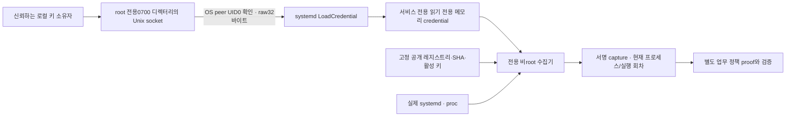

# systemd 수집기 실행·자격 증명 수명주기 인수 — v70

2026-11-14. [v69 호출 신원 결속](extra-systemd-caller-identity.md) 후속으로 운영 수집기의 실제 실행 경로를 보강했다.
**최종 동일 소스 스냅샷에서 관련316개, 실제 systemd13조건, 기존1,681,815행 결정 유지 검증을 통과했다.**
유료 API/AWS 호출은0이다. 운영 호스트에 설치하거나 실제 조직 SSO로 사람을 인증한 기록은 아니다.

## 개선 전후

| 항목 | 이전 | 이번 구현·검증 |
|---|---|---|
| 수집기 단위 파일 | 설치 경로를 치환한 문법 검사 | 실제 manager가 보안 제한을 적용한 서비스로 CLI 실행 |
| 실행 계정 | 기본 root 실행 템플릿 | 전용 정적 비root 서비스 계정과 필요한2개 capability만 구성 |
| 수집키 전달 | stdin에 자격 파일을 연결하는 미실행 예제 | root 전용 Unix 소켓 → LoadCredential 메모리 복사 → CLI의 직접 자격 파일 읽기 |
| 키 교체 | 수집기 역할/키 pin 검증 코드 | 현재 pin 없는 새 키 거부 → pin 교체 후 새 수집 성공 → 옛 키 proof 거부 |
| 키 폐기·종료 | 검증 로직/시험 입력 | 비활성 키·종료 대상에서 새 capture 생성0 확인 |
| CI 재시작 시험 | 20초 자식 시간 초과1건 | 유한60초로 시험 예산 조정, 보안 단언 유지, PR63 unit 재통과 |

수집기는 계속 읽기 전용이다. v69의 별도 요청 브로커가 승인 unit을 시작하는 기능과 구분한다.
시험 프로그램만 UUID가 붙은 소유 unit·설정·상태 디렉터리를 만들고 제거한다.

## 구조·키 흐름



[CredentialSocket](../scripts/f1_lab/systemd_credentials.py)은 신뢰하는 키 공급 콜백에 대한 로컬 어댑터다.
부모 디렉터리 소유자·0700, socket0600·기존 경로 부재를 확인하고 Linux SO_PEERCRED의 UID0만 받는다.
전송은 정확한32바이트, 연결/대기/총 연결 수는 제한한다. 종료 시 스레드를 정리하고 같은 inode의 소켓만 제거한다.
이 UID는 systemd/호스트 관리자 확인이며 사람 신원이 아니다. 키 공급자는 신뢰하는 서버 구성이고 외부 요청자가 정하지 않는다.
키 발급·비밀 저장소·암호화 백업·HA 키 소유자 자체를 새로 구현한 것은 아니다.

[직접 자격 읽기](../scripts/f1_lab/systemd_credential_reader.py)는 `CREDENTIALS_DIRECTORY` 아래 고정 이름 `runtime-key`만 읽는다.
시스템 서비스의 `/run/credentials/<unit>.service` 경로·비공개 디렉터리·root/실행 UID 소유자·정규 파일·크기32바이트를 확인한다.
심볼릭 링크는 O_NOFOLLOW로 거부하고, 읽기 전용0400 또는 systemd 읽기 ACL mask가 반영된0440만 받는다.
파일을 읽는 동안 inode/크기/mtime도 대조한다. 이 점검은 ACL 전체 정책이나 원격 호스트 무결성의 증명은 아니다.

CLI에 `--systemd-credential`을 추가했다. 이 모드가 실패하면 stdin/다른 파일/환경 비밀값으로 대체하지 않는다.
기존 stdin 기본 모드는 호환을 유지한다. 키 본문은 인자·환경·journal·실행 DB에 쓰지 않는다.
systemd는 실행 중 메모리 파일시스템에 읽기 전용 credential 파일을 만든다. 따라서 “키 파일이 전혀 없다”가 아니라
**이번 시험에서 개인키를 디스크 평문 파일로 만들지 않았고 서비스 종료 후 자격 사본을 제거했다**고 표현한다.
Python 메모리의 안전한 완전 삭제나 모든 호스트의 swap/메모리 잠금을 검증한 것은 아니다.

## 제한 계정과 설치 준비

- [운영 템플릿](../infra/systemd/secops-execution-collector@.service)은 User/Group을 `secops-collector`로 고정한다.
  [계정 명세](../infra/systemd/secops-collector.sysusers)는 배포 시 `/usr/lib/sysusers.d/secops-collector.conf` 등으로 설치할 수 있다.
  이번에는 `systemd-sysusers --dry-run`만 수행했고 호스트 계정/그룹을 만들거나 수정하지 않았다.
- Ambient/Bounding capability는 `CAP_SYS_PTRACE`, `CAP_DAC_READ_SEARCH`만 구성한다.
  다른 UID의 현재 실행 파일·프로세스를 읽는 데 사용하는 강한 권한이다. 비root라는 이유로 무권한/완전 격리라고 주장하지 않는다.
- NoNewPrivileges, PrivateNetwork, AF_UNIX만 허용, ProtectSystem=strict, ProtectHome,
  PrivateDevices·PrivateTmp, 커널/컨트롤그룹 보호, 네임스페이스 제한, native syscall architecture,
  메모리256MiB·태스크16·시작20초 상한을 둔다.
- 수집 범위는 공개 레지스트리의 tenant/server/unit/runtime 역할과 활성 키·SHA pin에 추가로 결속한다.
  읽기 권한을 가진 호스트 수집기/운영자 자체는 신뢰 경계이며 이 구성을 원격 attestation으로 표현하지 않는다.

기본 설치 경로는 `/opt/secops`, 공개 설정은 `/etc/secops/collector.conf`, 공개 레지스트리는 `/etc/secops/service-registry.json`이다.
설정에는 TENANT_ID, SERVER_ID, RUNTIME_SOURCE_ID, RUNTIME_KEY_ID, SERVICE_REGISTRY_SHA256만 공급한다.
키 소유자는 `/run/secops-credentials`를 root0700으로 준비하고 `runtime-key.sock` 공급자를 별도로 실행해야 한다.
템플릿은 `secops-execution-collector@app.service`로 `app.service`를 읽고,
`/var/lib/secops-evidence/app/<수집기 InvocationID>/capture.json`에 결과를 쓴다.
운영 Python 의존성·unit 허용 목록·독립 정책 출처·키 회수·보존 정책을 공급하는 배포 인수가 남아 있다.

이번 실제 시험은 설치/출력/자격 소켓 경로를 소유 임시 경로로 치환했다.
전용 운영 계정을 생성하지 않기 위해 수집 계정은 기존 정적 `daemon` UID1로, 대상 프로세스는 `nobody` UID65534로 실행했다.
운영에서는 공유 daemon 계정 대신 위 전용 계정을 사용해야 한다. 이 치환과 문법 검사·실제 실행을 결과 JSON에 구분했다.

## 실제 환경에서 발견해 해결한 내용

1. v69 템플릿의 `StandardInput=file:%d/runtime-key`는 이 환경에서 CLI 시작 전208/STDIN으로 실패했다.
   `StandardInput=null`과 직접 자격 읽기로 수정했다. 문법 검사 통과를 실제 기동 통과로 간주하지 않았다.
2. v255의 자격 소켓 client 주소에는 unit 이름도 포함된다. 긴 시험 인스턴스 이름은 연결에 실패해 소유 fixture 이름을 짧게 구성했다.
   운영 unit 이름도 배포 대상 버전의 주소 제한을 확인해야 한다.
3. systemd가 읽기 ACL을 붙인 자격 파일은 명목0440이 될 수 있다. 비공개 자격 디렉터리 안의 이 읽기 전용 형식도 처리했다.
4. 이 WSL의 동적 UID는 systemd manager 조회가 실패했다. 동적/정적 계정 각각 동일5개 제한 조합으로 대조했고 정적 비root는5개 모두 통과했다.
   동적 UID 실패의 배포판 내부 원인을 확정하지 않았으며 DynamicUser 인수 완료로 기록하지 않는다.

CLI 실패 출력에는 고정 단계·허용 목록의 오류 코드·관측된 UID/capability만 추가했다.
예외 원문·키 본문·서명 입력·사용자 자료를 출력하지 않는다.
출력 보안 상태는 로컬 자기 관측이며 별도의 원격 서명된 하드웨어 측정이 아니다.

## 최종 묶음 결과

| 검증 | 실제 결과 |
|---|---|
| 최종 관련 pytest | **316개 통과**, 실패/skip0. 자격 소켓/파일·CLI·신원·세션 재시작·기존 감사/웹/평가 계약 |
| 실제 systemd | Ubuntu24.04 WSL systemd255.4, **13조건 통과**, 별도2개 정상 capture의 추가 경보0 |
| 실행 권한 관측 | UID1, effective/bounding capability524292=SYS_PTRACE+DAC_READ_SEARCH, NoNewPrivs=true |
| 키 수명주기 | 새 키만 바꾸면 거부, 공개 pin 교체 후 성공, 옛 proof 거부, 폐기 키 capture0 |
| 종료 대상 | 새 현재 관측을 생성하지 않고 거부. 과거 실행으로 소급 채우지 않음 |
| 기존 프로세스 제어 | v68의7조건 재통과 |
| 기존 개발 결과 | **1,681,815행** 결정 지문 동일, 새 FP0·TP 손실0·정답 재열람0 |
| 소스·환경 | 최종 동일 고정 스냅샷·network none 비root Docker·Ruff/RUF100, 실제 systemd는 별도 WSL manager 인수 |
| 비용·정리 | 유료 API/AWS0, 소유 컨테이너·unit/file·상태/설정/소켓·자격 사본·WSL 스냅샷 제거 |

중간 고정 스냅샷의 전체 pytest도5,279개 통과했다. 그 뒤 실제 systemd 문제를 수정했으므로 이 수치를 최종 소스 전체 재실행으로 바꾸지 않는다.
최종 소스의316개 관련 테스트·실제13조건·결정 회귀는 별도 동일 스냅샷 결과다.
중간 시도·최종 소스/시험 지문은 [공개 결과 JSON](infrastructure-results/extra-systemd-collector-runtime-v70-20261114.json)에 보존했다.

## 앞선 CI 실패 처리

[PR63 최초 CI](https://github.com/cheonan-asan-sta/zero-trust-llm-secops/actions/runs/43560641283)의 unit은
5,266통과·2skip·1시간초과 실패였다. after_commit 자식 프로세스가20초 안에 끝나지 않은 것이 관측 사실이며 자원 경합을 확정 원인으로 단정하지 않는다.
이 시험은 지연 SLA가 아닌 재시작·키 폐기·세션 제한의 기능 시험이다. cold interpreter·영속 I/O를 포함한 유한60초로 시험 예산을 조정했고,
기존 종료 코드·중복 방지·이력·권한 회수·무관 세션 접근 단언은 유지했다. 제품 watchdog 동작·인가 정책·실제 권한 유효 기간은 바꾸지 않았다.
수정08d6823을 PR63에 반영해 [후속 CI](https://github.com/cheonan-asan-sta/zero-trust-llm-secops/actions/runs/43564641919)의 unit·Docker 성공을 확인했다.
전체 CI 집계와 이번 후속 PR의 CI는 GitHub에서 별도로 확인하며 로컬 기능/성능 근거와 섞지 않는다.

## 기존 지표와 남은 인수

| 항목 | F1 이전→이후 | FP 이전→이후 | FN 이전→이후 |
|---|---:|---:|---:|
| 공유 서버 감사 | 0%→0% | 24→24 | 6→6 |
| 웹 서버 감사 | 70.77%→70.77% | 37→37 | 1→1 |
| 인증 | 95.08%→95.08% | 0→0 | 3→3 |

이는 유지된 v67 개발 기준선이다. 정상2건의 추가 경보0을 운영 FPR0%나 독립 F1 목표 통과로 제시하지 않는다.
원래6개 공유 서버 사례에 사건 당시 신원·명령을 만들어 넣지 않았다.
실제 조직 SSO/사람 로그인·독립 PDP·앱/PEP 연결, 전용 계정의 실제 운영 설치·키 공급자 HA/보존,
종료가 빠른 실행의 kernel EXECVE/SYSCALL 수집과 새로운 독립 평가 자료는 여전히 남아 있다.

## 재현·선정 근거

[실제 인수 프로그램](../scripts/run_systemd_collector_runtime.py)은 root가 관리하는 별도 로컬 Linux/WSL에서만 실행한다.
소스와 의존성은 서비스 계정이 읽을 수 있는 소유 `/run/` 디렉터리에 두고 필요한 PYTHONPATH를 구성한다.

```text
python -m scripts.run_systemd_collector_runtime --directory <존재하지 않는 결과 디렉터리>
```

이 프로그램은 전용 시험 unit만 생성/정지/삭제하며 실제 계정 생성과 클라우드 변경은 하지 않는다.

- [systemd 자격·실행 환경](https://www.freedesktop.org/software/systemd/man/latest/systemd.exec.html):
  LoadCredential의 Unix stream 소켓과 CREDENTIALS_DIRECTORY, 서비스 계정/권한·환경 제한 선정 근거.
- [systemd v255 자격 처리 구현](https://github.com/systemd/systemd/blob/v255/src/core/exec-credential.c):
  unit/credential이 포함된 socket 주소와0400/ACL 처리의 버전별 동작을 확인했다.
- [sysusers.d](https://www.freedesktop.org/software/systemd/man/latest/sysusers.d.html): 전용 시스템 사용자/그룹의 선언형 설치 명세.
- [Linux capabilities](https://man7.org/linux/man-pages/man7/capabilities.7.html): 두 capability가 허용하는 권한 범위와 남은 위험의 근거.
- [pytest flaky tests](https://docs.pytest.org/en/stable/explanation/flaky.html): 시간 의존 시험은 기능 단언과 시간 예산을 구분하고 실제 실패를 기록한다.
