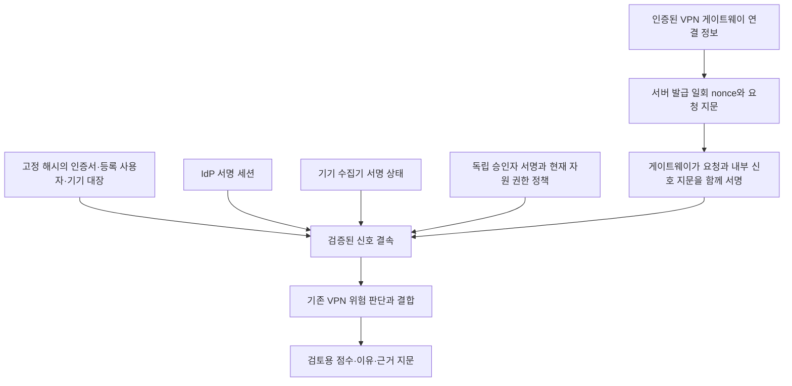

# extra: VPN 연결의 검증된 기기·권한 신호 — v42

2026-11-13 · 비용 없는 로컬 구현/비교. [이전 VPN 오탐 검증](extra-vpn-precision-audit.md)의 관측 부족을 보완하는 **선택형 신호 결속 경로**다.
**등록 인증서·실측 연결 정보·신선한 기기 상태·IdP 세션·현재 권한 정책·요청별 승인을 함께 검증한다.**
[전체 근거 JSON](infrastructure-results/extra-vpn-verified-signals-v42-20261113.json)에 구현·모델/원본/시험 지문·전후 결과와 한계를 기록한다.

기존 공개 VPN 로그에는 이 신호가 없어 과거 오탐60/60/88·미탐0은 그대로다.
새 통제 기능 시나리오에서는 정상20건의 오탐20→0, 경보/검토 유지 대상29건의 누락0→0을 확인했다.
이 수치를 실제 VPN/MDM 도입 성능이나 원래 여섯 영역95% 목표 달성으로 해석하지 않는다.

## 연결 구조와 권한 경계



검증된 상태는 신뢰된 운영자 설정으로 고정한 발급자의 서명이 통과했다는 뜻이다.
서명만으로 실제 기기 상태의 진실성·하드웨어 인증이나 발급자 무결성을 보증하지 않는다.
인증서·TLS 채널 지문은 실제 게이트웨이의 mTLS/PoP·TLS exporter 관측과 등록 절차에서 얻어야 한다.
이 저장소 변경은 그 결속/검증 인터페이스와 로컬 기능 경로를 구현했으며 실제 VPN hook/MDM 설치·운영 인수는 남는다.

## 무엇을 함께 검증하는가

| 근거 | 재사용/추가 경로 | 확인 조건 |
|---|---|---|
| 게이트웨이 | 신규 `zt-vpn-binding-1` | 지정된 게이트웨이 발급 키, tenant/server/session/version, nonce, 요청·내부 신호 SHA |
| 연결/기기 등록 | 신규 고정 해시 등록 대장 | 인증서 SHA가 해당 gateway/user/device에 등록·활성 상태인지, 버전·유효 기간·중복 매핑 |
| 기기 상태 | 기존 `SignedContinuousSignal` + `verify_observation` | 별도 기기 발급자, 정확한 device ID, 관리 기기·healthy, 관측30초 이내 |
| 사용자/세션 | 기존 `SignedSessionSignal` + `verify` | 별도 IdP 발급자, 사용자/기기/세션/버전/자원/행위/접속 IP 일치, active·인증/MFA 성공 |
| 현재 권한 | 기존 `PinnedResourcePolicies` | 운영자가 고정한 자원·역할·REMOTE_ACCESS 허용, 버전·유효 기간 |
| 업무 승인 | 기존 `PinnedApprovalVerifier` | 독립 승인자 키, 정확한 이벤트/사용자/기기/자원/행위·현재 요청 지문, remote_access 범위만 허용 |

IP나 VPN 로그의 이름 문자열로 기기를 인증하지 않는다.
연결은 tenant·gateway·session·client certificate SHA·TLS channel SHA에 묶고 endpoint와 원문 SHA도 대조한다.
게이트웨이/IdP/기기 수집기의 source는 역할별로 분리하며, 승인자 키가 이 키들과 같으면 거부한다.
원시 VPN 로그 시각은 기존 실험과 같은 UTC 계약으로 대조한다. 실제 게이트웨이의 로그 시간대 설정도 수집 경로에서 확인해야 한다.

## 실패·변경·위험 보존

- 인증된 analyst/admin 역할의 서버 호출만 요청 nonce를 만들 수 있다. 클라이언트가 임의의 기기/연결 사실을 넣는 공개 API는 추가하지 않았다.
- nonce는 일회·최대30초이며 교체된 nonce·서버/세션/버전·기기·자원·인증서·TLS 채널·원문 불일치를 거부한다.
- source/key 비활성·만료·서명 변조, 등록 해제·잘못된 인증서 매핑, 권한/승인 폐기·범위 불일치·파일/pin 불일치는 경보를 낮추지 않는다.
- 기기/사용자의 adverse 사실과 정책상 역할/행위 거부는 경보를 높인다.
  검증된 adverse 연결 상태는 프로세스 내60초 유지하며 뒤이은 healthy 신호로 지우지 않는다.
- 인증 실패·TLS 오류·명령/SQL·경로 탐색·민감 파일·스캐너·권한 도구·서비스 정지·명시적 거부 등 알려진 보안 징후는 healthy 승인으로 억제하지 않는다.
- 기존 기준선 위험과 이전60초 위험 유지가 있으면 보조 VPN 점수를 낮추지 않는다.
- 양성 신호를 모두 검증한 해당 요청에서만 **보조 VPN 신규 연결 위험**을 낮출 수 있다.
  신호가 없으면 기존 점수·경보·이유가 바이트 결속 비교상 같다.
- 결과에는 검증 상태와 근거 SHA를 추가할 수 있다. 원문 서명·개인키는 결과에 내보내지 않는다.
- 모든 결과는 `automatic_enforcement_allowed=False`다. 접근 허용·새 grant·권한 복원·차단/회수를 실행하지 않는다.

요청/부정 상태 저장은 로컬 메모리에 한정하고 용량을 제한했다.
재시작 시 이전 nonce는 미상으로 거부하며, 새 요청은 새 근거를 검증해야 한다.
분산 재사용 방지·장기 사고 상태·재해 복구/운영 승인을 구현했다고 주장하지 않는다.

## 같은 공개 VPN 자료 비교

실제 과거 자료에 임의의 healthy/승인 값을 덧붙이지 않았다. 각 행의 이전/신규 결정 전체가 같음을 확인했다.

| 자료 | 전체 VPN 행 | TP 이전→신규 | FP 이전→신규 | FN 이전→신규 | 검증 신호 보유 행 |
|---|---:|---:|---:|---:|---:|
| russellmitchell | 5,537 | 28→28 | 60→60 | 0→0 | 0 |
| santos | 5,622 | 28→28 | 60→60 | 0→0 | 0 |
| fox | 7,299 | 28→28 | 88→88 | 0→0 | 0 |

18,458행의 이전/신규 결정 순서 SHA가 같고 기존 라벨·원본·모델·임계값은 보존했다.
따라서 **과거 공개 로그에서 오탐이 감소했다고 보고하지 않는다.**

## 새 서명 신호의 통제 기능 비교

| 통제 시나리오 49건 | TP | FP | FN | TN | 정밀도 | 재현율 | F1 |
|---|---:|---:|---:|---:|---:|---:|---:|
| 기존 VPN 판단 | 29 | 20 | 0 | 0 | 59.18% | 100.00% | 74.36% |
| 요청별 검증 신호 결합 | 29 | 0 | 0 | 20 | 100.00% | 100.00% | 100.00% |

이 표의 양성은 악성 행위가 독립 확인됐다는 뜻이 아니라 경보/검토 유지가 요구되는 정책 통제 입력이다.
정상20건은 실제 암호 서명·등록 매핑·현재 정책·일회 요청 승인을 함께 통과한 통제 입력이다.
양성 통제에는 침해/불명/비관리 기기, 비활성 사용자, MFA/인증 실패, 승인되지 않은 역할/기기,
승인 누락/위조, 혼합 요청, 오래되거나 미래인 상태, 독립 원시 보안 징후가 포함된다.
기존 TP 손실과 새 FP는0이었다.
이들은 작성한 기능 반례이며 실제 공격 성공/실사용 정상 업무에서 독립 수집한 정답이 아니다.
100% 지표는 이 기능 묶음에만 적용하고 전체/독립 목표와 구분한다.

## 코드와 사용

- `scripts/f1_lab/vpn_verified_signals.py`: 모델·서명·권한·nonce/연결 결속과 선택형 위험 어댑터.
- `scripts/f1_lab/vpn_enrollment.py`: 인증서→등록 사용자/기기 대장의 고정 해시·버전·기간 검증.
- `scripts/f1_lab/vpn_signal_controls.py`: 별도 발급자 키를 메모리에서 생성하는 통제 입력. 개인키 파일을 만들지 않는다.
- `scripts/run_vpn_verified_signals.py`: 기존 로그 불변 비교와 통제 기능 시나리오 실행.

서버 측 사용 순서는 아래와 같다. `connection`은 인증된 게이트웨이 실측/등록 결과이고 `principal`은 기존 인증 계층이 결정한 값이어야 한다.
`features`와 `retained_context`도 서버가 원시 관측으로 계산하며 클라이언트가 제출한 요약을 신뢰하지 않는다.

```python
challenge = bridge.issue(connection, principal)  # 로컬/test 한정, 서버 시각
# 발급자들은 기존 서명 세션/기기 상태와 현재 요청 지문에 묶인 승인을 제공한다.
# gateway는 binding_bytes(binding)에 서명해 내부 신호 SHA와 nonce를 함께 결속한다.
bundle = VPNEvidence.model_validate_json(gateway_bundle_json)
result = VerifiedVPNRisk(frozen_v40b, bridge).decide(
    features, case_id, retained_context,
    nonce=challenge.nonce, evidence=bundle,
    raw_line=raw_line, principal=principal,
)
```

기존 모델/공개 자료를 가진 로컬 환경에서는 새 출력 폴더로 재현한다.

```powershell
.venv\Scripts\python.exe -m scripts.run_vpn_verified_signals `
  --plan infra/f1-lab/operation-refinement-protocol.json `
  --expected-plan-sha256 f7fd853011b6eb6d3fa07d95146e6c8e774bf13395fb027c16961eb6813ce629 `
  --prior runtime/f1/operation-retention-v40b-20261113/run.json `
  --expected-prior-sha256 2dbdf7b50cc652aa3140ff7afece6640e4b52d353d6c4e201ca21964c427ae82 `
  --output runtime/f1/vpn-verified-repro-new
```

## 로컬 검증과 남은 인수

- 최초 전체 묶음: Windows F1 관련 **826개**, network none Linux 전체 **3646개** 통과.
- 등록 인증서 결속·추가 원시 차단 조건·검증 메타데이터를 마무리한 뒤 최종 관련 묶음은 Windows/Linux **각280개** 통과.
  서로 다른 스냅샷과 중복 시험을 한 번의 전체 실행으로 합산하지 않는다.
- 최종 코드/시험 파일은 최종 Linux 스냅샷과 같다. 각 실행 소스 지문·OOM false·소유 컨테이너 제거를 확인했다.
- 게이트웨이/IdP/기기/승인 서명, scope·nonce 재사용/동시 경합, 미래/만료/시각 역행,
  현재 source/승인/등록부/정책 변경, 실제 기준선 위험과 과거 adverse 보존을 검사했다.
- 실제 데이터·기능 비교 23.248초. 전체125만 행과 실제 Docker VPN/mTLS 교섭 시험을 이번 수치로 대체하지 않는다.
- AWS·유료 API·GitHub push0. 기존 앱/PEP·규칙/라벨/모델·사용자 ZIP을 유지했고 예약 harrison/wilson 본문을 읽지 않았다.

다음은 실제 게이트웨이의 TLS exporter·등록 절차와 기기 상태 수집기의 출처를 연결해 새 원시/정답을 확보하는 것이다.
서명 발급자의 실제 MDM/IdP 정확성, 저장/키 보호·분산 nonce/사고 상태, 운영 배포·독립 성능 평가는 남는다.
원래 여섯 영역의 독립 목표와 운영 채택은 미완료다.
