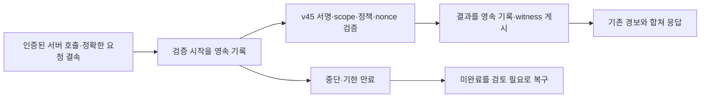

# 웹 위험·검토 기록의 영속화와 중복·중단 복구 v46

2026-11-13 · `extra`에서 [v45 웹 서버 근거 검증](extra-web-verified-context.md)에
**SQLite 기록부와 복구 어댑터**를 선택적으로 연결했다.
검증된 위험과 검토 기록을 요청별로 남기고, 재시작·중복 호출·이후 정상/미확인 증거 때문에
기존 경보가 사라지지 않도록 했다. 앱·승인/복구·PEP 경로에는 연결하지 않았다.

실행 예제10개·신규 테스트41개를 포함한 **Windows/Linux 관련357개씩 통과**했다.
[공개 실행 근거](infrastructure-results/extra-web-durable-v46-20261113.json)에 결과·소스/시험 지문을 기록했다.
실제 서버 관측 수집0·새 독립 자료0·새 F1 평가0이며, 기존 웹 FN30/FP19는 이전 실측 기록으로 보존한다.

## 저장과 응답의 순서



[web_evidence_ledger.py](../scripts/f1_lab/web_evidence_ledger.py)는 SQLite `synchronous=FULL`,
정규화한 기록의 해시 연결, 별도 HMAC 확인 파일을 사용한다.
공통 복구 유틸리티의 원자적 파일 저장·프로세스 잠금 방식을 재사용한다.
[web_durable_risk.py](../scripts/f1_lab/web_durable_risk.py)는 저장 전에 요청·원문·특징을 대조하고
검증 시작→서명 검증→완료 게시의 순서를 조정한다.

1. tenant·server·request ID로 요청 키를 만들고, 전체 요청 SHA와 운영자 SHA를 별도로 결속한다.
   같은 요청 ID의 본문·주체·세션/버전·자원·case 등이 바뀌면 기존 기록을 덮지 않고 충돌로 거부한다.
2. nonce의 SHA로 검증 시도를 식별한다. 같은 요청의 정확한 재시도는 중복으로 처리하고,
   다른 요청으로 nonce를 옮길 수 없다. 원래 nonce 문자열은 저장하지 않는다.
3. 서명 검증 전에 `started`를 게시한다. 검증 결과는 `completed`까지 저장·게시한 뒤에만 응답한다.
   저장 실패는 예외로 전달하며 정상/허용 결과로 바꾸어 반환하지 않는다.
4. 동일 요청의 점수 최댓값과 경보/검토 여부를 이력에서 다시 계산한다.
   검증된 adverse도 한번 기록되면 이후 정상/누락/재사용 결과로 자동 해제하지 않는다.
5. 미완료 시도는 검토 필요 상태다.30초 기한 전에는 복구로 가로채지 않고,
   기한 만료 후 명시적 복구에서 `interrupted`로 남긴다. 중단을 검증 성공이나 악성 확정으로 만들지 않는다.

새 wrapper를 사용하지 않는 기존 v44/v45 경로는 바꾸지 않았다.
새 서명 검증은 기존 v45가 수행하며 기록부 자체는 서명을 대신 검증하지 않는다.
저장용 결과 객체를 외부 클라이언트가 제출하는 API도 만들지 않았다.

## 중단·중복 상황에서 보장하는 것

| 상황 | 처리 |
|---|---|
| 동일 요청/nonce 중복 | 검증 결과를 새로 받아들이지 않고 기록된 위험/검토 상태를 반환. 이벤트 수 증가 없음 |
| DB·어댑터 재개, 메모리 challenge 소실 | 동일 요청의 기록된 위험을 복원. 오래된 서명을 새 증거로 승인하지 않음 |
| 나중에 정상 또는 미확인 증거 | 새 시도를 기록하되 앞선 경보·검토·높은 점수 보존 |
| 검증 뒤 완료 저장 실패 | 성공 응답 없음. 시작 기록이 남아 기한 만료 후 불확실한 검토 대상으로 복구 |
| DB commit 뒤 witness 게시 전 종료 | 게시 대기 head와 실제 DB가 일치하는지 대조해 복구 |
| DB 변조·DB만 과거로 복원·witness/key 누락·손상 | 저장소 사용 불가로 거부. 비어 있는 정상 이력으로 취급하지 않음 |
| 용량 한도 | 진행 중 시도의 완료 공간도 예약. 과거 기록을 자동 삭제하지 않고 새 접수를 거부 |

중요한 경계는 **영속 기록을 마친 결과만 응답한다**는 것이다.
검증이 메모리에서 끝난 직후 완료 저장 전에 종료됐다면 그 미응답 결과까지 복원했다고 말할 수 없다.
이 경우 실제 결론은 미확정이며 시작 기록을 검토 필요로 남긴다.
원래 signed proof bundle은 이 기록부에 보관하지 않으므로, 독립적인 재검토를 위해서는 수집기 쪽의
원본 증거 보관·접근 통제와 SHA 대조도 후속으로 필요하다.

기록은 실제 접근 허용·회수·차단·복원을 실행하지 않는다.
기록된 과거 adverse를 반환할 때 `retained_adverse`로 표시해 새 증거 검증과 구분한다.
현재 자동 종결/해제/삭제 API는 없으며 사람의 사건 검토·종결 권한 흐름은 별도 인수해야 한다.

## 저장 범위와 무결성의 한계

기본 한도는 기록2000개이고 설정 가능한 범위는2~10000개다.
기록8192바이트·DB64MiB의 입력 경계와 정확한 스키마/수명 전이를 검사한다.
새 시도는 시작/완료 두 자리를 포함해, 이미 진행 중인 시도의 남은 자리까지 예약한다.
이 범위의 로컬 실험용이며 운영 처리량·장시간 용량 계획을 측정한 결과는 아니다.

DB에는 요청/운영자/nonce/증거의 해시, 점수·경보·검토·시도 상태와 시각을 저장한다.
본문·원문 로그·평문 nonce·Ed25519 개인키·signed proof bundle은 저장하지 않는다.
식별자 해시는 연결을 위한 가명화이며 익명화나 암호화를 보장하지 않는다.

별도 `witness` 디렉터리에는 무결성 확인용 **HMAC 비밀키32바이트**를 의도적으로 영속 저장한다.
이것은 v45의 서명 개인키/API 키와 다르며 공개 JSON·Git에는 포함하지 않는다.
POSIX 권한을 제한하고 Windows에서는 상속 ACL을 포함한 실제 운영 권한 설정이 추가로 필요하다.
보고서에는 공개 가능한 head/checkpoint만 남긴다.

DB와 witness는 같은 호스트의 논리적으로 분리된 파일이다.
DB·witness·키를 함께 과거 상태로 되돌리거나 같은 관리자 권한으로 모두 위조하는 공격,
전체 호스트/디스크 소실·물리 장애·원격 WORM·호스트 HA까지 보장하지 않는다.
이전 head를 별도 보호 위치에 고정하는 절차와 일관된 백업·복원은 후속이다.
DB 파일만 따로 복원해 최신 witness와 맞지 않으면 이번 검증은 의도적으로 실패한다.

## 실제 검증 결과

실행 예제10개는 검증된 위험 저장, 정확한 중복, 나중 정상/누락 증거, 어댑터 재개,
기준 검토 저장, 기한 만료 중단 복구, 다른 운영자 거부, 본문 충돌 거부, 기존 위험 유지다.
예제의 원래 요청에는 검증 시도3개·이벤트6개가 남았고 경보가 유지됐다.
전체 예제 저장소 head는 이벤트10개이며 별도 미완료 요청은 adverse가 아닌 검토 필요 상태다.
예제는 v45의 고정 테스트 시계를 사용하고31초를 논리적으로 전진시켰다. 실제 서버 관측/대기 시간 측정은 아니다.

신규 집중41개에는 **실제 하위 프로세스 종료8경우**가 포함된다.
검증 시작/완료 각각에 대해 prepare 후·DB commit 전·DB commit 후·게시 후를 시험했다.
별도 프로세스 두 개의 동시 시작도 한 번만 기록됐고, 스레드 중복은 서명 검증 한 번·기록2개로 확인했다.
tenant/운영자·요청 충돌·시계 역행·용량 예약·DB/witness 손상·되돌림·재초기화 거부도 검사했다.

최종 Windows357·network none Linux Docker357개가 각각 통과했고 실패/skip0이다.
Linux 소스742파일이 전후 동일했고 exit0·OOM false·해당 소유 컨테이너 제거를 확인했다.
Ruff도 통과했다. 이전 집중37/41개와 최종357개를 합쳐 한 번의 실행 건수로 쓰지 않는다.
전체 앱·실제 IdP/PDP/센서·물리 장애 인수는 이번에 수행하지 않았다.

## 재현과 다음 작업

실제 예제는 `runtime/f1/web-durable-controls-v46-20261113`,
관련 시험은 `runtime/f1/web-durable-tests-v46-20261113`이다.
[고정 실행 프로토콜](../infra/f1-lab/web-durable-controls-protocol.json)의 SHA는
`46a71febf12658007c6303160b9d0674de74591de1645205e7c55140c7822bfd`다.

```powershell
.venv\Scripts\python.exe -m scripts.run_web_durable_controls --plan infra/f1-lab/web-durable-controls-protocol.json --expected-plan-sha256 46a71febf12658007c6303160b9d0674de74591de1645205e7c55140c7822bfd --output runtime/f1/web-durable-controls-new
```

재현에는 고정한 v45 receipt가 필요하고 새 출력 폴더만 허용한다.
새 키·nonce·store ID 때문에 재실행 지문은 달라지지만 기대 결과는 같아야 한다.
`events.sqlite`와 비밀 witness 파일은 로컬 runtime에만 두고 공유 근거에는 상태와 지문만 포함했다.

다음은 보호된 checkpoint와 일관된 백업·복원, 실제 요청 ID/본문·IdP/PDP/실행 수집기 연결,
상위 사건 저장소의 권한 있는 검토/종결 흐름 인수다.
원래 여섯 영역의 새 독립 평가·실제 서버 수집·F1 개선은 미완료다.
기존 데이터·규칙·모델·앱·사용자 ZIP은 보존했고, 유료 API/AWS·다운로드·GitHub push·병합은0이다.
