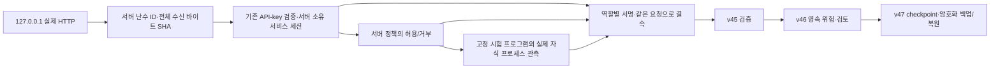

# 로컬 HTTP 요청 수집과 검증·기록·복원 연결 v48

2026-11-13 · `extra`에서 **실제 loopback TCP HTTP 요청의 바이트 수집**을 기존 웹 근거 검증·
영속 기록·암호화 복원 경로에 연결했다. 작성한 관측 객체를 입력하던 이전 예제에서,
서버가 받은 본문과 인증/권한/실행 hook 결과를 입력으로 만드는 단계로 진행했다.

실행 예제10개에서 로컬 HTTP9건을 수집했고5건이 서명 검증/기록 경로에 들어갔다.
서버 소유 고정 시험 프로그램4회 실행을 관측했고, 통제된 권한 거부/실행 불일치의 위험 기록이
암호화 복원 후에도 유지됐다. **운영 관측0·새 독립 최종 사례0·F1 성능 평가0**이다.
[공개 실행 근거](infrastructure-results/extra-web-capture-v48-20261113.json)에 결과와 지문을 기록했다.

## 수집 경로



- [web_request_capture.py](../scripts/f1_lab/web_request_capture.py): ASGI 수신/응답 시작 관측, 메타데이터 spool, 기존 검증/기록 연결.
- [web_capture_lab.py](../scripts/f1_lab/web_capture_lab.py): 실제 API-key 검증과 로컬 서비스 세션, 고정 정책/시험 프로그램을 가진 시험 서버.
- [web_capture_transport.py](../scripts/f1_lab/web_capture_transport.py): 임시 loopback listener와 종료 확인.
- [실행 예제](../scripts/run_web_capture_controls.py): 고정된 기존 모델을 로드해 HTTP 수집부터 복원까지 확인.

기존 `app/security.py`의 API-key digest 검증 함수를 재사용했다.
기존 운영 `app`/승인·복구/PEP에 middleware를 설치하거나 팀원 브랜치를 변경하지 않았다.
다른 ASGI 서비스에 적용하려면 인증/PDP/실행 지점이 명시적 `ServerObservation`을 제공해야 한다.
hook이 없으면 맥락 미확인으로 남으며 헤더에서 대신 만들어 넣지 않는다.

## 실제로 확보한 것과 추정하지 않는 것

| 항목 | 구현/관측 | 범위 |
|---|---|---|
| 요청 ID | 서버 난수32hex. 클라이언트 ID를 권한·중복 키로 채택하지 않음 | 재시도마다 새 HTTP 수신 ID. 업무 작업의 exactly-once 보장은 아님 |
| 본문 | ASGI에서 실제 수신한 전체 바이트의 SHA·크기 | 원문 저장 없음. 미완료/거부된 스트림을 빈 본문으로 바꾸지 않음 |
| 인증 | 실제 수신 API key를 기존 hash 비교 코드로 확인 | 로컬 서비스 계정이며 외부 IdP/OIDC·실제 사람·기기 확인이 아님 |
| 세션 | 서버 메모리의 service-session ID/버전/활성 상태 | 클라이언트 세션 헤더 무시. 운영 세션 저장소/분산 회수 인수는 미완료 |
| MFA | API-key 요청에 `not_used`로 명시 | MFA 성공을 만들지 않으며 정상 요청도 검토 상태 유지 |
| 권한 | 고정 서버 정책의 역할·method·경로 대조 결과 | 외부 기업 PDP 연동 아님 |
| 실행 | 실제 생성한 자식 PID와 인터프리터 지문·요청 결속 | 같은 서버가 관측한 고정 Python 시험 프로그램이며 독립 EDR/attestation 아님 |

시험의 `.php` 경로는 로컬 자원 alias다. 실제 PHP 엔진·파일 업로드 기능은 구현하지 않았다.
실행 프로그램은 서버에 고정된 본문 checksum 처리만 하며 query의 인코딩 명령을 실행하지 않는다.
거부 경로는 기본적으로 실행을 차단한다. 명시적 로컬 fault 설정에서만 거부 뒤 고정 프로그램을
실행시켜 검증 경로가 모순을 기록하는지 시험했다. 이 설정은 HTTP 입력으로 바꿀 수 없다.
이 사례를 실제 웹셸 침해나 공격 탐지 성공률로 표현하지 않는다.

인증/권한/실행 서명 키는 서로 다르지만 같은 시험 프로세스 안에 있다.
서명은 등록한 source와 결속/무결성을 검사하며 실제 수집기 분리·센서 진실성·하드웨어 attestation을 증명하지 않는다.
외부 서비스가 보내는 임의 JSON/헤더를 신뢰된 관측으로 채택하는 endpoint도 만들지 않았다.

## 누락·위조·실패 처리

수신 본문은 최대1MiB·1024조각·전체 수신5초로 제한하고 원래 조각 순서대로 handler에 전달한다.
끊김·시간 초과·잘못된 stream·한도 초과는 `body_sha256=null`과 미완료 상태로 남긴다.
실제로 완전한 빈 본문을 받은 경우만 빈 바이트 SHA를 기록한다.
제어 문자·모호한 raw target을 임의로 정리해 정상 URL로 바꾸지 않는다.

`X-User`, `X-Tenant`, `X-Session`, `X-Session-Version`, `X-Request-ID`는 신뢰된 신원/세션을 바꾸지 못한다.
실제 TCP 시험은 proxy header와 client 환경 proxy를 비활성화했다.
일반 적용에서는 ASGI 서버/역방향 proxy의 신뢰 설정을 별도로 인수해야 한다.
없는 peer IP·주체·세션·자원/권한/실행 정보를 정상 기본값으로 채우지 않는다.

기존 v45~47 연결은 인코딩 명령 요청 범위에 한정한다. 이 범위를 벗어난 요청도 메타데이터를
수집하지만 서명 검증/탐지 성공으로 세지 않는다. 같은 관측 projection의 case hash가 같아도
서버 요청 ID와 전체 요청 결속으로 서로 다른 HTTP 요청을 구분한다.

응답 시작 전에 수집/기록을 호출한다. 저장 실패는503으로 노출하고 정상 수집 완료로 반환하지 않는다.
그러나 handler는 이미 실행됐을 수 있으므로503이 업무 실행 rollback을 뜻하지 않는다.
capture의 status는 ASGI 응답 시작 시점의 application status이며 클라이언트 최종 전달 성공을 증명하지 않는다.
응답 시작 전 application 예외도 세부 예외 문자열 없이500 수집 기록으로 남긴다.

## 영속성과 개인정보

요청 메타데이터 spool은 새 비공개 폴더에 난수 ID별 JSON을 원자적으로 게시하고 최대1000건으로 제한한다.
본문/원문 target·인증 키·서명 개인키·평문 세션은 저장하지 않고 SHA·크기·상태·결과를 남긴다.
수집된 요청을 복원 대조에 사용할 때는 같은 tenant의 지정 collector 운영자만 분리된 복사본을 얻는다.
이 요청 객체 map은 메모리에만 있고 재시작 후 재구성을 보장하지 않는다.

spool은 단일 프로세스의 관측 메타데이터이며 서명된 원본 증거 보관소가 아니다.
권한 있는 관측이 갖춰진5건의 결과는 별도 v46 기록부에 남겼다.
재시작/암호화 복원으로 위험을 유지하는 경계와, 원본 proof/요청 상관 자료를 장기 보관하는 작업은 구분한다.
다중 worker·수신 전 durable intake·원본 증거 보관과 사건 검토/종결 연결은 후속이다.

## 검증 결과

| 실제 TCP 사례 | 결과 |
|---|---|
| 완전한 binary body | 수신 SHA와 고정 child가 처리한 SHA 일치 |
| 자격 증명 누락/오류 |401, 신원/세션을 만들어 검증하지 않음 |
| 실제 서버 정책 거부 |403, child 실행 없음 |
| 사용자/세션/요청/forwarded 헤더 위조 | 서버 관측/난수 ID 유지 |
| 완전한 빈 본문 | 실제 빈 바이트 SHA |
| 본문 초과 |413, 미완료/지문 없음, handler 미실행 |
| 로컬 service-session 폐기 |401, header로 새 세션 생성 불가 |
| 통제된 거부+실행 불일치 | 서명 검증된 adverse 기록 |
| 위 기록 암호화 백업→복원 | adverse·경보 유지 |

예제10조건·HTTP9건·영속 결정5건·고정 child4회다. listener와 child는 종료했다.
표본은 이미 관찰한 로컬 개발/기능 자료이며 정상/위협 독립 정답이 없다. 최종 평가에 재사용하지 않는다.
기존 고정 모델3종은 실제로 로드했지만 본문 SHA 추가를 새로운 탐지 특징이나 F1 개선으로 계산하지 않는다.
기존 공개 원시1,259,637행은 이번에 재생하지 않았다.

신규 테스트28개 포함 최종 Windows415·network none Linux Docker415개 통과, 실패/skip0·Ruff 통과다.
ASGI 조각 전달·타임아웃/끊김·본문/target 한도·실제 TCP·인증/정책/실행·spool 실패·운영자 범위를 검사했다.
Linux756소스 전후 동일·exit0/OOM false·해당 소유 컨테이너 제거를 확인했다.
전체 앱 회귀·외부 IdP/EDR·기업 운영/독립 성능 평가의 완료는 아니다.

## 재현과 다음 단계

실제 실행은 `runtime/f1/web-capture-controls-v48-20261113`, 관련 시험은 `runtime/f1/web-capture-tests-v48-20261113`이다.
[고정 프로토콜](../infra/f1-lab/web-capture-controls-protocol.json)의 SHA는
`5ebaa094a9f120e69144ffcd8f94bca1f8c61453c2cb711a4bdb52375d486a0d`다.

```powershell
.venv\Scripts\python.exe -m scripts.run_web_capture_controls --plan infra/f1-lab/web-capture-controls-protocol.json --expected-plan-sha256 5ebaa094a9f120e69144ffcd8f94bca1f8c61453c2cb711a4bdb52375d486a0d --output runtime/f1/web-capture-controls-new
```

고정한 기존 receipt/모델과 새 폴더가 필요하다. 자격 증명·서명 키와 예제 복구 키는 메모리에서 생성해
재실행 지문은 달라질 수 있다. 예제 암호문은 같은 실행에서 복원한 기능 산출물이고 운영 키를 별도로 제공하지 않는다.
공개 JSON에는 요청 원문/본문/키를 넣지 않았다. 단위 시험의 별도 임시 키 파일도 Git에는 포함하지 않는다.

다음은 실제 운영 IdP/PDP/실행 수집기·세션 저장소 연결, durable intake와 원본 증거 보관,
writer 절체 및 상위 사건 검토/종결 흐름의 인수다.
`local`/`test` 외에는 활성화하지 않았고 유료 API/AWS·다운로드·GitHub push·병합은0이다.
