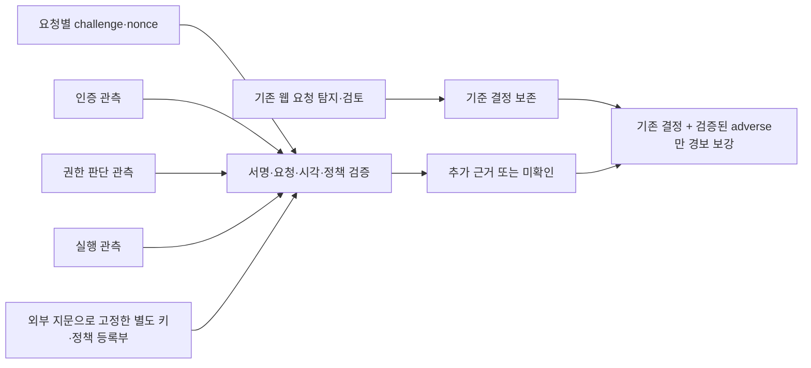

# 웹 요청의 검증 가능한 서버 근거 연결 v45

후속 [v46 영속 위험·검토 기록부](extra-web-evidence-ledger.md)는 선택형 저장 어댑터를 추가했다.
아래 v45의 메모리 상태·미구현 범위는 당시 기록으로 보존하며 실제 서버 수집/새F1 측정0은 그대로다.

2026-11-13 · `extra`의 무료 로컬 후속이다. [v44 명령 요청 검토](extra-web-residual-review.md)를
보완하기 위해 **요청별 인증·권한·실행 관측의 서명 검증 어댑터와 수집 계약**을 구현했다.
실제 IdP/PDP/실행 센서는 아직 연결하지 않았다. 기존 공개 로그에 없는 신원·본문·정책·실행 사실을
추정해서 채우지 않았으며, 실제 서버 관측 수집0·새 독립 평가0·새 F1 측정0이다.

[공개 실행 근거](infrastructure-results/extra-web-context-v45-20261113.json)에 기능 제어군13개,
입력/코드/시험 지문과 한계를 기록했다. 테스트가 통과했다는 것을 기업 성능이나 실제 공격 탐지율로 바꾸어 쓰지 않는다.
기존 앱·승인/복구·PEP 경로와 모델·규칙·평가 라벨은 그대로 보존했다.

## 구현한 흐름



그림의 인증/권한/실행 입력은 현재 서로 다른 메모리 키로 만든 **통제 입력**이다.
실제 서로 다른 서비스/운영자/호스트로 분리된 수집기가 배포됐다는 뜻은 아니다.
기존 VPN 신호는 웹 본문·정책·실행 사실을 표현하지 않으므로 거짓 SecurityEvent를 만들어 끼워 넣지 않았다.
기존의 Ed25519·외부 지문·정확한 scope·짧은 유효기간 검증 방식을 웹 전용 계약에 적용했다.

핵심 코드는 [web_verified_context.py](../scripts/f1_lab/web_verified_context.py),
통제 입력 생성은 [web_context_controls.py](../scripts/f1_lab/web_context_controls.py),
재현 실행은 [run_web_context_controls.py](../scripts/run_web_context_controls.py)에 있다.
이 경로는 `local`/`test`에서만 활성화되며 운영 HTTP API를 새로 노출하지 않는다.

## 수집기에 요구하는 명시적 필드

| 자료 | 필요한 내용 | 신뢰 경계 |
|---|---|---|
| `WebRequest` | tenant/server/request/case/subject/session/version/resource, method, target/body/raw SHA, 관측 시각 | 인증된 서버 측 호출자가 실제 요청에서 확보해야 함. 브라우저가 보낸 자기 주장으로 채우지 않음 |
| 인증 관측 | success/failure/unknown, MFA success/failure/not_used/unknown | 해당 요청·주체·세션 상태를 확인한 인증 수집기의 서명 |
| 권한 관측 | allow/deny/unknown, execute_uploaded_script, 정책 SHA·버전 | 독립된 권한 판단 수집기의 서명 + 운영자가 고정한 자원별 정책과 대조 |
| 실행 관측 | executed true/false/null, 실행 파일·process 참조 SHA | 실행 수집기의 요청 상관 관측. executed=true면 두 SHA 필수이며 미관측을 false로 만들지 않음 |
| 등록부 | 키별 역할/tenant/server/subject/resource scope·활성 여부·유효기간, 자원별 정책 SHA·최소 버전 | 이벤트 안의 키를 신뢰하지 않고 외부 SHA와 최소 버전으로 고정 |

본문이 실제로 비어 있음을 서버가 확인한 경우만 빈 바이트의 SHA를 쓴다.
공개 access 로그에 본문이 없다는 이유로 빈 본문이라고 가정하지 않는다.
로그의 IP·User-Agent·referer만으로 사용자·세션·권한·기기 상태를 채우지 않는다.
실제 실행을 관측하지 못했으면 `executed=null`이며 권한 거부와 실행이 함께 입증됐다고 할 수 없다.

서명은 등록된 키가 해당 요청에 대해 그 관측을 진술했다는 무결성을 확인한다.
해시/서명만으로 본문의 실제 내용·센서의 진실성·주체 신원·하드웨어 attestation을 입증하지 않는다.
현재 어댑터는 본문 원문을 보관하거나 직접 다시 해시하지 않고, 서버/수집기들이 같은 body SHA에
결속했는지 검사한다. 실제 수집기를 연결할 때 이 해시 생성 위치와 요청 상관 관계도 검증해야 한다.

## 검증과 판단

1. API key/OIDC로 인증한 해당 tenant의 analyst 이상만 challenge를 발급한다.
   challenge는 발급자 subject에 결속하고 원래 요청의 복사본을 별도로 저장한다.
2. 임의 nonce와 요청 전체의 SHA로 세 종류 증거를 같은 요청에 결속한다.
   tenant·server·subject·session/version·request ID·resource·case·method·target/body/raw SHA가 달라지면
   예전 증거를 사용할 수 없다. 원문 method/target과 로그 시각도 실제 문자열에서 대조한다.
3. 인증/권한/실행 세 역할을 모두 요구한다. 같은 공개키를 다른 역할로 재사용하거나
   같은 source를 다른 역할의 key ID로 꾸미는 등록도 거부한다. 관측 종류와 키의 역할도 대조한다.
4. challenge30초·관측/서명/키의 시각·등록부 유효기간/최소 버전·정책 SHA/버전을 검사한다.
   unknown은 정상으로 바꾸지 않는다. 매 요청마다 등록부를 읽고 결정 직전에도 지문을 확인한다.
5. nonce는 소유자 확인 후 검증 시도 한 번에 소비한다. 동일 시각의 동시 재사용도 lock으로 직렬화한다.
   다른 analyst가 nonce를 알아도 소유자의 요청을 소비할 수 없다.

| 검증 결과 | 결정 |
|---|---|
| 검증된 권한 거부 또는 인증/MFA 실패 **그리고 실제 실행 관측** | 점수1.0·경보/검토 추가. 자동 권한 회수/차단은 아님 |
| 인증·MFA 성공 + 권한 허용 + 명시적 실행 관측 | `consistent` 근거만 추가. 기존 경보·점수·검토 유지 |
| 권한 거부 + 실행 안 됨 | 검토 대상으로 유지. 실행된 우회로 추정하지 않음 |
| unknown·미관측·서명 오류·누락·만료·재사용·scope 불일치 | 해당 증거로 새 경보/정상 예외를 만들지 않고 기준 결정 유지 |
| nonce 또는 어댑터 없음 | 기존 v44 결정을 그대로 반환 |

정상 증거로 기존 탐지 신호를 낮추거나 검토를 지우지 않는다.
현재 모듈은 기존 경보 저장소/세션 회수 흐름에 연결되지 않았고, 앞선 adverse 결과의 영속 보관도 없다.
재사용 거부 후 반환하는 기준 결정은 **앞선 경보를 취소하는 명령이 아니다.** 실제 연동에서는 상위
사고/세션 저장소가 검증된 위험 기록을 보존하고, 새 호출 결과만으로 경보나 회수를 해제하지 않아야 한다.
재시작 시 pending challenge도 사라져 기존 증거는 다시 사용할 수 없다.

## 실제로 검증한 범위

기능 실행13개는 정상 맥락2·검증된 adverse3·검토2·불충분3·사용 불가3으로 모두 기대 결과를 냈다.
통제 입력의 인증/권한/실행 값은 작성한 기능 조건이고, 악성의 독립 정답이 아니다.
이13건으로 정밀도·재현율·F1을 계산하지 않는다. 개인키는 테스트 메모리에만 생성하고 공개 등록부만 썼다.
고정 테스트 시계는 `2026-11-13T09:00:00Z`이며 실제 서버 관측 시각이 아니다.

신규 집중 테스트60개를 포함해 Windows·network none Linux Docker에서 관련 **316개씩 통과**했다.
서명 위조·각 요청 필드 변경·세션 버전·본문 지문·키/역할 재사용·정책 변경·만료·시계 역행·
동시 재사용·다른 운영자·등록부 변경·누락/unknown·기존 경보 보존과 실제 실행기의13사례를 확인했다.
Linux 소스735파일은 전후 동일했고 exit0·OOM false·해당 소유 컨테이너 제거를 확인했다.
Ruff도 통과했으며 기존 전체 앱 회귀나 실제 운영 종단 인수는 이번에 다시 실행하지 않았다.

기존 R/S/Fox 로그에는 이 새 요청별 증거가 공급되지 않았다.
v44의 마지막 웹 실측 **FN30·FP19**와 넓은 명령 경보안의 실패 기록은 그대로 보존한다.
이번에는 원시 로그1,259,637행을 다시 재생하거나 성능을 재측정하지 않았다.
F1 향상·원래 여섯 영역95%/5% 목표 달성·새 독립 평가로 표현하지 않는다.

## 재현과 다음 단계

실제 실행은 `runtime/f1/web-context-controls-v45-20261113/run.json`,
관련 시험은 `runtime/f1/web-verified-context-tests-v45-20261113`에 있다.
[고정 프로토콜](../infra/f1-lab/web-context-controls-protocol.json)의 SHA는
`6d9bb3d0201a3a32960aa27349c098aa27d6081433794dead3d20e84f6233803`이다.

```powershell
.venv\Scripts\python.exe -m scripts.run_web_context_controls --plan infra/f1-lab/web-context-controls-protocol.json --expected-plan-sha256 6d9bb3d0201a3a32960aa27349c098aa27d6081433794dead3d20e84f6233803 --output runtime/f1/web-context-controls-new
```

새 출력 폴더만 허용하며 고정한 기존 v44 receipt가 필요하다.
새 메모리 키·nonce·실행 시각 때문에 재실행 receipt의 SHA는 달라질 수 있고 기대 조건은 같아야 한다.
API/AWS·새 다운로드·GitHub push·PR/브랜치 병합은0이다. 팀원 `aitest` 작업에는 손대지 않았다.

다음은 실제 요청 ID/본문 해시를 생성하는 서버 위치와 IdP/PDP/실행 수집기의 출처를 정하고,
동일 요청으로 연결되는지 검증하는 것이다. 영속 검토/위험 기록·중복 처리·운영 수집기와 상위 사고 흐름의
인수도 필요하다. 새 개발/보정 자료를 확보하고 후보 고정 전에는 최종 예약 자료를 열지 않는다.
