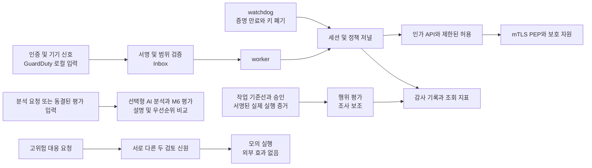

# 최종 보고와 시연용 원고

11월 16일 개발 마감에 맞춘 김택희 담당 초안이다. 최종 팀 제출 문서는 두 사람이 확인한다.
기준 구현은 `aitest` PR #55이며 후속 진단 보완과 전체 CI 결과는 해당 PR에 연결한다.
채희주의 `extra` 탐지 개선을 반영한 결과로 설명하지 않는다.

## 보고서 개인 활동

FastAPI 백엔드와 대응 자동화 엔진, 입력 자료 변환과 자동 시험을 담당하였다.
최초 계획의 리스크 안전 조건과 정책 실행을 상시 운영 경로로 확장하였다. 서명된 외부 신호를
검증하고 Inbox에 내구 저장한 뒤 worker가 처리하며, 새 입력이 없을 때도 watchdog이
증명 만료와 키 폐기를 점검하도록 구현하였다. 허용은 테넌트, 자원, 동작, 시간과 세션 버전에
제한하고 단일 사용 소비와 회수 상태를 기록하였다. GuardDuty EventBridge 경보는 실제 AWS
구독과 구분되는 로컬 입력 어댑터로 연결하였다.

정상 작업 기준선과 작업 승인, 수집된 실행 주체와 반출 목적지를 연결하였다. 필수 증거가
부족하면 판단을 보류하고 검증된 침해 신호는 기존 접근 집행 경로에 반영하였다. 고위험 대응은
요청자 이외 서로 다른 두 검토 신원의 승인을 요구하며 외부 조치는 모의 실행으로 제한하였다.
수집 큐와 서버 이력을 보관 정리하면서 미전송 자료, 중복 및 충돌 판별, 승인 사용과 취소,
회수 이력을 보존하였다. 전체 앱 복원에서는 기록자 정지, 암호화 백업, 격리 복원과 승인된
사본 재기동을 연결하고 이전 토큰 거부와 새 허용의 단일 사용을 검증하였다.

M6 실행기를 통해 같은 입력을 모델별로 전달하고 미탐, 오탐, 판단 보류와 응답 오류를
구분해 집계하였다. 공개 자료의 출처와 사용 조건, 해시와 라벨을 관리하고 세션 중복 및
정답 누수를 검사하였다. 현재 실행 증거 계약으로 기존 410건을 재실행했으며, 이미 검토한
통제 사례의 회귀 결과를 독립적인 최종 탐지 정확도로 표현하지 않았다. 기능 검증의 통과와
탐지 품질 목표의 달성은 별도로 보고하였다.

최초 계획에서 확대된 부분은 영속 전달, 상시 점검, 작업 승인과 실행 증거, 전체 복원 및
보관 정리이다. 이는 멘토링의 제로트러스트 명시와 지속 세션 검증 요구를 구체화한 것이다.
인프라 도구의 원래 구성과 성능 측정은 채희주 담당이며, 김택희는 앱 권한과 상태 의미,
기능 회귀 및 평가 집계를 제공하였다.

## 발표 8장 구성

| 장 | 화면 또는 도표 | 말할 내용 |
| --- | --- | --- |
| 1 문제와 범위 | 보호 자원과 신뢰 경계 | 로그인 한 번으로 계속 허용하지 않고 세션 사용 중에도 검증하는 로컬 프레임워크 |
| 2 실제 아키텍처 | 아래 데이터 흐름 | 입력, 지속 처리, 정책 상태, 자원 집행과 관측의 경계 |
| 3 제로트러스트 | 제한된 허용과 회수 상태 | 출처 및 신선도, 최소 권한, 단일 사용, 지속 검증과 감사 기록 |
| 4 AI 위치 | 규칙 경로와 선택형 분석 분기 | AI 설명과 우선순위 보조, AI 단독 허용 금지 |
| 5 운영 자동화 | 장애, 재시작과 복원 결과 | 미전송 보존, 중복 방지, 정리 후에도 회수 유지 |
| 6 기능 검증 | 관련 403과 무관 200, 복원 후 403 | 실제 HTTP 전달과 저장 계층 시험을 구분 |
| 7 평가 결과 | 집합별 보류 및 P/R/F1/FPR 표 | 통제 사례의 한계와 미달 지표까지 공개, extra 결과 별도 |
| 8 완료 범위와 다음 단계 | 인수표 | 실제 AWS, 실계정 조치, 패킷 IDS, 사람의 인수 및 독립 품질 검증 경계 |

위 그림의 AI 분기는 개념적 역할을 요약한다. 행위 평가마다 LLM을 자동 호출하는 연결은
구현하지 않았다. 실제 호출은 선택한 `/analysis` 분석 경로 또는 별도 M6 평가 실행에서
일어나며, 기본 지속 운영은 rule 모드다. 행위 평가와 LLM 결과에서 PEP로 직접 허용하는
화살표를 넣지 않는다. 실제 코드 기준의 상세 구조는 기존 아키텍처 문서를 함께 제시한다.

## 3분 시연 순서

0:00~0:30 보호 자원, mTLS와 기본 rule 모드를 설명한다. 모의 입력이라는 점을 밝힌다.

0:30~1:00 정상 허용의 한 번 사용과 재사용 거부를 보여준다. 관련 신호가 검증돼 반영된 뒤
기존 관련 접근은 403, 별도 정상 주체는 200임을 보여준다.

1:00~1:40 수집기 또는 코어의 장애 중 미전송 자료가 남고 재시작 후 같은 증거가 복구되는
기록을 보여준다. 완료 자료 보관 뒤에도 중복과 회수 상태가 유지됨을 설명한다.

1:40~2:20 복원 중단 시 maintenance 상태와 기록자 정지를 보여준다. 같은 백업으로 재개한
승인 사본에서 기존 토큰은 403, 새 토큰은 200이고 다시 사용하면 거부됨을 확인한다.

2:20~2:40 두 검토 신원이 필요하고 실행 결과가 SIMULATED임을 보여준다.
시험용 두 신원은 자동검증이며 실제 두 사람의 검토는 별도임을 설명한다.

2:40~3:00 평가 수치와 보류, 통제 사례의 한계, 현재 제외 범위를 정리한다.
기능 시험 통과를 탐지 정확도 목표 달성이라고 말하지 않는다.

전체 장애와 복원 검증은 실제로 수 분 이상 걸린다. 3분 발표에서는 사전에 끝낸 검증의
시각과 커밋이 보이는 기록 또는 녹화를 사용하고 모든 작업을 3분 내 완료한 것처럼 편집하지 않는다.

## 예상 질문에 답할 내용

**인증만 하나요?** 인증 이후에도 증명 만료, 서명키 폐기와 검증된 불리한 신호를 확인하고
현재 세션의 접근을 회수한다. 모든 사용자 행동의 정상성을 완벽히 판별한다는 뜻은 아니다.

**AI가 어디에 필요한가요?** 선택형 분석과 모델 비교에서 설명, 근거 정리와 조사 우선순위를
보조한다. 정책과 신뢰된 증거 없이 AI만으로 허용하지 않는다. 상시 경로는 rule 모드다.

**GuardDuty가 실제로 연결됐나요?** 형식과 출처, 범위, 중복 및 변조를 검사하는 로컬
EventBridge 입력이 구현돼 있다. 실제 AWS 계정의 구독 및 실시간 전송은 이번 범위에 없다.

**데이터가 현실적인가요?** 공개 원천과 출처, 라벨 근거를 기록했지만 변환과 통제 사례가
포함된다. 이미 본 자료의 회귀를 독립 평가로 바꾸지 않는다. 숨겨진 승인 악용과 정상 변경에서
미탐과 오탐이 남으며, 품질 목표 달성은 독립 자료와 최종 버전으로 별도 검증해야 한다.

**누가 무엇을 했나요?** 김택희는 앱 처리와 인가, 상태와 복원 의미, 기능 시험과 평가 실행기를
담당했다. 채희주는 아키텍처, AI 설계와 인프라 구성 및 실측을 담당한다. 전체 결과의 최종
인수와 발표는 공동 작업이며 자동검증 결과를 서로의 서명으로 대신하지 않는다.
