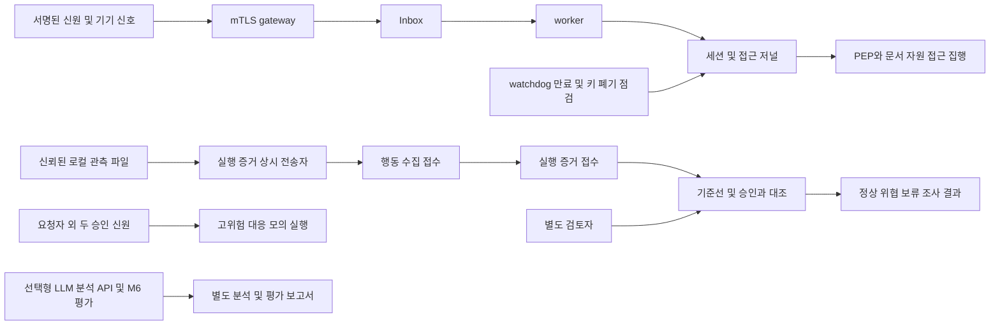

# 김택희 담당 최종 인수 안내

이 문서는 PR #54 인수 시점의 기록이다. 이후 보관 정리와 최종 검증 상태는
[11월 13일 자정 마감 기록](kim-midnight-closeout-20261113.md)을 우선한다.

기준은 PR #53이 병합된 `aitest` 커밋 `835b911c3142b68433574b575e37e7ae66abe0eb`다.
이번 변경은 `feature/kim`에서 진행하며 채희주의 `extra` F1 개선을 포함하지 않는다.
월요일 개발 마감에 앞서 11월 13일 오전 7시까지 로컬 프레임워크의 연결과 재현 자료를 정리한다.

## 구현 범위

프로젝트는 로컬 환경에서 지속 검증과 접근 집행을 자동화하는 제로트러스트 운영 프레임워크다.
외부 신고가 들어왔다는 사실만으로 세션을 회수하지 않는다. 서명, 출처, 테넌트, 대상 범위와 시각을
검증한 신호만 기존 Inbox와 worker로 처리한다. watchdog은 새 입력이 없어도 증명 만료와 키 폐기를 확인한다.

이번에는 실행 주체와 반출 목적지에 관한 입력을 상시 전송 경로에 연결했다.
기존 일반 신호 수집기의 권한은 유지하고 별도 `execution-observer` 신원으로 직접 core에 mTLS 접속한다.
보호된 상위 관측 파일을 읽어 행동 수집, 실행 증거, 평가 순으로 진행하며 각 단계의 영수증을 저장한다.
재시작과 응답 유실에는 이미 서명한 동일 자료를 재전송한다. 다른 내용의 같은 ID는 충돌로 남긴다.



행동 평가의 `enforcement_eligible`은 false다. 승인 범위와 다른 실행을 발견했다는 조사 결과만으로
실제 계정을 차단하거나 새 접근을 허용하지 않는다. 검증된 불리한 세션 신호에 의한 회수는 기존
접근 집행 경로에서 수행한다. 고위험 대응은 서로 다른 두 승인 신원을 요구하며 결과는 모의 실행이다.
테스트의 두 승인 신원은 서로 다른 자격 증명을 가진 시험 주체다. 두 사람이 독립 검토했다는 뜻은 아니다.

`POST /analysis`의 OpenAI 또는 hybrid 분석과 M6의 모델 비교 실행기는 구현돼 있다.
이번 로컬 실행 프로필은 `ANALYZER_MODE=rule`을 고정한다. 연속 수집 과정에서 매번 LLM을
자동 호출하거나 LLM 응답이 정책 검증을 건너뛰는 연결은 없다.
그림의 LLM 경로는 별도 분석과 평가 경로다. 행동 평가 서버와의 자동 연결은 구현 범위에 포함하지 않는다.

## 실행과 검증

아래 명령은 저장소 루트에서 실행한다. Docker와 Python 환경이 준비돼 있어야 한다.
API 키를 저장소에 넣거나 새 유료 모델 호출을 할 필요는 없다.

```bash
.venv/bin/ruff check .
.venv/bin/python -m pytest -q
.venv/bin/python -m scripts.test_execution_mtls_runtime \
  --directory runtime/c02/execution-final-new-run
```

통합 검증은 존재하지 않는 새 디렉터리를 지정한다. 10개 서비스와 28개 볼륨을 시험용으로 만들고
자신이 만든 컨테이너와 볼륨만 정리한다. 이미지 빌드는 `linux/amd64`를 명시한다.
Apple Silicon에서는 amd64 컨테이너 실행이 가능한 Docker 환경을 사용한다.

정상 결과는 `verification.json`의 `completed: true`, 모든 검사 항목의 `passed: true`와
`cleanup.purged: true`다. 정리 실패나 중도 실패를 통과로 집계하지 않는다.

| 확인 항목 | 정상 결과 |
| --- | --- |
| 사전 검토한 정상 실행 | normal, APPROVED_BASELINE_MATCH |
| 다른 실행 주체 또는 반출 목적지 | threat, EXECUTION_SCOPE_MISMATCH |
| 실행 주체 관측 누락 | unknown |
| 동일 자료 재입력 | 서명된 큐 1건과 동일 해시 유지 |
| 앱 장애 후 수집기 강제 종료 | 자동 재시작 후 대기 자료 접수 |
| 서명된 행동 수집 변조 | 실행 증거 접수 전에 rejected |
| 일반 전송자의 승인 및 토큰 발급 시도 | 403 |
| 두 승인 전 고위험 실행 | 409, 승인 후에도 effect_applied false |
| 검증된 불리한 신호 | 관련 문서 접근 403, 무관 접근 200 |
| 복원 중 강제 종료 | maintenance 유지, 수집기 정지 |
| 같은 복원 재개 | 행동 기록과 큐 보존, 기존 토큰 403, 새 토큰 200 |

서비스를 유지해서 입력 경계를 확인하려면 다음을 사용한다.

```bash
.venv/bin/python -m scripts.execution_mtls_runtime up --directory runtime/c02/execution-demo
.venv/bin/python -m scripts.execution_mtls_runtime status --directory runtime/c02/execution-demo
.venv/bin/python -m scripts.execution_mtls_runtime recover --directory runtime/c02/execution-demo
.venv/bin/python -m scripts.execution_mtls_runtime down --directory runtime/c02/execution-demo --purge
```

`recover`는 해당 시험 환경의 기존 토큰을 모두 무효화한다. `--purge`는 그 디렉터리에 기록한
시험 프로젝트만 삭제한다. 실제 자료 보존이 필요한 실행 환경에 시험 명령을 그대로 적용하지 않는다.

## 입력 계약과 제한

상위 관측기는 소유자 전용 입력 디렉터리에 완성된 JSON을 임시 이름으로 작성한 뒤 새 이름으로
rename한다. 디렉터리 권한은 700, 파일은 600이다. 게시한 파일의 이름과 내용은 바꾸지 않는다.
일반 사용자나 브라우저가 임의로 이 입력을 게시하는 기능은 제공하지 않는다.

묶음 입력의 최상위 필드는 `capture`와 `execution`이다. `capture`에는 별도 등록된 관측자의
서명된 행동 수집을 넣는다. `execution`에는 수집 ID와 해시, 세션 버전과 해시, 전체 이벤트와 연결 ID,
실제 관측한 주체와 목적지를 넣는다. 전송 데몬은 행동 수집 서명키나 기준선 승인키를 갖지 않는다.
누락된 관측을 승인 내용으로 채우지 않으며, 첫 접수가 늦어 만료된 자료를 새 시각으로 다시 서명하지 않는다.

이 어댑터는 EDR, 실제 프로세스 증명기, AWS 센서가 아니다. GuardDuty EventBridge 경보의 로컬 입력은
별도로 구현돼 있지만 실제 AWS 계정의 이벤트 구독과 조치는 연결하지 않았다.
네트워크 패킷 센서와 IDS, 실제 IdP 계정 차단도 구현 완료 범위에 포함하지 않는다.

실행 증거 큐는 10,000건과 32 MiB 한도로 입력과 중복 이력을 보존한다. 한도 초과 시 자료를
버리지 않고 새 접수를 거부한다. 장기간 무제한 운영에는 별도의 보관 정리 정책이 필요하다.
기존 신호 수집기의 보관 정리와 파일 회전 기능을 이 실행 증거 큐에 구현한 것으로 간주하지 않는다.

## 평가 결과를 읽는 방법

아래는 기존 자료의 결과다. 이번 변경에서 새로 모델을 호출하거나 탐지 규칙을 튜닝하지 않았다.
과거 결과의 소스 지문을 현재 소스로 덮어쓰지 않는다.

| 과거 200세션 실호출 | 분류된 건의 F1 | 전체 위협 100건 기준 탐지율 | 판단 보류 | 응답 오류 | 정상과 위협을 모두 맞힌 쌍 |
| --- | ---: | ---: | ---: | ---: | ---: |
| gpt-5.4-mini | 51.24% | 31% | 21 | 1 | 30/100 |
| gpt-6.1-sol | 97.56% | 40% | 120 | 0 | 38/100 |
| jev-1.14.0 | 72.96% | 58% | 64 | 0 | 20/100 |

세 모델이 동일한 200개 입력을 사용한 600회 생성 요청 기록이다. 별도의 OpenAI 토큰 수 확인
400회도 원자료에 기록돼 있다. 분류된 사례의 높은 F1을 전체 자동 판정 성공률로 제시하지 않는다.
모델 설명의 실제 의미가 증거와 맞는지에 관한 독립 검토는 이 600회 기록에서 완료되지 않았다.

기존 기준선 평가 240건에서 context 방식은 정밀도 100%, 재현율 66.67%, F1 80%, 보류 120건이었다.
실행 증거를 보강한 별도 170건에서는 정밀도 80%, 보류를 포함한 재현율 57.14%, F1 66.67%,
오탐률 14.29%, 오탐 10건, 보류 80건이었다. 이는 검토에 노출된 통제 실험 자료다.
기능 검증이나 이 자료만으로 독립 공개 로그에 대한 탐지 목표를 달성했다고 결론 내리지 않는다.

원본 동결은 `scripts.freeze_evaluation_evidence`로 수행한다. `freeze`가 반환한 manifest 해시를
별도 기록하고 `verify --manifest-sha256`에 전달하면 자료와 현재 소스의 변경을 검출한다.
동결은 파일 보존 검증이며 새 평가나 라벨의 독립 검토가 아니다.

## 전달받은 사람이 확인할 항목

새 디렉터리에서 통합 검증을 한 번 실행하고 `verification.json`, 실행 커밋과 이미지 ID,
실행 명령, 실패한 경우 첫 실패 지점을 전달한다. API 키, 개인키, 원본 토큰은 보내지 않는다.
팀원의 재현은 실제 수행자와 시각을 별도로 기록한다. 자동 실행 결과로 이를 대신 서명하지 않는다.

공유 화면에는 기존 분석과 세션 기능이 있다. 이번 행동 평가와 고위험 승인 API의 화면 연결은
완성된 것으로 표시하지 않는다. 발표는 아래 시연 원고와 검증 기록을 사용한다.

## 3분 시연 원고

0:00부터 0:40까지 위 흐름도에서 신호 수집, 검증, 세션 판단, 접근 집행을 설명한다.
인증 이후에도 입력과 watchdog이 세션의 정상 여부를 계속 확인한다는 점을 보여준다.

0:40부터 1:20까지 정상 실행, 승인과 다른 주체, 목적지 누락의 결과를 각각 normal, threat,
unknown으로 비교한다. 서명과 승인이 있어도 관측 근거가 없으면 정상으로 채우지 않는다고 설명한다.

1:20부터 2:00까지 관련 접근 403과 무관 접근 200, 서로 다른 승인 신원 두 개가 필요한
모의 대응 결과를 보여준다. 조사 결과와 실제 접근 집행의 경계를 구분한다.

2:00부터 2:40까지 수집기 강제 종료와 앱 장애 후 재전송, 복원 중 중단 후 재개 기록을 보여준다.
복원 후에도 기존 토큰은 403이고 새 토큰은 200인 결과를 확인한다.

2:40부터 3:00까지 평가표와 제한을 설명한다. 탐지 품질 개선과 실제 조직 연동은 별도 검증 대상이며,
시연 장애 시 같은 커밋의 `verification.json`과 CI 결과를 근거로 진행한다.
