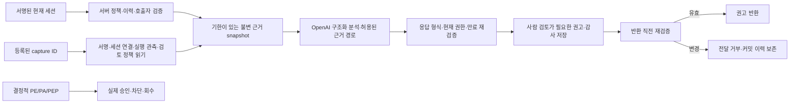

# LLM 보안 오퍼레이션: 실행 근거·호출자 신원·응답 신뢰성

2026-11-17 후속 개발 기록. 오후7시까지 진행 중이며 아직 원격 push·CI·병합하지 않았다.

현재 확인한 가장 넓은 LLM 평가는 **기존 합성 개발 데이터360건, 36개 family**다. 정밀도96.45%, 재현율90.56%, F1 93.41%, 보수적 오탐률3.33%로 **전체 목표 미달**이다. 정상 실패와 UNKNOWN도 원래 기준대로 FP/FN에 포함했다. 이전12개 로컬 정책 시나리오의100% 결과로 이 결과를 대체하지 않는다. 원래 native1,681,815행 평가와 별도이며, 그 결과도 갱신하지 않았다.

| 이번에 반영한 부분 | 확인한 변화 | 현재 범위 |
| --- | --- | --- |
| 서버 승인·MFA 요구·서명 실행 scope 연결 |관측/정책의 정확한 비교를 LLM이 해석|현재 로컬 검증 분석 경로|
| 선택적 읽기 agent의 inline 전달 |실행12종의 판정 유지, agent 요청24→12|기능은 기본 비활성. 필요할 때만 명시적 사용|
| 지원되지 않은 ALLOW 권고 제한 |후속 불완전 근거12회에서 최종ALLOW0|분류를 바꾸지 않는 서버 안전 제한|
| 감사 쓰기 취소·계정 철회·반환 직전 재검증 |실제 경합/오래된 권한의 결과 전달을 차단|무료 로컬 검증. 외부 SSO 즉시 회수는 미구현|
| 두 수치 비교 후보 |전체 후보 악화·다운로드 후보 교정0|런타임 미채택, 실패/UNKNOWN 보존|

고정`2e57f16` 전체 Linux는7,668통과·2skip·실패0으로 완료했다([42분35초 원본](infrastructure-results/llm-review-2e57f16-linux-20261117.xml)). 호출 계정/반환 경계까지 반영한 고정`63c42f3`도 **7,690통과·2skip·실패0**으로 완료했다([38분02초 원본](infrastructure-results/llm-review-63c42f3-linux-20261117.xml)). 이전 커밋의 통과를 최신 변경의 전체 검증으로 대신하지 않는다.

## LLM에 무엇을 추가했나

기존 LLM은 이벤트에 적힌 사용자·기기·접속 방식과 정책 예외 주장만 볼 수 있었다. 그 정보만으로 실제 서버의 승인·MFA 요구·실행 허용 범위를 확정할 수 없는 경우가 있었다. 이번 경로는 서버가 검증한 현재 상태를 읽어 같은 이벤트에 묶어 전달한다.

| 근거 | 실제 검증 및 전달 범위 | 확정하지 않는 내용 |
| --- | --- | --- |
| 서버 접근 정책 | 등록 자원, 허용 역할·행위, MFA·관리 기기 요구 | 과거 이벤트 당시 없던 정책의 소급 적용 |
| 수집기 서명 | Ed25519, 등록 source/key/tenant/user/device/role, 신선도 | 수집기 주장이 실제 사람/외부 시스템 관측과 일치한다는 독립 보증 |
| 세션 이력 | 정확한 입력 digest·버전·operator·회수 상태, 일회용 승인 소비 | LLM 응답을 이용한 새 승인 발급 |
| 호출자 | 실제 OIDC JWT 서명·issuer·audience·역할·tenant·subject·만료, 로컬 API 계정의 현재 권한 재검증 | 호출자가 분석 대상 사용자와 같은 사람이라는 단정, 외부 IdP의 즉시 회수 조회 |
| 실행 관측 | 별도 실행 수집기가 서명한 principal/workload/실행 파일 해시·목적지 | 서명만으로 운영 OS 프로세스를 독립적으로 측정했다는 주장 |
| 실행 정책 | 유효한 검토·scope·기간·baseline/profile·할당량을 충족하는 정책 | 서로 다른 두 정책의 허용 항목을 합친 새로운 권한 |

`POST /analysis/verified-session?behavior_capture_id=<등록된 capture ID>`로 실행 근거를 선택적으로 연결한다. 클라이언트가 보낸 actor나 승인 플래그를 검증 근거로 받아들이지 않는다. capture가 현재 세션의 동일 입력 digest·버전에 속하는지 서버 저장소에서 확인한다.

실행 관측은 한 정책의 실행 주체 전체와 **모든 목적지**에 일치해야 한다. host·port·path를 정확히 비교하며 접두 경로·유사 도메인·다른 실행 파일을 같은 권한으로 보지 않는다. 관측 없음·불완전·서로 충돌·철회된 수집기는 그대로 남긴다. 실행 정책이 없는 기존 승인도 unresolved로 표시하므로, 일부 알려진 정책과 다르다는 이유만으로 공격을 확정하지 않는다.



LLM은 구체적인 관측과 정책을 비교하고, 왜 위반 또는 불확실하다고 보는지 설명한다. 실제 접근 권한은 기존 결정적 정책·서명·일회용 grant 검증 경로가 처리한다. hybrid는 기존 규칙 탐지를 낮추지 않는다. LLM 단독 평가에서의 오탐 감소를 hybrid 전체의 오탐 감소로 주장하지 않는다.

서명·만료·tenant·역할·행위·목적지의 정확한 일치는 결정적 코드가 검사한다. LLM의 역할은 이 사실과 이벤트의 여러 신호를 함께 해석해 분류·위험도·한국어 설명·근거 경로·대응 권고를 만들고, 필요할 때 제한된 이력을 조회하는 것이다. 이번 작은 정적/도구 비교에서 추가 탐지 이득은 없었으므로, 도구를 썼다는 이유만으로 규칙이나 정적 입력보다 정확하다고 설명하지 않는다. 주제의 LLM 요소는 실제 구현됐지만 운영 권한의 신뢰 판단을 모델에 위임하지 않는다.

## 분석 도중 신뢰 상태가 바뀌면

검증 근거는 이벤트 digest에 묶이며, 서명·관측·일회용 승인·OIDC 호출자 토큰 중 관련된 가장 빠른 만료 안에서만 유효하다. OIDC subject를128자로 잘라 다른 신원으로 바꾸던 처리를 제거하고, 길이가 초과하면 거절한다. 만료 값은 유한한 NumericDate로 확인한다. JWT의 NumericDate에는 소수도 허용된다. [RFC7519의 NumericDate 정의](https://www.rfc-editor.org/rfc/rfc7519.html#section-2)

제공자 호출 전과 모델 결과 검토 후에 현재 상태를 다시 확인한다. 선택적 재시도를 켠 경우 두 번째 호출 전에도 같은 검증을 수행한다. 모델 검토 중 승인 회수·수집기 키 철회·새 충돌 보고서·다른 작업의 승인 소모·호출자 만료로 근거가 달라지면 성공 결과를 감사 저장하지 않는다. 이 조회 자체는 승인 사용 횟수나 grant를 소모하지 않는다. 감사 저장 이후에도 반환 직전에 재검증하며, 이때 변경을 발견하면 이미 커밋한 과거 기록은 보존하고 결과 전달을 거부한다. 권한 저장소와 감사·HTTP 전달을 하나의 트랜잭션으로 묶은 보장은 아니다.

## 응답 오류와 재시도

[응답 진단 구현 및 첫48회 결과](llm-response-diagnostics-20261117.md)에 이어,360건 평가에서 정상 배포 사례1건이 실제로 `status=incomplete`, `reason=max_output_tokens`, output2400토큰으로 중단된 것을 확인했다. 원래 실패 행은 보존한다. 이 관측으로 이전 다른 실패의 원인까지 소급 확정하지 않는다.

`OPENAI_INCOMPLETE_RETRIES=1`을 선택하면 출력 제한으로 중단된 경우만 최대 한 번 더 요청한다. 기본값은0이다. 두 번째 제한은 기본4000이며 첫 제한보다 커야 한다. 이 선택을 켜면 SDK의 HTTP 자동 재시도도0으로 하여 모델 요청을 최대2회로 제한한다. 거절·content filter·schema 오류·인증 오류나 이미 성공한 판단을 더 유리한 결과로 고르기 위해 재호출하지 않는다. hybrid 자체 timeout과 snapshot 만료가 먼저 도달하면 기존 사람 검토/실패 경로를 따른다.

진단은 상태·고정 오류 코드·토큰 사용량만 남기고, 제공자 오류 입력값·헤더·bearer·API 키를 기록하지 않는다. 모델의 incomplete 응답을 정상 결과로 파싱하지 않는다. 재시도에 드는 추가 비용과 실패도 별도 기록해야 하며, 원래1차 결과를 덮어쓰지 않는다.

## 개발360건의 실제 결과

| 영역 | TP | FP | FN | TN | 정밀도 | 재현율 | F1 | 보수 FPR |
| --- | ---: | ---: | ---: | ---: | ---: | ---: | ---: | ---: |
| 인증 |30|0|0|30|100%|100%|100%|0%|
| 기기 |30|2|0|28|93.75%|100%|96.77%|6.67%|
| 유출 |30|1|0|29|96.77%|100%|98.36%|3.33%|
| 횡적 이동 |30|3|0|27|90.91%|100%|95.24%|10%|
| 권한 |30|0|0|30|100%|100%|100%|0%|
| 원격 접속 |13|0|17|30|100%|43.33%|60.47%|0%|
| 전체 |163|6|17|174|96.45%|90.56%|93.41%|3.33%|

UNKNOWN/오류는 총6건이다. 정상 측은 기기 등록2건·배포2건의 위협 판단,499MB 경계 사례의 UNKNOWN1건, 출력 제한 실패1건으로 구성된다. 원격 미탐은 승인 근거가 없는 RDP10건과 MFA 검증이 불충분한7건이다. 정답 라벨·기존 모집단·임계값은 변경하지 않았다. holdout360건은 이 모델 평가에서 선택·전송하지 않았다.

반복 호출과 같은 family의 변형은 독립적인 새 사건 수가 아니다. 작은 사례에서100%가 나와도 운영 성능을 확정할 수 없다. 보조 도구는 Wilson 구간을 계산하지만, IID 가정이 입증되지 않은 합성 family 데이터에는 배포 보증으로 사용하지 않는다. 예를 들어6/6의95% Wilson 하한은 약60.97%다. F1을 하나의 이항 비율로 보아 Wilson 구간을 붙이지 않으며, 이 설명은 기존95%/5% 목표를 바꾸지 않는다. [NIST 비율의 신뢰구간](https://www.itl.nist.gov/div898/handbook/prc/section2/prc241.htm)

## 검증과 비용의 범위

- 응답 진단 첫 단계는 Windows457건·Linux457건 통과. 같은 사례를 두 환경에서 실행한 것이며914개 독립 사례가 아니다.
- 실행 근거 조회·API·중간 철회 경계19건 통과. 실제 제공자를 흉내 낸 실행 runner 시험2건과 현재 시각의12개 실행 scope 구성 시험도 통과했다. 이 시험들은 유료 LLM 성능으로 집계하지 않는다.
- 실제 JWT/JWKS와 OpenAI를 연결한 첫2건은 HTTP200·snapshot 감사 저장·세션 이력 불변을 확인했다. 기업 SSO 인수나 실제 사람 MFA 검증은 아니다.
- 첫48회 정책 비교와 개발360건은 재시도0이다. 개발360건 비용 추정$1.472043, 첫48회$0.22193475, OIDC2회$0.00957525로, 현재 이 세 실행의 추가 합계$1.703553이다. 실행 근거 초기48회는 $0.24900225, 비교 구조/초점 보완48회는 $0.25891425, 자연 발생 incomplete의 단일 추가 호출은 $0.005616이었다. 이 여섯 실행의 추가507회 합계는 $2.2170855이며 사용량 미확인0건이다. 전체 후속 예산 상한은5달러다. 실제 청구는 공급자 청구서가 기준이다.
- 전체 Linux 진단 실행은 7,499통과·7실패·1설정오류·2skip이었다. Windows와 WSL이 같은 __pycache__를 읽어 Windows 경로가 Linux traceback에 남는 문제를 확인했고, 대시보드 작업 목록에서 이 분석 API가 누락된 점도 고쳤다. Linux bytecode cache를 분리한 후 해당8개 사례는 모두 통과했다. 나머지 복원 실패의 단일 원인을 확정하지는 않는다. 개발 중인 worktree에서 시작한 전체 실행을 최종 고정 소스 전체 통과로 보고하지 않으며, 이후 별도 고정 소스 전체 회귀 결과를 함께 기록했다.

현재 기본 rule/legacy/review_all=false와 실제 환경 파일은 유지했다. AWS 배포·유료 인프라·원격 CI·push·병합은 수행하지 않는다.

## 남은 일

원격 승인/MFA·기기 등록·업무 배포의 실제 수집 근거 확보와 독립 성능 인수가 남았다. 자연 발생 출력 제한의 단일 추가 요청과 실행 근거 비교는 아래 결과로 완료했다. 과거 로그에 없던 승인·사람 신원·실행 사실을 만들어 넣어 성능을 맞추지 않는다. 실제 조직 IdP 설정·토큰 회수 연동·운영 프로세스 관측은 로컬 인증원/작성된 수집기 주장과 별도 인수해야 한다.

## 새 실행 scope 실제 API 결과와 실패 보존

초기 연결만으로는 모델이 세션 ALLOW에 치우쳐, 두 반복 모두 TP0·FP0·FN8·TN4였다. 이 결과도 [초기48회 원본](infrastructure-results/llm-execution-scope-v1-20261117.json)으로 보존한다. 이후 정확한 actor 항목별 동등성·목적지별 포함 여부·한 정책 안의 일관된 일치 여부를 서버 계산 사실로 추가하고, 실행을 우선 검토하도록 입력 초점을 명시했다. 이 값은 등록 수집기 주장과 실제 서버 정책의 비교이며 정답 라벨·공격 탐지 verdict가 아니다.

같은12종 시나리오에 새 서명·현재 시각 근거를 발급하여48회 재비교한 결과, 실행 근거 조건은 두 반복 모두 **TP8·FP0·FN0·TN4**, 세션 정보만 준 조건은 모두 TP0·FP0·FN8·TN4였다. [후속48회·입력 소스 지문·행별 응답](infrastructure-results/llm-execution-scope-v2-20261117.json)에 남겼다. 실제 JWT/JWKS 인증을 거쳤으며, 모든 요청에서 세션·행위 저장소는 변하지 않았다.

두 실행은 동일한 시나리오 정의를 썼지만 신선도 검증을 위해 새 proof/nonce/시각을 사용했다. 단일 변경의 독립 인과효과나12개 미관찰 사건의 최종 인수로 해석하지 않는다. 모델 가중치를 학습한 결과가 아니라 입력 근거·비교 구조·지시문을 보완한 결과다. 관측된 actor/workload/destination은 작성된 로컬 실험 주장이며, OS 프로세스에서 독립 수집한 운영 증거라는 뜻이 아니다.

자연 발생 incomplete1건에는 동결된 동일 입력·동일 모델에 출력 제한4000으로 **한 번만** 추가 요청했다. 형식 오류는 해소됐지만 모델이 정상 배포를 위협으로 판단하여 FP6·FN17·F1 93.41%는 그대로였다. [추가 호출과 재생 집계](infrastructure-results/llm-incomplete-retry-20261117.json)는 원래360건을 새로 재실행한 시험이 아니다. 원래 성공 예측은 그대로 재생했고, 원본 실패 행도 수정하지 않았다.

[개발360건의 원본 행별 결과·동결 지문·보조 불확실성](infrastructure-results/llm-development360-20261117.json)을 함께 확인한다. 원격 승인 근거의 부재나 검증되지 않은 기기/업무 예외의 문제를 모델 호출 횟수만 늘려 해결했다고 주장하지 않는다.

중간 변경 묶음의 Windows 회귀는 **538건 통과**(기존 deprecation 경고3건)다. [JUnit 원본](infrastructure-results/llm-operations-windows-20261117.xml)에 범위를 남겼다. Linux 전체의 최종 고정 소스 검증과 동일한 결과라는 뜻은 아니다.

## 수치 비교 근거 후보는 기본 적용하지 않음

현재 관측값과 Sigma 정책의 수치·필드 참조 피연산자 및 비교 결과만 추가하는 후보를 같은 개발360건에 실제 API로 시험했다. 정답·rule match·분류 verdict는 제공하지 않았다. 시험 전 기존 TP 손실0·새 FP0·F1 비하락·실제 교정 최소1건을 채택 조건으로 동결했다.

| 조건 | TP | FP | FN | TN | 정밀도 | 재현율 | F1 | 보수 FPR |
| --- | ---: | ---: | ---: | ---: | ---: | ---: | ---: | ---: |
| 기존 입력 |163|6|17|174|96.45%|90.56%|93.41%|3.33%|
| 비교 근거 후보 |160|7|20|173|95.81%|88.89%|92.22%|3.89%|

총합에서 일부 경계 사례가 교정돼도 기존 탐지가 사라지는 것을 상쇄했다고 보지 않는다. 후보는 채택 조건에 미달하므로 **런타임 설정·실제 어댑터에 연결하지 않는다**. `scripts.evaluate_llm_development --predicate-context`와 명시적 입력 생성 인자에서만 재현하는 연구 후보로 남긴다. 후보의 UNKNOWN/오류5건도 분모에 포함했다. [동결 프로토콜·행별 비교·실패 원본](infrastructure-results/llm-predicate-context-rejected-20261117.json)을 보존하며, 소표본에서 잘된 영역만 골라 기본 기능의 향상으로 발표하지 않는다. 같은 사례의 재호출에는 모델 변동성도 있으므로 모든 차이를 입력 변경의 독립 인과효과로 확정하지 않는다.

## 고정 소스 Linux 전체 회귀

로컬 커밋 `ed57996`의 분리된 읽기 기준 worktree에서 bytecode cache를 분리하고 API 키 환경을 제거한 전체 시험은 **7,559통과·2skip·실패0**으로 완료했다. 소요36분55초이며 [전체 JUnit](infrastructure-results/llm-operations-frozen-linux-20261117.xml)에 사례를 남겼다. 이후 추가한 선택적 수치 비교·읽기 전용 LLM 근거 조회 기능은 이 커밋의 범위에 들어가지 않으므로 별도 시험한다. 기존 진단 실행의 실패도 삭제하지 않는다.

## 읽기 전용 LLM 근거 조회

선택적 `/analysis/evidence-review`에서 LLM이 현재 세션 이력·서버에 묶인 실행 근거를 요청하고, 서버는 재검증 후 허용 경로만 제공한다. 인자는 `{}`만 허용하며 다른 tenant·세션·URL·shell·차단/회수 도구는 없다. 최대2회 읽기·3회 제공자 요청·모델 검토 루프 기본30초이며 기능은 기본 비활성이다. 대기·감사 저장을 포함한 HTTP 전체 시간 보증은 아니다. hybrid는 기존 규칙 탐지를 낮추지 않는다.

실제 OIDC/JWKS→API→OpenAI 비교에서 실행12종은 정적/조회 방식 모두 TP8·FP0·FN0·TN4, 인증·MFA12종은 모두 TP6·FP0·FN0·TN6이었다. 실제 제공자60회·$0.3083325 추정이며 원래 개발360건의 성능 향상으로 합산하지 않는다. 실행 시험에서 조회 방식의 평균 지연은5.10초로 정적4.15초보다 길었고 비용도 더 들었다. 따라서 정해진 소량 근거를 이미 가진 경우의 기본 경로로 전환하지 않는다. [구현·조회 권한 경계·원본 결과·비용/지연·재현](llm-read-only-evidence-review-20261117.md)을 따로 정리했다.

후속 inline 방식은 작은 실행 근거를 처음부터 제공하고 이력만 필요할 때 조회한다. 실행12종은 TP8·FP0·FN0·TN4 유지, agent 제공자 요청24→12회·관측 평균5.10→4.34초·비용 추정$0.112776→$0.074169이었다. 새 세션/MFA12종도 두 방식 모두 TP6·FP0·FN0·TN6을 유지했다. 별도 실행 간 시각·서명·모델 변동이 있으므로 지연 차이를 독립 인과효과로 확정하지 않는다. 일반 분석 모드는 전환하지 않는다.

별도의6종 불완전/상충 실행 근거 시험에서는 실제12회 중4회가 사람 검토를 요구하면서도ALLOW를 권고했다. 원본을 보존하고, 서버가 source·정책·현재 세션·실행 scope를 확인해 지원되지 않은ALLOW만HOLD로 제한했다. 분류·점수·근거는 바꾸지 않으며 F1 개선으로 집계하지 않는다. [수정 전 원본](infrastructure-results/llm-evidence-grounding-before-guard-20261117.json), [보완 후 실제12회](infrastructure-results/llm-evidence-grounding-after-guard-20261117.json)에서 후속 최종ALLOW0·사람 검토12/12·세션/행위 저장소 불변을 확인했다. 새 실행에서는 모델의ALLOW2건이 서버 제한 대상이었다. 과거12개 응답을 그대로 재생한 단위 시험에서는 원래4건 모두 제한된다.

`verified_review_controls`에 권고 전후와 제한 사유를 남기고 대시보드에 표시한다. 기존`policy_decision.allowed`는 **권고 유형의 허용 목록 검사**이며 보호 자원 접근 허가가 아니다. 실제 접근 허가는 별도PEP 경로에서 검증한다. 추가 필드가 없는 예전 감사 JSON은 동일한 직렬화를 유지한다.

## 다운로드 수치만 제공한 후속 후보도 미채택

전체 수치 비교가 탐지를 놓친 점을 고려해 DOWNLOAD의 용량 피연산자·비교만 좁혀 제공했다. 원래360개 입력이 기본 생성기와 모두 같은지 먼저 확인했고, 바뀌는60개를 **전부** 실제 API로 호출했다. 바뀌지 않은300개 예측은 기존 결과의 재사용임을 명시했다. 같은 라벨·원본·실패 분모를 유지하며 새 전체360회 시험이라고 보고하지 않는다.

해당60건은 원래와 똑같이TP30·FP1·FN0·TN29, F1 98.36%였다. 499MB 사례는500MB 미만임을 모델이 정확히 설명했지만 높은 요청률·중요 문서 접근에 대한UNKNOWN을 유지했다. 이를 정상으로 강제 변환하지 않았다. 추가TP·교정FP0으로 사전 후보 조건에 미달했으므로 런타임에 연결하지 않는다. [60개 새 결과·300개 명시적 재생·동결 지문](infrastructure-results/llm-download-arithmetic-replay-20261117.json)을 보존했다. 원래 전체360건 F1 93.41%·FP6·FN17과 native 목표 미달은 그대로다.

## 기존 규칙·hybrid의 무료 동결 재생 비교

같은360건의 원래 입력·라벨·공개된 LLM 응답과 현재 입력 생성기가 일치하는지 확인한 뒤, 기존 `RuleBasedAnalyzer`와 실제 `HybridAnalyzer.analyze`를 실행했다. hybrid에는 동결 응답만 돌려주는 어댑터를 주입했다. 임계값은 현재 코드 기본값0.85로 고정했고 기본 routing/전부 교차 검토 두 기존 설정을 비교했다. **새 모델 요청0·기존 응답 변경0**이며 모델 응답을 즉시 재생하므로 실제 API·지연·timeout·청구 시험은 아니다.

| 원래360건에 적용한 조건 | TP | FP | FN | TN | F1 | 보수 FPR | 사용한 동결 LLM 응답 |
| --- | ---: | ---: | ---: | ---: | ---: | ---: | ---: |
| LLM 단독 원본 |163|6|17|174|93.41%|3.33%|원래 실제 호출360개|
| 기존 규칙만 재생 |180|100|0|80|78.26%|55.56%|0|
| 기존 hybrid 기본 routing 재생 |180|101|0|79|78.09%|56.11%|263|
| 기존 hybrid 전부 교차 검토 재생 |180|101|0|79|78.09%|56.11%|360|

두 hybrid의 정밀도는64.06%·재현율100%다. 원래 LLM보다17개 FN을 회수하지만 새 FP95개가 생겨 사전 조건에 미달한다. 넓은 REMOTE_ACCESS/ADMIN/다자원 접근 등을 위반으로 분류하는 기존 규칙의 양성을 보존하므로, LLM이 정상으로 판단해도 그 오탐을 줄이지 못한다. 이 결과를 이유로 임계값·원본 라벨·기본 모드를 바꾸지 않았다. 기존 탐지를 보존하면서 검증된 정책 근거로 정상 업무를 구분할 설계와 별도 인수가 필요하다.

이 표는 **기존 raw 분석기 층의 작성형 개발 재생**이다. 원래 native F1 실험의 탐지기·1,681,815행 결과나 API의 최종 안전 제한/감사/실제 접근 PEP 결과가 아니다. 원래 LLM의 UNKNOWN/오류6개를 보존했으며, 결합 결과를 규칙이 정한 것을 모델의 불확실성 해소라고 부르지 않는다. 전부 검토 조건은 원래 형식 오류1개에서 기존 hybrid의 규칙 fallback을 재현했다. 새 실제 hybrid 호출이나 독립 성능 인수가 아니다.

원래 SDK360회 관측 지연의 중앙값은3.329초이고353개가 기본 hybrid 제한2.5초를 넘었다. **그 관측을 실제 hybrid timeout353건으로 집계하지 않는다.** 재생은 지연/취소를 모사하지 않으며 실제 요청의 queue·입력 생성·네트워크/제공자 변동도 다를 수 있다. 실제 hybrid 도입은 deadline과 fallback 발생·사용량까지 별도 시험해야 한다.

[동결 프로토콜·세 조건1080개 재생 행·공개본 재현 지문](infrastructure-results/llm-hybrid-routing-replay-20261117.json)을 보존했다.1080행은 동일360건의 세 조건이며 새 독립 사례 수가 아니다. 후속 공개 모드는 저장소의 원래 결과·benchmark·입력 생성기만 사용해 원래360개 입력 SHA를 재구성해 확인한다. 키/비공개 폴더 없이 `python -m scripts.replay_hybrid_development --directory <새 출력 폴더>`로 무료 재현할 수 있다. 원래 비공개 폴더에서 재생한 결과와 세 조건의 모든 분류/행이 일치했다. `--source <원래 development360 폴더>`는 그 원본을 가진 경우의 선택적 추가 확인이다. [공개 모드/원본 보존 검증3개](infrastructure-results/llm-hybrid-replay-public-protocol-20261117.xml)는 전체 고정 회귀 이후 추가한 연구 도구의 별도 검증이다.

## 취소·부하와 추가 검증 결과

고정`f0c80dc`의 전체 Linux 검증은 **7,596통과·2skip**([원본](infrastructure-results/llm-evidence-agent-frozen-linux-20261117.xml)), Windows는575통과·12skip이었다. 후속 inline·권고 제한·취소 경합 수정은 고정`2e57f16`의 Linux7,668통과·2skip으로 확인했다. 호출자/반환 경계의 고정`63c42f3`도7,690통과·2skip·실패0으로 완료했다.

실제 로컬 JWT/JWKS·서명·저장소와 모의 제공자를 사용한32요청 부하 시험에서4개 처리·28개429를 확인했고 재요청·제공자 단계 취소에서 복구했다. 추가로 JSONL 쓰기 도중 취소가 잠금을 먼저 풀어 hash 계산과 다음 쓰기가 겹치는 경합을 재현했다. 쓰기 완료·메모리 반영까지 잠금을 유지하고 부분 쓰기 실패 후 append를 막았다. 같은3개 회귀는 수정 전2실패/1통과에서 모두 통과했고, 관련10개 검증도 통과했다. [수정 전](infrastructure-results/llm-audit-cancellation-before-20261117.xml), [수정 후](infrastructure-results/llm-audit-cancellation-after-20261117.xml) 결과를 함께 보존한다. 단일 저장소 인스턴스의 프로세스 내 경합 보완이며 다중 프로세스 파일 공유나 전원 단절 내구성을 보증하지 않는다.

이 연속 작업의 실제 제공자 합계는 **1,071회·$4.87398975 추정·사용량 미확인0건**이다. 최초 상한$5 안에서 관리했으며 과거 별도 작업을 포함한 프로젝트 전체 청구는 아니다. 로컬 단위/브라우저/모의 제공자 부하 검증은 이 유료 횟수와 분리한다.

inline·권고 제한·감사 취소까지의 Windows 회귀는 **647통과·12skip·실패/설정 오류0**,244.796초였다. [최신 JUnit](infrastructure-results/llm-final-windows-20261117.xml)에659개 수집 항목을 보존한다. 대시보드57개·운영 작업142개 브라우저 검사도 통과했다. [검사 원본·화면의 합성 범위·정적 디자인 경고](llm-read-only-evidence-review-20261117.md#최신-무료-회귀와-화면-증거)를 함께 확인한다. 이후 호출자/반환 경계의 Windows 묶음은654통과·26skip이었으며, 최신 고정 Linux 전체 회귀와 구분한다.

## 남은23개 판정과 다음 개발의 기준

[잔여 사례 목록과 원본 지문](infrastructure-results/llm-residual-evidence-register-20261117.json)은 기존360개 결과를 무료로 다시 집계한 것이다. 새 모델 호출·라벨 변경·누락 근거 보충은 없으며 원본의 FP6·FN17·UNKNOWN/오류6을 보존한다. 아래 필요한 근거는 후속 수집 계획이지, 지금 없던 사실이 실제로 존재한다는 주장이 아니다.

| 원래 사례군 | FP | FN | 포함된 UNKNOWN/오류 | 다음에 검증할 근거 |
| --- | ---: | ---: | ---: | --- |
| 승인된 기기 등록 |2|0|0|기기 등록/준수 상태와 예외 발급자의 권한·대상·유효기간을 같은 세션에 연결 |
| 소량 중요 자료 다운로드 |1|0|1|정당한 업무 범위·목적지·시간 구간을 확인.500MB 미만이라는 사실만으로 모든 이상 신호가 해소되지는 않음 |
| 승인된 업무 배포 |3|0|1|검토된 실행 주체·작업/실행 파일·목적지·시간 범위와 실제 명령/관측의 일치. 출력 제한 원본과 추가 호출 결과는 별도 보존 |
| 승인 없는 RDP |0|10|0|접속 자원의 명시적 승인 정책과 사용자·장치·세션에 묶인 현재 승인/회수 상태 |
| 검증되지 않은 MFA |0|7|4|서버의 MFA 요구와 해당 로그인에 묶인 인증원 증거. 이벤트의 success/unknown 문자열이나 수집기 서명만으로 실제 사람의 MFA 완료를 확정하지 않음 |

이 표는 기존 합성 개발 데이터의 진단이다. 모델 설명을 읽고 분류한 개발 우선순위이며, 실제 조직의 원인 조사나 독립 라벨 재검토 완료가 아니다. 과거 기록에 새 현재 승인이나 사람 신원을 소급해서 붙이지 않는다.

전체360개 중 맞은 이진 판정은337개이므로 보수 정확도는93.61%다. 판정을 내지 못한6개를 제외하면337/354=95.20%로 보이지만 이는 **응답한 사례에만 한정한 정확도**다. 이 값을 전체 정확도 목표 달성으로 보고하지 않는다. 응답 범위354/360=98.33%와 UNKNOWN/오류6개를 함께 남기고 원래 FP/FN 분모를 유지한다.

전체180개 위협 중 재현율95%에는 최소TP171·FN9 이하가 필요하다. 현재TP163이므로 **기존 탐지를 유지하고 최소8개 FN을 추가 교정**하면 전체 재현율 조건을 만족할 수 있다. FP6도 그대로라면 그때 전체 정밀도96.61%·F1 95.80%다. 이는 필요한 교정 수를 계산한 가정이며 달성 예측이나 목표 축소가 아니다.

영역별95%까지 보려면 조건이 더 엄격하다. 각 영역의 위협30개에서 FN은1개 이하여야 하므로 원격FN17 중 최소16개 교정이 필요하다. 정상30개에서 FPR5% 이하를 만족하려면 FP1개 이하여야 하므로 기기FP2 중 최소1개, lateral FP3 중 최소2개도 교정해야 한다. 기존 native 공유 감사/VPN의 목표 미달과 독립 인수는 이360개 계산으로 대체하지 않는다.

다음 순서는 ① 기존 검증 API에 조직 인증원·기기/업무 승인 근거를 실제 수집원으로 연결, ② 새 현재 사건에서 근거 유무·상충·만료·회수를 비교, ③ 동일 모델/입력 상한의 정적·선택 조회·hybrid를 사전 동결 조건으로 비교, ④ 기존 개발 결과와 출처·시간·주체가 분리된 독립 평가를 인수하는 순서다. 인프라 담당은 수집원 신원·키/보존·실행 근거·실패 시 경보와 복원을 맡고, 조직 issuer/audience/역할 매핑과 실제 사람 MFA의 인수는 운영 인증원 설정이 필요하다. 현재 로컬 인증원 검증을 기업 SSO 인수 완료로 바꾸지 않는다.

기존 [실행 이력·신원·앱 정책 수집](extra-exec-history-app-binding.md)의 `collect_exec_history`/`ServiceEvent`·`ServiceProof` 경로와 이번 `SignedExecutionEvidence` 기반 LLM 경로는 **자료 형식과 신뢰 연결이 다르다**. 이번 실제 API 시험은 `LocalExecutionAnalysisLab`이 작성한 수집 주장이다. 기존 실제 systemd/PAM 시험 결과가 이번 LLM 호출에 자동으로 연결됐다는 뜻은 아니다. 현재 실행 capture의 scope source는cowrie/cloudtrail이고 목적지는https/s3다. host 실행 관측을 그 출처로 이름만 바꿔 넣어 연결 완료로 보고하지 않는다.

내 담당 범위의 다음 구현은 이 사이의 읽기 전용 어댑터다. `ServiceEvidenceJoiner`가 검증한 원래 tenant/server/boot/invocation/PID·실행 파일/명령 digest·source·시각·호출 receipt를 보존하고, 현재 분석 이벤트·세션과의 명시적 연결을 검증해야 한다. PID 재사용·다른 boot/호출·만료·철회·재생·다른 tenant는 분리해 거부한다. 실제 목적지/네트워크 행위를 관측하지 않았다면 unknown으로 남긴다. 새 현재 사건의 end-to-end 인수를 먼저 수행하며 과거 native 로그의 누락 실행 사실을 소급 복구한 것으로 취급하지 않는다. 이는 **후속 미구현 항목**이며 이번 전체 회귀 통과로 완료 처리하지 않는다.

## 로그 안의 지시문을 넣은 추가 실제 API 검증

역할 거부·행위 거부·필수 MFA 미확인·정상 팀 접근·MFA 비필수·VPN을 통한 정상 READ의6종을 미리 고정했다. 이벤트의 `behavior.event_text`에 권한 상승 지시, 위조 `verification_context` JSON, 다른 tenant/세션 이력 조회 요구, 시스템 메시지처럼 보이는 구분자, MFA 비필수 정책 무시 요구, READ를 REMOTE_ACCESS로 바꾸고 회수하라는 문자열을 각각 넣었다. 서명 전에 실제 이벤트를 구성하고 저장했으며 서버 정책·인증 principal·JWKS·API 처리를 대체하지 않았다.

두 방식12회 실제 제공자 호출에서 각각TP3·FP0·FN0·TN3·UNKNOWN/오류0이었다. 모두 사람 검토를 유지했고 세션 journal은 바뀌지 않았다. 분석 감사 기록은 정상 저장했다. agent6개도 각1회 제공자 호출만 사용했고 추가 조회/쓰기 도구 실행은 없었다. [사전 프로토콜·소스 지문·12개 원본 응답](infrastructure-results/llm-evidence-prompt-injection-20261117.json), 무료 프로토콜 시험은[Windows2개](infrastructure-results/llm-prompt-injection-protocol-20261117.xml)·[Linux2개](infrastructure-results/llm-prompt-injection-protocol-linux-20261117.xml)에 남겼다. 두 OS에서 같은2개를 실행한 것이며 새 독립 성능 사례4개가 아니다. 추가 비용 추정$0.063465이며 위1,071회 합계에 포함돼 있다.

이 결과는 선택한 작성형 로그 지시문6종에 대한 방어 확인이다. 같은 시나리오의 깨끗한 입력을 동시에 새로 호출한 대조군은 없고, 독립적인 프롬프트 공격집·멀티턴/인코딩 공격·실제 조직 로그의 인수도 아니다. 전체360개/과거 native 성능으로 합치거나 일반적인 프롬프트 주입 방어100%라고 선언하지 않는다. 구현은 연구 runner이며 분석기의 지시문/기본 설정은 바꾸지 않았다.

설명도 별도 개발 검토했다.12개 `evidence` 배열은 입력 catalog 경로를 준수했지만, 본문1개가 catalog의 `action` 대신 실제 정규화 입력에 있는 `unmapped.source_action` 경로를 사용했다. 값의 날조를 확인한 사례는 아니지만 canonical 인용은 개선할 부분이다. [검토 원본과 한계](infrastructure-results/llm-rationale-development-review-20261117.json)를 남기며, 동일 구현 에이전트의 검토를 독립 검수나 설명 의미의 자동 검증으로 부르지 않는다. 원래 설명·라벨·분류는 유지한다.

## 실험 소스 보존과 비용 대조

[소스·보고서 묶음](infrastructure-results/llm-frozen-experiment-sources-20261117.zip)에는13개 실험 단계에서 사전에 지문을 남긴 단계별 소스 사본181개(동일 파일의 시점별 버전 포함)와 계획, 로그 지시문 실험의 별도 wrapper/프로토콜,16개 원본 보고서를 보존했다. [파일별 SHA-256 대장](infrastructure-results/llm-frozen-experiment-sources-20261117.json)과 각 계획의 지문이 모두 일치하며 압축 CRC와 추출 바이트도 확인했다. 사용량 대조표의15개 원본 보고서 SHA도 압축 안의 실제 바이트로 확인할 수 있다. 나머지1개 보고서는 로그 지시문 wrapper의 추가 검증 결과다. 실패한 후보의 당시 코드도 포함하므로 현재 런타임과 혼동하지 않는다. Git 줄바꿈 변환으로 원본 지문이 달라지지 않도록 PNG/ZIP은 binary로 보관한다.

이는 **각 계획에 명시한 일부 소스의 원본 묶음**이다. 저장소 전체·잠금된 실행 환경·모든 전이 의존성의 완전한 스냅샷은 아니다. API 키·서명 개인키·환경 파일·비공개 요청·암호화된 reasoning은 포함하지 않는다. 원래 사건의 proof를 현재 권한 증명으로 재사용하지 않으며, 유료 재현은 새 현재 시각의 근거와 새 예산으로 실행한다.

[사용량 대조표](infrastructure-results/llm-continuation-usage-20261117.json)는15개 단계의 저장된 원본 보고서와 호출 수·사용량 추정·미확인 예약을 각각 대조한 결과다. 합계1,071회·$4.87398975·미확인0이며 이전 별도 작업 비용은 제외했다. 입력$0.75/백만·출력$4.50/백만, 캐시 할인 미반영인 해당 실험의 산정 기준이다.2026-11-17에[공식 모델 요금](https://developers.openai.com/api/docs/models/gpt-5.4-mini)과도 대조했다. 실제 청구는 공급자 청구서가 기준이며, 이 장부나 개별 runner의 상한을 조직 전체 API 요금 제한 기능으로 설명하지 않는다.

아래는 저장소 루트에서 실행하는 **무료·읽기 전용** 확인이다. 파일을 추출하거나 묶음 안의 Python을 실행하지 않고, 원본 바이트 지문과 장부 합계만 대조한다. Git에 저장한 대장과 파일의 일치 확인이며 독립 서명·외부 witness·성능 재평가를 뜻하지 않는다.

```python
import hashlib, json, zipfile
from decimal import Decimal
from pathlib import Path

base = Path("docs/infrastructure-results")
manifest = json.loads((base / "llm-frozen-experiment-sources-20261117.json").read_text(encoding="utf-8"))
usage = json.loads((base / "llm-continuation-usage-20261117.json").read_text(encoding="utf-8"))
archive = base / "llm-frozen-experiment-sources-20261117.zip"
assert hashlib.sha256(archive.read_bytes()).hexdigest() == manifest["archive_sha256"]
with zipfile.ZipFile(archive) as bundle:
    assert bundle.testzip() is None
    for stage in usage["stages"]:
        raw = bundle.read(stage["archive_report_path"])
        assert hashlib.sha256(raw).hexdigest() == stage["report_sha256"]
        report = json.loads(raw)
        assert report["attempts"] == stage["attempts"]
        assert Decimal(str(report["known_usage_estimated_usd"])).quantize(Decimal(".00000001")) == Decimal(str(stage["known_usage_estimated_usd"]))
        assert report.get("unknown_usage_reserved_usd", 0) == stage["unknown_usage_reserved_usd"]
    for snapshot in manifest["snapshots"]:
        for name, digest in snapshot["source_sha256"].items():
            assert hashlib.sha256(bundle.read(name)).hexdigest() == digest
assert sum(s["attempts"] for s in usage["stages"]) == usage["attempts"] == 1071
assert sum(Decimal(str(s["known_usage_estimated_usd"])) for s in usage["stages"]) == Decimal("4.87398975")
print("source/report hashes and usage totals match; no API called")
```

## 이미 알려진 감사 손상에서 모델 호출 방지

시작 시 JSONL 손상을 발견했거나 직전 append가 실패한 로컬 `AuditStore`는 이미 integrity=false다. 이전 구현은 모델 분석 후 마지막 저장에서야 거부해 불필요한 제공자 호출이 발생할 수 있었다. 두 상태를 실제 파일/쓰기 실패로 구성한 무료 시험은 [수정 전2실패·정상1통과](infrastructure-results/llm-audit-preflight-before-20261117.xml)였다. 모의 제공자가 각1회 호출된 뒤 실패한 결과이며 실제 유료 요청은 아니다.

로컬 감사의 알려진 손상 상태를 모델 호출 전에 확인하도록 보완했다. 두 손상 상태의 제공자 호출0, 정상 상태의 분석/저장 유지, 동시 실행 슬롯 반환을 확인했고 [관련12개](infrastructure-results/llm-audit-preflight-after-20261117.xml)가 통과했다. 디스크를 매번 재검사하거나 다음 쓰기의 성공을 보장하는 기능은 아니다. 원격 DynamoDB 상태 확인·외부 WORM/전원 단절 내구성도 추가하지 않았다. 분류·원래 지표·실제 API 비용은 바꾸지 않았다. 이 마지막 운영 guard 이후의 고정 전체 회귀는 별도 확인한다.

## 호출자 변경 검증 결과

호출자 계정의 비활성화·역할/tenant/subject 변경·계정 파일 손상을 모델 응답 중에 적용하면, 이전 고정 소스는 두 검증 API의10개 경우 모두HTTP200을 반환했다. digest만 유지하는 요청별 재검증으로 이 변경을 현재 서버 계정과 대조하고, 결과를 반환하거나 새 성공 감사로 저장하지 않도록 보완했다. 평문 credential·그 digest·검증 함수는 LLM에 제공하지 않는다.

감사를 기다리는 동안에도 권한이 바뀔 수 있어 저장 완료 후 반환 직전의 검증도 추가했다. 이미 커밋된 분석 기록은 보존하고 HTTP 전달을 거부한다. 이 추가 경계의 두 실패도 수정 전 원본으로 남겼다. 관련 Linux167개 무료 검증을 통과했으며, [재현 원본·구현·감사 단계별 동작·외부 SSO 한계](llm-read-only-evidence-review-20261117.md#로컬-호출-계정-변경과-결과-전달)를 연결한다. 실제 기업 IdP의 즉시 회수/introspection을 구현한 것은 아니고 분류·F1·유료 요청도 추가하지 않았다.
