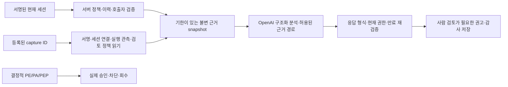

# LLM 보안 오퍼레이션: 실행 근거·호출자 신원·응답 신뢰성

2026-11-17 후속 개발 기록. 오후7시까지 진행 중이며 아직 원격 push·CI·병합하지 않았다.

현재 확인한 가장 넓은 LLM 평가는 **기존 합성 개발 데이터360건, 36개 family**다. 정밀도96.45%, 재현율90.56%, F1 93.41%, 보수적 오탐률3.33%로 **전체 목표 미달**이다. 정상 실패와 UNKNOWN도 원래 기준대로 FP/FN에 포함했다. 이전12개 로컬 정책 시나리오의100% 결과로 이 결과를 대체하지 않는다. 원래 native1,681,815행 평가와 별도이며, 그 결과도 갱신하지 않았다.

## LLM에 무엇을 추가했나

기존 LLM은 이벤트에 적힌 사용자·기기·접속 방식과 정책 예외 주장만 볼 수 있었다. 그 정보만으로 실제 서버의 승인·MFA 요구·실행 허용 범위를 확정할 수 없는 경우가 있었다. 이번 경로는 서버가 검증한 현재 상태를 읽어 같은 이벤트에 묶어 전달한다.

| 근거 | 실제 검증 및 전달 범위 | 확정하지 않는 내용 |
| --- | --- | --- |
| 서버 접근 정책 | 등록 자원, 허용 역할·행위, MFA·관리 기기 요구 | 과거 이벤트 당시 없던 정책의 소급 적용 |
| 수집기 서명 | Ed25519, 등록 source/key/tenant/user/device/role, 신선도 | 수집기 주장이 실제 사람/외부 시스템 관측과 일치한다는 독립 보증 |
| 세션 이력 | 정확한 입력 digest·버전·operator·회수 상태, 일회용 승인 소비 | LLM 응답을 이용한 새 승인 발급 |
| 호출자 | 실제 OIDC JWT 서명·issuer·audience·역할·tenant·subject, 토큰 만료 | 호출자가 분석 대상 사용자와 같은 사람이라는 단정, 외부 IdP의 즉시 회수 조회 |
| 실행 관측 | 별도 실행 수집기가 서명한 principal/workload/실행 파일 해시·목적지 | 서명만으로 운영 OS 프로세스를 독립적으로 측정했다는 주장 |
| 실행 정책 | 유효한 검토·scope·기간·baseline/profile·할당량을 충족하는 정책 | 서로 다른 두 정책의 허용 항목을 합친 새로운 권한 |

`POST /analysis/verified-session?behavior_capture_id=<등록된 capture ID>`로 실행 근거를 선택적으로 연결한다. 클라이언트가 보낸 actor나 승인 플래그를 검증 근거로 받아들이지 않는다. capture가 현재 세션의 동일 입력 digest·버전에 속하는지 서버 저장소에서 확인한다.

실행 관측은 한 정책의 실행 주체 전체와 **모든 목적지**에 일치해야 한다. host·port·path를 정확히 비교하며 접두 경로·유사 도메인·다른 실행 파일을 같은 권한으로 보지 않는다. 관측 없음·불완전·서로 충돌·철회된 수집기는 그대로 남긴다. 실행 정책이 없는 기존 승인도 unresolved로 표시하므로, 일부 알려진 정책과 다르다는 이유만으로 공격을 확정하지 않는다.

LLM은 구체적인 관측과 정책을 비교하고, 왜 위반 또는 불확실하다고 보는지 설명한다. 실제 접근 권한은 기존 결정적 정책·서명·일회용 grant 검증 경로가 처리한다. hybrid는 기존 규칙 탐지를 낮추지 않는다. LLM 단독 평가에서의 오탐 감소를 hybrid 전체의 오탐 감소로 주장하지 않는다.

## 분석 도중 신뢰 상태가 바뀌면

검증 근거는 이벤트 digest에 묶이며, 서명·관측·일회용 승인·OIDC 호출자 토큰 중 관련된 가장 빠른 만료 안에서만 유효하다. OIDC subject를128자로 잘라 다른 신원으로 바꾸던 처리를 제거하고, 길이가 초과하면 거절한다. 만료 값은 유한한 NumericDate로 확인한다. JWT의 NumericDate에는 소수도 허용된다. [RFC7519의 NumericDate 정의](https://www.rfc-editor.org/rfc/rfc7519.html#section-2)

제공자 호출 전과 결과 저장 전에 현재 상태를 다시 확인한다. 선택적 재시도를 켠 경우 두 번째 호출 전에도 같은 검증을 수행한다. 승인 회수·수집기 키 철회·새 충돌 보고서·다른 작업의 승인 소모·호출자 만료로 근거가 달라지면 성공 결과를 감사 저장하지 않는다. 이 조회 자체는 승인 사용 횟수나 grant를 소모하지 않는다.

## 응답 오류와 재시도

[응답 진단 구현 및 첫48회 결과](llm-response-diagnostics-20261117.md)에 이어,360건 평가에서 정상 배포 사례1건이 실제로 `status=incomplete`, `reason=max_output_tokens`, output2400토큰으로 중단된 것을 확인했다. 원래 실패 행은 보존한다. 이 관측으로 이전 다른 실패의 원인까지 소급 확정하지 않는다.

`OPENAI_INCOMPLETE_RETRIES=1`을 선택하면 출력 제한으로 중단된 경우만 최대 한 번 더 요청한다. 기본값은0이다. 두 번째 제한은 기본4000이며 첫 제한보다 커야 한다. 이 선택을 켜면 SDK의 HTTP 자동 재시도도0으로 하여 모델 요청을 최대2회로 제한한다. 거절·content filter·schema 오류·인증 오류나 이미 성공한 판단을 더 유리한 결과로 고르기 위해 재호출하지 않는다. hybrid 자체 timeout과 snapshot 만료가 먼저 도달하면 기존 사람 검토/실패 경로를 따른다.

진단은 상태·고정 오류 코드·토큰 사용량만 남기고, 제공자 오류 입력값·헤더·bearer·API 키를 기록하지 않는다. 모델의 incomplete 응답을 정상 결과로 파싱하지 않는다. 재시도에 드는 추가 비용과 실패도 별도 기록해야 하며, 원래1차 결과를 덮어쓰지 않는다.

## 개발360건의 실제 결과

| 영역 | TP | FP | FN | TN | 정밀도 | 재현율 | F1 | 보수 FPR |
| --- | ---: | ---: | ---: | ---: | ---: | ---: | ---: | ---: |
| 인증 |30|0|0|30|100%|100%|100%|0%|
| 기기 |30|2|0|28|93.75%|100%|96.77%|6.67%|
| 유출 |30|1|0|29|96.77%|100%|98.36%|3.33%|
| 횡적 이동 |30|3|0|27|90.91%|100%|95.24%|10%|
| 권한 |30|0|0|30|100%|100%|100%|0%|
| 원격 접속 |13|0|17|30|100%|43.33%|60.47%|0%|
| 전체 |163|6|17|174|96.45%|90.56%|93.41%|3.33%|

UNKNOWN/오류는 총6건이다. 정상 측은 기기 등록2건·배포2건의 위협 판단,499MB 경계 사례의 UNKNOWN1건, 출력 제한 실패1건으로 구성된다. 원격 미탐은 승인 근거가 없는 RDP10건과 MFA 검증이 불충분한7건이다. 정답 라벨·기존 모집단·임계값은 변경하지 않았다. holdout360건은 이 모델 평가에서 선택·전송하지 않았다.

반복 호출과 같은 family의 변형은 독립적인 새 사건 수가 아니다. 작은 사례에서100%가 나와도 운영 성능을 확정할 수 없다. 보조 도구는 Wilson 구간을 계산하지만, IID 가정이 입증되지 않은 합성 family 데이터에는 배포 보증으로 사용하지 않는다. 예를 들어6/6의95% Wilson 하한은 약60.97%다. F1을 하나의 이항 비율로 보아 Wilson 구간을 붙이지 않으며, 이 설명은 기존95%/5% 목표를 바꾸지 않는다. [NIST 비율의 신뢰구간](https://www.itl.nist.gov/div898/handbook/prc/section2/prc241.htm)

## 검증과 비용의 범위

- 응답 진단 첫 단계는 Windows457건·Linux457건 통과. 같은 사례를 두 환경에서 실행한 것이며914개 독립 사례가 아니다.
- 실행 근거 조회·API·중간 철회 경계19건 통과. 실제 제공자를 흉내 낸 실행 runner 시험2건과 현재 시각의12개 실행 scope 구성 시험도 통과했다. 이 시험들은 유료 LLM 성능으로 집계하지 않는다.
- 실제 JWT/JWKS와 OpenAI를 연결한 첫2건은 HTTP200·snapshot 감사 저장·세션 이력 불변을 확인했다. 기업 SSO 인수나 실제 사람 MFA 검증은 아니다.
- 첫48회 정책 비교와 개발360건은 재시도0이다. 개발360건 비용 추정$1.472043, 첫48회$0.22193475, OIDC2회$0.00957525로, 현재 이 세 실행의 추가 합계$1.703553이다. 실행 근거 초기48회는 $0.24900225, 비교 구조/초점 보완48회는 $0.25891425, 자연 발생 incomplete의 단일 추가 호출은 $0.005616이었다. 이 여섯 실행의 추가507회 합계는 $2.2170855이며 사용량 미확인0건이다. 전체 후속 예산 상한은5달러다. 실제 청구는 공급자 청구서가 기준이다.
- 전체 Linux 진단 실행은 7,499통과·7실패·1설정오류·2skip이었다. Windows와 WSL이 같은 __pycache__를 읽어 Windows 경로가 Linux traceback에 남는 문제를 확인했고, 대시보드 작업 목록에서 이 분석 API가 누락된 점도 고쳤다. Linux bytecode cache를 분리한 후 해당8개 사례는 모두 통과했다. 나머지 복원 실패의 단일 원인을 확정하지는 않는다. 개발 중인 worktree에서 시작한 전체 실행을 최종 고정 소스 전체 통과로 보고하지 않으며, 고정 소스에서 다시 검증한다.

현재 기본 rule/legacy/review_all=false와 실제 환경 파일은 유지했다. AWS 배포·유료 인프라·원격 CI·push·병합은 수행하지 않는다.

## 남은 일

원격 승인/MFA·기기 등록·업무 배포의 실제 수집 근거 확보와 독립 성능 인수가 남았다. 자연 발생 출력 제한의 단일 추가 요청과 실행 근거 비교는 아래 결과로 완료했다. 과거 로그에 없던 승인·사람 신원·실행 사실을 만들어 넣어 성능을 맞추지 않는다. 실제 조직 IdP 설정·토큰 회수 연동·운영 프로세스 관측은 로컬 인증원/작성된 수집기 주장과 별도 인수해야 한다.

## 새 실행 scope 실제 API 결과와 실패 보존

초기 연결만으로는 모델이 세션 ALLOW에 치우쳐, 두 반복 모두 TP0·FP0·FN8·TN4였다. 이 결과도 [초기48회 원본](infrastructure-results/llm-execution-scope-v1-20261117.json)으로 보존한다. 이후 정확한 actor 항목별 동등성·목적지별 포함 여부·한 정책 안의 일관된 일치 여부를 서버 계산 사실로 추가하고, 실행을 우선 검토하도록 입력 초점을 명시했다. 이 값은 등록 수집기 주장과 실제 서버 정책의 비교이며 정답 라벨·공격 탐지 verdict가 아니다.

같은12종 시나리오에 새 서명·현재 시각 근거를 발급하여48회 재비교한 결과, 실행 근거 조건은 두 반복 모두 **TP8·FP0·FN0·TN4**, 세션 정보만 준 조건은 모두 TP0·FP0·FN8·TN4였다. [후속48회·입력 소스 지문·행별 응답](infrastructure-results/llm-execution-scope-v2-20261117.json)에 남겼다. 실제 JWT/JWKS 인증을 거쳤으며, 모든 요청에서 세션·행위 저장소는 변하지 않았다.

두 실행은 동일한 시나리오 정의를 썼지만 신선도 검증을 위해 새 proof/nonce/시각을 사용했다. 단일 변경의 독립 인과효과나12개 미관찰 사건의 최종 인수로 해석하지 않는다. 모델 가중치를 학습한 결과가 아니라 입력 근거·비교 구조·지시문을 보완한 결과다. 관측된 actor/workload/destination은 작성된 로컬 실험 주장이며, OS 프로세스에서 독립 수집한 운영 증거라는 뜻이 아니다.

자연 발생 incomplete1건에는 동결된 동일 입력·동일 모델에 출력 제한4000으로 **한 번만** 추가 요청했다. 형식 오류는 해소됐지만 모델이 정상 배포를 위협으로 판단하여 FP6·FN17·F1 93.41%는 그대로였다. [추가 호출과 재생 집계](infrastructure-results/llm-incomplete-retry-20261117.json)는 원래360건을 새로 재실행한 시험이 아니다. 원래 성공 예측은 그대로 재생했고, 원본 실패 행도 수정하지 않았다.

[개발360건의 원본 행별 결과·동결 지문·보조 불확실성](infrastructure-results/llm-development360-20261117.json)을 함께 확인한다. 원격 승인 근거의 부재나 검증되지 않은 기기/업무 예외의 문제를 모델 호출 횟수만 늘려 해결했다고 주장하지 않는다.

중간 변경 묶음의 Windows 회귀는 **538건 통과**(기존 deprecation 경고3건)다. [JUnit 원본](infrastructure-results/llm-operations-windows-20261117.xml)에 범위를 남겼다. Linux 전체의 최종 고정 소스 검증과 동일한 결과라는 뜻은 아니다.

## 수치 비교 근거 후보는 기본 적용하지 않음

현재 관측값과 Sigma 정책의 수치·필드 참조 피연산자 및 비교 결과만 추가하는 후보를 같은 개발360건에 실제 API로 시험했다. 정답·rule match·분류 verdict는 제공하지 않았다. 시험 전 기존 TP 손실0·새 FP0·F1 비하락·실제 교정 최소1건을 채택 조건으로 동결했다.

| 조건 | TP | FP | FN | TN | 정밀도 | 재현율 | F1 | 보수 FPR |
| --- | ---: | ---: | ---: | ---: | ---: | ---: | ---: | ---: |
| 기존 입력 |163|6|17|174|96.45%|90.56%|93.41%|3.33%|
| 비교 근거 후보 |160|7|20|173|95.81%|88.89%|92.22%|3.89%|

총합에서 일부 경계 사례가 교정돼도 기존 탐지가 사라지는 것을 상쇄했다고 보지 않는다. 후보는 채택 조건에 미달하므로 **런타임 설정·실제 어댑터에 연결하지 않는다**. `scripts.evaluate_llm_development --predicate-context`와 명시적 입력 생성 인자에서만 재현하는 연구 후보로 남긴다. 후보의 UNKNOWN/오류5건도 분모에 포함했다. [동결 프로토콜·행별 비교·실패 원본](infrastructure-results/llm-predicate-context-rejected-20261117.json)을 보존하며, 소표본에서 잘된 영역만 골라 기본 기능의 향상으로 발표하지 않는다. 같은 사례의 재호출에는 모델 변동성도 있으므로 모든 차이를 입력 변경의 독립 인과효과로 확정하지 않는다.

## 고정 소스 Linux 전체 회귀

로컬 커밋 `ed57996`의 분리된 읽기 기준 worktree에서 bytecode cache를 분리하고 API 키 환경을 제거한 전체 시험은 **7,559통과·2skip·실패0**으로 완료했다. 소요36분55초이며 [전체 JUnit](infrastructure-results/llm-operations-frozen-linux-20261117.xml)에 사례를 남겼다. 이후 추가한 선택적 수치 비교·읽기 전용 LLM 근거 조회 기능은 이 커밋의 범위에 들어가지 않으므로 별도 시험한다. 기존 진단 실행의 실패도 삭제하지 않는다.

## 읽기 전용 LLM 근거 조회

선택적 `/analysis/evidence-review`에서 LLM이 현재 세션 이력·서버에 묶인 실행 근거를 요청하고, 서버는 재검증 후 허용 경로만 제공한다. 인자는 `{}`만 허용하며 다른 tenant·세션·URL·shell·차단/회수 도구는 없다. 최대2회 읽기·3회 제공자 요청·총30초이며 기본 비활성이다. hybrid는 기존 규칙 탐지를 낮추지 않는다.

실제 OIDC/JWKS→API→OpenAI 비교에서 실행12종은 정적/조회 방식 모두 TP8·FP0·FN0·TN4, 인증·MFA12종은 모두 TP6·FP0·FN0·TN6이었다. 실제 제공자60회·$0.3083325 추정이며 원래 개발360건의 성능 향상으로 합산하지 않는다. 실행 시험에서 조회 방식의 평균 지연은5.10초로 정적4.15초보다 길었고 비용도 더 들었다. 따라서 정해진 소량 근거를 이미 가진 경우의 기본 경로로 전환하지 않는다. [구현·조회 권한 경계·원본 결과·비용/지연·재현](llm-read-only-evidence-review-20261117.md)을 따로 정리했다.

수치 비교 실패360회 $1.619262와 위60회를 포함한 이 연속 작업의 실제 제공자 합계는 **927회·$4.14468 추정·사용량 미확인0건**이다. 최초 상한$5 안에서 관리하며, 과거 별도 작업의 API 비용을 포함한 프로젝트 전체 청구 합계는 아니다.
