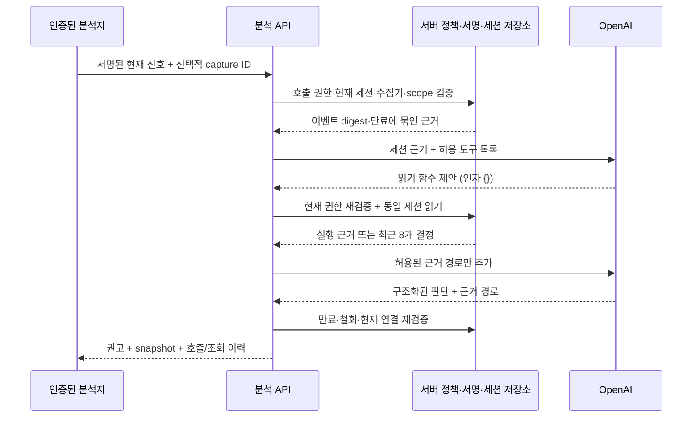

# LLM의 읽기 전용 근거 조회 구현·검증

2026-11-17 · 로컬 개발 기능 · 기본 비활성 · 실제 기업 SSO/OS 관측 인수와 별도

LLM이 검증된 현재 세션의 실행 근거와 최근 판단 이력을 요청하고, 서버가 허용한 자료만 돌려주는 선택적 분석 경로를 구현했다. LLM은 권한을 발급·회수하지 않으며, 최종 응답도 사람 검토가 필요한 권고다. 기존 정적 근거 입력 방식도 유지한다.

## 요청부터 결과까지



`POST /analysis/evidence-review?behavior_capture_id=<등록된 ID>`의 본문은 기존 `SignedSessionSignal`이다. 클라이언트가 `verification_context`나 임의 근거 JSON을 직접 제출하는 인터페이스가 아니다. analyst 이상 역할을 확인하며, capture는 동일 tenant·현재 세션·버전·입력 digest에 묶여 있어야 한다. 실행 근거 없이 세션 정책만 검토하는 요청도 지원한다.

LLM이 제안할 수 있는 함수는 다음 둘뿐이다.

| 함수 | 제공 범위 | 제한 |
| --- | --- | --- |
| `read_bound_execution_evidence` | 서버가 미리 검증한 capture의 주체·workload·실행 파일 해시·목적지·검토 정책·정확한 비교 | capture가 있을 때만 등록. 최종 실행 검토 전에 반드시 읽어야 함 |
| `read_current_session_history` | 동일 세션의 최근 8개 결정: 버전·시각·결정·상태·reason code·source trust·enforcement mode | 과거 정책 결정이며 실제 사람·공격의 독립 증거로 간주하지 않음 |

두 함수의 유일한 허용 인자는 빈 객체 `{}`다. 모델이 tenant·user·URL·경로·다른 세션을 선택할 수 없다. URL 방문·shell·파일 읽기·grant 발급·승인 소비·차단 도구는 등록하지 않는다. 같은 근거 그룹의 반복 조회, 여러 도구 동시 제안, 알 수 없는 도구, 새 대상 인자, 보지 않은 근거 인용을 거절한다.

## 실행 경계와 기존 탐지

한 분석은 최대 **도구 읽기 2회·제공자 요청 3회·총 30초**다. 총 제한은 `OPENAI_EVIDENCE_REVIEW_TIMEOUT_SECONDS`로 1–90초 범위에서 설정하며 각 호출에도 30초 제한을 둔다. SDK HTTP 자동 재시도는0이고 incomplete 자동 재시도도 하지 않는다. 마지막 모델 요청에는 추가 도구 사용을 허용하지 않는다. 입력49,152바이트·도구 결과24,576바이트의 상한을 넘으면 중단한다.

매 제공자 호출·도구 실행 전과 결과 저장 전에 현재 신뢰 상태를 확인한다. source/key 철회·정책 변경·승인 소모·만료·서로 다른 근거가 생기면 결과를 성공 감사로 남기지 않는다. 시간 초과도 취소하고 분석 동시 실행 슬롯을 반환한다. 캐시된 agent 객체를 공유해도 호출별 근거·조회 집합·사용량 기록은 별도다.

hybrid 설정에서는 기존 규칙의 위험·탐지를 낮추지 않는 병합을 그대로 적용한다. LLM 원래 판단은 trace의 `model_assessment_before_rule_merge`로 구분한다. 사람 검토를 강제하고 실제 조치는 기존 PE/PA/PEP 경로에 남긴다. 분석 snapshot은 결과이며 새로운 실행 권한이 아니다. 철회 확인과 감사 저장이 하나의 전역 원자적 트랜잭션이라는 보장은 하지 않는다.

성공 응답의 `llm_trace`에는 호출 수·안전한 응답 상태/토큰·실행한 도구 이름·반환 자료 SHA256/바이트 수·쓰기 도구 부재를 남긴다. 후속 보완으로 요청 모델·호출별 지연·출력 제한도 포함한다. 원본 모델 reasoning·bearer·개인키·grant token·제공자 오류 메시지는 넣지 않는다. 조회하지 않은 실행/이력은 결과 snapshot에도 추가하지 않는다. 기존 일반 분석 응답에서는 `llm_trace=None`을 직렬화하지 않아 예전 감사 JSON 형태를 유지한다.

## 실제 API 결과

로컬 실제 JWT 서명·issuer/audience·tenant/역할 검증과 실제 loopback JWKS HTTP 조회를 거쳐 API에 접근했다. principal 주입이나 JWKS fetch 대체는 하지 않았다. 외부 기업 IdP와 실제 사람 MFA의 인수 시험은 아니다. 모든 시나리오는 새 현재 시각의 서명·상태를 발급한 작성형 개발 사례다.

| 사례군 | 방식 | TP | FP | FN | TN | 실제 제공자 요청 |
| --- | --- | ---: | ---: | ---: | ---: | ---: |
| 실행 scope 12종 | 정적 근거 입력 |8|0|0|4|12|
| 실행 scope 12종 | 읽기 도구 조회 |8|0|0|4|24|
| 세션·MFA 정책 12종 | 정적 근거 입력 |6|0|0|6|12|
| 세션·MFA 정책 12종 | 선택적 읽기 agent |6|0|0|6|12|

실행 조회에서는 모든 agent 요청이 실행 근거를 한 번 읽은 뒤 최종 응답했다. 세션·MFA 시험에서는 이미 주어진 정책/신호만으로 판단하여 추가 도구를 쓰지 않았다. 각 비교에서 기존 TP 손실·새 FP0, UNKNOWN/오류0, 감사 snapshot/trace 일치, 세션 journal·행위 저장소 불변을 확인했다. 반복2회나 독립 운영 평가라는 뜻은 아니다.

| 실행 scope 측정 | 정적 방식 | 도구 조회 방식 |
| --- | ---: | ---: |
| 관측 평균 분석 지연 |4,146.28ms|5,099.66ms|
| 12개 분석의 사용량 비용 추정 |$0.069660|$0.112776|

이 소표본에서는 도구 조회가 정확도를 더 높이거나 비용·속도를 개선하지 않았다. 필요한 근거가 이미 작고 정해져 있으면 정적 입력이 실용적이다. 도구 방식은 필요한 근거의 선택과 조회 내역을 통제하는 선택적 경로로 두며 기본 경로로 전환하지 않는다. 지연은 한 실행의 관측값이고 SLA나 일반적 성능 우열의 통계적 증명은 아니다. 캐시 할인 미반영 사용량 추정이며 실제 청구는 공급자가 기준이다.

[실행 비교 원본·동결 지문·24개 분석 행](infrastructure-results/llm-evidence-review-execution-20261117.json), [세션·MFA 비교 원본](infrastructure-results/llm-evidence-review-session-20261117.json)에 모든 행과 사용량을 보존한다. 두 실행 합계는 실제 제공자 **60회·약 $0.3083325**다. 원래 개발360건 F1 93.41%나 native/독립 인수 지표를 이 소표본100%로 교체하지 않는다.

## 로컬 실행과 재현

선택적 API는 `OPENAI_EVIDENCE_AGENT_ENABLED=true`, `OPENAI_PROMPT_MODE=grounded`, `ANALYZER_MODE=openai` 또는 `hybrid`가 필요하다. 예시 기본값은 비활성이고 실제 환경 파일은 변경하지 않는다. 프로덕션에서는 현재 로컬 정책 저장소가 비활성화돼 이 API도404다. 유료 호출 설정을 켜는 것은 운영 인수 완료를 뜻하지 않는다.

```powershell
python -m scripts.evaluate_evidence_review_llm `
  --directory runtime/llm/new-evidence-review `
  --key-env-file <기존 로컬 키 환경 파일> `
  --max-budget 0.45 --suite session `
  --stop-at <미래의 timezone 포함 ISO 시각>
```

실행 scope는 `--suite execution`으로 선택한다. 출력 폴더가 존재하면 덮어쓰지 않는다. 이 유료 실험 runner의 비용 제어는 **시험용**이며 API 전체의 조직별 청구 한도 기능이 아니다. 요청 전에 입력·도구 schema·출력 schema와 출력 상한으로 비용을 예약하고, 사용량이 확인된 경우만 미사용 예약을 해제한다. 사용량 미확인·중단 직전 요청은 예약을 유지한다. 중단한 사례도 전체 분모에 남긴다. 모델을 호출하지 않는 MockTransport·실제 로컬 OIDC runner 시험은 유료 성능 평가와 따로 집계한다.

응답의 도구 제안과 `function_call_output`을 연결하고 제공자 reasoning item을 다음 요청에 그대로 전달하는 프로토콜은 [OpenAI 공식 함수 호출 문서](https://developers.openai.com/api/docs/guides/function-calling)를 따른다. SDK 전용 파싱 필드는 다음 API 입력에서 제거하고 reasoning 내용은 trace/public 결과에 복사하지 않는다.

관련 구현은 `app/analyzers/evidence_agent.py`, `app/main.py`, `app/analyzers/structured_response.py`, `app/services/execution_analysis_evidence.py`다. [전체 개선 결과와 미달 항목](llm-operation-evidence-20261117.md)을 함께 본다.
