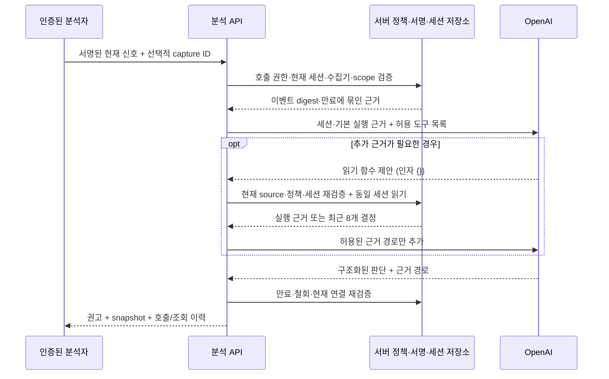

# LLM의 읽기 전용 근거 조회 구현·검증

2026-11-17 · 로컬 개발 기능 · 기본 비활성 · 실제 기업 SSO/OS 관측 인수와 별도

LLM이 검증된 현재 세션의 실행 근거와 최근 판단 이력을 요청하고, 서버가 허용한 자료만 돌려주는 선택적 분석 경로를 구현했다. LLM은 권한을 발급·회수하지 않으며, 최종 응답도 사람 검토가 필요한 권고다. 기존 정적 근거 입력 방식도 유지한다.

## 요청부터 결과까지



`POST /analysis/evidence-review?behavior_capture_id=<등록된 ID>`의 본문은 기존 `SignedSessionSignal`이다. 클라이언트가 `verification_context`나 임의 근거 JSON을 직접 제출하는 인터페이스가 아니다. analyst 이상 역할을 확인하며, capture는 동일 tenant·현재 세션·버전·입력 digest에 묶여 있어야 한다. 실행 근거 없이 세션 정책만 검토하는 요청도 지원한다.

LLM이 제안할 수 있는 함수는 다음 둘뿐이다.

| 함수 | 제공 범위 | 제한 |
| --- | --- | --- |
| `read_bound_execution_evidence` | 서버가 미리 검증한 capture의 주체·workload·실행 파일 해시·목적지·검토 정책·정확한 비교 | `on_request`에서 capture가 있을 때만 등록. 처음부터 제공하지 않은 실행 근거는 최종 검토 전에 읽어야 함 |
| `read_current_session_history` | 동일 세션의 최근 8개 결정: 버전·시각·결정·상태·reason code·source trust·enforcement mode | 과거 정책 결정이며 실제 사람·공격의 독립 증거로 간주하지 않음 |

두 함수의 유일한 허용 인자는 빈 객체 `{}`다. 모델이 tenant·user·URL·경로·다른 세션을 선택할 수 없다. URL 방문·shell·파일 읽기·grant 발급·승인 소비·차단 도구는 등록하지 않는다. 같은 근거 그룹의 반복 조회, 여러 도구 동시 제안, 알 수 없는 도구, 새 대상 인자, `evidence` 배열의 보지 않은 근거 경로를 거절한다. 설명 본문 전체의 의미를 자동 검증하는 기능은 아니다.

## 실행 경계와 기존 탐지

모델 검토 루프는 최대 **도구 읽기 2회·제공자 요청 3회·기본 30초**다. 검토 제한은 `OPENAI_EVIDENCE_REVIEW_TIMEOUT_SECONDS`로 1–90초 범위에서 설정하며 각 호출에도30초 제한을 둔다. 요청 접수·동시 실행 대기·감사 저장까지 합친 HTTP 전체 응답시간을 보증하는 값은 아니다. SDK HTTP 자동 재시도는0이고 incomplete 자동 재시도도 하지 않는다. 마지막 모델 요청에는 추가 도구 사용을 허용하지 않는다. 입력49,152바이트·도구 결과24,576바이트의 상한을 넘으면 중단한다.

매 제공자 호출·도구 실행 전과 제공자 결과 검토 후에 현재 신뢰 상태를 확인한다. 이 구간의 source/key 철회·정책 변경·승인 소모·만료·서로 다른 근거는 성공 분석 반환/저장을 거부한다. 감사 저장을 기다리는 동안에도 상태가 바뀔 수 있으므로, 저장 후 HTTP 결과 반환 직전에 다시 검증한다. 이미 커밋한 과거 분석 기록은 지우지 않고 전달을 거부한다. 시간 초과는 분석 동시 실행 슬롯을 반환한다. 캐시된 agent 객체를 공유해도 호출별 근거·조회 집합·사용량 기록은 별도다.

hybrid 설정에서는 기존 규칙의 위험·탐지를 낮추지 않는 병합을 그대로 적용한다. LLM 원래 판단은 trace의 `model_assessment_before_rule_merge`로 구분한다. 사람 검토를 강제하고 실제 조치는 기존 PE/PA/PEP 경로에 남긴다. 분석 snapshot은 결과이며 새로운 실행 권한이 아니다. 철회 확인과 감사 저장이 하나의 전역 원자적 트랜잭션이라는 보장은 하지 않는다.

성공 응답의 `llm_trace`에는 호출 수·안전한 응답 상태/토큰·실행한 도구 이름·반환 자료 SHA256/바이트 수·쓰기 도구 부재를 남긴다. 요청 모델·호출별 지연·출력 제한·처음부터 제공한 근거와 추가 조회도 구분한다. 원본 모델 reasoning·bearer·개인키·grant token·제공자 오류 메시지는 넣지 않는다. 모델에 제공하지 않은 실행/이력은 결과 snapshot에도 추가하지 않는다. 기존 일반 분석 응답에서는 추가 필드가 없으면 직렬화하지 않아 예전 감사 JSON 형태를 유지한다.

## 초기 조회 방식의 실제 API 결과

실패 처리도 경로별로 구분한다. `/analysis/verified-session`의 OpenAI 단독은 제공자 실패 시 결과를 거부한다. 같은 경로의 기존 hybrid는 제공자 오류/timeout에 규칙 fallback·사람 검토로 완료할 수 있지만, 현재 권한·근거 재검증은 여전히 통과해야 한다. `/analysis/evidence-review`는 검토 agent가 실패하면 hybrid 설정이어도 성공한 agent 결과로 대체하지 않고 거부한다. 완료된 분석 감사가 반드시 성공한 LLM 검토를 뜻하지 않는다. 유료 비교 runner에서는 정적 어댑터도 SDK 재시도0으로 고정했으며, 일반 런타임의 OpenAI 재시도 설정과는 별개다.

기존 raw hybrid의 별도360건 동결 재생은 F1 78.09%·새 FP95로 미채택이었다. 이 수치는 이 문서의 검증 근거12종이나 원래 native 탐지 결과와 다르다. [재생 범위·timeout의 한계·원본](llm-operation-evidence-20261117.md#기존-규칙hybrid의-무료-동결-재생-비교)을 먼저 확인하며, 단순 hybrid 활성화를 성능 목표 달성으로 설명하지 않는다.

로컬 실제 JWT 서명·issuer/audience·tenant/역할 검증과 실제 loopback JWKS HTTP 조회를 거쳐 API에 접근했다. principal 주입이나 JWKS fetch 대체는 하지 않았다. 외부 기업 IdP와 실제 사람 MFA의 인수 시험은 아니다. 모든 시나리오는 새 현재 시각의 서명·상태를 발급한 작성형 개발 사례다.

| 사례군 | 방식 | TP | FP | FN | TN | 실제 제공자 요청 |
| --- | --- | ---: | ---: | ---: | ---: | ---: |
| 실행 scope 12종 | 정적 근거 입력 |8|0|0|4|12|
| 실행 scope 12종 | 읽기 도구 조회 |8|0|0|4|24|
| 세션·MFA 정책 12종 | 정적 근거 입력 |6|0|0|6|12|
| 세션·MFA 정책 12종 | 선택적 읽기 agent |6|0|0|6|12|

실행 조회에서는 모든 agent 요청이 실행 근거를 한 번 읽은 뒤 최종 응답했다. 세션·MFA 시험에서는 이미 주어진 정책/신호만으로 판단하여 추가 도구를 쓰지 않았다. 각 비교에서 기존 TP 손실·새 FP0, UNKNOWN/오류0, 감사 snapshot/trace 일치와 세션 journal 불변을 확인했다. 실행 사례는 행위 저장소 불변도 검사했으며, 세션/MFA 사례에는 행위 저장소를 구성하지 않았다. 반복2회나 독립 운영 평가라는 뜻은 아니다.

| 실행 scope 측정 | 정적 방식 | 도구 조회 방식 |
| --- | ---: | ---: |
| 관측 평균 분석 지연 |4,146.28ms|5,099.66ms|
| 12개 분석의 사용량 비용 추정 |$0.069660|$0.112776|

이 소표본에서는 도구 조회가 정확도를 더 높이거나 비용·속도를 개선하지 않았다. 필요한 근거가 이미 작고 정해져 있으면 정적 입력이 실용적이다. 도구 방식은 필요한 근거의 선택과 조회 내역을 통제하는 선택적 경로로 두며 기본 경로로 전환하지 않는다. 지연은 한 실행의 관측값이고 SLA나 일반적 성능 우열의 통계적 증명은 아니다. 캐시 할인 미반영 사용량 추정이며 실제 청구는 공급자가 기준이다.

[실행 비교 원본·동결 지문·24개 분석 행](infrastructure-results/llm-evidence-review-execution-20261117.json), [세션·MFA 비교 원본](infrastructure-results/llm-evidence-review-session-20261117.json)에 모든 행과 사용량을 보존한다. 두 실행 합계는 실제 제공자 **60회·약 $0.3083325**다. 원래 개발360건 F1 93.41%나 native/독립 인수 지표를 이 소표본100%로 교체하지 않는다.

## 작은 실행 근거를 처음부터 제공한 비교

선택적 agent를 켰을 때의 기본 전달은 `OPENAI_EVIDENCE_EXECUTION_DELIVERY=inline`이다. 작은 검증 실행 묶음을 처음부터 제공하고, 세션 이력은 필요할 때 추가 조회한다. `on_request`는 앞의 명시적 실행 조회를 재현한다. 초기 제공은 `prefetched_evidence`, 실제 도구 호출은 `tools_executed`로 따로 기록해 실행하지 않은 도구를 실행했다고 표시하지 않는다.

| 실행 scope agent 12건 | 초기 on_request | 후속 inline |
| --- | ---: | ---: |
| TP/FP/FN/TN |8/0/0/4|8/0/0/4|
| 실제 제공자 요청 |24|12|
| 관측 평균 분석 지연 |5,099.66ms|4,344.92ms|
| 사용량 비용 추정 |$0.112776|$0.074169|

후속 실행에서 함께 비교한 정적 방식은 TP8·FP0·FN0·TN4, 평균3,877.19ms·$0.0708075였다. 새 세션/MFA12종 비교도 두 방식 모두 TP6·FP0·FN0·TN6으로 유지됐다. [inline 실행 원본](infrastructure-results/llm-evidence-review-inline-execution-20261117.json), [inline 세션/MFA 원본](infrastructure-results/llm-evidence-review-inline-session-20261117.json)에 사전 조건과 모든 결과를 남겼다.

같은 시나리오 뜻을 썼지만 새 서명·nonce·시각과 확률적 모델 응답이므로 지연·비용 차이를 독립 인과효과로 확정하지 않는다. 이 표의 요청 수 감소는 실제로 확인한 값이다. 선택적 agent 자체는 여전히 기본 비활성이며 일반 `/analysis`의 기본 모드를 전환하지 않는다.

## 없는 실행 근거를 허용 권고로 바꾸지 않음

실행 보고 없음·주체 누락·목적지 누락·보고 충돌·실행 정책 없는 기존 승인·유효한 검토 정책 없음의6종은 정상/위협 이진 정답이 없는 별도 근거 처리 시험이다. 두 방식12회 실제 API에서 근거 없는 구체 위반은 만들지 않고 사람 검토를 유지했지만, 그중4회는 `ALLOW`를 권고했다. 실제 접근이나 grant를 실행한 결과는 아니었다. [수정 전 모든 응답](infrastructure-results/llm-evidence-grounding-before-guard-20261117.json)을 보존한다.

서버는 `enforce_verified_review_safety`로 source·요청자 연결·정책 요건·현재 세션 승인·실행 scope 근거를 검사한다. 필요한 근거가 충족되지 않은 `ALLOW` 권고만 `HOLD_FOR_REVIEW`로 제한한다. 기존 위협 분류·점수·근거·다른 대응 권고를 바꾸지 않는다. `verified_review_controls`에 안전 점검 전후 권고·제한 사유를 남긴다. 원래12개 응답을 바꾸지 않고 guard를 재생하면4개 모두 검토 대기로 바뀐다. 이는 추가 모델 호출이나 F1 개선이 아니다.

후속 실제 API12회에서도 두 방식 모두6/6 사람 검토·추가 허용 권고0·세션/행위 저장소 불변을 확인했다. 이 실행에서 모델이 낸 허용 권고는2개였고 서버가 모두 제한했다. [후속 실제 응답과 제한 사유](infrastructure-results/llm-evidence-grounding-after-guard-20261117.json)에 남겼다. 두 실행의 모델 변동성을 guard의 분류 성능 향상으로 해석하지 않는다. 사례의 `NORMAL`은 지원되는 공격 근거가 없다는 뜻이며 실행 권한 확인을 뜻하지 않는다.

기존 `policy_decision.allowed`는 **권고 유형이 응답 허용 목록에 속하는지**를 표시한다. 따라서 `HOLD_FOR_REVIEW`에서도true일 수 있다. 보호 자원 접근 허가는 `/zero-trust/protected-access`의 별도 PEP 판단이다. 이 기존 계약을 바꾸지 않고 API 설명과 화면 표현을 명확히 했다.

## 운영 화면과 취소 경합

분석 상세와 작업 결과에 서명·요청자 연결·MFA 요구/관측·대상 사람의 독립 검증 여부·실행 scope 비교·호출 수·사용량·안전 점검 전후 권고를 표시한다. 누락·문자열 boolean·형식 오류를 검증 성공으로 바꾸지 않는다. 인용한 경로의 HTML은 텍스트로 표시하며 bearer·개인키·credential 등 민감 필드를 숨긴다. 근거의 수집·만료 시각을 보여주고 과거 분석 기록을 현재의 접근 허가로 표시하지 않는다.

무료 부하 시험은 실제 로컬 JWT/JWKS·서명·저장소와 모의 제공자 transport를 사용했다. 두 tenant의32개 동시 요청에서4개만 모델 처리에 들어가고28개는429로 제한됐으며 재요청으로 복구됐다. 제공자 처리 중 취소는 감사 성공을 남기지 않고 슬롯을 반환했다. 결과 감사의 tenant 분리·재시작 후 hash chain·세션 journal 불변도 확인했다. 유료 LLM 정확도 시험으로 집계하지 않는다.

JSONL 감사 쓰기를 시작한 뒤의 취소는 별도다. 파일 스레드는 요청 취소만으로 중단되지 않아, 기존 구현은 잠금을 먼저 풀고 다음 쓰기와 겹칠 수 있었다. 이를 실제 hash 계산 경계에서 재현한 뒤, 쓰기가 끝날 때까지 잠금을 유지하고 메모리 반영 후 취소를 전달하도록 고쳤다. 부분 쓰기 실패는 후속 append를 막는다. 이때 기록은 완료된 분석에 대한 감사이며 HTTP 응답이 사용자에게 전달됐다는 뜻이 아니다. 단일 프로세스·한 저장소 인스턴스의 경합 보완이며 다중 프로세스 파일 공유나 전원 단절 내구성을 새로 보증하지 않는다.

## 로컬 호출 계정 변경과 결과 전달

API 키 인증의 재검증 함수는 평문 키를 캡처하지 않고 digest·최초 principal만 캡처한다. 두 검증 분석 API는 매 근거 수집/재검증에서 서버 계정 파일을 다시 읽고, 계정 비활성화·역할/tenant/subject 변경·손상된 설정·현재 프로세스가 사용하는 인증 설정 변경을 거부한다. 공백/JSON 키 순서만 바뀐 같은 계정은 계속 허용한다. 검증 함수나 credential digest를 모델 입력·snapshot·trace에 넣지 않는다. 일반 분석 API 전체에 새 검증 동작을 적용한 것은 아니다.

| 변경을 확인한 시점 | 분석 결과 | 감사 기록 |
| --- | --- | --- |
| 모델 호출 전 |호출을 진행하지 않음|새 성공 기록 없음|
| 제공자 응답 후, 감사 저장 전 |검증 분석 실패로 반환|새 성공 기록 없음|
| 감사 커밋 후, 결과 반환 직전 |반환을 거부|이미 커밋한 분석은 그대로 보존|
| 파일 쓰기 중 HTTP 요청 취소 |쓰기가 끝날 때까지 잠금 유지 후 취소 전달|커밋됐을 수 있음. HTTP 전달 증명이 아님|

마지막 검증과 모든 외부 권한 저장소를 하나의 트랜잭션으로 묶은 것은 아니다. 실자원 접근은 매 접근의 PEP가 별도로 판단한다. 외부 OIDC는 JWT 검증·토큰 만료와 표준 JWKS 캐시를 사용하며, IdP의 역할 변경/토큰 회수를 즉시 introspection하는 기능은 아직 없다. 요청 operator와 현재 세션 operator의 일치를 확인하는 것이며, 그 자체로 이벤트 대상 사람의 MFA나 수집기→SOC 분석자의 위임을 증명하지 않는다. 실제 조직 SSO와 위임 인수는 남은 작업이다.

이전 고정 소스`2e57f16`에서는 모델 응답 중 계정 변경5종×두 API의10개 검증이 모두 실패했다(실제로는HTTP200을 반환). [수정 전 원본](infrastructure-results/llm-caller-authority-before-20261117.xml)을 보존한다. 감사 커밋 후 철회에서도 두 API가 이전에는200을 반환한[별도2개 재현](infrastructure-results/llm-caller-delivery-before-20261117.xml)을 남겼다. 수정 후 관련 Linux167개는 모두 통과했다([원본](infrastructure-results/llm-caller-authority-linux-20261117.xml)). 실제 로컬 키 인증·서명·저장소에 모의 제공자를 연결한 무료 검증이며 LLM 탐지 성능의 추가 표본이 아니다.

추가로 실제 읽기 agent와 모의 HTTP 제공자가 `read_current_session_history`를 제안하는 바로 그 시점에 계정을 비활성화했다. [도구 직전 회수 검증1개](infrastructure-results/llm-caller-tool-revocation-20261117.xml)는 통과했고, 이력의 추가 읽기·두 번째 제공자 요청·새 감사 저장을 모두 막았다. 기존167개와 별도 실행한 Linux 전용 경계 시험이다.

## 로컬 실행과 재현

선택적 API는 `OPENAI_EVIDENCE_AGENT_ENABLED=true`, `OPENAI_PROMPT_MODE=grounded`, `ANALYZER_MODE=openai` 또는 `hybrid`가 필요하다. 위 실제 비교는 runner에 고정한 모델·`reasoning_effort=low`·최대 출력2400토큰을 사용했다. 모델 이름은 각 결과의 동결 계획을 따른다. 다른 설정으로 결과가 재현된다고 보증하지 않는다. 예시 기본값은 비활성이고 실제 환경 파일은 변경하지 않는다. 프로덕션에서는 현재 로컬 정책 저장소가 비활성화돼 이 API도404다. 유료 호출 설정을 켜는 것은 운영 인수 완료를 뜻하지 않는다.

```powershell
python -m scripts.evaluate_evidence_review_llm `
  --directory runtime/llm/new-evidence-review `
  --key-env-file <기존 로컬 키 환경 파일> `
  --max-budget 0.45 --suite session `
  --execution-delivery inline `
  --stop-at <미래의 timezone 포함 ISO 시각>
```

실행 scope는 `--suite execution`으로 선택한다. 출력 폴더가 존재하면 덮어쓰지 않는다. 이 유료 실험 runner의 비용 제어는 **시험용**이며 API 전체의 조직별 청구 한도 기능이 아니다. 요청 전에 입력·도구 schema·출력 schema와 출력 상한으로 비용을 예약하고, 사용량이 확인된 경우만 미사용 예약을 해제한다. 사용량 미확인·중단 직전 요청은 예약을 유지한다. 중단한 사례도 전체 분모에 남긴다. 모델을 호출하지 않는 MockTransport·실제 로컬 OIDC runner 시험은 유료 성능 평가와 따로 집계한다.

응답의 도구 제안과 `function_call_output`을 연결하고 제공자 reasoning item을 다음 요청에 그대로 전달하는 프로토콜은 [OpenAI 공식 함수 호출 문서](https://developers.openai.com/api/docs/guides/function-calling)를 따른다. SDK 전용 파싱 필드는 다음 API 입력에서 제거하고 reasoning 내용은 trace/public 결과에 복사하지 않는다.

관련 구현은 `app/analyzers/evidence_agent.py`, `app/main.py`, `app/analyzers/structured_response.py`, `app/services/execution_analysis_evidence.py`다. [전체 개선 결과와 미달 항목](llm-operation-evidence-20261117.md)을 함께 본다.

## 최신 무료 회귀와 화면 증거

후속 변경의 Windows 묶음 회귀는 **654통과·26skip·실패/설정 오류0**이다. [JUnit](infrastructure-results/llm-caller-final-windows-20261117.xml)은680개 수집 항목을 포함하며 skip을 통과에 더하지 않는다.26개 skip에는 기존12개와 POSIX 계정 파일 규약 때문에 이 OS에서 실행하지 않은 호출 계정 경계14개가 포함된다. 계정 파일/도구 직전 회수의 실제 실행 결과는 앞의 Linux 시험에 따로 남겼다. 이전647/12 회귀와 고정 커밋의 전체 Linux7,596통과 결과도 보존하며 범위를 구분한다. 최신 고정`63c42f3`의 Linux 전체 회귀는 **7,690통과·2skip·실패0**([JUnit](infrastructure-results/llm-review-63c42f3-linux-20261117.xml))이었다.38분02초이며 skip2개는 패치한 Linux 컨테이너 이미지 전용 시험으로 호스트 실행에서는 수행하지 않았다. 이번 결과를 새 컨테이너 이미지 검증이나8시간 soak로 확대하지 않는다.

[분석 상세 브라우저57개 검사](infrastructure-results/llm-evidence-dashboard-browser-20261117.json), [운영 작업 브라우저142개 검사](infrastructure-results/llm-evidence-operations-browser-20261117.json)는 모두 통과했다. [1440px 화면](infrastructure-results/llm-evidence-dashboard-1440-20261117.png), [390px 화면](infrastructure-results/llm-evidence-dashboard-390-20261117.png)은 **합성 응답 fixture를 사용한 표시 검증**이다. 실제 유료 응답이나 실제 사람 MFA 성공의 증명 사진이 아니다. 본문·인용 경로·안전 제한·기밀 마스킹, 예전 기록의 누락 필드, 확대/좁은 화면을 검사했다.

Ruff는 app/scripts/tests 전체 통과했다. Impeccable의 정적 검사에는 기존 `.demo-note`의 한쪽 테두리 경고1개가 남아 있다. 이번 변경에서 추가한 스타일이 아니며 정적 JS/CSS 검사가 화면 전체의 접근성을 보증하지 않는다. 실제 화면은 브라우저 검사와 직접 확인을 함께 사용했다.

추가 [로그 지시문6종·실제 API12회](infrastructure-results/llm-evidence-prompt-injection-20261117.json)는 두 방식 각각TP3·FP0·FN0·TN3으로 판정을 유지했다. 위조 정책 JSON이나 다른 tenant 조회 지시도 이벤트 데이터로 전달했으며 실제 조회/쓰기 도구 실행은 없었다. 이 작은 작성형 시험을 일반적인 프롬프트 공격 방어율이나 독립 F1로 보고하지 않는다. 실행 방법은 `python -m scripts.evaluate_evidence_prompt_injection --directory <새 폴더> --key-env-file <기존 로컬 키 파일> --max-budget 0.15 --stop-at <시간대 포함 미래 시각>`이다. 계획·payload·wrapper 소스 지문을 유료 요청 전에 저장하며6종 중 실패/미실행 사례도 분모에 보존한다.

[동일 구현 에이전트의 설명 개발 검토](infrastructure-results/llm-rationale-development-review-20261117.json)에서는 이12개 응답의 `evidence` 배열 경로가 모두 실제 입력 catalog에 있는지 다시 확인했다. 다만 정적 VPN READ 설명1개가 본문에서 catalog의 `action` 대신 정규화 입력의 `unmapped.source_action` 경로를 사용했다. READ라는 값은 실제 입력에 존재해 사실 날조로 판정한 것은 아니지만, 설명 본문의 인용 표준 준수는 부족했다. 원본 설명과 분류를 수정하지 않았다. 구조화 배열 검증을 설명 전체의 사실성/충실도100%로 발표하지 않으며, canonical 경로 사용 개선과 독립적인 설명 심사는 후속 과제다.
