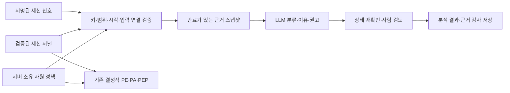

# 검증된 원격 접속 정책·세션 근거의 LLM 연결

2026-11-17 · 기준 main `96a1570` + 직전 로컬 개선 `2070ad5` · 로컬 인증원 검증 · 운영 SSO 미연결

## 최종 결과와 적용 상태

서버 정책·서명된 관측·현재 세션/회수·일회용 승인 소비를 검증해 LLM에 전달하는 경로를 구현했다. 최종 코드에서 **Windows442건·Linux442건, Ruff check . 통과**를 확인했다. 같은 시험을 두 환경에서 반복한 것이며884개 독립 사례가 아니다. 최종 ASGI 경로로도 실제 OpenAI를2회 호출해 MFA 필수 unknown은 ACCESS_POLICY_VIOLATION, MFA 비필수는 NORMAL로 응답했고, 두 요청 모두200·근거 감사 저장·세션 이력 불변을 확인했다.

| 새 로컬12개 시나리오·최종 코드 | TP/FP/FN/TN | 정밀도 | 재현율 | F1 | 보수 FPR |
|---|---|---:|---:|---:|---:|
| 근거 없는 plain·반복1 |2/1/4/5|66.67%|33.33%|44.44%|16.67%|
| 검증 근거 제공·반복1 |6/1/0/5|85.71%|100%|92.31%|16.67%|
| 근거 없는 plain·반복2 |2/1/4/5|66.67%|33.33%|44.44%|16.67%|
| 검증 근거 제공·반복2 |6/0/0/6|100%|100%|100%|0%|

첫 최종 반복의FP1은 `mfa_not_required` 정상 사례에서 SDK ValidationError로 결과를 받지 못한 건이다. 실제 위협 경보로 단정한1건과 구분한다. 실패를 빼지 않는 보수 채점상 FP로 남겼다. 이후 실제 ASGI 경로에서 이 사례는200/NORMAL이었지만, 앞선 실패를 성공으로 덮어쓰지 않는다. 첫 실패의 raw 응답·토큰 사용량을 SDK에서 받기 전 예외가 발생해 원인이 토큰 한도/형식 중 무엇인지는 현재 기록으로 확정할 수 없다.

**과거 원격 미탐2건은 여전히 미탐이며 전체 목표 미달이다.** 새 enum을 포함한 과거24건 두 재평가는 TP10·FN2 유지, FP0/1·F1 90.91/86.96%였다. 별도12건은TP6/FP0/FN0/TN6이었다. 모든 과거 TP의ID를 비교해 기존 탐지 손실0을 확인했지만, 오탐 비증가를 모든 반복에서 달성했다고 선언하지 않는다. 최초 연결 단계에서도 과거24건FP1/0의 변동이 있었다. 과거에 없는 승인을 새로 만들어 넣거나 새12건을 기존 분모에 합치지 않았다.

기본 rule/legacy/review_all=false는 유지했다. 새 기능은 grounded 분석과 검증된 세션을 명시적으로 요청하는 선택 경로다. 이번 작업은 로컬 브랜치에만 보존하며 원격 push·새 CI·병합·AWS 배포를 실행하지 않았다.

[전체 실측·행별 예측·출처/소스 지문 JSON](infrastructure-results/llm-verified-session-evidence-20261117.json) · [Windows JUnit](infrastructure-results/llm-verified-session-windows-20261117.xml) · [Linux JUnit](infrastructure-results/llm-verified-session-linux-20261117.xml)

## 구현과 신뢰 범위

새 `POST /analysis/verified-session`은 기존 `SignedSessionSignal`을 받는다. 등록된 Ed25519 수집기 키·tenant·사용자·기기·역할 범위·서명·시각을 확인한 뒤, 이미 기록된 정확한 세션 입력과 현재 이력을 읽는다. 서버가 로드한 자원 정책의 버전/지문·허용 역할/행동·MFA/관리 기기 요구를 함께 수집해 LLM에 전달한다.

이것은 이벤트가 스스로 주장하는 예외 boolean을 검증 완료로 바꾸는 기능이 아니다. 서버가 확인한 수집기와 현재 로컬 정책/결정 기록을 구분해 제공하는 경로다. 서명 검증은 등록된 수집기가 그 관측을 서명했다는 뜻이며, 실제 기업 IdP나 사람의 인증을 독립적으로 확인한 것은 아니다. 이번 실측은 임시 로컬 키와 자체 설정 정책을 사용했다. 외부 SSO·승인 티켓 시스템·운영 단말을 수집했다고 쓰지 않는다.



LLM은 실제 허용·회수 권한이나 도구를 받지 않는다. 이 연결은 현재 정책/세션을 읽을 뿐 승인 토큰을 발급·소비하거나 상태를 바꾸지 않는다. 분석에 사용한 근거는 `AnalysisResult.verification_context`로 응답과 감사 이력에 저장한다. 근거 없는 일반 분석은 기존 JSON 형식을 유지하도록 이 선택 필드를 생략한다.

## 수집·검증하는 항목

| 근거 | 검증/수집 방식 | 한계 |
|---|---|---|
| 수집기 신원과 관측 | 기존 `SignalVerifier.verify`, 등록 키·활성 상태·발급/만료·서명·범위 검사 | 외부 사람/IdP를 독립 검증하지 않음 |
| 원격 자원 정책 | 서버가 로드한 `ResourcePolicy`, bundle version/SHA256, 등록 여부·role/action 허용·`require_mfa` | 현재 서버 설정이며 과거 로그 당시 정책으로 소급하지 않음 |
| 실제 로컬 세션 연결 | 같은 tenant/session/event/서명 입력 SHA·버전·사용자/기기/자원/행동·원래 operator 확인 | 아직 평가/기록되지 않은 신호로 승인 근거를 만들지 않음 |
| 현재 승인/회수 상태 | 검증된 저널의 최신 결정·상태·사유·challenge 대기·유효 시각 | ALLOW 문자열만으로 실제 접근을 허용하지 않음 |
| 일회용 승인 소비 | 저널 검증 트랜잭션에서 최신 grant 소비 이력을 원자적으로 함께 읽음 | 토큰/해시는 모델이나 응답에 노출하지 않음 |
| MFA 정책과 관측 | 서버의 필수 여부와 서명된 관측의 success/failed/unknown/not_required 분리 | unknown을 실패한 MFA나 실제 의무 정책으로 만들어내지 않음 |

정책이 바뀌었거나 기존 신호와 최신 세션이 다르면 연결을 거절한다. 만료되거나 키·source 권한이 철회돼도 거절한다. LLM 호출 후 한 번 더 수집해 근거가 바뀌면 성공 결과를 저장하지 않는다. 사용된 일회용 승인, 다른 operator의 승인, 과거의 정상 MFA로 회수 상태를 덮는 경우를 막는다.

`verified_session.*` 경로는 서버 내부 `VerifiedSessionContext`에서만 근거 목록과 응답 enum에 추가된다. 일반 이벤트의 `event_text`나 요청 JSON에 같은 이름을 넣어 검증된 근거를 만들 수 없다. 스냅샷은 immutable bytes로 보관하고 조회 때 event digest·만료를 다시 검사한다. 유효한 근거의 중복만 정리하며 없는 경로/null 경로는 계속 거절한다.

## 분류 계약 보완

기존 분류는 인증 이상·기기·권한 상승·내부 이동·유출에 집중돼 있었다. 첫 실제 비교에서는 모델이 현재 서버의 DENY를 정확히 설명하면서도 “어떤 공격 기법인지 모른다”며 UNKNOWN을 반환했다. 이를 숨기거나 UNKNOWN을 threat로 재채점하지 않았다.

`ACCESS_POLICY_VIOLATION`을 추가해 명시적으로 확인한 자원 미등록·역할/행동 거부·회수된 접속·필수 MFA 미충족을 표현하도록 했다. 이는 실패한 접근 조건이며 침해 성공을 뜻하지 않는다. 현재 서버 정책이 명확하면 공격 subtype이나 외부 사람 신원이 미확인이라는 이유만으로 그 정책 실패를 지우지 않도록 했다. 반대로 단순 원격 이벤트의 `ELEVATED_RISK/STEP_UP`, MFA 비필수 정책의 unknown, 외부 IdP 미연결만으로 이 분류를 만들지 않게 했다.

분류는 모델이 반환한다. 후처리로 UNKNOWN을 위협으로 바꾸거나 정답을 응답에 덮어쓰지 않았다. 기존 정상/위협 채점 방식도 유지했다. 이 enum은 API 출력 계약에 추가된 값이며 자체 UI 두 곳의 한국어 표시를 추가했다. 외부 클라이언트가 enum을 고정했다면 새 값을 지원해야 한다.

## 기존 성능과 새 실측을 구분하는 방법

1. **과거 36건:** 이전 합성 development24건과 별도12건의 원본·라벨은 변경하지 않았다. 새 승인·MFA 근거를 소급하지 않았다. 기존 메시지가 같음을 확인하고, 새 enum을 포함한 출력 형식에서도 실제 API로 재평가했다. 기존 TP를 다른 새 TP로 교환해 FN 총수만 유지한 경우는 통과시키지 않는다.
2. **새 로컬 12개 시나리오:** 서버 정책과 수집기 신호/이력이 있는 새로운 실험이다. 정상6/위협6을 실행 전에 의도로 정의하고, 엔진이나 모델 출력으로 정답을 만들지 않았다. 같은 fresh event에 plain/verified 입력을 번갈아 보내고 2회 반복한다. 12×2×2=48요청이며48개 독립 사례가 아니다.
3. **초기 실패 보존:** 일반 접근 정책 위반 분류가 없던 첫 비교, 타입 추가 후 비교, 최종 승인 소비/응답 호환 보강 후 비교를 각각 저장했다. 초기 낮은 성능이나 응답 형식 오류를 제외하지 않는다.

새 시나리오는 역할 거부·행동 거부·필수 MFA unknown/failed·회수 후 접속·미등록 자원과, 정상 관리자/업무 접속·MFA 비필수·비필수 상태의 unknown·VPN상의 READ·허용된 건강한 BYOD다. 정책 이름/행동은 모델 입력에 있지만 채점용 scenario 이름과 정답은 모델에 보내지 않는다. 이 실험의 label은 구체적 로컬 접근 조건을 대상으로 하며, 새 실환경 공격 ground truth나 과거 원격 사례의 권한을 증명하지 않는다.

새 cohort는 개발·수정에 노출된 로컬 실험이므로 독립 인수가 아니다. 검증된 정책/PEP 사실과 추가 지침을 함께 주는 파이프라인의 효과이며, 모델 자체 학습이나 LLM만의 추론 성능으로 설명하지 않는다. 기존 native1,681,815행과 원래6영역 독립 목표의 분모에 더하지 않는다.

## 연결 절차

기본 rule/legacy 설정은 유지했다. 선택적으로 기존 `infra/llm-grounded.example.env`의 grounded OpenAI/hybrid 설정을 사용하고, 인증된 analyst 권한과 다음 서버 설정을 적용한다. 실제 secret 환경 파일은 이번 작업에서 수정하지 않았다.

```dotenv
# 서버 소유 정책과 공개키 registry. 실제 개인키/API 키를 이 파일에 넣지 않는다.
ZERO_TRUST_POLICY_PATH=runtime/local-remote-policy.json
TRUSTED_SIGNAL_SOURCES_PATH=runtime/local-collector/sources.json
# AUTH_MODE=api_key 또는 oidc와 기존 인증 설정이 필요하다.
```

이 설정은 local/test 서버가 시작할 때 로드한다. 기본 정책은 여전히 packaged 문서/금고 데모다. 설정을 추가했다고 기업 정책이나 원격 서비스가 자동으로 등록되지 않는다. 운영 정책·source scope는 실제 관리자가 소유한 설정으로 관리해야 한다.

등록 수집기의 `SignedSessionSignal`을 기존 `/zero-trust/signals/evaluate`로 평가·기록한 뒤, **그 정확한 동일 신호**를 `/analysis/verified-session`에 전달한다. 두 번째 요청은 세션을 다시 평가하거나 버전을 갱신하지 않는다. 원래 operator와 현재 tenant가 일치해야 한다. 오래된 이벤트에 현재 신호를 붙이는 요청은 거절한다. production에서는 기존 로컬 ZeroTrustOperations가 비활성화되므로 이 경로도404다.

오류는 서명/범위/시각 거절401, 세션 없음404, 현재 연결/정책 불일치409, 잘못된 입력422, registry/분석기 미설정503, 용량 초과429, 제공자 실패/호출 중 근거 변경502로 반환한다. 근거가 잘못되면 LLM 호출 전에 거절하며, 호출 후 바뀐 근거로 성공 기록을 남기지 않는다.

새 로컬 검증을 재현하는 아래 명령은 **유료**다. 기존 키 파일은 메모리에서만 읽고 다른 파일에 복사하지 않는다. 출력 디렉터리가 있으면 덮어쓰지 않는다.

```powershell
python -m scripts.evaluate_verified_session_llm --directory runtime/llm/new-verified-session-run --key-env-file <기존-env-경로> --max-budget 2.5
```

실행기는 임시 Ed25519 개인키를 메모리에서 생성하고 공개 registry/서버 정책/실제 검증된 SQLite 저널을 로컬에 만든다. 각 증거는 실제 호출 시각에 새로 생성하며 가상의 과거 clock을 사용하지 않는다. 임시 개인키는 저장하지 않으므로 실험을 종료하면 그 키로 새 신호를 재발급할 수 없다. 기존 신호도 만료 후에는 거절된다. 이 실행기가 원격 운영 수집기를 설치하는 것은 아니다.

모든 실제 호출은 mini 고정 snapshot·reasoning low·최대2400 출력 토큰·재시도0·store=false·외부 도구 없음이다. 각 실행기는 순차 호출하며 두 종류 평가를 병행한 구간의 전체 동시 호출은 최대2다. 이번 작업 전체 한도는 $5로 유지했다. 가격은 [공식 mini 명세](https://developers.openai.com/api/docs/models/gpt-5.4-mini)의 입력 $0.75/출력 $4.50 per million을 사용한 추정이며 실제 청구는 공급자 기준이다.

## 남은 범위

실제 기업 IdP의 인증·MFA 증명, 승인 티켓/접속 허가 원장, 조직별 정책/자원 매핑은 아직 연결하지 않았다. 현재 기능은 그 근거를 전달할 서버 검증 경로를 로컬에서 구현한 것이다. 과거 원격 미탐2건에 당시 신호가 없다는 한계도 남아 있다. 새 로컬 실험의 성공을 과거 두 건의 탐지 개선이나 전체95% 인수로 처리하지 않는다.

기본 분석기 전환·CI·push·main/aitest 병합·AWS 배포·8시간 soak는 이번 요청에 포함하지 않았다. 누적 작업은 로컬 기능 브랜치에 보존한다.

## 모든 실제 실험 결과

TP/FP/FN/TN 순서이며 UNKNOWN·오류·미시도를 정상에서FP, 위협에서FN으로 집계한다. 따라서 아래 보수 FPR은 순수 경보의 오탐률과 다르다. 모델 출력의 `violation_type`을 그대로 사용하며 UNKNOWN을 위협으로 강제 변환하지 않는다.

| 실행 | 분석기 | TP/FP/FN/TN | F1 | UNKNOWN/오류 |
|---|---|---|---:|---:|
| 과거입력 session-evidence-plain24-1-20261117 | grounded | 10/1/2/11 | 86.96% | 0 |
| 과거입력 session-evidence-plain24-2-20261117 | grounded | 10/0/2/12 | 90.91% | 1 |
| 과거입력 session-evidence-plain12-20261117 | grounded | 6/0/0/6 | 100.00% | 0 |
| 과거입력 session-evidence-v2-plain24-1-20261117 | grounded | 10/0/2/12 | 90.91% | 1 |
| 과거입력 session-evidence-v2-plain24-2-20261117 | grounded | 10/1/2/11 | 86.96% | 1 |
| 과거입력 session-evidence-v2-plain12-20261117 | grounded | 6/0/0/6 | 100.00% | 0 |
| 새근거 session-evidence-new12-20261117 반복1 | plain | 1/1/5/5 | 25.00% | 2 |
| 새근거 session-evidence-new12-20261117 반복1 | verified | 1/0/5/6 | 28.57% | 4 |
| 새근거 session-evidence-new12-20261117 반복2 | plain | 1/1/5/5 | 25.00% | 1 |
| 새근거 session-evidence-new12-20261117 반복2 | verified | 2/0/4/6 | 50.00% | 3 |
| 새근거 session-evidence-v2-new12-20261117 반복1 | plain | 2/1/4/5 | 44.44% | 1 |
| 새근거 session-evidence-v2-new12-20261117 반복1 | verified | 6/0/0/6 | 100.00% | 0 |
| 새근거 session-evidence-v2-new12-20261117 반복2 | plain | 2/1/4/5 | 44.44% | 0 |
| 새근거 session-evidence-v2-new12-20261117 반복2 | verified | 6/0/0/6 | 100.00% | 0 |
| 새근거 session-evidence-final-new12-20261117 반복1 | plain | 2/1/4/5 | 44.44% | 0 |
| 새근거 session-evidence-final-new12-20261117 반복1 | verified | 6/1/0/5 | 92.31% | 1 |
| 새근거 session-evidence-final-new12-20261117 반복2 | plain | 2/1/4/5 | 44.44% | 0 |
| 새근거 session-evidence-final-new12-20261117 반복2 | verified | 6/0/0/6 | 100.00% | 0 |

초기 cohort는 타입 부족으로 근거를 받아도 UNKNOWN이 많아 F1 28.57/50%였다. 타입 보완 후 중간 비교는 두 번 모두100%였지만, 최종 코드의 새 반복에는 정상 응답 검증 오류가1건 발생했다. 중간100%만 채택해 최종 성능처럼 쓰지 않는다. 분류·설명·근거·인가 조건을 함께 개선하는 개발 결과이며 독립 성능 인수는 아니다.

## 비용·실행·검증 근거

| 실제 실행 | 요청 | 확인된 토큰 사용량 비용 추정 | 사용량 미확인 |
|---|---:|---:|---:|
| session-evidence-plain24-1-20261117 | 24 | $0.096306 | 0 |
| session-evidence-plain24-2-20261117 | 24 | $0.094313 | 0 |
| session-evidence-plain12-20261117 | 12 | $0.043490 | 0 |
| session-evidence-v2-plain24-1-20261117 | 24 | $0.098552 | 0 |
| session-evidence-v2-plain24-2-20261117 | 24 | $0.096688 | 0 |
| session-evidence-v2-plain12-20261117 | 12 | $0.043998 | 0 |
| session-evidence-new12-20261117 | 48 | $0.225809 | 0 |
| session-evidence-v2-new12-20261117 | 48 | $0.221073 | 0 |
| session-evidence-final-new12-20261117 | 48 | $0.221468 | 1 |
| 실제 ASGI 경로 smoke |2|$0.010312|0|
| 이번 요청 합계 |266|$1.152008|1|

미확인1건은 해당 입력/최대출력 기준 예약 추정 $0.028229를 유지했다. 확인 사용량+미확인 예약 추정은 **$1.180238**다. 실제 청구를 확정한 값이나 공급자 청구 hard cap은 아니다. 성공 요청의 남은 예약은 사용량 수신 후 반환하고 다음 단계는 확인 비용+아직 미확인인 예약+새 최대 예약을 $5 안에서 검사했다. 과거 예약을 단순 누적한 수치는 동시 지출이 아니므로 실제 사용액으로 더하지 않는다.

실제 API 비교는 단계별 프로토콜/소스 snapshot을 동결했고 당시 입력·응답·서버 정책·공개 registry·SQLite 이력은 `runtime/llm/session-evidence-*/`에 보존했다. 비밀 키는 저장하지 않았다. 공개JSON에는 계획·사례별 예측·선택된 근거·파일 SHA를 저장한다. 원문 runtime은 Git 제외 경로이므로 clone만으로 과거 raw 요청을 재생할 수는 없다.

최종 모델 비교 후에는 제공자 설정 누락이500 대신503으로 처리되도록 얇은 HTTP 오류 경계만 보완했다. 이 변경을 포함한 소스로 단위 회귀442건과 실제 ASGI+OpenAI 두 요청을 완료했다. 분류 프롬프트/출력 schema/근거 수집기는 최종48요청의 동결 소스와 같다. 일반 분석의 새 선택 필드 생략, caller의 검증 근거 주입 거절, provider 호출 중 source/세션 철회, 만료/다른 operator/소비된 일회용 grant, 감사 저장 등을 검증했다. 기존 라이브러리 deprecation 경고는 Windows3/Linux2건이며 테스트 실패는0이다.

유료 실제 ASGI 경로를 다시 확인하려면 다음 명령을 사용한다. 로컬 인증 principal과 임시 service를 주입한 실험이며 실서비스 인증을 우회해 운영 서버를 호출하는 명령이 아니다.

```powershell
python -m scripts.smoke_verified_session_api --directory runtime/llm/new-asgi-smoke --key-env-file <기존-env-경로>
```

원래 benchmark cases SHA256은 `de6ecc654b55450a9b5636dd29f08742c056e9be43c6458aabecf000a407775f`로 동일하다. packaged 정책과 신뢰할 수 있는 실제 운영 승인/MFA 증명을 혼동하지 않으며, 실제 SSO/승인 원장 연결·독립 라벨 검토·새 source 평가·형식 실패 관측 강화가 후속 과제다.
