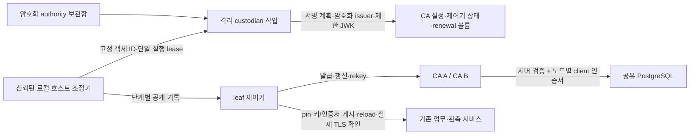

# 3주차 지속 실행 CA/JWK 교체·CA 프로세스 이중화

2026-11-06 · 채희주 인프라 구성·실행·측정, Codex 도구 보조.

[지속 실행 leaf 개인키 교체](persistent-key-rotation.md) 다음 묶음이다. 기존 서명 계획 조정기·
암호화 보관함·교체 게시기·CA 장애 전환 코드를 재사용한다. 자체 앱·탐지·정책·개선 전 평가 데이터와
정밀도·재현율·F1·오탐률 기준은 유지한다. 이 문서의 인수 건수는 탐지 품질 표본이 아니다.

## 기존에서 발전한 범위

| 경계 | 이전 선택형 실행 환경 | 이번 선택형 실행 환경 |
|---|---|---|
| 서비스 | 16개·CA 1개·Badger | 18개·CA 2개·공유 PostgreSQL 1개 |
| 연결·저장 | 내부망9·볼륨31 | 내부망10·볼륨36, DB 전용망·노드별 DB client 키 |
| leaf 키 | 신원39개 자동 교체 | 기존 교체기를 유지하고 CA 세대 변경 때 이행 |
| CA·발급용 JWK | 이 실행 환경에서는 고정 | root·issuer·JWK 독립 타이머와 서명된 순차 계획 연결 |
| 비밀 보관 | 온라인 CA의 암호화 issuer 키 | 별도 보관함에 암호화된 root/issuer/JWK 묶음, 격리 작업만 해독 |
| 재시작 검증 | 처음 고정한 CA·JWK와 대조 | 처음 승인한 anchor부터 서명 이력을 검증하고 허용된 경로만 인정 |
| CA 장애 | 발급/갱신 중단 | 연결 수립 실패 시 다른 CA로 전환, 사용한 nonce·폐기는 DB 공유 |
| 긴 검증 | CI 한 job에서 순차 실행 | 동일 소스를 고정한 독립 job에서 병렬 실행, 전체 성공 gate 유지 |

`scripts.persistent_authority_runtime`으로 **새로 승인한 로컬 프로필**을 만든다. 이전 실행 환경의
루트 개인키는 보관하지 않았으므로 복구하거나 자동 가져오지 않는다. 볼륨 구성·release 입력이
다른 descriptor는 자동 승격하지 않으며 기존 데이터·키 볼륨을 변경하지 않는다.

## 제로 트러스트 운영 경계



- 온라인 CA·leaf 제어기·DB·업무 서비스에는 보관함과 Docker socket을 마운트하지 않는다.
  CA 설정은 두 노드에 읽기 전용이며, DB client 키는 노드별로 분리한다.
- custodian은 UID10001·읽기 전용 rootfs·network=none·권한 제거·자원 제한으로 실행한다.
  root·issuer·전체 JWK의 평문은 이 소프트웨어 보관 작업의 RAM에만 나타난다. 호스트 초기 등록의
  RAM과 보관함 password도 신뢰 경계에 포함하며 HSM·물리적 air gap으로 표현하지 않는다.
- 호스트는 원래 Docker 관리 권한을 가진 신뢰 관리자다. 실행할 컨테이너 ID·이미지 ID·소유 라벨·
  정확한 볼륨/읽기 권한·내부망·비루트·capability 제거를 확인한다. 다른 객체나 유실 볼륨을
  자동 생성해 작업을 이어가지 않는다.
- 발급 중단 → 신뢰 겹침 → 두 CA의 새 issuer/JWK 확인 → 활성 leaf 이행 → 실제 TLS/reload 확인 →
  구 신뢰 제거 → 두 CA의 구 JWK 거부 → 구 파일 정리 순서다. 일부 신원이 이행하지 않거나
  CA/저장소가 준비되지 않으면 제거·정리를 보류한다.
- 교체 후 새 설정을 새로운 기준으로 다시 봉인하지 않는다. 처음 승인한 CA 정책·신원·권한과
  root anchor부터 모든 계획의 서명·epoch·이전 manifest·파일 경로를 검사한다.
  CA 정책/SAN/역할 추가, 임의 signer/issuer/root, 불완전한 journal은 시작/변경 거부 대상이다.
- 회수한 collector는 새 leaf를 발급하지 않고 제거한 peer pin도 복원하지 않는다. 구 파일의
  서명 일관성 확인에 필요한 과거 issuer와 현재 네트워크의 신뢰 bundle은 구분한다.
  CA 발급 양성 대조가 앱 역할·수신 권한의 재부여를 뜻하지 않는다.

## 공유 DB와 장애 경계

기존 [CA HA 시험](ca-high-availability.md)의 PostgreSQL17 고정 image digest·별도 전송 PKI·
`verify-full`·client 인증서·제한 role·SERIALIZABLE 거래 조건을 재사용한다. 연결 전 TLS 인증 실패는
다른 노드로 숨기지 않고 거부하며, 이미 전송한 POST의 결과가 불명확하면 자동 재전송하지 않는다.
연결 수립 단계의 네트워크 실패만 기존 `ca_endpoints`의 전환 대상이다.

DB 초기 생성은 새 로컬 프로필의 한 번짜리 permit으로 제한한다. 재시작에는 PG_VERSION·초기화
marker와 CA에 고정한 DB 식별자를 요구한다. CA role은 보호된 anchor를 조회만 할 수 있다.
첫39개 발급을 확인한 뒤 초기 등록 완료를 기록한다. 이후에는 사용한 nonce·폐기·발급 테이블과
기본 발급 이력을 확인한 뒤 CA를 실행하므로, 유실한 테이블을 빈 저장소로 다시 만드는 것을 막는다.

CA 자체 시작 검사에는 인증서 인증만 사용하는 제한된 읽기 전용 PostgreSQL probe를 사용한다.
서버·client TLS, frame 크기/개수, 전체5초 예산, 고정 SELECT 결과만 처리한다. 임의 SQL RPC,
평문·password 인증 fallback이나 write retry는 제공하지 않는다. 구현 근거는
[PostgreSQL17 SSL 흐름](https://www.postgresql.org/docs/17/protocol-flow.html#PROTOCOL-FLOW-SSL),
[프로토콜 형식](https://www.postgresql.org/docs/17/protocol-message-formats.html),
[고정 step-ca의 DB bucket](https://github.com/smallstep/certificates/blob/v0.30.2/db/db.go)이다.

이 검사는 빈 DB/테이블 유실·잘못된 DB 연결에 대한 방어다. 일부 행을 잃은 과거 DB와 관리 기록을
통째로 되돌리는 공격까지 막는 외부 anti-rollback 증거는 아니다. DB·물리 호스트는 각각 하나이며
DB 복제/자동 선출·호스트 HA·전체 백업 복원 통합은 후속이다. DB 전송 PKI의 자동 교체도 후속이고
현재 로컬 fixture의 전송 인증서는2일이다. 만료하면 실패를 숨기지 않고 명시적 갱신/복구가 필요하다.

## 재시작과 사용

```powershell
.venv/Scripts/python.exe -m scripts.persistent_authority_runtime up --directory runtime/c02/my-authority
.venv/Scripts/python.exe -m scripts.persistent_authority_runtime run --directory runtime/c02/my-authority
.venv/Scripts/python.exe -m scripts.persistent_authority_runtime status --directory runtime/c02/my-authority
.venv/Scripts/python.exe -m scripts.persistent_authority_runtime down --directory runtime/c02/my-authority
```

`run`은 신뢰 호스트에서 주기를 검사하는 foreground 조정기다. `tick`은 한 단계, `once`는 현재
교체 한 건을 마친다. 예시 정책은 root365일·issuer30일·JWK1일, 만료 여유1일이다. 초기 시험용
CA는2일 유효하므로 만료 여유가 먼저 적용될 수 있다. 운영 조직의 승인된 정책으로 확정한 값이 아니다.

진행 중 호스트 조정기나 같은 leaf 컨테이너를 재시작하면 같은 서명 계획·암호화 pending 묶음으로
이어간다. 완료된 idle 상태의 정상 down/up은 서명 세대·DB·키·회수 상태를 보존한다. 진행 중인
일반 up/down은 거부하고 고정 객체에서 `tick/once/run`으로 먼저 이어간다. 컨테이너 자체 유실·
새 객체에 대한 자동 재승인·물리 호스트 복구는 이 프로필의 완료 범위가 아니다.

폐기 가능한 **시험 프로필**만 `down --purge`로 소유 자원을 지운다. 기존 kind·다른 프로젝트·
사용자 ZIP은 정리 대상에 포함하지 않는다. 키/JWT·음성 대조의 구 키 사본도 Linux 시험 볼륨에만
두며 종료 시 볼륨 전체를 정리한다. unlink를 메모리·백업까지 복구 불가능한 소거로 표현하지 않는다.

## 묶음 검증과 결과 기록

```powershell
.venv/Scripts/python.exe -m pytest -q tests/test_persistent_authority.py tests/test_authority_database_guard.py tests/test_parallel_ci.py
.venv/Scripts/python.exe -m scripts.test_persistent_authority_runtime --directory runtime/c02/authority-batch-acceptance
```

예정 인수는 초기39개 발급·서버11개, 두 DB client 신원·TLS 음성 대조, 동시 nonce 경쟁, CA 장애
전환과 유효 업무 유지, 공유 폐기/nonce의 재시작 보존, root/issuer/JWK 각 타이머, 교체 중 재시작,
구 root/JWK 거부·정리, 회수 신원 유지, 정상 재시작·변조 거부·테이블 유실 거부를 한 실행에 묶는다.
결과는 [공개 원자료](infrastructure-results/persistent-authority-batch-20261106.json)와 해당 PR의
정확한 head/병합 후 CI에 기록한다. 완료 전 실행을 성공으로 세지 않는다.

개발 중 관련 집중190개(신규91개)와 고정 Ruff0.17.3을 통과했다. 첫 집중 실행141/27실패의
fixture hash·Windows 경로 차이와 후속 보완을 구분한다. 첫 실제 기동은 Postgres의
`repository:tag@digest`와 RepoDigests의 `repository@digest` 표현 차이로 발급 전0검사에서
중단·소유 자원0이었다. 실제 digest/플랫폼 검증을 유지해 보완했으며, 최신 전체 결과는 원자료를 따른다.

두 번째 실제 실행은 장애 전환·DB 재시작과 첫 전체 authority 교체를 포함해23개를 통과한 뒤
구 root 검사 RPC의 필수 headers 인자 누락으로 중단·소유 자원0이었다. 호출 signature 사전
검사를 추가하고 현재 서버 pin을 사용하도록 대조를 보강해, 구 pin 거부가 root 제거를 가리지
않게 했다. 이 실행을 전체 인수 통과로 세지 않는다. 주기 미도래 때 무거운 검사를 생략하고,
변경 전 검증의 공개 파일 hash는 RO·network-none 작업 한 번으로 모아 검사 범위를 유지한다.

CI는 host 전체 회귀·Docker 전체 회귀·앱 전체 복구·관측·CA·leaf 교체·새 authority/HA·Lambda를
분리한다. 모두 같은 `github.sha`를 checkout하며, 기존 hash lock·오프라인 프로젝트 설치·
검사 범위를 유지한다. 필수 `test` gate는 모든 job의 성공을 요구하고 실패·skip·취소·누락을 거부한다.
개발 중 짧은 관련 검사 후 최종 코드를 고정하여 전체 회귀를 실행하며, 벽시계 단축은 실제 CI 완료
시간을 측정한 뒤 기록한다. 팀원 독립 인수와 실제 조직 운영 채택은 아직 미완료다.

CA/SAN을 신뢰하는 모든 Go/NGINX 연결의 즉시 CRL/OCSP 집행이나 기존 TLS 세션 강제 종료,
손상된 root의 독립 신뢰 복구·HSM·관리 영역 전체 rollback 방지는 후속이다. 로컬 테스트와 기존
CI를 사용하며 AWS 배포·유료 LLM 호출은 하지 않는다. 일정과 역할은 기존 계획을 유지한다.

공개 이력은64세대·4MiB 이내로 검사한다. 범위를 넘으면 검사를 생략하지 않고 거부하며,
장기 운영용 서명 checkpoint·이력 압축/보관 절차는 후속이다.

최종 로컬 묶음 검증: **Docker2281통과·기존 경고2/Ruff 통과, 통합35/35·소유 자원0**.
test image 코드219개·CI 파일2개와 실제 인수의 소스/설정/release 지문을 대조했다.
이는 base50842b4의 커밋 전 작업 트리이며 정확한 clean PR head/병합 후 CI는 PR 기록으로 구분한다.
두 ZIP SHA256·기존 kind ID/실행 상태와 동료 저장 계약 코드 보존을 확인했다.
