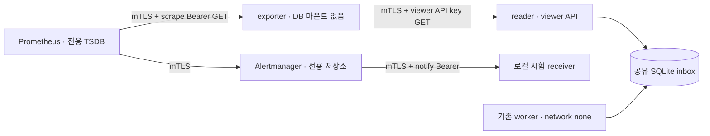

# 3주차 C01: mTLS 지속 실행 환경의 관측·경보 통합

11/6 착수·11/7 검증 묶음: [DB 전송 PKI 사전 점검·관측 준비·로컬 일괄 검증](infrastructure-preflight-batch.md). 채희주가 만료/신원/키 권한 선검사와 현재 rule 평가 경계·소스/엔진 고정 실행을 구성한다. 집중236/신규59·고정 Ruff·로컬 Docker2340·관측75/75·authority38/38·소유 자원0을 확인했다. 정확한 clean head/병합 후 CI는 PR 기록을 따른다. DB 전송 인증서 자동 교체·DB/물리 HA·팀원 독립 인수는 후속이다.

11/6 후속 [CA leaf 통합 인수](ca-runtime-acceptance.md)는 이 관측 경로에 선택형 CA/제어기를
연결한다. 아래14서비스/수동 leaf 경로는 그대로 보존하며 CA 키 교체/HA 통합 인수와 구분한다.

2026-11-06 · 채희주 인프라 구성·실행·측정, Codex 도구 보조.
기존 앱·정책·탐지 기준을 유지하며 3주차 관측 통합을 진행한 기록이다. 김택희의 독립 재현과
C01~C03 최종 조건부 선정은 별도로 남긴다.

## 기존 구현에서 추가한 것

기존 C01 비교와 all-hops 시험은 조회·수집·경보를 개별 캠페인에서 검증했고, 지속 실행 경로는
앱·수집·집행·worker·watchdog의 9개 서비스였다. 이번에는 기존 구현을 재사용해
**선택형 관측 프로필**에 reader·exporter·Prometheus·Alertmanager·로컬 시험 receiver를 연결한다.
기본 9개 서비스 경로는 유지하고 관측 프로필은 14개 서비스·8개 내부망을 사용한다.



그림은 조회/알림 흐름이며 알림이 접근권한을 승인하거나 회수하지 않는다. 실제 접근 제한은 기존
서명 검증·정책·worker·watchdog·PEP가 담당한다. 자체 대시보드 개발 계획은 유지한다.

## 신원·망·저장 분리

| 구성요소 | 권한과 연결 |
|---|---|
| reader | metrics-read 망만 연결. 별도 viewer API 키 digest와 mTLS metrics-reader 신원. inbox GET만 허용 |
| exporter | reader·monitoring 망만 연결. viewer 키·scrape 토큰만 보유. 보안 DB·수집/응답 키·spool 마운트 없음 |
| Prometheus | monitoring 망만 연결. exporter 호출 인증서/scrape 토큰·AM 호출 인증서와 전용 TSDB 볼륨 |
| Alertmanager | monitoring 망만 연결. notify 클라이언트 인증서/토큰·전용 notification/silence 저장소 |
| receiver | monitoring 망만 연결. 전용 서버 인증서·notify 토큰. 인증된 로컬 시험 알림만 수신 |
| operator | 명시적 신뢰 테스트 콘솔. 조회/관리용 별도 클라이언트 신원. 서비스의 viewer·scrape·notify 토큰은 마운트하지 않음 |

서비스별 UID/GID 10001, read-only root, capability 제거, no-new-privileges, PID/CPU/메모리 상한과
restart 정책을 기존 경로에서 재사용한다. 호스트 포트·Docker socket·호스트 홈은 연결하지 않는다.
worker/watchdog는 계속 network=none이다. 준비 단계의 공개 자산 다운로드/빌드 외 서비스의
외부 통신 경로는 없다. 실제 IdP/EDR·클라우드·유료 LLM을 호출하지 않는다.

reader는 **API에서 viewer 역할로 조회만 수행**하지만 현재 앱의 SQLite 초기화/트랜잭션 구조상
보안 DB 볼륨은 RW로 공유한다. OS 권한으로도 쓰기를 할 수 없는 별도 read replica를 구현한 것은
아니다. 신뢰 실행 코드인 reader와 exporter의 권한 경계를 구분하며 앱 저장 구조 변경은 김택희와
별도 계약해야 한다. exporter·Prometheus·Alertmanager·receiver에는 보안 DB를 연결하지 않는다.

Prometheus/Alertmanager의 native TLS는 전용 client SAN으로 관리 접근을 제한한다. Prometheus
admin/lifecycle 활성화 플래그는 추가하지 않는다. Alertmanager API의 메서드/경로별 세분화 RBAC은
별도 구현하지 않았으며, 허용된 SAN과 관리 프로세스를 신뢰하는 로컬 관리 영역이라는 한계를 둔다.
알림 서비스 신원으로 앱 권한을 변경할 수는 없다.

## 버전과 실행 환경 고정

기존 [C01 tools lock](../infra/observability/tools.lock.json)의 Prometheus 3.15.1·Alertmanager 0.34.2
공식 릴리스 archive SHA-256을 확인한다. 기존 캐시도 지문이 맞을 때만 재사용한다. 지정된 regular
파일 4개(prometheus/promtool/alertmanager/amtool)만 추출하고 경로·종류·크기를 검사한다.
임의 archive 경로 전체를 풀거나 실행 권한을 가져오지 않는다.

도구 이미지는 현재 앱의 검증된 로컬 빌드 태그에서 만든다. BuildKit은 `FROM sha256:<로컬 ID>`를
외부 이미지 이름으로 해석했으므로 해당 문법을 사용하지 않는다. 대신 기반 태그의 실제 image ID를
검사한 뒤 결과 이미지가 기반 RootFS 레이어 prefix를 그대로 상속했는지 대조한다. 기록한 도구
image ID·4개 바이너리 지문을 재시작 전에 확인한다.

[실행 환경 고정](runtime-release-lock.md)에 관측 tools lock·공통 경보 규칙·14개 서비스 구조를
포함한다. 설치된 Prometheus/Alertmanager YAML의 별도 지문도 저장하고 재시작에 대조한다.
설정·이미지가 다르면 자동 덮어쓰기/재승인 없이 시작을 거부한다. Compose는 로컬 image ID와
pull_policy=never를 사용한다. 이 기록은 신뢰 호스트의 지문이며 서명/SLSA·운영 승인·악성 root
방어·완전한 바이트 재현 빌드를 뜻하지 않는다.

## 실행과 보존

```powershell
.venv/Scripts/python.exe -m scripts.monitored_mtls_runtime up --directory runtime/c02/my-monitoring
.venv/Scripts/python.exe -m scripts.monitored_mtls_runtime status --directory runtime/c02/my-monitoring
.venv/Scripts/python.exe -m scripts.monitored_mtls_runtime down --directory runtime/c02/my-monitoring
```

일반 down은 저장 볼륨을 유지한다. 같은 소스/설정·directory로 up하면 기존 키·등록·DB/spool·
TSDB·Alertmanager 저장소를 재사용한다. 처음부터 다시 시험할 때에는 존재하지 않는 새 경로를 쓴다.

```powershell
.venv/Scripts/python.exe -m scripts.monitored_mtls_runtime down --purge --directory runtime/c02/my-monitoring
```

purge는 생성한 프로젝트·label·이미지/볼륨 범위를 대조하고 그 실험 자원만 정리한다. 기존 사용자
컨테이너·Docker Desktop 데몬·OS 신뢰는 변경하지 않는다. 기본 프로필과 관측 프로필의 descriptor를
섞어 시작하지 않으며, source/설정 변경 후 기존 환경을 자동 재봉인하지 않는다.

receiver는 인증된 시험 알림을 RAM에 최대 1,000개 보관하는 기존 시험 수신기다. 재시작 후 알림
수신 이력까지 보존하는 운영 이벤트 저장소가 아니다. 지속 보존 시험 대상은 Prometheus TSDB와
Alertmanager silence다. notification log도 같은 저장 경로를 사용하지만 별도 상태 보존을 검증한
것으로 확대하지 않는다. 1일 보존·1초 scrape/evaluation·2초 for·3초 backlog
기준은 기존 로컬 C01 계약을 재사용하며 운영 SLO로 확대하지 않는다.

## 로컬 인수 시험

```powershell
.venv/Scripts/python.exe -m pytest tests/test_monitored_mtls_runtime.py tests/test_runtime_release.py tests/test_continuous_mtls_runtime.py -q
.venv/Scripts/python.exe -m scripts.test_continuous_mtls_runtime --monitoring --directory runtime/c02/monitoring-reproduce01
```

기존 48개 지속 실행/mTLS 회귀에 실제 관측 검사를 함께 실행한다.

1. 평문·인증서 누락·다른 서비스 인증서와 scrape Bearer 누락/오류를 거부한다. 유효 mTLS여도
   viewer API 키가 틀리면 거부하며 조회 서비스 신원으로 관찰을 제출할 수 없어야 한다.
2. worker를 정지하고 실제 서명 관찰을 HTTP 202로 내구 접수한다. 대기 경보의 **새 firing**을
   확인한 뒤 worker 재개·completed·같은 fingerprint/startsAt의 resolved를 대조한다.
   시험 관찰은 collector feed/spool을 변경하지 않는 별도 직접 접수이므로 기존 회귀의 수집 카운터를 보존한다.
3. reader 중단 때 collection failure와 오래된 inbox 지표 부재를 확인한다. exporter 중단은 scrape
   failure로 구분한다. 각각 복구한 뒤 새 발생 시점과 같은 경보의 해제를 확인한다.
4. Prometheus 재시작 전의 고정 시각으로 같은 식을 조회해 기존 표본 보존을 대조한다. 새 표본으로
   통과할 수 없도록 조회 시각을 고정한다. 실제 업무 경보와 무관한 합성 silence를 만들고
   Alertmanager 재시작 뒤 내용 보존·삭제를 확인한다.
5. 서비스를 모두 정지한 뒤 Prometheus 설정을 변경하면 14개 서비스가 시작되지 않아야 한다.
   검증한 원본 설정을 복구한 뒤 기존 저장소/키로 정상 재개한다.
6. 기존 보안 회귀가 끝난 뒤 대기 관찰의 공개 등록 키를 비활성화한다. worker 재검증으로 failed가
   남고 processing-failed 경보가 인증 수신기에 도달해야 한다. 실패 이력을 삭제해 경보를 해제하지 않는다.

각 장애의 알림 목록 시작 인덱스를 별도로 저장한다. 앞선 startup/장애의 firing/resolved를 재사용하지
않으며 수신기 컨테이너의 장애 시작 UTC 시각보다 새 startsAt인지도 검사한다. 같은 job·instance·
fingerprint·startsAt을 대조하고, 대상 alert의 pending/firing 상태가 모두 해제된 뒤 새 장애를 시작한다.
원문 키·토큰·서명된 요청은 문서나
공개 원자료에 넣지 않는다. 테스트의 신뢰 호스트는 필요한 합성 토큰을 해당 서비스에서 읽어
메모리/표준입력으로만 시험 요청에 전달하며 일반 operator 볼륨의 서비스 권한은 확장하지 않는다.

## 실행 기록과 남은 일

준비 1·2회는 `FROM sha256:<로컬 ID>` 해석으로 빌드가 실패했고, 각각 0개 검사·소유 자원 정리0으로
끝났다. 첫 진행 안내에서 이를 소스 변경 거부로 추정했지만, 실제 빌드 오류를 확인해 바로잡았다.
추가 계정 인증이나 클라우드 작업을 요구하지 않았다. 기반 태그/ID·상속 레이어 대조 방식으로 수정했다.

중간 관측 통합 실행은 71개를 통과했다. 이후 이전 descriptor의 proxy pin 누락 시 정리 호환,
중복 도구 목록 거부, 늦게 도착한 이전 경보의 장애 시작 시각 검증을 보완하고 최종 소스로 다시
검증했다. 최종 관측 71개가 모두 통과했고 소유 컨테이너·볼륨·망은 각각 0개다.
중간 실행의 source 지문과 최종 소스를 구분한다. 기본 9개 서비스는 최종 소스에서
실제 시작·정지·기존 자격 보존 재개·서비스 목록 유지 4개 검사를 통과했고 소유 자원 잔여는 0이다.

초기 Linux 전체 회귀는 테스트 이미지에 `.dockerignore`가 빠져 1건 실패했다. 검증기가 입력 누락을
찾은 것이므로 예외/제외 처리하지 않고 Dockerfile.test의 COPY에 필요한 파일을 추가했다.
수정 후 전체 Linux 회귀는 2,021개 통과·기존 경고2·744.35초로 완료했다.
Windows 전체 2,016 통과/4 skip/기존 경고3은
추가 경보 시각 회귀 1개를 넣기 전 2,020개 수집 버전의 기록이며, 최종 집중 129개와 최종 CI의
전체 소스 결과를 별도로 남긴다. 기존 경고를 억제하거나 과거 수치를 최신 결과로 바꾸지 않는다.

최종 집중 회귀는 신규 38개를 포함한 129개 통과(6.12초)다. 실제 관측 환경의 실행 입력은
151개이며 release SHA-256은 `af9232ce3bd29c3eb0798ae6bedff8294c4335ca47e8a36b1927890df7346cb1`이다.
[공개 원자료](infrastructure-results/persistent-monitoring-20261106.json)에 최종 source/도구/설정·
검사·정리와 실패/중간 시도를 구분해 기록했다. PR에는 정확한 head 및 병합 후 CI 근거를 남긴다.
채희주의 실제 도구 실행과 김택희 독립 검토 미완료를 구분한다.

[PR #33](https://github.com/cheonan-asan-sta/zero-trust-llm-secops/pull/33)의 병합 전 CI는
호스트2,019 통과/2 skip·Docker2,021·관측71·복구18을 통과했다. 병합 후 동일 tree의
[첫 CI](https://github.com/cheonan-asan-sta/zero-trust-llm-secops/actions/runs/42088599100)는
호스트의 범위 지정 설치가 Ruff 0.17.3 대신 새 0.17.4를 받아 기존 공급망 스크립트의 SIM102에서
중단됐다. 이를 관측 기능 회귀나 통합 검사 완료로 기록하지 않는다. 후속으로 호스트 CI도 기존
Docker의 build/test wheel lock을 `--only-binary=:all: --require-hashes`로 설치하고 프로젝트는
`--no-index --no-deps --no-build-isolation`로 설치한 뒤 `pip check`한다. 검사 규칙/기존 판정
코드/lock은 바꾸지 않는다. 후속 PR에 정확한 head와 병합 후 전체 재실행 근거를 남긴다.
로컬에서는 최종 Linux 시험 이미지 안의 새 venv에서 같은 설치 명령·오프라인 프로젝트 빌드·
`pip check`·Ruff 0.17.3 검사를 통과했다. 해당 임시 컨테이너는 종료 시 삭제했다.

이번은 선택형 관측 경로 통합이며 CA 자동화와 동적 키 변경의 통합 인수, JSONL 사건/감사/outbox를
포함한 전체 저장 계약, C01~C03 조건부 최종 선정·운영 부하/인증·독립 재현은 남아 있다.
기존 C03 앱 런타임 패치/검사 결과를 새 Go 도구 포함 이미지의 취약점 검토 완료로 확대하지 않는다.
새 도구 이미지의 공급망 검토와 실제 조직 IdP/운영 권한 연계는 후속 인수 조건이다.
관측 경보는 탐지 정밀도·재현율·F1·오탐률 평가를 대신하지 않으며 해당 데이터/기준선은 변경하지 않는다.
11/29 기능 동결·12/6 제출 가능본 일정과 [개인별 역할](roles/chaeheeju.md)을 유지한다.

## 공식 근거

- [Prometheus configuration](https://prometheus.io/docs/prometheus/latest/configuration/configuration/):
  파일 기반 scrape 인증·TLS·경보 전달 설정을 사용한다.
- [Alertmanager configuration](https://prometheus.io/docs/alerting/latest/configuration/):
  mTLS/Bearer webhook·send_resolved와 별도 storage path를 구성한다.
- [Prometheus query API](https://prometheus.io/docs/prometheus/latest/querying/api/):
  고정 time 매개변수로 재시작 전 표본을 다시 조회한다.
