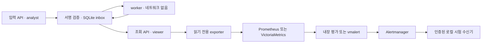

# C01 제로트러스트 관측·경보 로컬 비교

11/6 후속 [선택형 관측 지속 실행 통합](../persistent-monitoring.md)을 추가했다. 기존 고정 도구·
viewer exporter·mTLS 구현을 기존 지속 실행 경로와 연결하고 저장/설정·경보/복구를 검증한다.
아래 11/3 비교는 당시 근거로 보존하며 운영 인증/부하·독립 재현·최종 선정 완료로 바꾸지 않는다.

2026년 11월 3일 · v0.17.0 · 기준 소스 `719f069`.
채희주 담당 브랜치 `feature/chaeheeju-c01-observability`에서 Codex 도구로 구성·실행·측정한다.
다른 팀원의 수동 수행·독립 검토로 기재하지 않는다. 운영 채택·독립 재현은 후속이다.

## 해결할 공백과 구현

기존 앱은 테넌트별 `GET /zero-trust/signals/inbox`에서 내구 큐의 상태·최장 대기 시간을 제공하지만,
관측 도구가 읽을 지표 변환과 실제 수집/경보 경로의 비교 증거는 없었다.
[읽기 전용 수집기](../../scripts/signal_metrics_exporter.py)는 기존 **viewer 권한 API**만 호출해
상태별 건수·최장 대기 시간과 수집 성공 여부를 Prometheus text 형식으로 제공한다.
DB를 직접 읽거나 권한·정책을 쓰지 않는다. 사용자/기기/이벤트 ID·서명·토큰은 지표 label로 내보내지 않는다.

수집 실패에는 `secops_signal_collection_success 0`만 제공하고 지난 큐 수치를 재사용하지 않는다.
정상 빈 큐는 pending 0·age 0, 오류는 상태 지표 부재로 구분한다.
미등록 값·음수·bool/문자열 건수·NaN/Infinity·합계 불일치·잘못된 응답·과대 본문을 정상 수치로 바꾸지 않는다.
설정된 단일 inbox 경로의 GET만 사용하며 redirect·환경 proxy를 따라 인증정보를 보내지 않는다.
스크랩은 별도 Bearer 자격 증명이 있어야 한다.



이 그림은 시험 데이터 흐름이다. API와 exporter의 연결은 viewer 조회이며 계정/접속 권한 변경 경로가 아니다.
서명 관찰의 권한·검증·세션 회수는 기존 M3가 담당한다. C01 자체로 회수 품질이나 실제 IdP/EDR 연동을 증명하지 않는다.

## 사전 조건과 격리

[비교 계약](../../infra/observability/contract.json)과 [공통 경보 규칙](../../infra/observability/alerts.yaml)을 따른다.
[고정 버전·출처·지문](../../infra/observability/tools.lock.json)은 공식 GitHub Release 자산 SHA-256을 HTTPS로 확인한다.
이번 도구의 서명/SLSA를 검증했다고 주장하지 않는다. 릴리스의 enterprise/cluster 자산은 사용하지 않는다.
선택한 태그의 저장소 LICENSE는 각각 Apache-2.0이다:
[Prometheus](https://raw.githubusercontent.com/prometheus/prometheus/v3.15.1/LICENSE),
[Alertmanager](https://raw.githubusercontent.com/prometheus/alertmanager/v0.34.2/LICENSE),
[VictoriaMetrics/vmalert](https://raw.githubusercontent.com/VictoriaMetrics/VictoriaMetrics/v1.155.0/LICENSE).
별도 상용 지원/서비스를 가입한 것은 아니며, 최종 배포 시 각 구성요소의 LICENSE/NOTICE 보존도 확인한다.

| 항목 | 두 후보 공통 조건 |
|---|---|
| 후보 | Prometheus 3.15.1 + Alertmanager 0.34.2 / VictoriaMetrics 1.155.0 + vmalert 1.155.0 + 같은 Alertmanager |
| 입력 | 실제 local/test 서명 관찰 접수·별도 worker·기존 SQLite inbox. 합성 사용자·이벤트만 사용 |
| 평가 | 같은 규칙, scrape 1초/timeout 800ms, upstream timeout 500ms, 평가 1초, `for` 2초, backlog age 3초 |
| 조회/보존 | instant query lookback 5분, 보존 설정 1일. VM의 의도적 query 지연/evalDelay는 0초로 명시. 수집 버퍼는 기본값이며 force_flush를 호출하지 않음 |
| 알림 | 같은 Alertmanager 설정·인증된 로컬 webhook, group_wait 0초/group_interval 1초, send_resolved 활성화 |
| 예산 | 후보 구성 전체 CPU 2개·메모리 640MiB. Prometheus 1.5/512 + AM 0.5/128, VM 1/384 + vmalert 0.5/128 + AM 0.5/128 |
| 실행 | UID/GID 10001, read-only root·capability 전부 제거·no-new-privileges, PID 128·임시 `/tmp` 제한 |
| 통신 | 모든 서비스 Docker 내부 전용 네트워크. 호스트 공개 포트 없음. worker network none. Docker socket·호스트 홈 마운트 없음 |
| 신원 | 입력 서비스 analyst key와 조회 서비스 viewer key 분리. exporter는 viewer key만 보유. scrape·notification 토큰도 별도 Linux 볼륨에 UID 10001/mode 0600으로 생성 |
| 원본 | 서명 개인키는 호스트 메모리에만 유지, 공개 등록만 마운트. 자격 증명은 명령 인자·보고서에 저장하지 않음 |
| 반복 | 후보당 3회, 반복 번호마다 시작 후보를 바꿈. 매번 새 상태/토큰/볼륨을 만들고 해당 자원만 정리 |

네트워크는 producer·reader·monitoring으로 나눈다. exporter는 monitoring/reader에만 연결하며
collector IP에 직접 연결할 수 없는지 시험한다. viewer의 제출 거부와 서로 다른 용도 자격 증명의 혼용 거부도 확인한다.
DB를 공유하는 두 앱 인스턴스는 로컬 시험의 역할 분리 구성이다. 실제 조직의 다중 신원 발급/운영을 구현한 것은 아니다.

## 시나리오와 측정

1. 누락/잘못된 scrape 자격 증명, API 무인증, scrape 토큰의 API 사용, viewer key의 collector 사용을 거부한다.
   viewer가 조회 API에 관찰을 제출해도 403이어야 한다. 정상 상태에서 수집과 현재 경보 해제를 확인한다.
2. worker가 없는 상태에서 유효한 서명 관찰을 HTTP 202로 접수한다. 실제 pending age가 기준을 넘으면 backlog webhook이 도착해야 한다.
3. worker를 시작해 실제 completed 전이와 backlog resolved 알림을 확인한다.
4. 조회 앱 중단은 collection failure로, exporter 중단은 scrape failure로 경보한다. 각각 재시작 뒤 resolved 알림을 확인한다.
   조회 실패 동안 exporter가 오래된 큐 수치를 제공하지 않아야 한다.
5. 저장소/평가기를 재시작하고 **재시작 전의 고정 시각**을 같은 식으로 조회한다.
   새 수집값으로 통과하지 못하도록 기존 시각의 표본 수가 보존됐는지 대조한다.
6. 두 번째 관찰을 정상 접수한 뒤 시험 등록의 해당 키를 disabled로 바꾼다.
   worker가 재검증해 failed로 전이하고 processing-failed 알림이 도착해야 한다. 이 오류를 정상 처리나 자동 권한 복구로 바꾸지 않는다.

각 장애 직전에 수신 이벤트의 인덱스를 저장하고 **그 이후의 새 firing/resolved**만 해당 단계의 성공 증거로 인정한다.
시작 직후/이전 단계의 같은 이름 알림을 다시 사용하지 않는다.
job/instance와 fingerprint/startsAt도 묶어 같은 경보 수명주기의 발생·해제인지 확인한다.
복구 전에도 인덱스를 새로 저장하므로 같은 webhook에 섞인 다른 대상의 resolved를 복구로 잘못 세지 않는다.

[실행기](../../scripts/compare_observability.py)는 실제 backend·평가기·Alertmanager·수신기를 함께 실행한다.
지연은 장애 전이 명령/접수 응답 후 **로컬 webhook을 처음 확인한 호스트 시각**까지이며 Docker exec와 polling 비용을 포함한다.
내부 rule 평가 CPU 시간이나 네트워크 패킷 기준 순수 전송 지연이 아니다. 표본 3개의 P95는 최댓값이다.
자원은 후보 컨테이너만의 Docker stats 반올림 표본이고, 지원 앱/exporter/worker·호스트/프로브는 제외한다.
디스크는 종료 직전 storage 볼륨의 논리 파일 크기로 실제 할당량·장기 보존 크기와 다르다.

```powershell
.\.venv\Scripts\python.exe -m scripts.compare_observability --repeats 3
```

Docker Linux amd64 엔진과 Python 프로젝트 개발 환경이 필요하다. 첫 실행의 공개 도구 다운로드·이미지 빌드만 인터넷을 사용한다.
실행 중 AWS·유료 모델·실사용자 데이터·외부 알림 서비스는 사용하지 않는다. 대시보드는 기존 자체 개발 방향을 유지한다.
`runtime/c01/summary.json`·`resources.jsonl`·설정·도구 지문을 보관하며 private 로그와 원본은 Git/Docker context에서 제외한다.
실험은 생성한 이름 목록의 컨테이너·임시/비밀 볼륨·네트워크·이미지 태그만 제거한다. 호스트 전체 prune은 하지 않는다.

## 초기 연결 실패와 수정

- 첫 연결 시도에서 현재 Docker 내부 네트워크의 호스트 port binding이 빈 배열로 표시됐다.
  이 시도는 성능/합격 결과에 넣지 않고, 공개 포트 없이 Docker exec의 고정 대상 HTTP 프로브를 사용하도록 수정했다.
- 다음 smoke 시험은 Prometheus 경로를 통과했지만 VM backlog 알림이 제한 시간에 도착하지 않았다.
  초기 설정에서 `datasource.queryStep=1s`를 평가 주기로 오인했다. 공식 설명상 이 값은 최근 표본의 조회 범위다.
  `for`는 빈 결과에서 초기화되므로, 평가 1초를 유지하면서 조회 범위를 두 구성 모두 5분으로 맞춰 재시험한다.
  초기 실패 기록은 보존하고 실패한 설정으로 후보 제품의 성능을 순위화하지 않는다.
  [vmalert 공식 troubleshooting·queryStep 설명](https://docs.victoriametrics.com/victoriametrics/vmalert/#common-mistakes).
- 기반 앱 이미지에서 상속되는 앱 healthcheck가 관측 바이너리에도 실행되는 것을 제거했다.
  각 구성의 실제 수집·알림 경로로 준비 상태를 확인하고 최종 반복에서 불필요한 앱 probe를 자원 사용량에 섞지 않는다.
- 이어진 연결 검토에서 시작 직후 `ExporterDown` 기록을 나중 중단/복구 확인에 재사용할 수 있는 시험 실행기의 결함을 발견했다.
  그 반복은 중단·제외하고 이벤트 인덱스로 각 장애 구간을 분리하는 회귀 시험을 추가한 뒤 전체 반복을 다시 실행했다.
  시작 시 표본이 아직 없는 구간의 일시적 경보는 최종 기록에 그대로 남기며, 안정화 이후 경보 해제와 실제 장애를 구분한다.
- 인덱스 분리만으로는 같은 이름의 다른 대상이 한 webhook에 섞이는 경우를 충분히 구분하지 못했다.
  대상·fingerprint·startsAt 결합과 복구 단계의 별도 인덱스 검증을 추가하고 이전 반복은 최종 비교에서 제외했다.

## 상태와 남은 검증

실제 반복 결과는 [실측 요약](../infrastructure-results/c01-windows-20261103.json)에 기록한다.
이 기록이 없는 환경이나 실패한 반복은 통과/선정 완료로 간주하지 않는다. 독립 팀원 재현과 운영 채택은 별도다.

최종 구성에서 후보당 3회, 각 18개 기록 검사로 **54개씩·합계 108개**가 통과했다.
각 반복은 completed 1·failed 1의 실제 서명 관찰 상태를 확인했고, 재시작 전 고정 시각의 표본 수가 재시작 후에도 보존됐다.
자원 수집은 총 435행이며 수집 오류는 없었다. Windows 전체 591건(기존 경고 3개),
Linux Docker 전체 591건(기존 경고 2개), Ruff도 통과했다. 신규 25건은 수집·자격 증명·redirect·과대/잘못된 값·
지난 알림 재사용·다른 대상/수명주기의 resolved 혼동·이전 보고서의 성공 상태 재사용을 막는 회귀 시험이다.

| 최종 로컬 실측, 각 n=3 | Prometheus + AM P50 / P95 | VM + vmalert + AM P50 / P95 |
|---|---:|---:|
| backlog 발생 알림 최초 확인 | 7.801 / 7.843초 | 7.950 / 9.552초 |
| backlog 해제 알림 최초 확인 | 6.325 / 6.345초 | 6.370 / 6.584초 |
| 조회 앱 중단 알림 최초 확인 | 3.048 / 4.597초 | 4.619 / 4.826초 |
| exporter 중단 알림 최초 확인 | 4.489 / 4.753초 | 6.015 / 6.231초 |
| exporter 복구 알림 최초 확인 | 2.903 / 2.931초 | 2.968 / 6.000초 |
| 접수 후 키 disabled → 처리 실패 알림 | 7.860 / 7.870초 | 9.636 / 9.678초 |

후보 전체의 동시 표본 메모리 최댓값은 각각 약 63.60MiB·66.88MiB였다. Docker stats의 반올림·표본치이며
지원 서비스/호스트를 포함하지 않는다. 이 작은 차이로 보편적인 메모리 우위를 주장하지 않는다.
논리 storage 파일은 각각 약 54.7KB·150.8~151.4KB였으나 두 관찰·수분 시험이라 장기 저장 효율 비교가 아니다.
P95는 3회 중 최댓값이며 순수 서비스 지연·전체 장애 복구 시간/SLA로 사용하지 않는다.

**후속 로컬 통합의 잠정 기준선은 Prometheus+Alertmanager로 제안한다. 운영 채택은 보류한다.**
두 구성 모두 이 작은 기능/안전 시험을 통과했다. 현재 요구는 단일 로컬 서비스의 소규모 신호 큐 감시이며,
별도 평가 프로세스 없이 두 구성요소로 운영할 수 있다는 복잡도 근거를 우선했다.
실측 지연·메모리는 이 조건에서의 참고 근거이며 시장 전체 성능 순위를 뜻하지 않는다.
VM 구성은 유지 후보로 남기고 보존/카디널리티·입력량 요구가 커지면 해당 부하에서 다시 비교한다.
운영 인증·통신·복원 조건과 타 팀원 재현을 통과하기 전에는 상시 운영 구성으로 전환하지 않는다.

빠른 기능 검증을 위한 1초/수초 조건이다. 운영 경보 임계값·SLO·경보 피로도·부하/고카디널리티·장기 보존,
HA·백업/복원·RTO/RPO·완전한 알림 무손실을 입증하지 않는다. 알림 경로 자체/저장소 전체가 꺼질 때의 별도 감시도 후속이다.
로컬 내부망에서 TLS를 시험하지 않았으며 공개 query/admin endpoint의 사용자별 인증·인가도 구현 범위 밖이다.
기존 viewer는 전용 monitoring scope보다 넓은 테넌트 조회 권한이다. exporter 코드의 고정 GET과
읽기 전용 역할·망 분리를 검증했으며, 자격 증명 자체를 오직 지표 경로에만 제한하는 별도 역할은 후속이다.
이 실험 구성 그대로 기업 운영에 노출하지 않는다. 읽기 전용 지표도 접근 권한·최소 보존이 필요하다.
한 번 만든 같은 이미지로 반복하지만 기존 Dockerfile의 base tag·범위 의존성은 재빌드 때 달라질 수 있다.
실제 이미지 ID·소스/설정 지문을 확인하며 바이트 동일 재빌드가 입증됐다고 주장하지 않는다.
패키지/도구 채택과 이벤트 탐지 정밀도·재현율·F1/오탐률 목표는 별개이며 개선 전 자료를 바꾸지 않았다.

11/15까지 부하·조회/경보 완전성·운영 부담·실패 원인을 비교하고 잠정 구성을 검토한다.
11/22 최종 선정은 실제 요구·독립 재현·인증/통신/복원 조건을 확인한 뒤 결정한다.

공식 설정 근거: [Prometheus configuration](https://prometheus.io/docs/prometheus/latest/configuration/configuration/),
[Alertmanager configuration](https://prometheus.io/docs/alerting/latest/configuration/),
[VictoriaMetrics single-node](https://docs.victoriametrics.com/victoriametrics/single-server-victoriametrics/),
[vmalert](https://docs.victoriametrics.com/victoriametrics/vmalert/).
